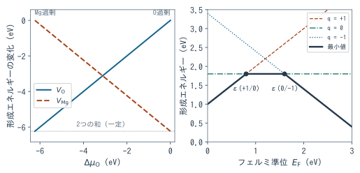

.. _defect-formation:

点欠陥の形成エネルギー
======================

結晶や非晶質の固体には、原子が抜けた位置（空孔）や、本来の位置の間に入り込んだ原子などの
点欠陥がある。点欠陥がどれだけできやすいかは、欠陥を作るのに要るエネルギーで決まる。
ただしこのエネルギーは、欠陥を含む構造と含まない構造の全エネルギー差だけでは決まらない。
出入りした原子がどこから来てどこへ行くか、つまり原子のやりとりの相手の化学ポテンシャルと、
欠陥が電荷をもつ場合は電子のやりとりの相手（フェルミ準位）にも依存する。
この記事では、形成エネルギーを全エネルギーと化学ポテンシャルから導き、その値が条件によって
どう変わるか、熱平衡の欠陥濃度とどう結びつくかを扱う。

**前提知識**: :ref:`化学ポテンシャル<chemical-potential>`、
:ref:`化学式単位あたりの相対エネルギー<energy-reference>`\ （全エネルギーの基準）、
:ref:`構造最適化<structure-optimization>`\ （固定セル緩和）。

**学習目標**:

* 点欠陥の形成エネルギーを、欠陥を含むセルと完全結晶の全エネルギー、出入りした原子の化学ポテンシャルから導く。
* 化合物が安定に存在する条件から化学ポテンシャルの取りうる範囲を求め、形成エネルギーが条件によって eV の単位で変わることを示す。
* 荷電欠陥の形成エネルギーがフェルミ準位に依存することと、遷移準位の意味を説明する。
* 配置エントロピーを含むギブス自由エネルギーの最小化から熱平衡の欠陥濃度を導き、空孔を人為的に入れたモデルとの違いを判断する。

.. _point-defects:

点欠陥とスーパーセル
--------------------

原子1個程度の範囲に限られた乱れを **点欠陥** と呼ぶ。主な種類は次の3つである。
化合物ABでは、Aの位置が空いた **空孔**\ :math:`V_{\rm A}`、原子の間の位置に入った
**格子間原子**\ :math:`{\rm A}_i`、Aの位置をBが占めた **置換**\ :math:`{\rm B}_{\rm A}` がある。
欠陥が電荷 :math:`q`\ （電気素量 :math:`e` を単位とし、電子を1個取り去ると :math:`+1`）をもつときは、
:math:`V_{\rm A}^{q}` のように右上に書く。

第一原理計算では、完全結晶の単位胞を何個か並べた **スーパーセル** に欠陥を1つ入れ、
周期境界条件で計算する。これは、欠陥がスーパーセルの周期で並んだ結晶の計算である。
欠陥どうしの距離を十分に離せば、孤立した欠陥の性質に近づく。欠陥のまわりの原子は欠陥に応じて動くので、
原子の位置を緩和する。このときセルの形と大きさは完全結晶の値に固定する（\ :ref:`固定セル緩和<structure-optimization>`）。
セルを完全結晶の格子定数に保つのは、少数の欠陥が結晶全体の格子定数をほとんど変えない
希薄な極限を表すためである。非晶質では、溶融・急冷などで作った不規則な構造そのものを
スーパーセルとして使い、どのサイトの原子を取り除くかによって形成エネルギーが変わる。

.. _defect-formation-energy:

形成エネルギーの定義
--------------------

欠陥を含む結晶を、元素ごとの原子のやりとりの相手（**リザーバー**）と接した系として考える。
元素 :math:`i` のリザーバーの化学ポテンシャルを、1原子あたりで :math:`\mu_i` とする。
欠陥を作るときに結晶へ加わった元素 :math:`i` の原子の数を :math:`n_i` とし、取り除いた場合は
:math:`n_i<0` とする。例えば空孔 :math:`V_{\rm Li}` では :math:`n_{\rm Li}=-1` である。

温度と圧力を固定して欠陥を1つ作ると、結晶のギブス自由エネルギーは
:math:`G[{\rm X}]-G[{\rm bulk}]` だけ変わる。:math:`{\rm X}` は欠陥を含む結晶、
:math:`{\rm bulk}` は同じ数の単位胞からなる完全結晶である。一方、リザーバーは元素 :math:`i` の原子を
:math:`n_i` 個失うので、化学ポテンシャルの定義 :eq:`thermo-chemical-potential`\ から
そのギブス自由エネルギーは :math:`-\sum_in_i\mu_i` だけ変わる。両者の和が欠陥の形成ギブスエネルギーで、

.. math::
   :label: defect-formation-gibbs

   \Delta G_{\rm f}[{\rm X}]=G[{\rm X}]-G[{\rm bulk}]-\sum_in_i\mu_i

となる。絶対零度で原子の振動と :math:`pV` を無視すると、:math:`G` を全エネルギー
:math:`E_{\rm tot}` で置き換えられ、中性の欠陥の **形成エネルギー**

.. math::
   :label: defect-formation-neutral

   E_{\rm f}[{\rm X}]=E_{\rm tot}[{\rm X}]-E_{\rm tot}[{\rm bulk}]-\sum_in_i\mu_i

を得る [DefZhangNorthrup1991]_ [DefFreysoldt2014]_。Liの空孔なら

.. math::
   :label: defect-formation-vacancy

   E_{\rm f}[V_{\rm Li}]=E_{\rm tot}[V_{\rm Li}]-E_{\rm tot}[{\rm bulk}]+\mu_{\rm Li}

で、Liを1個取り除いたセルと元のセルのエネルギー差に、取り除いたLiの化学ポテンシャルを足した量になる。
取り除いたLiはどこかへ行かなければならず、その行き先で1原子あたり :math:`\mu_{\rm Li}` のエネルギーをもつ。

**エネルギーの基準の相殺。** :ref:`全エネルギーの基準<energy-reference>`\ は擬ポテンシャルなどの
計算条件で変わる。元素 :math:`i` の原子1個あたりの基準のずれを :math:`\epsilon_i` とすると、
:math:`E_{\rm tot}[{\rm X}]-E_{\rm tot}[{\rm bulk}]` には :math:`\sum_in_i\epsilon_i` が含まれる。
:math:`\mu_i` を同じ計算条件で求めれば :math:`\mu_i` にも :math:`\epsilon_i` が入り、
:eq:`defect-formation-neutral`\ の中で打ち消し合う。化学ポテンシャルを別の手法や文献の値から取ると、
この相殺が成り立たない。

そこで、元素 :math:`i` の単体（金属Liの結晶、O\ :sub:`2`\ 分子など）の1原子あたりの全エネルギー
:math:`E_i^{\rm ref}` を同じ条件で計算し、化学ポテンシャルをそこからの差 :math:`\Delta\mu_i` で表す。
:ref:`化学ポテンシャルの節<chemical-potential>`\ で見たように、単体の固体の化学ポテンシャルは
1原子あたりの全エネルギーで近似できるので、:math:`\Delta\mu_i=0` はその単体と平衡にある条件を表す。:eq:`defect-formation-neutral`\ は

.. math::
   :label: defect-formation-delta-mu

   \begin{aligned}
   \mu_i&=E_i^{\rm ref}+\Delta\mu_i,\\
   E_{\rm f}[{\rm X}]&=\underbrace{E_{\rm tot}[{\rm X}]-E_{\rm tot}[{\rm bulk}]-\sum_in_iE_i^{\rm ref}}_{E_{\rm f}^0[{\rm X}]}
   -\sum_in_i\Delta\mu_i
   \end{aligned}

と分かれる。:math:`E_{\rm f}^0` は計算する構造だけで決まり、:math:`-\sum_in_i\Delta\mu_i` が
実験の条件（どの相と平衡にあるか、気相の分圧など）による変化を表す。

.. _chemical-potential-limits:

化学ポテンシャルの取りうる範囲
------------------------------

:math:`\Delta\mu_i` は自由に選べるわけではない。母物質が化合物 :math:`{\rm A}_x{\rm B}_y` のとき、
化合物がリザーバーと平衡に存在するには、化合物1化学式単位を作る反応の平衡条件
（\ :eq:`thermo-phase-equilibrium`\ と同じ考え方）から

.. math::
   :label: defect-compound-equilibrium

   x\mu_{\rm A}+y\mu_{\rm B}=E_{\rm tot}[{\rm A}_x{\rm B}_y],
   \qquad
   x\Delta\mu_{\rm A}+y\Delta\mu_{\rm B}=\Delta H_{\rm f}[{\rm A}_x{\rm B}_y]

が成り立つ。右の式は左の式に :eq:`defect-formation-delta-mu`\ を代入したもので、
:math:`\Delta H_{\rm f}=E_{\rm tot}[{\rm A}_x{\rm B}_y]-xE_{\rm A}^{\rm ref}-yE_{\rm B}^{\rm ref}` は
化学式単位あたりの生成エネルギーである。安定な化合物では :math:`\Delta H_{\rm f}<0` になる。

上限は単体の析出で決まる。:math:`\Delta\mu_{\rm A}>0` なら、Aの化学ポテンシャルが単体Aより高いので、
:eq:`thermo-transfer`\ によりAは単体として析出する。したがって :math:`\Delta\mu_{\rm A}\le0`、
:math:`\Delta\mu_{\rm B}\le0` である。これを :eq:`defect-compound-equilibrium`\ と合わせると

.. math::
   :label: defect-mu-range

   \frac{\Delta H_{\rm f}}{x}\le\Delta\mu_{\rm A}\le0

となる。:math:`\Delta\mu_{\rm A}=0` の端を「A過剰」、:math:`\Delta\mu_{\rm A}=\Delta H_{\rm f}/x`\ （このとき
:math:`\Delta\mu_{\rm B}=0`）の端を「B過剰」の条件と呼ぶ。同じ元素からなる別の化合物
:math:`{\rm A}_m{\rm B}_l` があれば、それが析出しない条件
:math:`m\Delta\mu_{\rm A}+l\Delta\mu_{\rm B}\le\Delta H_{\rm f}[{\rm A}_m{\rm B}_l]` が範囲をさらに狭める。

Li\ :sub:`3`\ PO\ :sub:`4`\ のような3元素の化合物では、
:math:`3\Delta\mu_{\rm Li}+\Delta\mu_{\rm P}+4\Delta\mu_{\rm O}=\Delta H_{\rm f}[{\rm Li_3PO_4}]` から
独立な変数は2つになり、Li\ :sub:`2`\ OやLi\ :sub:`4`\ P\ :sub:`2`\ O\ :sub:`7`\ などの
他の化合物と単体の析出条件が、2次元の多角形の範囲を作る。Li空孔の形成エネルギーは
:eq:`defect-formation-delta-mu`\ により :math:`\Delta\mu_{\rm Li}` だけずれるので、この範囲のどこを選ぶかで変わる。

リザーバーが気相のときは、:math:`\Delta\mu` を温度と分圧で決められる。例えば酸素では、
:ref:`理想気体の化学ポテンシャル<chemical-potential>`\ :eq:`thermo-ideal-gas-mu`\ と
:math:`\mu_{\rm O}=\mu_{\rm O_2}/2` から

.. math::
   :label: defect-oxygen-gas

   \Delta\mu_{\rm O}(T,p_{\rm O_2})
   =\frac12\left[\mu_{\rm O_2}^{o}(T)-E_{\rm tot}[{\rm O_2}]\right]
   +\frac12k_{\rm B}T\ln\frac{p_{\rm O_2}}{p^{o}}

となる。:math:`\mu^{o}_{\rm O_2}(T)` は1分子あたりの標準化学ポテンシャルで、全エネルギーを
基準にした温度依存の部分は統計力学か熱化学の表から求める。同じ考え方で表面の安定性を気相の条件に
結びつけた例が、`GaN表面の相図 <https://example.quloud-platform.quemix.com/gan_surface/phase_diagram.html>`__\ である。

.. _charged-defects:

荷電欠陥とフェルミ準位
----------------------

イオン結晶や半導体の欠陥は、電子を受け取ったり放したりして電荷をもつことが多い。
電荷 :math:`q` の欠陥を作ると、結晶から :math:`q` 個の電子が電子のリザーバーへ移る。
電子のリザーバーの化学ポテンシャルは\ :ref:`フェルミ準位<fermi-dirac-distribution>`\ で、
これを価電子帯上端 :math:`E_{\rm VBM}` から測った :math:`E_{\rm F}` で表すと
:math:`E_{\rm VBM}+E_{\rm F}` である。:eq:`defect-formation-neutral`\ と同じ数え方で

.. math::
   :label: defect-formation-charged

   E_{\rm f}[{\rm X}^q](E_{\rm F})=E_{\rm tot}[{\rm X}^q]-E_{\rm tot}[{\rm bulk}]
   -\sum_in_i\mu_i+q\,(E_{\rm VBM}+E_{\rm F})+E_{\rm corr}

となる [DefFreysoldt2014]_。:math:`E_{\rm corr}` は次に述べる有限セルの補正である。
形成エネルギーは :math:`E_{\rm F}` に対して傾き :math:`q` の直線である。正に帯電した欠陥の形成エネルギーは
フェルミ準位が低い（p型の）条件ほど低く、負に帯電した欠陥では逆にフェルミ準位が高い（n型の）条件ほど低い。

2つの電荷 :math:`q`、:math:`q'` の形成エネルギーが等しくなるフェルミ準位を **遷移準位**
:math:`\varepsilon(q/q')` と呼ぶ。:eq:`defect-formation-charged`\ で両者を等しいとおくと

.. math::
   :label: defect-transition-level

   \varepsilon(q/q')=\frac{E_{\rm f}[{\rm X}^q](E_{\rm F}=0)-E_{\rm f}[{\rm X}^{q'}](E_{\rm F}=0)}{q'-q}

となる。フェルミ準位が :math:`\varepsilon(q/q')` を横切ると、熱平衡で最も安定な電荷が入れ替わる。
フェルミ準位そのものは、欠陥とキャリアの電荷の総和が0になる条件から決まる。

**有限セルの補正。** 周期セルに電荷 :math:`q` を入れると、静電エネルギーが発散しないように
一様な逆符号の背景電荷を加えて計算する。すると欠陥の電荷は、その周期像と背景電荷とも相互作用する。
立方セルの一辺を :math:`L`、比誘電率を :math:`\varepsilon_{\rm r}`、点電荷の格子のマーデルング定数を
:math:`\alpha_{\rm M}` とすると、この相互作用の主な項は :math:`L` に反比例し、
Makov–Payneの補正の最初の項は

.. math::
   :label: defect-makov-payne

   E_{\rm corr}\simeq\frac{q^2e^2\alpha_{\rm M}}{8\pi\varepsilon_0\varepsilon_{\rm r}L}

である [DefMakovPayne1995]_。:math:`\varepsilon_0` は真空の誘電率である。
欠陥を含むセルと完全結晶とで静電ポテンシャルの基準をそろえる項も要る。これらをまとめて扱う方法に、
Freysoldtらの方法がある [DefFreysoldt2009]_。補正の詳細は総説 [DefFreysoldt2014]_ にある。

**中性のセルで原子を取り除く場合。** イオン結晶から中性のLi原子を1個取り除いたセルは、
Li\ :sup:`+`\ が抜けた電荷 :math:`-1` の空孔と、電子が1個足りない状態（価電子帯の正孔、または
近くの陰イオンに局在した正孔）を同時に含む。中性のセルから求めるのは、この組の形成エネルギーである。
電荷 :math:`-1` の空孔の形成エネルギーは :eq:`defect-formation-charged`\ によりフェルミ準位とともに変わり、
中性のセルの値と等しくなるのは :math:`E_{\rm F}=\varepsilon(0/{-1})` のときだけである。

.. _defect-concentration:

欠陥濃度
--------

形成エネルギーが正でも、有限温度では配置のエントロピーのために欠陥ができる。
欠陥が入りうるサイトが :math:`N` 個あり、そのうち :math:`n` 個に欠陥があるとする。
欠陥どうしは相互作用しないとし、欠陥1個あたりの形成ギブスエネルギーを
:math:`g_{\rm f}=E_{\rm f}-TS_{\rm f}`\ （:math:`S_{\rm f}` は振動のエントロピーの変化）とする。
:math:`n` 個の欠陥をサイトに配る並べ方は :math:`W=N!/[n!(N-n)!]` 通りなので、配置のエントロピーは
:math:`k_{\rm B}\ln W` で、欠陥の数による系のギブス自由エネルギーの変化は

.. math::
   :label: defect-gibbs-n

   G(n)=G_0+ng_{\rm f}-k_{\rm B}T\ln\frac{N!}{n!\,(N-n)!}

となる。Stirlingの近似 :math:`\ln m!\simeq m\ln m-m` を使うと、
:math:`\ln W\simeq N\ln N-n\ln n-(N-n)\ln(N-n)` なので

.. math::
   :label: defect-gibbs-derivative

   \frac{\partial G}{\partial n}=g_{\rm f}+k_{\rm B}T\ln\frac{n}{N-n}

である。熱平衡ではこれが0になるので、:math:`n/(N-n)=\exp(-g_{\rm f}/k_{\rm B}T)` を得る。
欠陥が少ない :math:`n\ll N` では、欠陥濃度 :math:`c=n/N` は

.. math::
   :label: defect-concentration

   c\simeq\exp\!\left(\frac{S_{\rm f}}{k_{\rm B}}\right)\exp\!\left(-\frac{E_{\rm f}}{k_{\rm B}T}\right)

となる。1つのサイトに向きの異なる欠陥がいくつか入りうる場合は、その数を前に掛ける。
荷電欠陥では、:math:`E_{\rm f}` に :eq:`defect-formation-charged`\ の値を使い、
:math:`E_{\rm F}` と濃度を電荷の中性条件と合わせて決める。

この導出は、欠陥の数が熱平衡まで増減できることを前提にしている。欠陥は表面や結晶粒界などで
生まれ、消える。分子動力学のスーパーセルに空孔を1つだけ入れて計算するモデルでは、
空孔の数は固定され、:math:`c` は温度によらず「空孔1個÷サイト数」である。
このモデルで求めた拡散の温度依存性には、空孔ができる難しさ（:math:`E_{\rm f}`）が入らない。
熱平衡の空孔を介した拡散では、空孔の濃度も :eq:`defect-concentration`\ で温度とともに増えるので、
拡散の活性化エネルギーには移動障壁に加えて形成エネルギーが入る。

.. _defect-examples:

説明用の事例：化学ポテンシャルと荷電状態による変化
--------------------------------------------------

**MgOの化学ポテンシャルの範囲。** MgO（結晶）の298.15 Kでの標準生成エンタルピーは
−601.60 kJ/mol [DefCODATA1989]_ で、1化学式単位あたり :math:`\Delta H_{\rm f}=-6.235` eVにあたる
（1 kJ/mol = 0.010364 eV）。第一原理計算では :eq:`defect-compound-equilibrium`\ の
:math:`\Delta H_{\rm f}` を全エネルギーから求めるが、ここでは範囲の幅の目安として実験値を使う。
:eq:`defect-mu-range`\ から :math:`-6.235\,{\rm eV}\le\Delta\mu_{\rm O}\le0` で、
:math:`\Delta\mu_{\rm Mg}=\Delta H_{\rm f}-\Delta\mu_{\rm O}` である。

中性の酸素空孔 :math:`V_{\rm O}`\ （:math:`n_{\rm O}=-1`）とMg空孔 :math:`V_{\rm Mg}`\ （:math:`n_{\rm Mg}=-1`）の形成エネルギーは、
:eq:`defect-formation-delta-mu`\ から

.. math::
   :label: defect-mgo-vacancies

   E_{\rm f}[V_{\rm O}]=E_{\rm f}^0[V_{\rm O}]+\Delta\mu_{\rm O},
   \qquad
   E_{\rm f}[V_{\rm Mg}]=E_{\rm f}^0[V_{\rm Mg}]+\Delta H_{\rm f}-\Delta\mu_{\rm O}

となる。

.. list-table:: MgOの両極限での化学ポテンシャルと空孔の形成エネルギーの変化（eV）
   :header-rows: 1
   :widths: 22 18 18 21 21

   * - 条件
     - :math:`\Delta\mu_{\rm O}`
     - :math:`\Delta\mu_{\rm Mg}`
     - :math:`E_{\rm f}[V_{\rm O}]-E_{\rm f}^0[V_{\rm O}]`
     - :math:`E_{\rm f}[V_{\rm Mg}]-E_{\rm f}^0[V_{\rm Mg}]`
   * - O過剰
     - 0
     - −6.235
     - 0
     - −6.235
   * - Mg過剰
     - −6.235
     - 0
     - −6.235
     - 0

O過剰からMg過剰へ条件を移すと、酸素空孔の形成エネルギーは6.2 eV下がり、Mg空孔の形成エネルギーは
同じだけ上がる（:numref:`fig-defect-formation-dependence`\ の左）。同じ構造・同じ計算条件の
:math:`E_{\rm f}^0` を使っても、化学ポテンシャルの選び方だけで値が eV の単位で変わる。
一方、2つの空孔の和 :math:`E_{\rm f}[V_{\rm O}]+E_{\rm f}[V_{\rm Mg}]=E_{\rm f}^0[V_{\rm O}]+E_{\rm f}^0[V_{\rm Mg}]+\Delta H_{\rm f}` は
化学ポテンシャルによらない。陽イオンと陰イオンの空孔を組で作ると（Schottky欠陥）、取り除いた原子が
化学式単位1つ分になり、その行き先が化合物自身になるからである。

**荷電欠陥の模型。** バンドギャップ3.0 eVの物質で、:math:`E_{\rm F}=0` での形成エネルギーが
電荷 :math:`+1`、0、:math:`-1` に対してそれぞれ1.0、1.8、3.4 eVの欠陥を考える
（値は説明のための仮定）。:eq:`defect-transition-level`\ から
:math:`\varepsilon(+1/0)=(1.0-1.8)/(0-1)=0.8` eV、:math:`\varepsilon(0/{-1})=(1.8-3.4)/(-1-0)=1.6` eVである。
:numref:`fig-defect-formation-dependence`\ の右で、太線は各フェルミ準位で最も低い形成エネルギーを
つないだもので、0.8 eVより下では電荷 :math:`+1`、0.8〜1.6 eVでは中性、1.6 eVより上では
電荷 :math:`-1` が安定である。

   左：MgOの酸素空孔（実線）とMg空孔（破線）の形成エネルギーの変化 :eq:`defect-mgo-vacancies`\ 。
   縦軸は、取り除いた元素の単体と平衡な条件（:math:`\Delta\mu=0`）での値 :math:`E_{\rm f}^0` からの差。
   点線は2つの変化の和で、:math:`\Delta H_{\rm f}=-6.235` eVで一定。
   右：仮定した荷電欠陥の形成エネルギー :eq:`defect-formation-charged`\ 。細線は電荷 :math:`+1`\ （破線）、
   0（一点鎖線）、:math:`-1`\ （点線）、太線は最小値、黒丸は遷移準位。

**欠陥濃度。** :eq:`defect-concentration`\ で :math:`S_{\rm f}=0`、:math:`E_{\rm f}=1.0` eVとすると、
濃度は300 Kで :math:`1.6\times10^{-17}`、600 Kで :math:`4.0\times10^{-9}`、1000 Kで :math:`9.1\times10^{-6}` である。
:eq:`defect-gibbs-derivative`\ から得た :math:`n/(N-n)=\exp(-E_{\rm f}/k_{\rm B}T)` を厳密に
:math:`n/N` へ直しても、この3けたでは変わらない。300 Kでは形成エネルギーが0.1 eV下がるだけで
濃度が約48倍になる。上のMgOのように化学ポテンシャルで形成エネルギーが数eV変わると、
濃度は何十けたも変わりうる。

.. _defect-formation-limits:

解釈と限界
----------

* **化学ポテンシャルの基準。** 形成エネルギーの値は、:math:`\mu_i` をどの条件で選んだかと一緒に示して
  初めて意味をもつ。基準が異なる値どうしは、:eq:`defect-formation-delta-mu`\ の第2項の差だけずれる。例えば\ `Li₃PO₄のLi空孔形成エネルギー <https://example.quloud-platform.quemix.com/li3po4/vacancy-formation.html>`__\ では、
  Li\ :sub:`3`\ PO\ :sub:`4`\ の32原子の不規則構造からLiを1個取り除いた形成エネルギーが、
  文献のDFTでは約5 eV、事例のOpenMXでは約3〜4 eVである。2つの計算は元の原子配置も異なる。この差を手法の精度の差として読むには、
  構造、Liの化学ポテンシャル、緩和の条件をそろえる必要がある。どの要因がどれだけ効いているかは、
  条件をそろえた計算なしには決められない。
* **スーパーセルの大きさ。** 欠陥はその周期像と、ひずみ場（距離の3乗に反比例して弱まる）や、
  荷電欠陥では静電相互作用（:eq:`defect-makov-payne`\ のように距離に反比例）を通じて相互作用する。
  セルを大きくして形成エネルギーの変化を調べると、孤立した欠陥の値にどれだけ近いかが分かる。
* **緩和と構造。** 欠陥のまわりの緩和には複数の極小がありうる。初期構造によって異なる極小に
  落ちると、同じ欠陥でも形成エネルギーが変わる。非晶質では、取り除くサイトごとに環境が違うので、
  形成エネルギーは1つの値ではなく分布になる。
* **エネルギーの精度。** GGAなどの近似汎関数はO\ :sub:`2`\ 分子の結合を過大に見積もり、
  酸化物の生成エネルギーに系統的な誤差を生む [DefWang2006]_。バンドギャップを小さく見積もると、
  荷電欠陥でフェルミ準位を動かせる範囲と遷移準位の位置も変わる。機械学習ポテンシャルで形成エネルギーを
  求める場合も、:math:`E_i^{\rm ref}` を同じモデルで求めないと、基準のずれが相殺しない。
* **有限温度。** :eq:`defect-formation-neutral`\ は絶対零度の全エネルギーで書いた。高温では、
  振動のエントロピー :math:`S_{\rm f}` と、気相などのリザーバーの化学ポテンシャルの温度依存性が効く。
* **空孔の数を固定したモデル。** 欠陥濃度の節で述べたように、空孔を人為的に入れたモデルの拡散は
  空孔の移動だけを表す。実験の試料で空孔が熱平衡で生成されるなら、実験の拡散の活性化エネルギーには形成エネルギーが加わり、
  組成や不純物で空孔の数が決まっているなら加わらない。どちらの場合かで、モデルの値と比べてよい量が変わる。

関連資料
--------

* :ref:`chemical-potential`
* :ref:`energy-reference`
* :ref:`fermi-dirac-distribution`
* `Li₃PO₄のLi空孔形成エネルギー <https://example.quloud-platform.quemix.com/li3po4/vacancy-formation.html>`__
* `GaN(0001)の表面相図 <https://example.quloud-platform.quemix.com/gan_surface/phase_diagram.html>`__

参考文献
--------

.. [DefZhangNorthrup1991] S. B. Zhang and J. E. Northrup, *Phys. Rev. Lett.* **67**, 2339–2342 (1991).
   `doi:10.1103/PhysRevLett.67.2339 <https://doi.org/10.1103/PhysRevLett.67.2339>`_.
.. [DefFreysoldt2014] C. Freysoldt, B. Grabowski, T. Hickel, J. Neugebauer, G. Kresse, A. Janotti,
   and C. G. Van de Walle, *Rev. Mod. Phys.* **86**, 253–305 (2014).
   `doi:10.1103/RevModPhys.86.253 <https://doi.org/10.1103/RevModPhys.86.253>`_.
.. [DefMakovPayne1995] G. Makov and M. C. Payne, *Phys. Rev. B* **51**, 4014–4022 (1995).
   `doi:10.1103/PhysRevB.51.4014 <https://doi.org/10.1103/PhysRevB.51.4014>`_.
.. [DefFreysoldt2009] C. Freysoldt, J. Neugebauer, and C. G. Van de Walle, *Phys. Rev. Lett.* **102**,
   016402 (2009). `doi:10.1103/PhysRevLett.102.016402 <https://doi.org/10.1103/PhysRevLett.102.016402>`_.
.. [DefWang2006] L. Wang, T. Maxisch, and G. Ceder, *Phys. Rev. B* **73**, 195107 (2006).
   `doi:10.1103/PhysRevB.73.195107 <https://doi.org/10.1103/PhysRevB.73.195107>`_.
.. [DefCODATA1989] J. D. Cox, D. D. Wagman, and V. A. Medvedev, *CODATA Key Values for Thermodynamics*,
   Hemisphere (1989). `CODATAの表 <https://www.codata.info/resources/databases/key1.html>`_.
