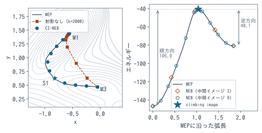

.. _neb:

最小エネルギー経路とNEB法
=========================

固体の中の原子は、安定な位置のまわりで振動しながら、まれに隣の安定な位置へ移る。
移る途中の原子配置はエネルギーが高く、途中で最もエネルギーが高い配置と出発点とのエネルギー差が移動の障壁になる。
この記事では、2つの安定構造を結ぶ経路をイメージ（途中の原子配置）の列で表し、
各イメージに働く力を組み替えて経路を求めるNEB（nudged elastic band）法を導く。
経路の最高点を鞍点へ押し上げるclimbing imageと、得られた点が本当に鞍点かを確かめる方法も扱う。

**前提知識**: :ref:`点欠陥の形成エネルギー<defect-formation>`\ （空孔）、
:ref:`構造最適化<structure-optimization>`\ （力と停留点）、
:ref:`虚数振動数と動的安定性<imaginary-frequency>`\ （ヘッセ行列の固有値と曲率）。

**学習目標**:

* 最小エネルギー経路と1次の鞍点を力とヘッセ行列で定義し、順方向・逆方向の移動障壁を区別する。
* ばねでつないだイメージの列から、射影しないと経路が角を切ることと、イメージが極小へ滑り落ちることを導き、NEBの力がこの2つをどう取り除くかを説明する。
* climbing imageの力が鞍点で0になる理由を示し、得られた点が1次の鞍点かをヘッセ行列の固有値から判定する。
* 空孔を介した原子の移動で、端点・経路の候補・イメージの数の選び方が結果にどう効くかを判断する。

.. _minimum-energy-path:

ポテンシャルエネルギー面と最小エネルギー経路
--------------------------------------------

:math:`N` 個の原子の座標をまとめた :math:`3N` 次元のベクトルを :math:`\boldsymbol R`、
その配置のエネルギーを :math:`E(\boldsymbol R)` とする。電子状態計算では、各配置で電子の基底状態を
求めた全エネルギーが :math:`E` になる。:math:`E(\boldsymbol R)` を配置の関数とみたものを
**ポテンシャルエネルギー面** と呼ぶ。原子に働く力と、エネルギーの2階微分を並べた
ヘッセ行列 :math:`H` は

.. math::
   :label: neb-force-hessian

   \boldsymbol F(\boldsymbol R)=-\nabla E(\boldsymbol R),
   \qquad
   H_{ab}(\boldsymbol R)=\frac{\partial^2E}{\partial R_a\,\partial R_b}

である。:math:`a,b` は :math:`3N` 個の座標成分を表す。:math:`H` は\ :ref:`力定数<harmonic-approximation>`\ を
並べた行列と同じものである。安定構造 A は :math:`\boldsymbol F=\boldsymbol 0` で、
:math:`H` の固有値が一様な並進による0を除いてすべて正の点、つまりエネルギーの極小である。

A から別の極小 B へ移る経路を、弧長 :math:`s` を引数とする曲線 :math:`\boldsymbol R(s)` で表し、
その単位接線を :math:`\hat{\boldsymbol\tau}(s)=d\boldsymbol R/ds` とする。各点の力を、接線方向の成分と
それに垂直な成分に分ける。**最小エネルギー経路**\ （minimum energy path, MEP。最低エネルギー経路とも書く）は、
経路上のすべての点で力の垂直成分が0になる経路である。

.. math::
   :label: neb-mep-condition

   \boldsymbol F^{\perp}(\boldsymbol R(s))
   \equiv\boldsymbol F-(\boldsymbol F\cdot\hat{\boldsymbol\tau})\,\hat{\boldsymbol\tau}
   =\boldsymbol 0 .

垂直成分が残る点では、経路を力の向きへ少しずらすとエネルギーが1次で下がる。
:eq:`neb-mep-condition`\ はその1次の変化が無いこと、つまり各点が経路に垂直な方向について
停留していることを表す。停留点が谷底（垂直方向の極小）か尾根（垂直方向の極大）かは、
垂直方向のエネルギーの2階微分で決まり、:eq:`neb-mep-condition`\ だけでは区別できない。
2つの極小を結ぶ谷を通る経路では各点が垂直方向の谷底にあり、谷に沿った力だけが残る。

経路に沿ったエネルギーの変化は、:eq:`neb-force-hessian`\ の力を使うと

.. math::
   :label: neb-energy-along-path

   \frac{dE}{ds}=\nabla E\cdot\frac{d\boldsymbol R}{ds}
   =-\boldsymbol F\cdot\hat{\boldsymbol\tau}

となる。MEP上でエネルギーが最大になる点では :math:`dE/ds=0` なので
:math:`\boldsymbol F\cdot\hat{\boldsymbol\tau}=0` であり、:eq:`neb-mep-condition`\ と合わせると
:math:`\boldsymbol F=\boldsymbol 0` になる。この点は力が消える停留点で、経路に沿った方向には
エネルギーの極大である。:math:`H` の固有値のうち負のものがちょうど1つある停留点を
**1次の鞍点** と呼ぶ。谷を通るMEPの最高点は垂直方向には極小なので、この1次の鞍点になる。
経路は、負の固有値の固有ベクトルの向きに鞍点を出入りする。

.. _migration-barrier:

移動障壁の順方向と逆方向
------------------------

MEPの最高点を :math:`\boldsymbol R_{\rm S}`、両端の極小を :math:`\boldsymbol R_{\rm A}`、
:math:`\boldsymbol R_{\rm B}` とする。A から B へ移るときに越える **移動障壁** と、
逆向きの障壁は

.. math::
   :label: neb-barriers

   \Delta E_{\rm A\to B}=E(\boldsymbol R_{\rm S})-E(\boldsymbol R_{\rm A}),
   \qquad
   \Delta E_{\rm B\to A}=E(\boldsymbol R_{\rm S})-E(\boldsymbol R_{\rm B})

である。2つの差をとると鞍点のエネルギーが消え、

.. math::
   :label: neb-barrier-difference

   \Delta E_{\rm A\to B}-\Delta E_{\rm B\to A}=E(\boldsymbol R_{\rm B})-E(\boldsymbol R_{\rm A})

となる。順・逆の障壁は同じ鞍点を共有するが、基準にする出発点のエネルギーが違う。
両端のエネルギーが等しい結晶中の等価なサイト間の移動では順・逆の障壁は等しいが、
サイトごとに環境が異なる非晶質では一般に異なる。そのため、経路ごとに両方向の障壁を数える。両者の差は、\ :ref:`詳細つり合い<detailed-balance-barriers>`\ を通じて順・逆の遷移速度の比を決める。

MEPの途中にエネルギーの極小がある場合は、その極小を中間の安定構造とみなし、
A から中間の極小へ、中間の極小から B へ、という2回の素過程に分ける。
それぞれの素過程に\ :eq:`neb-barriers`\ を使う。経路全体の最高点と A のエネルギー差は、
1回の移動の障壁ではない。

.. _nudged-elastic-band:

弾性バンドとNEBの力
-------------------

連続な経路をそのまま扱う代わりに、経路を :math:`P+2` 個の原子配置
:math:`\boldsymbol R_0,\boldsymbol R_1,\ldots,\boldsymbol R_{P+1}` で表す。
これらを **イメージ** と呼び、両端は構造最適化した極小
:math:`\boldsymbol R_0=\boldsymbol R_{\rm A}`、:math:`\boldsymbol R_{P+1}=\boldsymbol R_{\rm B}` に固定する。
中間の :math:`P` 個のイメージを動かして、:eq:`neb-mep-condition`\ を満たす点の列に近づける。

素朴な方法は、隣り合うイメージをばね定数 :math:`k` のばねでつなぎ、

.. math::
   :label: neb-elastic-band-objective

   S(\boldsymbol R_1,\ldots,\boldsymbol R_P)
   =\sum_{i=1}^{P}E(\boldsymbol R_i)
   +\sum_{i=0}^{P}\frac{k}{2}\,|\boldsymbol R_{i+1}-\boldsymbol R_i|^2

を最小化することである。これを射影なしの弾性バンドと呼ぶことにする。イメージ :math:`i` に働く力は
:math:`-\partial S/\partial\boldsymbol R_i` で、

.. math::
   :label: neb-plain-band-force

   -\frac{\partial S}{\partial\boldsymbol R_i}
   =\boldsymbol F_i+\boldsymbol F^{\rm s}_i,
   \qquad
   \boldsymbol F^{\rm s}_i=k(\boldsymbol R_{i+1}-\boldsymbol R_i)-k(\boldsymbol R_i-\boldsymbol R_{i-1})

となる。:math:`\boldsymbol F_i=\boldsymbol F(\boldsymbol R_i)` はポテンシャルによる力、
:math:`\boldsymbol F^{\rm s}_i` はばねの力である。イメージ :math:`i` での経路の単位接線を
:math:`\hat{\boldsymbol\tau}_i` とし（求め方は次節）、どちらの力も接線成分と垂直成分に分けると、
最小化には2つの問題が生じる [NebJonsson1998]_。

**滑り落ち。** ポテンシャルの力の接線成分 :math:`(\boldsymbol F_i\cdot\hat{\boldsymbol\tau}_i)\hat{\boldsymbol\tau}_i` は、
:eq:`neb-energy-along-path`\ によりイメージを経路に沿ってエネルギーの低い側へ押す。
これに逆らうのはばねの接線成分だけなので、:math:`k` が小さいとイメージは両端の極小へ滑り落ち、
障壁の近くにイメージが残らない。

**角を切る。** 経路が曲がっていると、ばねの力に垂直成分が生じる。経路が滑らかで
イメージがほぼ等間隔 :math:`\Delta s` に並ぶとき、曲率を :math:`\kappa`、曲率中心の向きの単位法線を
:math:`\hat{\boldsymbol n}` として :math:`\boldsymbol R_{i\pm1}` を :math:`\boldsymbol R_i` のまわりで展開すると

.. math::
   :label: neb-spring-curvature

   \boldsymbol R_{i\pm1}\simeq\boldsymbol R_i\pm\Delta s\,\hat{\boldsymbol\tau}_i
   +\frac{(\Delta s)^2}{2}\,\kappa\,\hat{\boldsymbol n}_i,
   \qquad
   \boldsymbol F^{\rm s}_i\simeq k(\Delta s)^2\kappa\,\hat{\boldsymbol n}_i

となる。ばねは経路を曲率中心の側へ引き、弦を張るように経路をまっすぐにする。
収束した点では :math:`\boldsymbol F_i^{\perp}=-k(\Delta s)^2\kappa\,\hat{\boldsymbol n}_i\neq\boldsymbol 0` なので、
イメージはMEPの谷底から外れ、谷の斜面を横切る。斜面上の点は同じ断面の谷底より高いので、
経路の最高エネルギーは鞍点のエネルギーを表さない（説明用の事例では鞍点より高くなる）。滑り落ちを防ぐために :math:`k` を大きくするほど、
この角切りは強くなる。:math:`k` の選び方で両方を同時に解消することはできない。

NEB法は、:eq:`neb-plain-band-force`\ の2つの力から、それぞれ必要な成分だけを残す
[NebJonsson1998]_ [NebHenkelmanJonsson2000]_。

.. math::
   :label: neb-force

   \boldsymbol F^{\rm NEB}_i
   =\underbrace{\boldsymbol F_i-(\boldsymbol F_i\cdot\hat{\boldsymbol\tau}_i)\,\hat{\boldsymbol\tau}_i}_{\boldsymbol F_i^{\perp}}
   +\underbrace{k\left(|\boldsymbol R_{i+1}-\boldsymbol R_i|-|\boldsymbol R_i-\boldsymbol R_{i-1}|\right)\hat{\boldsymbol\tau}_i}_{\boldsymbol F_i^{{\rm s}\parallel}} .

ポテンシャルの力からは垂直成分だけを、ばねの力からは接線成分だけを取る。
この「力の一部を押しやる（nudge）」操作が名前の由来である。2つの項は互いに直交するので、
:math:`\boldsymbol F^{\rm NEB}_i=\boldsymbol 0` は両方が別々に0になることを意味する。

* :math:`\boldsymbol F_i^{\perp}=\boldsymbol 0` は\ :eq:`neb-mep-condition`\ を各イメージで満たすことである。
  ばねの垂直成分を捨てたので角切りは起きない。ただし接線 :math:`\hat{\boldsymbol\tau}_i` は隣のイメージから
  推定するので（次節）、収束したイメージの列は連続なMEPをイメージの位置で近似したものであり、
  イメージの間隔を細かくするほどその近似がよくなる。
* :math:`\boldsymbol F_i^{{\rm s}\parallel}=\boldsymbol 0` は :math:`|\boldsymbol R_{i+1}-\boldsymbol R_i|=|\boldsymbol R_i-\boldsymbol R_{i-1}|`
  で、イメージは経路に沿って等間隔に並ぶ。ポテンシャルの接線成分を捨てたので滑り落ちも起きない。

収束した経路と間隔は :math:`k` に依存しない。:math:`k` が変えるのは、そこへ近づく速さだけである。
NEBの力は\ :eq:`neb-elastic-band-objective`\ のような1つの関数の勾配ではないので、
エネルギーの減少で歩幅を決める直線探索はそのままでは使えない。速度を使うquick-minやFIRE、
NEB向けに調整した準Newton法などで、:math:`\boldsymbol F^{\rm NEB}_i` が許容値より小さくなるまで
イメージを動かす [NebSheppard2008]_。

.. _neb-tangent:

接線の取り方
------------

:eq:`neb-force`\ の射影は接線 :math:`\hat{\boldsymbol\tau}_i` に依存する。両隣を結ぶ
:math:`\boldsymbol R_{i+1}-\boldsymbol R_{i-1}` を規格化した接線は簡単だが、垂直方向の力に比べて
経路に沿ったエネルギーの変化が大きい区間では、イメージの列にねじれ（kink）が生じて収束しにくい
[NebHenkelmanJonsson2000]_。HenkelmanとJónssonは、両隣のうちエネルギーの高い側へのベクトルを使う
接線を提案した。:math:`\boldsymbol\tau_i^+=\boldsymbol R_{i+1}-\boldsymbol R_i`、
:math:`\boldsymbol\tau_i^-=\boldsymbol R_i-\boldsymbol R_{i-1}`、:math:`E_i=E(\boldsymbol R_i)` として

.. math::
   :label: neb-tangent

   \boldsymbol\tau_i=
   \begin{cases}
   \boldsymbol\tau_i^+ & (E_{i+1}>E_i>E_{i-1})\\
   \boldsymbol\tau_i^- & (E_{i+1}<E_i<E_{i-1})\\
   \boldsymbol R_{i+1}-\boldsymbol R_{i-1} & (E_{i+1}=E_i=E_{i-1})\\
   \boldsymbol\tau_i^+\Delta E_i^{\max}+\boldsymbol\tau_i^-\Delta E_i^{\min} & (\text{それ以外で }E_{i+1}\ge E_{i-1})\\
   \boldsymbol\tau_i^+\Delta E_i^{\min}+\boldsymbol\tau_i^-\Delta E_i^{\max} & (\text{それ以外で }E_{i+1}<E_{i-1})
   \end{cases}

とし、:math:`\hat{\boldsymbol\tau}_i=\boldsymbol\tau_i/|\boldsymbol\tau_i|` とする。重みは
:math:`\Delta E_i^{\max}=\max(|E_{i+1}-E_i|,|E_{i-1}-E_i|)`、
:math:`\Delta E_i^{\min}=\min(|E_{i+1}-E_i|,|E_{i-1}-E_i|)` である。
最後の2つの場合はイメージ :math:`i` がエネルギーの極大か極小にあるとき（両隣のエネルギーが等しいときを含む）で、
両側のベクトルをエネルギー差で重み付けして混ぜるので、極値の前後で接線が急に切り替わらない。
3点のエネルギーがすべて等しいと、この重みが両方0になってベクトルが0になるので、3番目の場合として
両隣を結ぶ接線を使う。

.. _climbing-image-neb:

climbing image
--------------

NEBの収束後、イメージはMEPの上に等間隔で並ぶが、鞍点に置かれるとは限らない。
最高エネルギーのイメージでも、鞍点の手前や先にあれば鞍点より低い。イメージを細かくすると鞍点の
近くを捉えやすくなるが、最高イメージのエネルギーは単調には鞍点に近づかない（説明用の事例）。
しかも計算量はイメージの数に比例して増える。**climbing image NEB**\ （CI-NEB）は、最高エネルギーのイメージ
:math:`i_{\max}` だけ、ばねを外し、ポテンシャルの力の接線成分の符号を反転させる
[NebHenkelmanUberuagaJonsson2000]_。

.. math::
   :label: neb-climbing-force

   \boldsymbol F^{\rm CI}_{i_{\max}}
   =\boldsymbol F_{i_{\max}}-2\,(\boldsymbol F_{i_{\max}}\cdot\hat{\boldsymbol\tau}_{i_{\max}})\,\hat{\boldsymbol\tau}_{i_{\max}}
   =\boldsymbol F^{\perp}_{i_{\max}}-(\boldsymbol F_{i_{\max}}\cdot\hat{\boldsymbol\tau}_{i_{\max}})\,\hat{\boldsymbol\tau}_{i_{\max}} .

正の微小な係数 :math:`\eta` を使ってこの力の向きに :math:`\delta\boldsymbol R=\eta\,\boldsymbol F^{\rm CI}` だけ動かすと、
エネルギーの変化は :math:`\delta E=-\boldsymbol F\cdot\delta\boldsymbol R` から

.. math::
   :label: neb-climbing-energy-change

   \delta E=-\eta\left[\,|\boldsymbol F^{\perp}|^2-(\boldsymbol F\cdot\hat{\boldsymbol\tau})^2\,\right]

となる。垂直方向にはエネルギーを下げ、接線方向には上げる。そのため、climbing imageは経路に沿って
エネルギーを上り、垂直方向には谷底へ下りる向きに動く。:math:`\boldsymbol F^{\rm CI}=\boldsymbol 0` は
両成分が0、つまり :math:`\boldsymbol F=\boldsymbol 0` を意味するので、収束した点は停留点である。
ただし :math:`\boldsymbol F=\boldsymbol 0` から言えるのは停留点であることまでで、
それが1次の鞍点かどうかは、後の節「\ :ref:`saddle-point-check`\ 」の方法で判定する。
停留点の位置はばねで決まらないので、同じ鞍点に十分収束した場合、そのエネルギーはイメージの数によらない。
ほかのイメージはclimbing imageの両側でそれぞれ等間隔に並ぶが、両側の間隔は一般に異なる。

最初からclimbing imageを使うと、経路の形が定まる前に、まだ低い位置にある最高イメージを
誤った極大へ押し上げることがある。そのため、通常のNEBである程度収束させてから切り替える。
MEPに極大が複数ある場合、climbing imageが押し上げるのはその時点で最も高いイメージだけである。

.. _neb-path-setup:

端点・経路の候補・イメージの数
------------------------------

**端点の緩和。** :eq:`neb-barriers`\ の基準は両端の極小のエネルギーなので、両端は同じセル・同じ計算条件で
:ref:`固定セル緩和<structure-optimization>`\ しておく。端点に力が残っていると、
障壁の基準そのものが極小からずれる。中間のイメージは、ふつう両端の原子座標を直線補間して作る。
周期境界条件では、同じ原子の両端の座標を最も近い周期像どうしで結ぶ。
直線補間で原子どうしが近づきすぎると、最初の数ステップの力が大きくなる。

**空孔を介した移動。** 原子が抜けた位置（空孔）の隣の原子がその空孔へ移ると、
その原子がもといた位置が空く。原子がサイト :math:`j` からサイト :math:`i` へ移るとき、
空孔は :math:`i` から :math:`j` へ、原子と逆向きに移る。始状態は「:math:`i` が空孔」、
終状態は「:math:`j` が空孔」の構造で、どちらも同じ数の原子を含む。
:eq:`neb-barrier-difference`\ の右辺は、空孔がサイト :math:`j` にある構造と :math:`i` にある構造の
エネルギー差である。2つの構造は組成が同じなので、化学ポテンシャルの項が打ち消し合い、
この差はサイト :math:`j` と :math:`i` の空孔の\ :ref:`形成エネルギー<defect-formation-energy>`\ の差に等しい。
非晶質ではサイトごとに形成エネルギーが違うので、順・逆の障壁も違う。

**経路の候補。** 空孔の隣のどの原子が移りうるかは、事前には分からない。よく使われる方法は、
距離が閾値より短いサイトの組を候補に選び、それぞれでNEBを解くことである。
`Li₃PO₄のLi空孔の拡散経路 <https://example.quloud-platform.quemix.com/li3po4/vacancy-paths.html>`__\ が
紹介する文献では、3.5 Å未満のLiサイトの組を候補にしている。得られる経路の数は、閾値に加えて、
候補を経路として採る基準でも変わる。例えば、NEBが収束しない組、途中に極小が現れて2回の素過程に分かれる組、
端点の緩和で空孔が別のサイトへ移ってしまう組を、どう数えるかである。
同じ構造でも、計算手法（機械学習ポテンシャルの種類など）が変わればエネルギー面が変わり、
採られる経路の数とつながり方が変わる。

**イメージの数。** NEBのイメージの数は、経路の形をどれだけ細かく表すかを決める。
climbing imageが同じ鞍点に十分収束すれば、そのエネルギーはイメージの数によらないので、障壁だけが目的なら
少ないイメージで足りる。ただし、イメージが少なすぎると途中の極小や2つ目の極大を見落とす。
経路に沿ったエネルギーの曲線を描き、途中に極小が無いことを見ておくと、
1回の素過程として扱ってよいかが分かる。

.. _saddle-point-check:

鞍点の確認
----------

climbing imageの力が許容値まで小さくなっても、その点が1次の鞍点とは限らない。
経路が尾根の上を通っていれば2次以上の鞍点に収束しうるし、途中の肩のような平坦な部分で
止まっていることもある。そこで、climbing imageの配置でヘッセ行列\ :eq:`neb-force-hessian`\ を求め、
その固有値を数える。周期セルでは、原子を1つずつ小さく動かして力の変化を求める
:ref:`有限変位法<phonon-force-constant-calculation>`\ が使える。

原子の質量を対角に並べた行列を :math:`M` とすると、振動数を与えるのは質量で重み付けした
:math:`D=M^{-1/2}HM^{-1/2}` の固有値 :math:`\omega^2` である。:math:`D` は :math:`H` に
正則な対称行列 :math:`M^{-1/2}` を両側から掛けた形なので、Sylvesterの慣性法則により、
負・0・正の固有値の数は :math:`H` と同じである。したがって

* 一様な並進による0（周期セルでは3つ）を除き、負の固有値がちょうど1つ
  （\ :ref:`虚数振動数<imaginary-frequency>`\ が1つ）なら1次の鞍点である。
* 負の固有値が2つ以上なら、2次以上の鞍点である。2つ目の負の固有値の固有ベクトルの向きに
  経路をずらしてNEBをやり直すと、エネルギーの低い経路へ移る。
* 負の固有値が無ければ、その点は極小か、まだ鞍点に達していない。

負の固有値の数は :math:`H` と :math:`D` で同じだが、固有ベクトルの向きは一般に異なる。
:math:`D` の固有ベクトルに :math:`M^{-1/2}` を掛けたものは :math:`H` の固有ベクトルにならないからである。
直交座標で定義したMEP（この記事の\ :eq:`neb-mep-condition`）と比べるときは、同じ直交座標の :math:`H` の
負の固有値の固有ベクトルを使う。1次の鞍点で経路の向きが正しければ、これはclimbing imageでの接線とほぼ平行になる。
:math:`D` の固有ベクトルと比べるなら、経路も質量で重み付けした座標で定義する必要がある。

1次の鞍点であっても、それが目的の2つの極小を結ぶとは限らない。負の固有値の固有ベクトルの向きに
鞍点から両側へ少しずらし、構造最適化（最急降下）で下った先が、それぞれ目的の始点と終点の極小に
着くことを確かめる。別の極小に着けば、その鞍点は別の素過程のものである。

原子数が多いセルでは、移る原子とその近くの原子だけを動かしてヘッセ行列の一部を求めることがある。
この場合、遠くの原子の緩和との結合を無視しているので、固有値の符号の判定は近似になる。

.. _neb-muller-brown-example:

説明用の事例：Müller–Brownポテンシャル上のNEB
---------------------------------------------

これまでの式の働きを、2次元の模型で確かめる。Müller–Brownポテンシャル [NebMullerBrown1979]_ は
4つのガウス関数の和

.. math::
   :label: neb-muller-brown

   \begin{aligned}
   E(x,y)&=\sum_{m=1}^{4}A_m\exp Q_m(x,y),\\
   Q_m(x,y)&=a_m(x-x_m)^2+b_m(x-x_m)(y-y_m)+c_m(y-y_m)^2
   \end{aligned}

で、:math:`(A_m)=(-200,-100,-170,15)`、:math:`(a_m)=(-1,-1,-6.5,0.7)`、:math:`(b_m)=(0,0,11,0.6)`、
:math:`(c_m)=(-10,-10,-6.5,0.7)`、:math:`(x_m)=(1,0,-0.5,-1)`、:math:`(y_m)=(0,0.5,1.5,1)` である。
エネルギーと座標は無次元で、MEPが大きく曲がる点が角切りを見るのに向く。
停留点を\ :eq:`neb-force-hessian`\ の解析的な勾配とヘッセ行列からNewton法で求めると、
次の値になる。

.. list-table:: Müller–Brownポテンシャルの停留点（一部）
   :header-rows: 1
   :widths: 22 34 20 24

   * - 点
     - 座標 :math:`(x,y)`
     - エネルギー
     - ヘッセ行列の固有値
   * - 極小 M1
     - (−0.558, 1.442)
     - −146.70
     - 410.5、4068.2
   * - 極小 M3
     - (−0.050, 0.467)
     - −80.77
     - 221.0、1479.2
   * - 鞍点 S1
     - (−0.822, 0.624)
     - −40.66
     - −750.9、490.2

:eq:`neb-barriers`\ からM1→M3の順方向の障壁は106.03、M3→M1の逆方向の障壁は40.10である
（丸める前のエネルギーから求めた）。その差65.93は、:eq:`neb-barrier-difference`\ の通り
両端のエネルギー差 :math:`-80.77-(-146.70)` に等しい。

M1とM3を結ぶ直線上に等間隔に置いたイメージから出発し、FIRE法で各イメージの力の大きさが
:math:`10^{-4}` 未満になるまで動かした。接線は\ :eq:`neb-tangent`\ で求めた。
:numref:`fig-neb-muller-brown`\ の左図では、CI-NEBのイメージ（丸）が谷底を通って大きく曲がるMEP（実線）に
乗っている。射影なしの弾性バンドを硬いばね（:math:`k=2000`、中間イメージ9個）で最小化すると（四角）、
経路はS1を通らずに谷の斜面を横切り、イメージの多くはM1の近くに集まる。

   Müller–Brownポテンシャル上のNEB（M1→M3）。左：等高線（間隔12）と経路。実線はS1から最急降下で
   両側へ下って求めたMEP、丸はCI-NEB（中間イメージ9個、:math:`k=50`）、星はclimbing image、
   四角は射影なしの弾性バンド（:math:`k=2000`）。右：MEPに沿った弧長とエネルギー。白抜きの丸と菱形は
   climbing imageを使わないNEB（中間イメージ9個と3個）で、各イメージをMEP上の最も近い点の弧長に置いた。
   矢印は順方向と逆方向の障壁、点線は鞍点S1のエネルギー。

**イメージの数とclimbing image。** 右図の白抜きの点はMEPの曲線に乗っているが、最高のイメージは
鞍点の手前か先にあり、鞍点より低い。climbing imageを加えると、最高のイメージはS1に収束する。

.. list-table:: M1→M3の最高エネルギー（:math:`k=50`）
   :header-rows: 1
   :widths: 30 35 35

   * - 中間イメージの数 :math:`P`
     - NEBの最高イメージ
     - CI-NEBのclimbing image
   * - 3
     - −42.71
     - −40.66
   * - 5
     - −43.37
     - −40.66
   * - 9
     - −43.15
     - −40.66

climbing imageを使わないNEBの最高エネルギーは、鞍点より2.0〜2.7低い。この差はイメージを増やしても
単調には縮まない。最高のイメージと鞍点の距離は、イメージの並び方が鞍点とどうずれるかで決まるからである。
climbing imageの位置はどの :math:`P` でもS1と :math:`2\times10^{-7}` 以内で一致した。

**ばね定数。** 中間イメージ9個のNEBで :math:`k=5,50,500` と変えると、収束した各イメージの位置の差は
最大 :math:`1.2\times10^{-4}` で、隣り合うイメージの間隔はどれも0.1761〜0.1762にそろった。
収束までのステップ数は4532、1218、706と変わった。:eq:`neb-force`\ から導いた通り、
:math:`k` は収束の速さだけを変える。

**射影なしの弾性バンド。** 同じ9個のイメージで\ :eq:`neb-elastic-band-objective`\ を最小化すると、
:math:`k=5` では9個すべてがM1かM3から0.1以内へ滑り落ち、最高エネルギーは−80.74で、
M3のエネルギーとほぼ同じになった。バンドは障壁について何も教えない。
:math:`k=2000` ではイメージがMEPから最大0.40離れ、最高エネルギーは−8.95と、
鞍点より31.7高くなった。角切りのために、障壁を大きく見積もる。

**鞍点の確認。** 中間イメージ9個のclimbing imageでヘッセ行列を求めると、固有値は−750.9と490.2で、
負の固有値が1つだけある。その固有ベクトルと\ :eq:`neb-tangent`\ の接線の内積の絶対値は0.9985で、
負の曲率の向きは経路に沿っている（この模型の座標は直交座標で、質量の重みは無い）。
この固有ベクトルの向きに両側へ :math:`10^{-3}` だけずらして最急降下で下ると、それぞれM1とM3に着く。
したがってこの点は、M1とM3を結ぶ1次の鞍点である。

**途中の極小。** M1からM2（(0.623, 0.028)、エネルギー−108.17）へ中間イメージ15個でNEBを解くと、
経路はM3から0.020の位置にイメージを置いて通り、その前後に−40.67と−72.48の2つの極大が現れる。
この経路はM1→M3とM3→M2の2回の素過程からなり、M1から経路の最高点までのエネルギー差は
1回の移動の障壁ではない。

.. _neb-interpretation-limits:

解釈と限界
----------

* **局所的な探索。** NEBは初期の経路の近くにあるMEPへ収束する。別の鞍点を通る、
  障壁のより低い経路が存在しても見つからないことがある。候補の選び方や初期の経路を変えて
  結果が変わるかで、見落としの有無を判断する。HenkelmanとJónssonのdimer法 [NebDimer1999]_
  のように、終状態を指定せずに鞍点を探す方法もある。
* **0 Kのポテンシャルエネルギー。** NEBの障壁はポテンシャルエネルギー面上の差で、零点振動や
  振動のエントロピーを含まない。移動の頻度を求めるには、鞍点と極小の振動を使った\ :ref:`遷移状態理論<transition-state-theory>`\ が要る。
* **セルと電荷。** 周期セルで空孔を動かすと、空孔はその周期像とも相互作用する。セルを大きくしたときに
  障壁が変わるかを調べれば、この相互作用の大きさを見積もれる。イオン結晶で陽イオンを取り除いた
  空孔は\ :ref:`電荷をもちうる<charged-defects>`\ ので、中性のセルで求めた障壁と荷電した空孔の障壁は一般に異なる。
* **エネルギー面の精度。** 鞍点付近の配置は、平衡付近の構造よりエネルギーが高く、原子間の距離も異なる。
  機械学習ポテンシャルでは、こうした遷移途中の構造が\ :ref:`学習データ<mlip-training-data>`\ に含まれるかで
  障壁の精度が変わる。`Li₃PO₄のLi空孔移動障壁 <https://example.quloud-platform.quemix.com/li3po4/vacancy-barriers.html>`__\ が
  紹介する文献では、移動途中の構造を学習から外すと、DFTとの障壁の差が大きくなった。
* **座標の選び方。** :eq:`neb-mep-condition`\ の「垂直」は座標の内積で決まるので、
  直交座標と質量で重み付けした座標とでは、MEPの形が少し変わる。一方、鞍点は力が0の停留点なので、
  その位置とエネルギーは座標の選び方によらない。したがって、同じ始点と同じ鞍点を比べる場合、障壁も座標の選び方によらない。
* **非晶質の障壁の分布。** 非晶質では経路ごとに障壁が異なり、:eq:`neb-barriers`\ の値は分布をもつ。
  多数回の移動からなる拡散の速さは、障壁の平均ではなく、移動の\ :ref:`経路がどうつながっているか<thermal-activation-limits>`\ で決まる。

関連資料
--------

* :ref:`structure-optimization`
* :ref:`imaginary-frequency`
* :ref:`mlip-training-data`
* `Li₃PO₄のLi空孔の拡散経路 <https://example.quloud-platform.quemix.com/li3po4/vacancy-paths.html>`__
* `Li₃PO₄のLi空孔移動障壁 <https://example.quloud-platform.quemix.com/li3po4/vacancy-barriers.html>`__

参考文献
--------

.. [NebJonsson1998] H. Jónsson, G. Mills, and K. W. Jacobsen, in *Classical and Quantum Dynamics in
   Condensed Phase Simulations*, edited by B. J. Berne, G. Ciccotti, and D. F. Coker
   (World Scientific, 1998), pp. 385–404.
   `doi:10.1142/9789812839664_0016 <https://doi.org/10.1142/9789812839664_0016>`_.
.. [NebHenkelmanUberuagaJonsson2000] G. Henkelman, B. P. Uberuaga, and H. Jónsson,
   *J. Chem. Phys.* **113**, 9901–9904 (2000).
   `doi:10.1063/1.1329672 <https://doi.org/10.1063/1.1329672>`_.
.. [NebHenkelmanJonsson2000] G. Henkelman and H. Jónsson, *J. Chem. Phys.* **113**, 9978–9985 (2000).
   `doi:10.1063/1.1323224 <https://doi.org/10.1063/1.1323224>`_.
.. [NebSheppard2008] D. Sheppard, R. Terrell, and G. Henkelman, *J. Chem. Phys.* **128**, 134106 (2008).
   `doi:10.1063/1.2841941 <https://doi.org/10.1063/1.2841941>`_.
.. [NebMullerBrown1979] K. Müller and L. D. Brown, *Theor. Chim. Acta* **53**, 75–93 (1979).
   `doi:10.1007/BF00547608 <https://doi.org/10.1007/BF00547608>`_.
.. [NebDimer1999] G. Henkelman and H. Jónsson, *J. Chem. Phys.* **111**, 7010–7022 (1999).
   `doi:10.1063/1.480097 <https://doi.org/10.1063/1.480097>`_.
