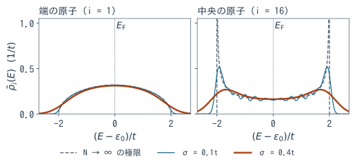
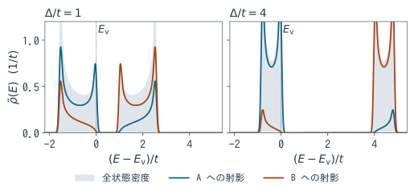

.. _projected-dos:

射影状態密度
============

**射影状態密度** （projected density of states, PDOS）は、状態密度を原子や軌道ごとの
寄与に分けた量である。部分状態密度（partial DOS）とも呼ばれる。状態密度はどのエネルギーに
どれだけ状態があるかを示すが、その状態がどの原子のどの軌道からできているかは示さない。PDOSは、各状態を局在した軌道へ射影した重みでこれを分け、例えば酸化物の価電子帯が
主に酸素の2p軌道からなり、そこに金属の軌道がどれだけ混じっているかを読めるようにする
[PdosHoffmann1987]_。本稿では、PDOSの定義と和則を導き、2準位模型でPDOSと軌道の混成やイオン性との関係を式で追う。
続いて、実際の計算でPDOSを作るときに結果を左右する、非直交基底での射影、ガウス関数によるぼかし、
エネルギーの基準の揃え方を説明する。最後に2つのタイト・バインディング模型でPDOSを計算し、PDOSから読めることと読めないことを整理する。

**前提知識**: :ref:`状態密度<density-of-states>`、:ref:`Löwdin解析<lowdin>` の密度行列と
対称直交化、:ref:`タイト・バインディング近似<tightbinding>`、
:ref:`開放端の鎖の固有状態<fc-standing-waves>`、:ref:`価電子帯上端<valence-conduction-band-gap>`。

**学習目標**:

* 直交基底への射影の重みからPDOSを定義し、和則と、占有状態で積分するとLöwdin電子数になることを導く。
* 2準位模型で、スペクトルの重なり、軌道の混成、イオン性の関係を導く。
* 非直交基底でのMulliken型とLöwdin型の射影の違いと、射影が基底に依存する理由を説明する。
* ガウス関数によるぼかしで保存される量と変わる量を導き、ぼかしの幅の選び方を説明する。
* 構造ごとに価電子帯上端で揃えた図から読めることと読めないことを説明する。
* 水素原子鎖とAB交替鎖の模型で、原子の環境やイオン性がPDOSの形と重みにどう現れるかを読む。

状態密度を軌道ごとに分ける
--------------------------

分子や有限の鎖のように準位 :math:`\varepsilon_i` が離散的な系では、1スピンあたりの
状態密度を

.. math::
   :label: pd-dos

   \rho(E)=\sum_i\delta(E-\varepsilon_i)

と書ける。:math:`\delta` はディラックのデルタ関数である。これを軌道ごとに分けるために、
原子に中心を置いた正規直交な基底 :math:`\{\lambda_\mu\}`\ （:math:`\mu=1,\ldots,K`）を用意し、
状態 :math:`\psi_i` の軌道 :math:`\mu` への重みを

.. math::
   :label: pd-weight

   w_{\mu i}=|\langle\lambda_\mu|\psi_i\rangle|^2

と定義する。この重みで :eq:`pd-dos` の各項を分けたものが、軌道 :math:`\mu` への
射影状態密度である。

.. math::
   :label: pd-pdos

   \rho_\mu(E)=\sum_iw_{\mu i}\,\delta(E-\varepsilon_i),\qquad
   \rho_A(E)=\sum_{\mu\in A}\rho_\mu(E)

:math:`\rho_A` は原子 :math:`A` に属する軌道の和で、原子への射影状態密度と呼ぶ。

状態 :math:`\psi_i` が基底の張る空間に入っていれば :math:`\sum_\mu w_{\mu i}=1` であり、
基底の数だけある状態をすべて足せば :math:`\sum_iw_{\mu i}=1` である。したがって

.. math::
   :label: pd-sum-rule

   \sum_\mu\rho_\mu(E)=\rho(E),\qquad
   \int\rho_\mu(E)\,dE=1

が成り立つ。前者は、PDOSを全軌道について足すと状態密度に戻ることを表す。後者は、
各軌道の重みが占有・非占有を合わせた全エネルギー範囲に合計1だけ分配されることを表す。

占有数 :math:`f(E)`\ （絶対零度ではフェルミ準位以下で1、以上で0）を掛けて積分すると、
軌道に割り当てられる電子数が得られる。閉殻でスピンの因子2を含めると、Löwdin解析の記号で :math:`\langle\lambda_\mu|\psi_i\rangle=C^{\mathrm L}_{\mu i}`、
:math:`n_i=2f(\varepsilon_i)` だから、

.. math::
   :label: pd-population

   N_\mu=2\int f(E)\,\rho_\mu(E)\,dE
   =\sum_in_i\bigl|C^{\mathrm L}_{\mu i}\bigr|^2
   =P^{\mathrm L}_{\mu\mu}

となる。右辺は :eq:`lw-population` の和を作る対角成分である。つまり、Löwdin基底へ射影したPDOSは、Löwdin電子数をエネルギーごとに分解したものである。電子数は1つの数だが、PDOSはその電子がどのエネルギーの状態に入っているかを示す。

周期系では、バンド :math:`n`、波数 :math:`\boldsymbol k` の状態の重み
:math:`w_{\mu n}(\boldsymbol k)` を使い、:eq:`rho(E)` と同じ規格化（1スピン・単位胞あたり）で

.. math::
   :label: pd-pdos-k

   \rho_\mu(E)=\frac{1}{\Omega_{\mathrm{BZ}}}\int_{\mathrm{BZ}}
   \sum_nw_{\mu n}(\boldsymbol k)\,\delta\bigl(E-\varepsilon_n(\boldsymbol k)\bigr)\,
   \mathrm d\boldsymbol k

と定義する。:math:`\mu` は単位胞の中の軌道を指す。

PDOSの形は、ハミルトニアンの行列要素と直接つながっている。:eq:`pd-pdos` の
:math:`m` 次のモーメントは、基底の張る空間での固有状態による展開
:math:`\hat H^m=\sum_i\varepsilon_i^m|\psi_i\rangle\langle\psi_i|` から

.. math::
   :label: pd-moment

   \int E^m\rho_\mu(E)\,dE=\sum_iw_{\mu i}\,\varepsilon_i^m
   =\langle\lambda_\mu|\hat H^m|\lambda_\mu\rangle

となる。:math:`m=1` は軌道エネルギー :math:`H_{\mu\mu}` である。:math:`m=2` から、
重心のまわりの広がりは
:math:`\langle\lambda_\mu|\hat H^2|\lambda_\mu\rangle-H_{\mu\mu}^2=\sum_{\nu\ne\mu}|H_{\mu\nu}|^2`
で、他の軌道とのホッピングの2乗和に等しい。結合する相手が多いほど、また結合が強いほど、
その軌道のPDOSは広がる。

.. _orbital-hybridization:

軌道の混成とスペクトルの重なり
------------------------------

2つの直交した軌道 :math:`|A\rangle`、:math:`|B\rangle` だけからなる2準位模型で、PDOSと
混成の関係を調べる。ハミルトニアンを

.. math::
   :label: pd-dimer-h

   H=\begin{pmatrix}\varepsilon_A&-t\\-t&\varepsilon_B\end{pmatrix},\qquad
   \Delta=\varepsilon_B-\varepsilon_A\ge0,\qquad
   \bar\varepsilon=\frac{\varepsilon_A+\varepsilon_B}{2}

とする。:math:`t>0` はホッピング、:math:`\Delta` は軌道エネルギーの差である。
固有値は :math:`E_\pm=\bar\varepsilon\pm R`\ （:math:`R=\sqrt{\Delta^2/4+t^2}`）である。

固有ベクトルの重みは、固有値 :math:`E` だけで書ける。固有方程式
:math:`(\varepsilon_A-E)c_A-tc_B=0`、:math:`-tc_A+(\varepsilon_B-E)c_B=0` の第1式から
:math:`t^2|c_B|^2=(E-\varepsilon_A)^2|c_A|^2`、行列式が0の条件から
:math:`t^2=(E-\varepsilon_A)(E-\varepsilon_B)` である。2式から
:math:`|c_B|^2/|c_A|^2=(E-\varepsilon_A)/(E-\varepsilon_B)` となり、規格化すると

.. math::
   :label: pd-weight-e

   w_A(E)=\frac{E-\varepsilon_B}{2E-\varepsilon_A-\varepsilon_B},\qquad
   w_B(E)=\frac{E-\varepsilon_A}{2E-\varepsilon_A-\varepsilon_B}

を得る。下の準位 :math:`E_-` に代入すると、Bの重みは

.. math::
   :label: pd-dimer-w

   w_B^-=\frac12\left(1-\alpha\right),\qquad
   \alpha=\frac{\Delta/2}{\sqrt{\Delta^2/4+t^2}}

である。:math:`\alpha` は、Harrisonが結合軌道の **極性** （polarity）と呼んだ量に当たる
[PdosHarrison1973]_。:math:`E_-` の状態は :math:`c_A` と :math:`c_B` が同符号の結合性軌道、
:math:`E_+` は異符号の反結合性軌道である。

:eq:`pd-pdos` に従ってPDOSを書くと、

.. math::

   \rho_A(E)&=(1-w_B^-)\,\delta(E-E_-)+w_B^-\,\delta(E-E_+)\\
   \rho_B(E)&=w_B^-\,\delta(E-E_-)+(1-w_B^-)\,\delta(E-E_+)

となる。:math:`t=0` なら :math:`w_B^-=0` で、Aの山は :math:`\varepsilon_A`、Bの山は
:math:`\varepsilon_B` にだけ立つ。:math:`t\ne0` のとき、主にAからなる準位 :math:`E_-` にBの重みが現れ、:math:`E_+` にAの重みが現れる。PDOSで2つの軌道の山が同じエネルギーに
現れることを **スペクトルの重なり** と呼ぶ。:math:`\Delta>0` のこの模型では、
スペクトルの重なりは1つの固有状態に2つの軌道が混じっていること、すなわち **軌道の混成** を表す。2電子が :math:`E_-` に入ると、
:eq:`pd-population` から、Bに割り当てられる電子数（占有状態でのBの重みの和）は :math:`N_B=2w_B^-` である。

:math:`\alpha` は **共有結合性** と **イオン性** の間の位置を表す。:math:`\Delta=0`\ （同種の原子、
例えば :ref:`Löwdin解析<lowdin>` の水素分子）では :math:`\alpha=0`、:math:`w_B^-=1/2` で、電子は2つの軌道に等しく分かれる。:math:`t\ll\Delta` では :math:`\alpha\simeq1-2t^2/\Delta^2` から

.. math::
   :label: pd-ionic-limit

   w_B^-\simeq\frac{t^2}{\Delta^2}

となり、結合性軌道はほぼAだけからなる。このとき電子はほぼAに移り、イオン結合の極限に近づく。
それでも :math:`t\ne0` である限り、占有状態にはBの重み :math:`2t^2/\Delta^2` が残る。

:eq:`pd-dimer-w` から、PDOSの重みとホッピングの関係について2つのことがわかる。
第1に、重みは比 :math:`t/\Delta` だけで決まる。同じ :math:`w_B^-` は異なる :math:`t` と
:math:`\Delta` の組から生じるので、重みからホッピングの大きさは決まらない。第2に、
同じエネルギーに山が重なることは、混成の十分条件ではない。:math:`t=0` でも
:math:`\varepsilon_A=\varepsilon_B` なら2つの山は重なる。状態ごとの重みを見ずに、状態について
足したPDOSだけから両者を区別することはできない。また、重み :math:`|c_A|^2`、:math:`|c_B|^2` は
係数の符号を含まないので、状態が結合性か反結合性かも示さない。これを区別するには、
係数の積 :math:`c_Ac_B` にハミルトニアンの非対角要素を掛けてエネルギーごとに描くCOHP
[PdosDronskowski1993]_ や、重なり行列の要素を掛けるCOOP [PdosHoffmann1987]_ が使われる。

.. _pdos-nonorthogonal:

非直交基底での射影
------------------

第一原理計算で使う原子軌道 :math:`\chi_\mu` は一般に直交していない。展開係数を
:math:`C_{\mu i}`、重なり行列を :math:`S` とすると（記号は :ref:`Löwdin解析<lowdin>` と同じ）、
軌道 :math:`\psi_i` の規格化は、:math:`C` の第 :math:`i` 列を :math:`C_i` として
:math:`C_i^\dagger SC_i=\sum_{\mu\nu}C_{\mu i}^*S_{\mu\nu}C_{\nu i}=1` である。
この和を基底関数ごとに分ける方法が2通りある。

.. math::
   :label: pd-mulliken-lowdin

   w^{\mathrm M}_{\mu i}=\operatorname{Re}\bigl[C_{\mu i}^*\,(SC)_{\mu i}\bigr],\qquad
   w^{\mathrm L}_{\mu i}=\bigl|(S^{1/2}C)_{\mu i}\bigr|^2

前者がMulliken型 [Mulliken1955]_、後者が対称直交化した基底 [Lowdin1950]_ への射影である。
どちらも :math:`\mu` について足すと1になり、:eq:`pd-sum-rule` の第1式を満たす。
占有状態について足すと、それぞれMulliken電子数とLöwdin電子数になる。
Mulliken型の重みは、符号が負にもなりうる重なりの項 :math:`\operatorname{Re}[C_{\mu i}^*S_{\mu\nu}C_{\nu i}]` を2つの基底関数に半分ずつ
割り当てたものなので、負になることがある。Löwdin型の重みは絶対値の2乗なので負にならない。

:eq:`pd-mulliken-lowdin` に複素共役、実部、絶対値が入るのは、周期系のBloch軌道では係数が一般に複素数だからである。
係数をすべて :math:`i` 倍しても状態は同じなので、重みはこの位相によってはいけない。複素共役を付けない
:math:`C_{\mu i}(SC)_{\mu i}` は、:math:`i` 倍で符号が変わってしまう。:math:`C_{\mu i}^*(SC)_{\mu i}` は位相によらず、
:math:`\mu` について足すと実数の1になるが、各項は虚部をもちうるので、実部を重みとする。本稿の模型のように係数が実数なら、
:eq:`pd-mulliken-lowdin` は :math:`C_{\mu i}(SC)_{\mu i}` と :math:`\bigl((S^{1/2}C)_{\mu i}\bigr)^2` に戻る。

:ref:`平面波基底<basis-set-cutoff>`\ の計算では、Kohn–Sham軌道を原子軌道の組へ射影してPDOSを作る。原子軌道の組は
軌道の空間を完全には張らないので :math:`\sum_\mu w_{\mu i}<1` となり、PDOSの和は状態密度に
届かない。射影から漏れた割合 :math:`1-\sum_\mu w_{\mu i}` を状態について平均した量はspilling parameterと呼ばれ、射影の質の目安に使われる [PdosSanchezPortal1995]_。

どの方法でも、PDOSの値は基底関数の取り方に依存する。同じ波動関数でも、原子軌道の広がりや
直交化の方法を変えれば、ある状態の重みがどの原子に入るかが変わる。

.. _dos-broadening:

ガウス関数によるぼかし
----------------------

:eq:`pd-pdos` はデルタ関数の和で、そのままでは図にならない。周期系の :eq:`pd-pdos-k` も、
数値計算では有限個の\ :ref:`k点のメッシュ<kpoint-meshes>`\ での和になり、やはりデルタ関数の
和になる。そこで各デルタ関数を、面積1のガウス関数

.. math::
   :label: pd-gauss

   g_\sigma(x)=\frac{1}{\sqrt{2\pi}\,\sigma}\exp\!\left(-\frac{x^2}{2\sigma^2}\right)

に置き換えた

.. math::
   :label: pd-broadened

   \tilde\rho_\mu(E)=\sum_iw_{\mu i}\,g_\sigma(E-\varepsilon_i)

を描く。:math:`\sigma` はガウス関数の標準偏差で、これを **ぼかしの幅** と呼ぶ。
:math:`\int g_\sigma\,dx=1`、:math:`\int x\,g_\sigma\,dx=0`、
:math:`\int x^2g_\sigma\,dx=\sigma^2` だから、全エネルギー範囲で積分すると

.. math::

   \int\tilde\rho_\mu\,dE&=\int\rho_\mu\,dE\\
   \int E\,\tilde\rho_\mu\,dE&=\int E\,\rho_\mu\,dE\\
   \int E^2\tilde\rho_\mu\,dE&=\int E^2\rho_\mu\,dE+\sigma^2\!\int\rho_\mu\,dE

となる。ぼかしは重みの合計と重心を変えず、広がりを :math:`\sigma^2` だけ増やす。
ただし、これは全範囲で積分した場合に限る。エネルギーの窓を切って積分すると、窓の端から
ガウス関数の裾が出入りするので、窓の中の重みや重心は :math:`\sigma` に依存する。

:math:`\sigma` の下限は準位の間隔で決まる。有限の分子や鎖では準位そのものの間隔、周期系ではk点の間隔にバンドの傾き :math:`|\nabla_{\boldsymbol k}\varepsilon|` を掛けた程度が、その間隔に当たる。
:math:`\sigma` がこれより小さいと、曲線に個々の準位の山が残る。上限は読み取りたい構造で決まる。:math:`\sigma` が
ギャップやピークの幅に近づくと、バンド端の外に裾が出て、ピークの位置も動く。
したがって、価電子帯上端やギャップの値は、ぼかした曲線ではなく固有値から求める。

ぼかしの幅の定義は文献やプログラムによって異なる。
:ref:`金属のk点積分<smearing>`\ で使うガウシアンスメアリング
:math:`f=\tfrac12\operatorname{erfc}\bigl((\varepsilon-\mu)/\sigma\bigr)` では、
:math:`-df/d\varepsilon=\exp\bigl(-(\varepsilon-\mu)^2/\sigma^2\bigr)/(\sqrt\pi\,\sigma)`
の標準偏差が :math:`\sigma/\sqrt2` である。同じ記号 :math:`\sigma` が、標準偏差の
:math:`\sqrt2` 倍を指すことがあるので、幅の値を比べるときは定義を揃える必要がある。
また、スメアリングは自己無撞着計算の占有数を変え、エネルギーにも影響する。PDOSのぼかしは
計算の後で図を作るための処理で、占有数にも全エネルギーにも影響しない。

.. _pdos-energy-alignment:

エネルギーの基準と価電子帯上端
------------------------------

周期系の計算では、固有値の原点に絶対的な意味がない。無限に続く結晶では平均の静電
ポテンシャルを決める基準がなく、プログラムは通常それを0とおくので、真空準位や別の結晶と
共通の原点を持たない [PdosVandeWalle1987]_。構造の異なる計算でPDOSを比べるときは、
絶縁体なら各構造の価電子帯上端 :math:`E_{\mathrm v}`、金属なら\ :ref:`フェルミ準位<fermi-level-and-occupation>`\ を0に揃える。

揃えた図で読めるのは、同じ構造の中での相対的な位置である。例えば、ある軌道の重みが
価電子帯の上端付近と下端付近のどちらに多いかは、基準の取り方によらない。一方、2つの構造の
間で特徴の位置が動いたとき、その移動は特徴そのものの移動から :math:`E_{\mathrm v}` の移動を
差し引いたものである。:math:`E_{\mathrm v}` も構造とともに動くので、揃えた図だけでは
どちらが動いたかを区別できない。

揃えた図の重心の移動は、全エネルギーの分解としても読めない。理由は2つある。
第1に、占有された固有値の和 :math:`\sum_in_i\varepsilon_i` を :math:`E_{\mathrm v}` から測ると
:math:`\sum_in_i(\varepsilon_i-E_{\mathrm v})=\sum_in_i\varepsilon_i-NE_{\mathrm v}` となり、
:math:`E_{\mathrm v}` が構造ごとに違えば、電子数 :math:`N` 倍の差が混じる。第2に、\ :ref:`Kohn–Sham法<kohn-sham-dft>`\ の
全エネルギーは固有値の和ではなく、電子間相互作用の二重計上を差し引く項を含む
（参考資料のMartinの教科書）。したがって、揃えた図で重心が下がったことから
全エネルギーが下がったとは結論できない。

説明用の科学的事例：水素原子鎖の端と中央
----------------------------------------

`水素原子を並べると電子バンドは生まれるのか <https://example.quloud-platform.quemix.com/hydrogen_chain/band_formation.html>`_
の有限水素原子鎖（STO-3G基底、原子間隔1.8 Å、Psi4 1.10）では、RKS-PBEのLöwdin結合次数が、
パラメータを含まない一様な最近接タイト・バインディング模型の値と小数点以下2〜3桁まで
一致する（:ref:`結合次数<bond_order>`）。そこで、同じ模型で原子ごとのPDOSを計算する。
以下の値は模型から求めたもので、Psi4の計算結果ではない。

:math:`N` 原子の開放端の鎖の固有状態は、:ref:`開放端の鎖の定在波<fc-standing-waves>` で
求めたとおり :math:`E_j=\varepsilon_0-2t\cos\theta_j`、
:math:`\phi_j(i)=\sqrt{2/(N+1)}\sin(i\theta_j)`\ （:math:`\theta_j=j\pi/(N+1)`）である。
原子 :math:`i` への重みは :math:`w_{ij}=\phi_j(i)^2` だから、端の原子（:math:`i=1`）のPDOSは

.. math::

   \rho_1(E)=\sum_{j=1}^{N}\frac{2}{N+1}\sin^2\theta_j\,\delta(E-E_j)

となる。:math:`N\to\infty` では :math:`\theta_j` が密に並び、和を
:math:`\frac{N+1}{\pi}\int_0^\pi d\theta` に置き換えられる。:math:`dE/d\theta=2t\sin\theta` を使うと

.. math::
   :label: pd-chain-edge

   \rho_1(E)=\frac{2}{\pi}\frac{\sin^2\theta}{2t\sin\theta}
   =\frac{\sqrt{4t^2-(E-\varepsilon_0)^2}}{2\pi t^2}

を得る。鎖の中央の原子では :math:`\sin^2(i\theta)` が :math:`\theta` について速く振動するので、
平均の1/2に置き換えてよい。すると

.. math::
   :label: pd-chain-bulk

   \rho_{\mathrm c}(E)=\frac{1}{\pi\sqrt{4t^2-(E-\varepsilon_0)^2}}

となり、無限鎖の1原子あたりの\ :ref:`状態密度<density-of-states>`\ に一致する。

   原子数 :math:`N=32` の開放端の一様な鎖について、端の原子（左）と中央の原子（右）への
   射影状態密度 :eq:`pd-broadened`\ （1スピンあたり）。細い青線は幅 :math:`\sigma=0.1t`、太い茶色の線は
   :math:`\sigma=0.4t` でぼかした曲線、灰色の破線は :math:`N\to\infty` の極限
   :eq:`pd-chain-edge`、:eq:`pd-chain-bulk`。点線は半充填のフェルミ準位
   :math:`E_{\mathrm F}=\varepsilon_0`。

:numref:`fig-pdos-chain-sites`\ では、同じ元素の同じ軌道でも、鎖のどこにあるかでPDOSの形が
大きく違う。端の原子の重みはバンドの中央に集まり、:math:`|E-\varepsilon_0|<t` にある割合は
極限で :math:`1/3+\sqrt3/(2\pi)\approx0.609` である。中央の原子では、極限で同じ範囲に1/3しかなく、
重みはバンド端に寄っている。この違いは :eq:`pd-moment` の2次のモーメントで説明できる。
隣接原子の数は端で1、中央で2なので、広がりは :math:`t^2` と :math:`2t^2` になる。

一方、占有状態で積分した電子数 :eq:`pd-population` は、どちらの原子も1である。鎖は1つおきの2組の原子に分けられ、ホッピングは組の間にしかない。このため固有状態は
:math:`\varepsilon_0` について対称な対をなし、対の2状態は各原子に同じ重みを持つので、
どの原子でも重みの半分がフェルミ準位より下に入る。:ref:`Löwdin解析<lowdin>` で示したPsi4のRHFの値（:math:`N=16` の端の原子で0.994程度）が1からわずかにずれるのは、
自己無撞着な計算がこの模型の対称性を厳密には持たないためである。電子数が同じでもPDOSの形が
違うことは、PDOSが電子数には現れない、原子の環境の情報を持つことを示している。

この図は、ぼかしの幅を選ぶときの目安も示す。:math:`N=32` の鎖の準位の間隔は、バンドの中央付近で
:math:`0.190t` である。:math:`\sigma=0.1t` の曲線には、この間隔で並ぶ準位ごとの小さな山が残る。
:math:`\sigma=0.4t` の曲線はなめらかだが、中央の原子ではバンド端の発散のピークが
:math:`\pm1.67t` 付近まで内側へ動き、バンドの外（:math:`|E-\varepsilon_0|>2t`）に重みの0.167が
はみ出す。:math:`\sigma=0.1t` では0.083である。

説明用の科学的事例：AB交替鎖とイオン性
--------------------------------------

2準位模型の議論を周期系に広げるため、単位胞（格子定数 :math:`a`）にAとBの軌道を1つずつ
交互に並べ、隣り合うAとBの間にだけホッピング :math:`-t` がある鎖を考える。
:ref:`ブロッホ和<bloch-sum>` でハミルトニアンを波数ごとに書くと

.. math::
   :label: pd-ab-hk

   H(k)&=\begin{pmatrix}\varepsilon_A&h(k)\\h(k)^*&\varepsilon_B\end{pmatrix}\\
   h(k)&=-t\bigl(1+e^{-ika}\bigr),\qquad |h(k)|=2t\left|\cos\frac{ka}{2}\right|

となる。各波数で :eq:`pd-dimer-h` の :math:`t` を :math:`|h(k)|` に置き換えた2準位模型なので、
バンドは

.. math::
   :label: pd-ab-band

   E_\pm(k)=\bar\varepsilon\pm\sqrt{\frac{\Delta^2}{4}+4t^2\cos^2\frac{ka}{2}}

であり、:eq:`pd-weight-e` の導出は :math:`t^2` を :math:`|h(k)|^2` に置き換えても
そのまま成り立つ。重みはエネルギーだけの関数なので、PDOSは状態密度に重みを掛けた
:math:`\rho_A(E)=w_A(E)\rho(E)`、:math:`\rho_B(E)=w_B(E)\rho(E)` になる。

下のバンドの上端は :math:`ka=\pi` で、:math:`h=0` だから :math:`E_{\mathrm v}=\varepsilon_A`、
重みは純粋にAである。下端は :math:`k=0` で、Bの重みが最大になる。:math:`\Delta/t=4` では、
:eq:`pd-dimer-w` の :math:`t` を :math:`|h(0)|=2t` に置き換えて :math:`w_B=0.146` である。

   AB交替鎖の射影状態密度（1スピン・単位胞あたり、4000点のk点メッシュ、
   幅 :math:`\sigma=0.05t`\ ）。左は :math:`\Delta/t=1`、右は :math:`\Delta/t=4`。
   淡い灰色の領域が全状態密度、青線がAへの射影、茶色の線がBへの射影で、
   青線と茶色の線の和が灰色の領域の上端になる。横軸は各模型の価電子帯上端
   :math:`E_{\mathrm v}` を0とし、点線で示す。バンド端の発散は縦軸の範囲で切っている。

:numref:`fig-pdos-ab-chain`\ では、どちらの :math:`\Delta` でも価電子帯（下のバンド）は
主にAからなり、Bの重みは価電子帯の下端で大きく、上端で0になる。2準位模型でいえば、
価電子帯の下端はBが最も多く混じった結合性の状態、上端はBと混じらないAの状態である。
:math:`\Delta/t` を大きくすると、価電子帯のBの重みは小さくなる。

下のバンドを単位胞あたり2電子で満たしたときの、Bに割り当てられる電子数 :math:`N_B` を
:eq:`pd-population` から求めると、次の表のようになる。比較のため、同じ :math:`t` と
:math:`\Delta` の2準位模型の値 :math:`2w_B^-` と、:math:`\Delta\gg t` での近似値も示す。

.. list-table:: Bに割り当てられる電子数 :math:`N_B`\ （スピン和、単位胞あたり）
   :header-rows: 1
   :widths: 16 28 28 28

   * - :math:`\Delta/t`
     - AB交替鎖
     - 2準位模型 :math:`2w_B^-`
     - 近似 :math:`4t^2/\Delta^2`
   * - 0
     - 1.000
     - 1.000
     - —
   * - 0.1
     - 0.919
     - 0.950
     - 400
   * - 1
     - 0.563
     - 0.553
     - 4.000
   * - 2
     - 0.357
     - 0.293
     - 1.000
   * - 4
     - 0.165
     - 0.106
     - 0.250
   * - 8
     - 0.055
     - 0.030
     - 0.0625

:math:`\Delta=0` では電子がAとBに1個ずつ分かれ、:math:`\Delta` が大きいほど電子はAに移る。
:math:`\Delta/t\ge1` の範囲で同じ :math:`\Delta` で比べると、交替鎖の :math:`N_B` は2準位模型より大きい。:math:`\Delta\gg t` でこうなるのは、
各Aが2つのBと結合しており、:eq:`pd-moment` の広がり :math:`\langle|h(k)|^2\rangle=2t^2` が2準位模型の2倍
だからである。実際、:eq:`pd-ionic-limit` の :math:`t^2` を :math:`2t^2` に置き換えると、
:math:`\Delta\gg t` での近似 :math:`N_B\simeq4t^2/\Delta^2` が得られ、:math:`\Delta/t=8` では
交替鎖の値に近い。

:math:`\Delta` が小さいと、大小は逆になる。:math:`\Delta/t=0.1` では交替鎖の :math:`N_B` が0.919、2準位模型が0.950で、
両者は :math:`\Delta/t\approx0.88` で等しくなる。交替鎖では、価電子帯の上端 :math:`ka=\pi` の近くで :math:`|h(k)|` が :math:`t` より小さくなり、
そこの状態のBの重みは2準位模型より小さく、上端ではAだけになる。:math:`\Delta` が小さいと、この上端付近の寄与が、
平均の広がりが大きいことの効果を上回る。

ぼかした曲線を積分して :math:`N_A` や :math:`N_B` を求めると、積分の上限によって値が変わる。
:math:`\Delta/t=4` の占有されたAの重みは :math:`N_A=2-N_B=1.835` である。ぼかした
:math:`2\tilde\rho_A` を :math:`E_{\mathrm v}` まで積分すると、:math:`\sigma=0.1t` で1.665、
:math:`\sigma=0.4t` で1.456となり、正しい値より小さい。:math:`E_{\mathrm v}` にはAの重みが
集まっていて、その山の上側の裾が窓の外に出るからである。ギャップの中央まで積分すると、
どちらの幅でも小数第3位まで1.835に一致する。ギャップの半分（:math:`2t`）が :math:`\sigma` の5倍以上あり、
ギャップの中央を越えて出入りする裾が小さいからである。:math:`\sigma=t` では1.817となり、ずれが見えてくる。
電子数を厳密に求めるには、ぼかす前の固有状態の重みを、:eq:`pd-population` のように占有した状態について直接足す。

同じ読み方は、実際の酸化物の計算にも使える。
`BaTiO₃の二重井戸ポテンシャル Part 2 <https://example.quloud-platform.quemix.com/BaTiO3/total-energy.html#batio3-mode-dos>`__
では、OpenMXのLDA（CA19）と局在基底（PAO）で、5原子の立方晶BaTiO\ :sub:`3`\ と、極性
ソフトモードに沿って原子をずらした構造のPDOSを、ガウス関数でぼかし、各構造の価電子帯上端を0に揃えて比べている。主にO 2pからなる価電子帯に、Ti 3dの重みが有限に現れる。形式的な
酸化数ではTi\ :sup:`4+`\ はd電子を持たないが、交替鎖でAに電子が移っても :math:`N_B` が0に
ならないのと同じく、Ti 3dとO 2pの混成によって占有状態にTi 3dの重みが残る。Cohenは、
このTi 3d–O 2pの混成がBaTiO\ :sub:`3`\ とPbTiO\ :sub:`3`\ の強誘電不安定性に欠かせないことを
示した [PdosCohen1992]_。ただし実際の物質では1原子に複数の軌道があり、PAO基底への射影の
仕方も模型と異なるので、模型の数値と事例の数値を直接比べることはできない。

解釈と限界
----------

PDOSは観測量ではなく、基底の取り方に依存する。:ref:`Löwdin電子数<lowdin>` と同じく、
状態の重みをどの原子に割り当てるかは、原子軌道の広がり、直交化の方法（Mulliken型かLöwdin型か）、射影の完全さ（spilling parameter）で変わる。PDOSは、同じ方法・同じ基底で
得た結果どうしで比べる。

占有状態で積分したPDOSは、:eq:`pd-population` のとおりLöwdin電子数やMulliken電子数を
エネルギーごとに分けたもので、形式的な電子数ではない。遷移金属イオンの形式的な酸化数を
変えても、イオンの近くの電子数はほとんど変わらないことが計算で示されている
[PdosRaebiger2008]_。また、PDOSの重みは混成の行列要素そのものでもない。2準位模型の :eq:`pd-dimer-w` が示すとおり、重みは :math:`t/\Delta` の比と結合する相手の数で
決まり、山が重なることだけでは混成の有無も決まらない。

構造ごとに価電子帯上端で揃えた図では、基準そのものが構造とともに動く。揃えた図での
重心の移動は :math:`E_{\mathrm v}` の移動を含み、全エネルギーの分解としても読めない
（:ref:`pdos-energy-alignment`）。

ぼかした曲線から窓を切って求めた量は、:math:`\sigma` と窓の取り方に依存する。裾の出入りは
重みの集まるバンド端やピークで大きいので、窓の端がそこにかかると値が大きく変わる。
数値を示すときは、ぼかしの関数と幅の定義、窓の範囲も併せて書く。

関連項目
--------

* :ref:`lowdin`
* :ref:`bond_order`
* :ref:`brillouinzone`
* :ref:`bandstructure`
* :ref:`kpoint_sampling`
* :ref:`tightbinding`
* `水素原子を並べると電子バンドは生まれるのか <https://example.quloud-platform.quemix.com/hydrogen_chain/band_formation.html>`_
* `BaTiO₃の二重井戸ポテンシャル Part 2 <https://example.quloud-platform.quemix.com/BaTiO3/total-energy.html>`_

参考資料
--------

* R. M. Martin, *Electronic Structure: Basic Theory and Practical Methods*, 2nd ed.
  (Cambridge University Press, 2020),
  `doi:10.1017/9781108555586 <https://doi.org/10.1017/9781108555586>`_.

.. [PdosHoffmann1987] R. Hoffmann, “How Chemistry and Physics Meet in the Solid State,”
   *Angewandte Chemie International Edition in English* **26**, 846–878 (1987),
   `doi:10.1002/anie.198708461 <https://doi.org/10.1002/anie.198708461>`_.
.. [PdosSanchezPortal1995] D. Sánchez-Portal, E. Artacho, and J. M. Soler, “Projection of
   plane-wave calculations into atomic orbitals,” *Solid State Communications* **95**,
   685–690 (1995),
   `doi:10.1016/0038-1098(95)00341-X <https://doi.org/10.1016/0038-1098(95)00341-X>`_.
.. [PdosVandeWalle1987] C. G. Van de Walle and R. M. Martin, “Theoretical study of band
   offsets at semiconductor interfaces,” *Physical Review B* **35**, 8154–8165 (1987),
   `doi:10.1103/PhysRevB.35.8154 <https://doi.org/10.1103/PhysRevB.35.8154>`_.
.. [PdosHarrison1973] W. A. Harrison, “Bond-Orbital Model and the Properties of
   Tetrahedrally Coordinated Solids,” *Physical Review B* **8**, 4487–4498 (1973),
   `doi:10.1103/PhysRevB.8.4487 <https://doi.org/10.1103/PhysRevB.8.4487>`_.
.. [PdosDronskowski1993] R. Dronskowski and P. E. Blöchl, “Crystal orbital Hamilton
   populations (COHP): energy-resolved visualization of chemical bonding in solids based on
   density-functional calculations,” *Journal of Physical Chemistry* **97**, 8617–8624 (1993),
   `doi:10.1021/j100135a014 <https://doi.org/10.1021/j100135a014>`_.
.. [PdosCohen1992] R. E. Cohen, “Origin of ferroelectricity in perovskite oxides,”
   *Nature* **358**, 136–138 (1992),
   `doi:10.1038/358136a0 <https://doi.org/10.1038/358136a0>`_.
.. [PdosRaebiger2008] H. Raebiger, S. Lany, and A. Zunger, “Charge self-regulation upon
   changing the oxidation state of transition metals in insulators,” *Nature* **453**,
   763–766 (2008),
   `doi:10.1038/nature07009 <https://doi.org/10.1038/nature07009>`_.
