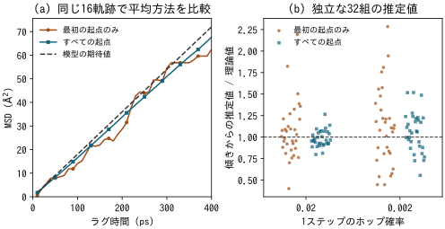

平均二乗変位と拡散係数
======================

同じ粒子を時間に沿って追うと、固体の中でイオンがどれだけ遠くまで動けるかを調べられる。
等方的な三次元系では、長時間での平均二乗変位の傾きを6で割ると拡散係数になる。
有限の軌跡から傾きを求めるには、短時間の振動が落ち着き、ホップを十分観測できた範囲を選ぶ。

前提は\ :ref:`分子動力学法<molecular-dynamics>`、\ :ref:`平衡化<equilibration>`、
:ref:`周期境界条件<pbc-allowed-wavevectors>`\ である。

学習目標
--------

* 軌跡から平均二乗変位を計算し、拡散係数を推定できる時間範囲を選ぶ。
* 独立なホップの模型から、平均二乗変位が時間に比例する理由と傾きの意味を説明する。
* 推定値のばらつきを読み、トレーサー拡散係数とイオン伝導度の対応を判断する。

.. _mean-squared-displacement:

平均二乗変位とラグ時間
----------------------

平衡化後の軌跡から、対象種の原子を\ :math:`N`\ 個選ぶ。時刻\ :math:`t_0`\ から
時間\ :math:`\tau`\ が経過する間の変位を、同じ原子\ :math:`i`\ の二つの位置の差で表す。
この時間間隔を\ **ラグ時間**\ と呼ぶ。変位を二乗してから原子と時間起点について平均した量が
**平均二乗変位**\ （mean squared displacement, MSD）である [RdfAllenTildesley2017]_
[DiffMcCluskey2025]_。

.. math::
   :label: diffusion-msd

   \begin{aligned}
   \Delta\boldsymbol r_i(t_0,\tau)&=\boldsymbol r_i(t_0+\tau)-\boldsymbol r_i(t_0),\\
   M(\tau)&=\frac{1}{N K(\tau)}
       \sum_{i=1}^{N}\sum_{t_0}\left|\Delta\boldsymbol r_i(t_0,\tau)\right|^2 .
   \end{aligned}

:math:`K(\tau)`\ は、始点と終点の両方を取れる時間起点の数である。等間隔に記録した
:math:`F`\ フレームでラグを\ :math:`m`\ フレームとすれば、毎フレームを起点にして
:math:`K=F-m`\ 個の区間が取れる。変位を先に平均すると、逆方向への変位が打ち消し合う。
変位の二乗を平均すれば、向きがそろっていなくても移動の広がりを測れる。

周期境界下では、セルを横切った回数と方向を保持した\ **折り返さない座標**\ で変位を求める。
例えば長さ10 Åのセルで、同じ粒子が正方向へ9 Åから11 Åに移動すると、セル内表示では
9 Åから1 Åに飛ぶ。真の変位は正方向に2 Åである。保存済みの座標から境界通過を復元するには、
隣り合うフレームの間隔を十分短くして、どの周期像へ移ったか一意に判別できるようにする。
固体全体が並進する場合は、ホスト構造に対する位置からイオンの変位を求める。

.. _einstein-relation:

Einstein関係と拡散領域
----------------------

短時間では、原子はほぼ初めの速度\ :math:`\boldsymbol v_i(t_0)`\ で進む。
この\ **弾道領域**\ では、変位は時間に比例し、MSDは時間の二乗に比例する。
固体では、サイト内の振動が続く間、MSDの増加が一時的に止まることもある。
十分長い時間で移動が積み重なり、MSDが時間に比例して増える範囲が\ **拡散領域**\ である。
等方的な三次元系で、流れのない平衡状態の自己拡散係数\ :math:`D`\ は、
MSDを使う\ **Einstein関係**\ で表せる [RdfAllenTildesley2017]_。

.. math::
   :label: diffusion-einstein

   D=\lim_{\tau\to\infty}\frac{M_{\mathrm{eq}}(\tau)}{6\tau},
   \qquad M(\tau)\simeq 6D\tau+b .

:math:`M_{\mathrm{eq}}(\tau)`\ は二乗変位の平衡平均である。有限の軌跡では
\ :eq:`diffusion-msd`\ の標本平均\ :math:`M(\tau)`\ に、拡散領域で切片\ :math:`b`\ を含む
直線を当てはめる。短時間の運動を含む軌跡では、拡散領域の
直線を原点に固定すると傾きがずれることがある。単位が Ų と ps なら、傾きの6分の1は
Ų/ps で得られ、1 Ų/ps は\ :math:`10^{-8}\,\mathrm{m^2\,s^{-1}}`\ に等しい。
一方向の拡散を見る場合は、その方向の変位だけを二乗して傾きを2で割る。
異方的な系では、方向ごとの傾きから拡散の異方性を読める。

.. _random-walk-diffusion:

ランダムウォークで傾きを導く
----------------------------

立方格子上で、粒子が長さ\ :math:`a`\ だけ隣の点へ移る一回の移動を\ **ホップ**\ とする。
各ホップの向きは6方向のいずれかで等確率とし、前のホップから独立に選ぶ。
:math:`n`\ 回の変位ベクトル\ :math:`\boldsymbol s_1,\ldots,\boldsymbol s_n`\ の和を二乗すると、
同じホップの二乗と異なるホップ同士の内積が現れる。

.. math::
   :label: diffusion-walk-msd

   \left\langle\left|\sum_{j=1}^{n}\boldsymbol s_j\right|^2\right\rangle
   =\sum_{j=1}^{n}\langle|\boldsymbol s_j|^2\rangle
    +2\sum_{j<k}\langle\boldsymbol s_j\cdot\boldsymbol s_k\rangle
   = n a^2 .

独立で各方向が等確率なので、:math:`j\ne k`\ の内積の平均はゼロになる。
粒子1個が全方向にホップする合計頻度を\ :math:`\Gamma`\ とすると、ラグ時間
:math:`\tau`\ 内の平均ホップ回数は\ :math:`\Gamma\tau`\ であり、MSDは
:math:`\Gamma a^2\tau`\ となる。

ホップが一定の総頻度\ :math:`\Gamma`\ で独立に起こる連続時間模型で、粒子の
確率密度\ :math:`P(\boldsymbol r,t)`\ を考える。一方向へのホップ頻度は
:math:`\Gamma/6`\ なので、ある点での密度の増減は、6個の隣接点から来る項と
その点から出る項の差である。格子間隔に比べて密度がなだらかに変化する範囲では、
各軸の正負の隣接点を足すと一次の空間微分が相殺される。二次まで展開すると、

.. math::
   :label: diffusion-walk-fick

   \begin{aligned}
   \partial_t P(\boldsymbol r,t)
   &=\frac{\Gamma}{6}\sum_{\alpha=x,y,z}
    \big[P(\boldsymbol r+a\boldsymbol e_\alpha,t)
          +P(\boldsymbol r-a\boldsymbol e_\alpha,t)-2P(\boldsymbol r,t)\big] \\
   &\simeq \frac{\Gamma a^2}{6}\nabla^2P(\boldsymbol r,t) .
   \end{aligned}

:math:`\boldsymbol e_\alpha`\ は軸方向の単位ベクトルである。拡散方程式の
:math:`\nabla^2P`\ の係数が\ :math:`D`\ なので、この模型の拡散係数は

.. math::
   :label: diffusion-random-walk-d

   D=\frac{\Gamma a^2}{6},\qquad M(\tau)=6D\tau .

となる。係数の6は、独立な三つの方向でそれぞれ\ :math:`\langle(\Delta x)^2\rangle=2D\tau`
となることに対応する。前のサイトへ戻るホップが続く場合は、ホップ同士の内積が残り、
同じホップ回数でも移動の広がりは変わる。

説明用の事例：立方格子のランダムウォーク
----------------------------------------

跳躍距離3 Åの模型で、時間を1 psずつ進め、各ステップで独立に確率\ :math:`p`\ で
ホップさせる。平均ホップ数は時間に比例するので、この離散時間模型でも
:math:`\Gamma=p/(1\,\mathrm{ps})`\ を\ :eq:`diffusion-random-walk-d`\ に入れると、
拡散係数は\ :math:`p=0.02`\ で0.030 Ų/ps、:math:`p=0.002`\ で0.0030 Ų/psと求まる。それぞれ、1000 psの独立な16軌跡を1組とする32組を計算した。MSDは10 ps刻みで
求め、50〜250 psの範囲に切片付きの直線を当てはめた。

:numref:`diffusion-random-walk-figure`\ の左では、同じ16軌跡でも時間起点を増やすと
推定したMSDが模型の直線に近づく。右では、ホップ確率を小さくすると、全起点で平均しても
理論値に対する傾きのばらつきが広がる。

.. _diffusion-random-walk-figure:

   (a) ホップ確率0.02の1組で、最初の起点だけを使ったMSD（丸印）、全起点を使ったMSD
   （四角印）、模型の期待値（破線）。(b) 各方法で推定した拡散係数を理論値で割った値。
   各印は独立な16軌跡の1組を表す。拡散係数は50〜250 psの傾きから求めた。
   横方向のずれは点を見分けるために付けた。

ホップ確率0.02では、全起点を使った推定値の32組平均は0.0295 Ų/psだった。
理論値で規格化した推定値の標本標準偏差は、起点が一つの場合の0.336から0.096に下がった。
ホップ確率を0.002にすると、1組の平均ホップ数が316回から33回に減り、全起点を使った
場合の標準偏差は0.233になった。時間起点を増やすと軌跡内の情報を多く利用できるが、
同じ軌跡上で区間が重なるため、独立なホップの数は増えない。

.. _tracer-diffusion-and-conductivity:

トレーサー拡散係数とイオン伝導度
--------------------------------

対象種のイオンを個々に追って得る自己拡散係数は、同じ種のイオンを標識して追う
**トレーサー拡散係数**\ :math:`D^*`\ に対応する。例えば、同位体交換後に二次イオン質量分析
（SIMS）で同位体の深さ分布を測ると、標識の広がりから\ :math:`D^*`\ を推定できる
[DiffKuwata2016]_。インピーダンス測定で得るイオン伝導度\ :math:`\sigma`\ は、イオンが運ぶ
電荷全体の移動を反映する。

電荷\ :math:`q`\ の一種類のイオンが伝導し、その数密度を\ :math:`n_{\mathrm{ion}}`\ とする。
別々のイオンの変位に相関がない場合には、**Nernst–Einstein式**\ で伝導度を推定できる。
:math:`T`\ は絶対温度、:math:`k_{\mathrm B}`\ はボルツマン定数である。

.. math::
   :label: diffusion-nernst-einstein

   \sigma_{\mathrm{NE}}=\frac{n_{\mathrm{ion}} q^2}{k_{\mathrm B}T}D^* .

電荷全体の移動を見るときは、各イオンの変位を足してから二乗する。この二乗を展開すると、
各イオンのMSDに加えて、異なるイオンの変位の内積が現れる。
内積の平均が残る場合、伝導度から換算した拡散係数\ :math:`D_\sigma`\ と
:math:`D^*`\ は異なる。ここでは両者の比を\ **Haven比**\ :math:`H_{\mathrm R}`\ とする
[DiffHoward2018]_。

.. math::
   :label: diffusion-haven-ratio

   D_\sigma=\frac{k_{\mathrm B}T\sigma}{n_{\mathrm{ion}}q^2},
   \qquad H_{\mathrm R}=\frac{D^*}{D_\sigma}=\frac{\sigma_{\mathrm{NE}}}{\sigma} .

変位相関の寄与が消えると\ :math:`H_{\mathrm R}=1`\ になり、同じ向きへの協調した運動が
電荷移動を増やすと\ :math:`H_{\mathrm R}<1`\ になる。数密度が温度によらない近似では、
:math:`D_\sigma`\ は\ :math:`\sigma T`\ に比例する。拡散の活性化エネルギーを伝導度の測定と
照合する際は\ :math:`\sigma T`\ の温度依存性を使う。Haven比が温度で変わると、
:math:`D^*`\ と\ :math:`\sigma T`\ から得る活性化エネルギーにも差が生じる。

.. _msd-interpretation-limits:

解釈と限界
----------

**直線を当てはめる範囲。**\ 短いラグでは弾道運動やサイト内振動が傾きに入り、長いラグでは
平均に使える時間起点が減る。拡散領域とみなせる範囲で当てはめ区間をずらし、安定した傾きが
得られるかを評価する。低温でホップがまれな場合は、少数のホップが傾きを左右する。
目安にできるのは観測時間と、その間に移動したイオンやホップの数である。

**傾きの不確かさ。**\ 隣り合うラグで使う軌跡は重なり、MSDの点どうしは相関する。
各点が独立と仮定した直線回帰の標準誤差は、この相関を取りこぼす [DiffMcCluskey2025]_。
独立に平衡化した複数の軌跡からそれぞれの傾きを求めると、その散らばりで有限の観測時間による
不確かさを評価できる。構造、ポテンシャル、セルサイズなどの選択による差は、同じ計算条件内の
ばらつきとは別に扱う。

**空孔の割合と組成。**\ イオンが占められる位置のうち、空いているものを空孔と呼ぶ。
空孔を介してイオンが動く場合、空孔の割合が変わるとイオン1個が空孔に隣り合う機会が変わる。
等価なサイト間を同じ移動障壁でホップする模型では、空孔が希薄な極限でイオン1個の
トレーサー拡散係数は空孔の割合\ :math:`c_{\mathrm v}`\ に比例する（:eq:`thermal-vacancy-diffusion`）。
`Li₃PO₄の31原子モデル <https://example.quloud-platform.quemix.com/li3po4/lithium-msd.html>`__
はLi空孔を1個入れて作ったモデルであり、
`1006原子モデル <https://example.quloud-platform.quemix.com/li3po4/large-model-diffusivity.html>`__
とは組成や構造の作り方も異なる。両者の拡散係数の差には、それぞれのモデルでの空孔の割合や
局所構造が影響しうるため、サイズの効果を取り出すには組成と作製条件をそろえる必要がある。

関連資料
--------

* :ref:`動径分布関数<radial-distribution-function>`\ は、同じ時刻の原子対の距離を集計して局所構造を調べる。
* `Liの平均二乗変位 <https://example.quloud-platform.quemix.com/li3po4/lithium-msd.html>`__
  と `大規模モデルのLi拡散係数 <https://example.quloud-platform.quemix.com/li3po4/large-model-diffusivity.html>`__
  は、Li₃PO₄のMD軌跡と実験の比較を扱う [RdfLiPhosphate]_。

参考文献
--------

.. [DiffMcCluskey2025] A. R. McCluskey, S. W. Coles, and B. J. Morgan,
   “Accurate Estimation of Diffusion Coefficients and their Uncertainties from Computer Simulation,”
   *J. Chem. Theory Comput.* **21**, 79–87 (2025).
   `doi:10.1021/acs.jctc.4c01249 <https://doi.org/10.1021/acs.jctc.4c01249>`__.
.. [DiffKuwata2016] N. Kuwata, X. Lu, T. Miyazaki, Y. Iwai, T. Tanabe, and J. Kawamura,
   “Lithium diffusion coefficient in amorphous lithium phosphate thin films measured by secondary ion mass
   spectroscopy with isotope exchange methods,” *Solid State Ionics* **294**, 59–66 (2016).
   `doi:10.1016/j.ssi.2016.06.015 <https://doi.org/10.1016/j.ssi.2016.06.015>`__.
.. [DiffHoward2018] J. D. Howard and N. A. W. Holzwarth,
   “Analysis of the statistical and convergence properties of ionic transport coefficients with application to
   the solid electrolyte Li₂OHCl,” *Solid State Ionics* **325**, 80–89 (2018).
   `doi:10.1016/j.ssi.2018.07.025 <https://doi.org/10.1016/j.ssi.2018.07.025>`__.
