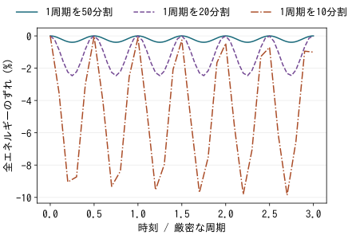

.. _molecular-dynamics:

分子動力学法と統計アンサンブル
==============================

分子動力学（molecular dynamics, MD）法は、原子に働く力から位置と速度の
時間変化を求める方法である。固定体積の気体の圧力を測る場合と、結晶が温度と
ともに形を変える様子を追う場合では、一定に保つ量が異なる。

古典力学の運動方程式と\ :ref:`運動エネルギーと温度<temperature>`\ を前提に、
力から軌跡を求める方法、NVE・NVT・NPTで固定する量、平衡化後の測定区間の
見分け方を学ぶ。

運動方程式と時間刻み
--------------------

原子 :math:`i` の質量を :math:`m_i`、位置と速度を :math:`\boldsymbol r_i` と
:math:`\boldsymbol v_i` とする。原子配置全体を :math:`\boldsymbol R`、
そのポテンシャルエネルギーを :math:`U(\boldsymbol R)` と書く。セルを
固定し、外部とのエネルギー交換がない場合、力はエネルギーの勾配から求まる。

.. math::
   :label: md-newton

   \boldsymbol F_i=-\nabla_i U(\boldsymbol R),\qquad
   m_i\dot{\boldsymbol v}_i=\boldsymbol F_i,\qquad
   \dot{\boldsymbol r}_i=\boldsymbol v_i.

初期の位置と速度を指定し、時間刻み :math:`\Delta t` ごとに\ :eq:`md-newton`\ を
近似的に解く。速度Verlet法では、現在の力で速度を半ステップ進め、その速度で
位置を更新する。新しい配置で力を評価した後、速度の残り半分を進める [MdSwope1982]_。

.. math::
   :label: md-velocity-verlet

   \begin{aligned}
   \boldsymbol v_i(t+\Delta t/2)
     &=\boldsymbol v_i(t)+\frac{\Delta t}{2m_i}\boldsymbol F_i(t),\\
   \boldsymbol r_i(t+\Delta t)
     &=\boldsymbol r_i(t)+\Delta t\,\boldsymbol v_i(t+\Delta t/2),\\
   \boldsymbol v_i(t+\Delta t)
     &=\boldsymbol v_i(t+\Delta t/2)
       +\frac{\Delta t}{2m_i}\boldsymbol F_i(t+\Delta t).
   \end{aligned}

最初の2行から、位置の更新に初速度による移動と加速度による
:math:`\tfrac12(\boldsymbol F_i/m_i)\Delta t^2` の補正が含まれることが分かる。
この更新を繰り返して得る時系列を軌跡という。時間刻みが大きすぎると速い振動を
追えず、振動数や保存量に誤差が現れる。軽い原子を含む硬い結合は速く振動するため、
その運動を陽に扱う場合は細かい時間刻みを要する。

.. _statistical-ensembles:

NVE・NVT・NPTで固定する量
------------------------------

統計アンサンブルとは、同じ巨視的条件にある系が取りうる微視的状態と、その
出現確率をまとめたものである。以下では :math:`N` を粒子数、:math:`V` を体積、
:math:`E` を系の全エネルギー、:math:`T` を熱浴の温度、:math:`P` を外圧とする。

.. list-table::
   :header-rows: 1
   :widths: 25 23 28 24

   * - アンサンブル
     - 固定する量
     - 主に揺らぐ量
     - 用途
   * - NVE（ミクロカノニカル）
     - 粒子数、体積、全エネルギー
     - 運動エネルギー、瞬間の温度
     - 孤立系の運動
   * - NVT（カノニカル）
     - 粒子数、体積、熱浴の温度
     - 系のエネルギー、瞬間の温度、内部圧力
     - 指定体積での平均圧力
   * - NPT（等温等圧）
     - 粒子数、熱浴の温度、外圧
     - 体積、系のエネルギー、瞬間の温度、内部圧力
     - 外圧のもとでの平均体積や構造

NVEでは、運動エネルギー :math:`K` とポテンシャルエネルギー :math:`U` が
互いに変換されても、その和は連続時間の運動方程式で保存される。
:eq:`md-newton`\ を使うと、一方が増える速さと他方が減る速さが等しいと分かる。

.. math::
   :label: md-energy-conservation

   E=K+U,\qquad K=\sum_i \frac{m_i|\boldsymbol v_i|^2}{2},\qquad
   \frac{dE}{dt}=\sum_i\boldsymbol v_i\cdot(\boldsymbol F_i+\nabla_i U)=0.

数値積分した軌跡では :math:`E` の小さな変動がありうる。時間とともに一方向へ
ずれていく場合は、時間刻みや力の精度を見直す手がかりになる。

NVTでは、平衡での微視的状態の確率密度は相空間の標準的な体積要素に対して
:math:`\exp[-E/(k_{\mathrm B}T)]` に比例する。:math:`k_{\mathrm B}` は
ボルツマン定数である。NPTでは体積も状態に含まれ、外圧との仕事に対応する
:math:`PV` が加わる。体積と、その体積での物理的な位置・運動量に対する
確率密度は :math:`\exp[-(E+PV)/(k_{\mathrm B}T)]` に比例する。
温度と外圧は、この平衡分布を定める条件である [MdAndersen1980]_。

.. _thermostat-barostat:

熱浴と圧力浴
------------

サーモスタットは熱浴とのエネルギー交換を、バロスタットは外圧のもとでの
セルの変化を表すアルゴリズムである。古典的な系で運動の独立な自由度を
:math:`f` とすると、瞬間の温度の推定量 :math:`T_{\mathrm{kin}}` は

.. math::
   :label: md-kinetic-temperature

   \langle K\rangle=\frac{f}{2}k_{\mathrm B}T,\qquad
   T_{\mathrm{kin}}(t)=\frac{2K(t)}{f k_{\mathrm B}}

である。重心運動を除いたり結合長を拘束したりする場合、:math:`f` から
対応する自由度を引く。熱平衡でも :math:`T_{\mathrm{kin}}` は揺らぐ。
毎ステップの単純な速度スケーリングは :math:`K` を設定値に固定する。
Berendsen法は :math:`K` を設定値へ徐々に近づけるので平衡化に使われるが、
運動エネルギーの揺らぎを抑え、正準分布の分散を再現しない
[MdBerendsen1984]_ [MdBussi2007]_。

正準分布のサンプリングには、揺らぎを保つ温度制御を使う。
Bussiらの確率的速度スケーリングは、平均を戻す効果に加え、正準分布に
必要な揺らぎを与える [MdBussi2007]_。Langevin法は摩擦と、それに見合う
ランダムな力を組み合わせ、連続時間で正準分布を保つ [MdLeimkuhler2013]_。
Nosé–Hoover法は補助変数を使う決定論的な方法で、
正準分布を不変にする。軌跡がその分布を十分に訪れるかは系にも依存し、単純な
調和振動子ではNosé–Hoover法で訪れない領域が残ることがある [MdHoover1985]_。

等方的な圧力制御ではセルの拡大・縮小で体積が変わる。結晶の軸比や角度が変わる
相転移を調べる場合は、その変形を許すセル自由度が要る。外圧が一定でも、
内部圧力とセルの大きさは揺らぐ [MdParrinello1981]_。

.. _equilibration:

平衡化と測定区間
----------------

初期条件の影響を減らすため、計算の始めに平衡化の区間を設ける。温度が先に
安定しても、密度や結晶の変形の緩和にはさらに時間がかかる場合がある。
測定の開始時刻を決める際は、目的の量について平均や揺らぎが時間とともに
系統的に変わっていないかを見る。

平衡化後も時刻が近い観測値は互いに似通う。多数のフレームを保存しても、
独立な観測の数は同じ割合で増えない。軌跡をブロックに分け、ブロックの
長さを延ばしながら平均のばらつきを評価すると、時刻間の相関を無視して
不確かさを小さく見積もることを避けられる [MdFlyvbjerg1989]_。

計算事例での使い分け
--------------------

* `気体のモル体積 <https://example.quloud-platform.quemix.com/gas_laws/argon_molar_volume.html>`__
  では、温度と体積を指定して平均圧力を求める。熱浴を使うNVTでは、圧力が応答となる。
* `CO₂の赤外スペクトル <https://example.quloud-platform.quemix.com/co2_ir/ir_spectrum.html>`__
  では、熱浴を外したNVEの軌跡から分子振動を読み取る。熱浴による運動の変化を
  避け、初速度で与えたエネルギーが振動としてどう現れるかを調べる。
* `BaTiO₃の構造相転移 <https://example.quloud-platform.quemix.com/BaTiO3/phase_transition.html>`__
  では、圧力を制御しながら熱浴の目標温度を上げ、セルと原子配置の変化を追う。
  NPTの制御を使っているが、温度は時間とともに変わる。各温度での平衡を
  評価するには、保持時間と構造の緩和を考慮する。

.. _md-oscillator-example:

説明用の事例：時間刻みと振動子
------------------------------

時間刻みを選ぶ目安は、追いたい最速の振動を1周期あたり何回更新できるかである。
1次元調和振動子 :math:`m\ddot x=-m\omega^2x` を、初期変位 :math:`x_0`、
初速度ゼロから\ :eq:`md-velocity-verlet`\ で進める。厳密な周期を
:math:`\tau_{\rm osc}=2\pi/\omega` とする。

:math:`h=\omega\Delta t`、:math:`X=x/x_0`、:math:`W=v/(\omega x_0)`
とおく。半ステップの速度を位置の式へ代入し、更新後の位置を使って速度を求めると、
次の時刻の :math:`(X',W')` は

.. math::
   :label: md-oscillator-update

   X'=(1-h^2/2)X+hW,\qquad
   W'=(1-h^2/2)W-h(1-h^2/4)X

である。この更新で :math:`W^2+(1-h^2/4)X^2` は保存される。
:math:`0<h<2` では軌道が有界で、1ステップあたりの位相の進みは
:math:`\arccos(1-h^2/2)` になる。全エネルギーを初期値
:math:`E_0=m\omega^2x_0^2/2` で割ると :math:`X^2+W^2` なので、
この初期条件では :math:`(E-E_0)/E_0=(h^2/4)(X^2-1)` である。
全エネルギーの変動幅は時間刻みの二乗に比例する。

.. list-table:: 厳密な周期を分割して10周期ぶん積分した結果
   :header-rows: 1
   :widths: 33 33 34

   * - 1周期の刻み数
     - 全エネルギーの最大相対偏差
     - 数値的な周期／厳密な周期
   * - 50
     - 0.395%
     - 0.9993
   * - 20
     - 2.467%
     - 0.9959
   * - 10
     - 9.868%
     - 0.9831

この振動子では1周期を20分割しても、エネルギーは最大約2.5%ずれる。
:numref:`fig-md-verlet-step`\ では、刻みが粗いと変動幅が広がる。
数値的な周期も短くなるため、変動幅に加えて、観測したい振動数の変化も
刻み選びの手がかりになる。

   はじめの3周期での全エネルギーのずれ。横軸は厳密な周期で割った時刻。
   実線、破線、一点鎖線は1周期あたり50、20、10ステップを表す。

.. _md-temperature-example:

説明用の事例：粒子数による温度の揺らぎ
--------------------------------------

正準分布では、温度制御が適切でも、小さい系ほど瞬間の温度が大きく揺らぐ。
独立な二次形式の運動自由度が :math:`f` 個あるとき、各項の平均は
:math:`k_{\rm B}T/2`、分散は :math:`(k_{\rm B}T)^2/2` である。
分散を足し、:eq:`md-kinetic-temperature`\ で温度に換算してから平均で割る。

.. math::
   :label: md-temperature-relative-fluctuation

   \frac{\operatorname{SD}(T_{\rm kin})}{T}
   =\frac{\sqrt{f(k_{\rm B}T)^2/2}}{f k_{\rm B}T/2}
   =\sqrt{\frac{2}{f}}.

3次元で重心運動だけを除くなら :math:`f=3N-3` となる。:math:`N=32,256,2048`
に対する相対標準偏差は、順に14.66%、5.11%、1.80%である。
全自由度を数える場合の導出は\ :ref:`温度の計算<temperature>`\ にある。
軌跡の平均温度の標準誤差には、瞬間値の揺らぎに加えて時刻間の相関も効く。

.. _md-interpretation-limits:

解釈と限界
----------

* **刻みの収束。** 調和振動子の変動幅は一つの振動と積分法から得た目安である。
  実際の系は速い衝突や拘束、電子状態の数値誤差も含む。刻みを半分にして、
  エネルギーの一方向のずれと、目的の振動数や圧力の両方が変わるかを見る。
* **平衡分布と時間相関。** 正準分布を再現するサーモスタットでも、摩擦や
  温度調整は軌跡の時間相関を変えうる。振動スペクトルと平衡平均では、
  同じ温度制御が適切かを別々に判断する。
* **観測時間。** 温度の揺らぎが理論値に近い場合でも、相の切り替わりなど
  遅い過程を観測できたかは別に評価する。初期構造を変えた軌跡を比べると、
  一つの構造にとどまったために平均が安定して見える場合を見分けられる。

関連資料
--------

* :ref:`temperature`
* :ref:`周期境界条件<pbc-allowed-wavevectors>`

参考文献
--------

.. [MdSwope1982] W. C. Swope et al., *J. Chem. Phys.* **76**, 637–649 (1982).
   `doi:10.1063/1.442716 <https://doi.org/10.1063/1.442716>`_.
.. [MdAndersen1980] H. C. Andersen, *J. Chem. Phys.* **72**, 2384–2393 (1980).
   `doi:10.1063/1.439486 <https://doi.org/10.1063/1.439486>`_.
.. [MdBussi2007] G. Bussi, D. Donadio, and M. Parrinello, *J. Chem. Phys.*
   **126**, 014101 (2007). `doi:10.1063/1.2408420 <https://doi.org/10.1063/1.2408420>`_.
.. [MdBerendsen1984] H. J. C. Berendsen, J. P. M. Postma, W. F. van Gunsteren,
   A. DiNola, and J. R. Haak, *J. Chem. Phys.* **81**, 3684–3690 (1984).
   `doi:10.1063/1.448118 <https://doi.org/10.1063/1.448118>`_.
.. [MdLeimkuhler2013] B. Leimkuhler and C. Matthews, *Appl. Math. Res. Express*
   **2013**, 34–56 (2013).
   `doi:10.1093/amrx/abs010 <https://doi.org/10.1093/amrx/abs010>`_.
.. [MdHoover1985] W. G. Hoover, *Phys. Rev. A* **31**, 1695–1697 (1985).
   `doi:10.1103/PhysRevA.31.1695 <https://doi.org/10.1103/PhysRevA.31.1695>`_.
.. [MdParrinello1981] M. Parrinello and A. Rahman, *J. Appl. Phys.* **52**,
   7182–7190 (1981). `doi:10.1063/1.328693 <https://doi.org/10.1063/1.328693>`_.
.. [MdFlyvbjerg1989] H. Flyvbjerg and H. G. Petersen, *J. Chem. Phys.* **91**,
   461–466 (1989). `doi:10.1063/1.457480 <https://doi.org/10.1063/1.457480>`_.
