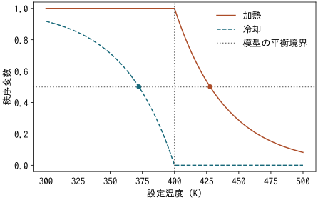

.. _heating-simulation:

昇温計算で相転移を調べる
========================

昇温する分子動力学計算では、結晶の形や原子配置が変化する様子を時間に沿って
追うことができる。軌跡から読み取る転移温度は、熱力学的に二相がつり合う温度と
ずれることがある。どの量で相を見分け、温度のずれがどこから生じるかを考える。

前提は\ :ref:`統計アンサンブル<statistical-ensembles>`\ と
:ref:`平衡化<equilibration>`\ である。この記事では、構造から相を判定し、
昇温速度、保持時間、セルサイズが転移の見え方にどう影響するかを学ぶ。
溶融・急冷で非晶質モデルを作るときの冷却速度や保持時間の決め方も扱う。

.. _heating-phase-indicators:

分極・局所変位・格子定数で相を見分ける
--------------------------------------

**秩序変数** は、相によって値や対称性が変わる量である。強誘電相転移では
:ref:`自発分極<spontaneous-polarization>`\ がその例である。
分極の向きや大きさが変わるとき、単位構造内の原子の相対変位やセルの形にも
変化が現れる。分極を直接求めていない計算では、局所変位と格子定数を構造の
指標として使える [HeatQi2016]_。

たとえば、六つの配位原子が作る八面体の中心から、金属原子がどれだけずれるかを測る。
八面体 :math:`i` の中心金属の位置を :math:`\boldsymbol r_i`、
六つの配位原子の位置を :math:`\boldsymbol r_{ij}` とすると、局所変位は

.. math::
   :label: heating-local-displacement

   \boldsymbol u_i=\boldsymbol r_i-\frac{1}{6}\sum_{j=1}^{6}
      \boldsymbol r_{ij}

である。周期境界下では、各配位原子の周期像のうち中心金属原子に最も近い像を
選ぶ（最小像規約）。セル境界をまたいだ八面体でも、この選び方なら近接原子と
中心金属との距離を保ったまま八面体の中心を求められる。
全体の平均に加え、等価な基準軸に投影した成分ごとの分布を見ると、
平均が小さくても局所変位が残る場合を見分けられる。分極の異なる\ :ref:`分域<ferroelectric-domains>`\ が混在する
場合も平均は小さくなりうる。局所変位の分布と空間的な相関を併せると、
:ref:`変位型や秩序–無秩序型<displacive-order-disorder>`\ の描像を検討できる。

軸長が揃っていたセルで一部の軸長が変わることを格子定数の分裂という。
揺らいでいる軸長の瞬間値より、複数フレームの平均と揺らぎを比べる方が
持続的な変形を捉えやすい。変位の向きも軸も相に応じて入れ替わるので、
軸の取り方を明示する。変位がほぼゼロのフレームでは方向角が不安定に
なるため、大きさや成分の分布も併せて調べる。

.. _apparent-transition-temperature:

軌跡から読む見かけの転移温度
----------------------------

温度を連続的に上げると、同じ温度にとどまる時間は限られる。局所変位の
向きが切り替わり、格子の分裂も変化する温度域を見つけ、軌跡上の
**見かけの転移温度** を割り当てる。たとえば方向角が温度とともに変わる速さを
求めると、向きが急変する区間にピークが現れる。微分は揺らぎまで強調するので、
平均に使う温度幅を変えてもピークが残るか、別の指標も同じ温度域で変化するかを
見る。各指標が異なる温度で変わるなら、判定の規則と変化が起きた温度幅を示す。

一定の外圧における平衡の転移温度は、共存する二相の同じ物質量あたりの
ギブス自由エネルギーが等しくなる温度である。昇温中に相が切り替わる時刻には、
自由エネルギーで有利な相への変化に要する時間も効く。とくに一次転移では、
新しい相が核を作るまで初期の相が準安定な状態で残ることがある。
加熱時と冷却時で切り替わる温度が異なる現象を **ヒステリシス** という
[HeatShao2025]_。この場合、加熱と冷却の転移温度の平均も、平衡値を直接与える
わけではない。

.. _heating-rate-and-size:

昇温速度・保持時間・セルサイズの影響
------------------------------------

目標温度 :math:`T_{\mathrm{set}}` を一定速度で上げるとする。昇温速度を
:math:`\dot T_{\mathrm{set}}`、ある温度域の幅を :math:`\Delta T` とすると、
その範囲を通過する時間は

.. math::
   :label: heating-dwell-time

   \Delta t=\frac{\Delta T}{\dot T_{\mathrm{set}}}

である。通過時間が構造の緩和時間に比べて短ければ、温度制御が設定値を追っていても
構造の変化は遅れる。温度を段階的に変える計算では、温度刻みと各段階の保持時間を
変えると、その刻みで相の変化を分解できるか、保持中に構造が緩和できるかを調べられる。

セルサイズは、形成できる分域や新しい相の核の大きさ、許される揺らぎの波長を
制限する。セルを拡大したときの転移温度の変化の向きは、相や計算条件に依存する。
複数のセルサイズを用いるときは、セルの変形条件と昇温速度をそろえるとサイズの
影響を比較しやすい。初速度を変えた複数の軌跡で得るばらつきも、サイズ変化による
ずれと区別する。加熱・冷却や一定温度での保持を併用すれば、初期相の影響や
準安定状態の持続を調べられる [HeatQi2016]_ [HeatShao2025]_。

構造相転移と融解の検出
----------------------

`BaTiO₃の構造相転移 <https://example.quloud-platform.quemix.com/BaTiO3/phase_transition.html>`__
では、Tiの局所変位の方向と格子定数の両方から結晶相を割り当てている。
使ったモデル間で転移温度に差があり、その差にはモデルに加えて、
セルサイズや昇温プロトコルの影響もありうる。比較には、学習に使った
参照計算の条件や昇温の設定をそろえる必要がある。

融解では、結晶に特徴的な原子の周期配列が失われる。
近接原子の並び方を表す\ :ref:`結合配向秩序パラメータ<bond-orientational-order>`
の急な低下が、融解の目印になる。\ :ref:`拡散<mean-squared-displacement>`\ や長距離の構造秩序も調べると、
高温で揺らいでいる結晶と、流動する液体を見分ける根拠が増える [HeatChen2025]_。
急速な加熱や周期境界のもとでは結晶が過熱する場合があるため、
秩序が失われた温度を読むときも昇温速度と保持時間が重要になる。

.. |melt-quench-heading| replace:: 溶融・急冷で非晶質モデルを作る

.. _melt-quench:

|melt-quench-heading|
---------------------

溶融・急冷では、結晶を溶かしてから短時間で冷却し、原子が規則的な配列を作る前に動きを遅くする。
分子動力学では、高温で液体になるまで保持した後に冷却し、低温で保持する。
高温保持中に、\ :ref:`平均二乗変位（MSD）<mean-squared-displacement>`\ が長時間で時間に
比例して増え、\ :ref:`動径分布関数（RDF）<radial-distribution-function>`\ から結晶に
特徴的な長距離のピークが消えれば、融解の目安になる。
冷却後の低温保持では、目標温度のもとで冷却直後の構造がどう緩和するかを追う。

冷却後の配置を静的な計算の出発点にする場合は、座標に残る力が後続の計算に影響する。
セルの大きさと形を保つ場合は、急冷と低温保持の後に\ :ref:`原子座標を緩和<structure-optimization>`\ して力を下げる。

冷却が速いほど、同じ温度範囲を通過するのにかかる時間は短い（\ :eq:`heating-dwell-time`\ で
速度の絶対値を使う）。通過時間が構造の緩和時間より短い場合、原子の配列は温度の変化に追いつかない。
通常の実験に比べてMDが扱える時間は桁違いに短く、同じ温度差を冷却するときの冷却速度も高い。
急冷後の局所構造や密度には冷却履歴の影響が残る。例えばシリカでは、冷却速度を変えると
配位数や環の大きさの分布などが変わる [HeatVollmayr1996]_。

小さい周期セルでは、セル内の配置が短い周期で繰り返される。高温での再配列が足りないと、
その配置に初期の結晶秩序が残ることもある。
`Li₃PO₄の溶融・急冷後の構造 <https://example.quloud-platform.quemix.com/li3po4/melt-quench-structure.html>`__\
では、γ相の32原子セルをOpenMXの\ :ref:`第一原理分子動力学<md-force-evaluation>`\ で急冷し、
セルを固定して原子座標を緩和した。より長く高温保持したLiらの32原子モデルも、緩和後の構造に
部分的な結晶配列を含んでいた [RdfLiPhosphate]_。

こうした小セルは不規則な局所配置を調べる模型として使える。実験の非晶質を代表するかは、
急冷後に残る結晶秩序とセルサイズへの依存性で判断する。

同じ作製条件でも、異なる初速度から独立に高温保持と急冷を行うと、異なる構造を得ることがある。
同じ条件で作った構造間のばらつきが分かれば、冷却速度やセルサイズを変えたときの差が、
一つの軌跡に特有の違いかどうかを判断できる。急冷後の\ :ref:`動径分布関数<radial-distribution-function>`\ には、
どの距離に原子対が集まりやすいかが現れる。結晶に特徴的な近接原子の向きが残ったかは、
\ :ref:`結合配向秩序パラメータ<bond-orientational-order>`\ を使って調べられる。

.. _heating-window-example:

説明用の事例：温度域を通過する時間と相の遅れ
--------------------------------------------

`BaTiO₃の昇温計算 <https://example.quloud-platform.quemix.com/BaTiO3/phase_transition.html>`__
では、QuloudのGPUでCHGNetを使い、外圧を制御したNPTで10 K/psの速さで昇温した。
:eq:`heating-dwell-time`\ にこの速度を入れると、10 Kの範囲は1 ps、20 Kは2 ps、
50 Kは5 psで通過する。仮に構造が反応するのに4 ps程度かかる場合、20 K幅では
その半分しか時間がない。ここでの4 psは比較のための仮定である。

セルを変えると、同じ昇温速度でも観測される転移温度が動いた。以下は同事例の
CHGNetで、BaTiO₃の基本の5原子セルを各軸に5回または8回並べたときの読み取り値である。

.. list-table:: CHGNetの昇温軌跡から読んだ転移温度
   :name: heating-chgnet-transition-table
   :header-rows: 1
   :widths: 34 33 33

   * - セル
     - 直方晶（斜方晶）から正方晶へ
     - 正方晶から立方晶へ
   * - 5 × 5 × 5
     - 321 K
     - 646 K
   * - 8 × 8 × 8
     - 390 K
     - 827 K
   * - 増加幅
     - 69 K
     - 181 K

この計算ではどちらの見かけの転移温度も上がった。有限セルでは、新しい相の
核が生まれる体積と、成長できるサイズがともに変わる。大きいセルで核を作る
場所が増えると転移は早まりうる。逆に、小セルで単位胞がそろって変形する経路が
選ばれていた場合、セルを広げると変形の進み方も変わる。表の増加幅だけで、
どの要因が支配したかを特定することは難しい。

.. _heating-lag-example:

説明用の事例：加熱と冷却で現れる温度差
--------------------------------------

構造が温度の変化に追いつかない場合、加熱と冷却で同じ判定基準を使っても
転移温度に差が出る。単純な模型として、規格化した秩序変数 :math:`Q` の
平衡値 :math:`Q_{\rm eq}` が、温度 :math:`T_0=400\,\mathrm{K}` の上下で
低温側の1と高温側の0に切り替わるとする。緩和の時間尺度を
:math:`\tau=4\,\mathrm{ps}` とおき、変化の速さが平衡値からのずれに比例する
と仮定する。

.. math::
   :label: heating-order-lag

   \frac{dQ}{dt}=\frac{Q_{\rm eq}-Q}{\tau},
   \qquad
   Q(t)-Q_{\rm eq}=[Q(0)-Q_{\rm eq}]\exp(-t/\tau).

右の式は、設定温度が :math:`T_0` を通過した時刻を :math:`t=0` とし、
通過後の :math:`Q_{\rm eq}` を一定に保った場合の解である。加熱では
:math:`Q` が1から下がり、冷却では0から上がる。両方の軌跡で
:math:`Q=1/2` を転移と判定すると、遅れは
:math:`\tau\ln 2=2.773\,\mathrm{ps}` となる。

加熱・冷却の速さをともに10 K/psとすると、温度のずれは片側で約27.7 Kである。
:numref:`fig-heat-order-lag`\ の丸印では、加熱で427.7 K、冷却で372.3 Kになる。
この模型のヒステリシス幅は丸め前の値から求めると55.5 Kである。

   緩和の遅れを表す模型の秩序変数。実線は加熱、破線は冷却。
   点線は模型の平衡境界400 Kと判定値0.5、丸印は見かけの転移温度を表す。

.. _heating-interpretation-limits:

解釈と限界
----------

* **軌跡上の判定と平衡。** 秩序変数の急変は、その軌跡が別の構造へ移った時刻を
  示す。平衡境界を知るには、各温度で十分に緩和させた分布や二相の自由エネルギー
  を求める必要がある。加熱と冷却の遅れが対称になるのは、この模型の仮定による。
  核形成や成長が異なる速度で起きる系では、両方向で遅れの大きさも変わる。
* **変位分布の温度幅。** 軌跡を温度帯で区切って分布を作るときは、転移を
  またぐと二つの相のフレームが一つの分布に混ざる。温度帯を細かくすると両相を
  分けやすくなるが、帯ごとのフレームも少なくなる。
  ピークの位置や向きが平均幅に敏感なら、平滑化の違いを相の差と誤認しないよう、
  独立な軌跡や一定温度での保持から分布を補う。
* **セルサイズとばらつき。** 一つのサイズにつき一つの軌跡だけを比べると、
  構造が切り替わる時刻の偶然のばらつきもサイズ差に含まれる。初速度を変えた
  複数の軌跡で判定温度の分布を求めれば、そのばらつきとサイズの効果を区別できる。
* **相の判定と融解。** 多くの分域がある場合、全体の分極が打ち消し合うことがある。
  結晶相を判定するときは変位分布と格子を照合する。融解では結合配向だけでなく
  :ref:`拡散<mean-squared-displacement>`\ も見ると、秩序が弱くなった固体と流動する液体を区別する根拠が増える。

.. _heating-related:

関連資料
--------

* :ref:`molecular-dynamics`
* :ref:`radial-distribution-function`

.. _heating-references:

参考文献
--------

.. [HeatQi2016] Y. Qi, S. Liu, I. Grinberg, and A. M. Rappe,
   *Phys. Rev. B* **94**, 134308 (2016).
   `doi:10.1103/PhysRevB.94.134308 <https://doi.org/10.1103/PhysRevB.94.134308>`_.
.. [HeatShao2025] C. Shao and H. Huang, *Chinese Phys. B* **34**, 027701 (2025).
   `doi:10.1088/1674-1056/ad9e94 <https://doi.org/10.1088/1674-1056/ad9e94>`_.
.. [HeatChen2025] P.-Y. Chen, K. Shibata, and T. Mizoguchi, *APL Mach. Learn.*
   **3**, 036115 (2025).
   `doi:10.1063/5.0268149 <https://doi.org/10.1063/5.0268149>`_.
.. [HeatVollmayr1996] K. Vollmayr, W. Kob, and K. Binder,
   “Cooling-rate effects in amorphous silica: A computer-simulation study,”
   *Phys. Rev. B* **54**, 15808–15827 (1996).
   `doi:10.1103/PhysRevB.54.15808 <https://doi.org/10.1103/PhysRevB.54.15808>`_.

.. raw:: html

   
