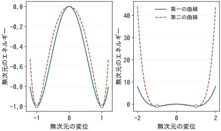

.. _mlip:

機械学習原子間ポテンシャル
==========================

機械学習原子間ポテンシャル（machine-learning interatomic potential, MLIP）は、
原子配置とセルからポテンシャルエネルギーを予測する。参照データに
第一原理計算を使う場合、新しい構造ごとに電子状態を解き直す計算を
学習済みモデルの評価に置き換えられる。多くの構造を緩和したり、
長い :ref:`分子動力学<molecular-dynamics>` の軌跡を生成したりできる。
結果の精度は、どの配置をどの参照手法で学習したかに依存する。

この記事では、エネルギー・力・応力の関係を確認し、学習データから
適用できる範囲を読み取り、目的に合う検証を選ぶ。

原子配置からエネルギー・力・応力を求める
----------------------------------------

原子位置の組を :math:`\boldsymbol R`、セルの基底を列に持つ行列を
:math:`A`、モデルのパラメータを :math:`\theta` とする。エネルギー
:math:`U_\theta(\boldsymbol R,A)` を予測するモデルでは、その微分から
原子 :math:`i` の力 :math:`\boldsymbol F_i` とセルの応力が求まる。
体積 :math:`V` のセルを微小ひずみ :math:`\boldsymbol\varepsilon` で変形し、
原子の分率座標を保つと、引張を正とした応力 :math:`\sigma_{ab}` は

.. math::
   :label: mlip-energy-derivatives

   \boldsymbol F_i=-\left.\frac{\partial U_\theta}
      {\partial\boldsymbol r_i}\right|_A,\qquad
   \sigma_{ab}=\left.\frac{1}{V}
      \frac{\partial U_\theta}{\partial\varepsilon_{ab}}\right|_{\boldsymbol\varepsilon=0}

となる。:math:`a,b` は直交座標の成分を表す。原子を動かしたときの
エネルギーの傾きが力に、セルをひずませたときの傾きが応力に対応する。
有限温度のMDで使う全応力には、この配置に由来する項に加え、
運動量の寄与が入る。

多くのモデルは、全エネルギーを原子ごとの寄与の和として表す。各寄与は
近傍の原子種と原子間の相対配置で決まる。回転・並進や、同種原子の番号の
付け替えによって、全エネルギーが変わらないようにモデルを作る。
近傍に範囲を限る表現では、相互作用がその範囲を超えて効く場合に、
電荷や長距離相互作用の別の表現が必要になることがある
[MlipBehler2007]_ [MlipDrautz2019]_。

.. _mlip-training-data:

学習データが決める適用範囲
--------------------------

参照計算から得た構造、エネルギー、力、必要に応じて応力を組にして学習する。
エネルギーには配置ごとの安定性、力には個々の原子の変位に対する傾き、
応力には変形に対する傾きの情報がある。参照に密度汎関数理論（DFT）を使うと、
その交換相関汎関数や計算条件で得たエネルギー面を近似することになる。
力や応力が参照DFTに近くても、実験との差には参照DFTの近似も含まれる。

汎用モデルは多くの元素の組み合わせや構造を参照データに含む。
系に特化したモデルは、目的の材料の相・ひずみ・欠陥などを優先して学習する。
たとえば原子クラスター展開（atomic cluster expansion, ACE）は、
原子の周りの多体配置を基底関数で展開する枠組みである [MlipDrautz2019]_。
多体の情報を使って原子間で特徴を伝えるMACEを、広いデータで学習した後、
対象材料の参照計算で追加学習する方法もある。この追加学習を **微調整** と
呼ぶ [MlipBatatia2022]_ [HeatChen2025]_。

含まれる元素が同じでも、高温の液体、結晶、表面、圧縮したセルは、原子の
近接環境が異なる。学習した環境の範囲から外れた配置への予測を外挿という。
構造探索や昇温計算では、出発構造の近くで精度を確認したモデルでも、
途中で未学習に近い環境を通ることがある。利用する温度・圧力・組成と、
現れうる構造を考えて、参照データと検証構造を選ぶ。

MLIPが出すエネルギーの基準は、参照計算の出力や学習時の元素別オフセットに
依存する。異なるモデルの全エネルギーの表示値を直接引くと、その基準の差も入る。
比較には :ref:`化学式単位あたりの相対エネルギー<energy-reference>` を使う。

.. _mlip-validation:

調べたい性質ごとに検証する
--------------------------

参照データの一部を学習に使わず、モデルが見ていない構造でエネルギー・力・
応力の誤差を求める。同じ軌跡の近い時刻のフレームは似ているため、ランダムに
振り分けるだけでは、未知の相やひずみに対する性能を見積もりにくい。
別の軌跡や相から検証データを取ると、用途に近い予測を評価できる。

力の誤差を全原子で平均した値だけでは、似た相どうしの小さなエネルギー差や、
変位の方向によるエネルギー曲線の違いを捉えたかどうかは分からない。
相転移を目的とする場合は、用途に対応する量で検証する。

.. list-table::
   :header-rows: 1
   :widths: 34 66

   * - 検証する量
     - 分かること
   * - 0 Kの相対エネルギー
     - 各相の静的な安定性の順序とその差を捉えたか。
   * - 小変位・大変位でのエネルギー曲線
     - 平衡付近の曲率と、大きな変形に対するエネルギー上昇を捉えたか。
   * - 昇温時に現れる相と見かけの転移温度
     - 指定したセル・時間・温度条件で構造変化を再現したか。

.. _mlip-batio3-example:

説明用の事例：BaTiO₃で三つの検証量を比べる
------------------------------------------

BaTiO₃では、あるMLIPが静的な相の順位を再現しても、昇温軌跡に同じ相が
現れるとは限らない。CHGNetの公開事例を使い、静的な順位、一つの変位に
沿ったエネルギー、昇温時の構造変化を順に比べる。

**静的なエネルギー順位。** `BaTiO₃の安定基底状態 <https://example.quloud-platform.quemix.com/BaTiO3/stability.html>`__
では、各相で最適化した格子を固定し、原子を緩和して0 Kのエネルギーを比べた。
CHGNet 0.3.0を使ったLAMMPS計算では、菱面体晶を基準に
直方晶（斜方晶）が0.763、正方晶が5.043、立方晶が64.320 meV/化学式単位だけ
高かった。モデルはこの条件の4構造の中で菱面体晶を最も低く評価した。

**変位に沿ったエネルギー。** `二重井戸ポテンシャル Part 1 <https://example.quloud-platform.quemix.com/BaTiO3/total-energy-DFT-MLIP.html>`__
では、各手法で求めた基準格子定数 :math:`a_0` の立方晶セルを使い、
Tiだけを :math:`[001]` 方向に動かした。事例の入力例に示された
:math:`a_0` は、OpenMXで4.020 Å、SevenNetで4.035 Å、CHGNetで4.036 Åである。
それぞれの格子で変位ゼロから極小までのエネルギー低下は、OpenMXのPBE計算で
6.16、CHGNet 0.3.0で1.69 meV/化学式単位だった。CHGNetの井戸はOpenMXの
約27%の深さだった。この比には両手法の格子定数の違いも含まれる。

井戸の深さと、中心付近の力の変化は独立に調べる。変位を :math:`x`、
小さい変位幅を :math:`\Delta x` とする。:eq:`mlip-energy-derivatives` で
力は負の一次微分なので、曲率は力の傾きからも得られる。

.. math::
   :label: mlip-energy-curvature

   \begin{gathered}
   \left.\frac{d^2 U}{dx^2}\right|_{0}
       \simeq \frac{U(+\Delta x)-2U(0)+U(-\Delta x)}{(\Delta x)^2},\\
   \left.\frac{d^2 U}{dx^2}\right|_{0}
       \simeq-\frac{F_x(+\Delta x)-F_x(-\Delta x)}{2\Delta x}.
   \end{gathered}

中心近くの変位点を追加すれば、小変位で力が戻す向きか、さらに押し出す向きかを
判定できる。大きい変位点を追加すれば、井戸の外側でエネルギーが増える様子を
調べられる。極小の深さの比だけから曲率の比を求めることはできない。

二つの曲線の形がなぜ独立に変わるかを、無次元の変位 :math:`u` と
無次元のエネルギー :math:`w_1,w_2` で示す。第一の曲線に、中心と
極小ではゼロになる非負の項を足して第二の曲線を得る。

.. math::
   :label: mlip-two-wells

   w_1(u)=-2u^2+u^4,\qquad
   w_2(u)=w_1(u)+u^2(u^2-1)^2.

両曲線は :math:`u=0` で0、:math:`u=\pm1` で :math:`-1` になる。
追加項は他の点でエネルギーを下げないので、極小の位置と深さはそのままである。
中心付近では追加項の主要部は :math:`u^2` である。中心での二階微分
:math:`w_1''(0)=-4` にこれが2を加えるため、:math:`w_2''(0)=-2` になる。
:eq:`mlip-energy-curvature` に相当する中心差分を :math:`\Delta u=0.01`
で評価しても、曲率はそれぞれ約−4.000と−2.000になる。

井戸の外側の :math:`u=2` では、第一の曲線は8、第二の曲線は44である。
中心の曲率、極小の深さ、大変位での壁は、変位曲線の別々の性質を表す。
ここでの関数は読み方を示す模型である。

:numref:`fig-mlip-two-wells` の左の拡大図では、中心付近の二つの曲線は
曲がり方が違うが、両側の極小では重なる。右では変位の範囲を広げており、
井戸の外側では差がさらに大きくなる。実際のモデル比較でも、用途に応じて
中心付近と大変位側の両方の点を取り、何を再現できたかを判断する。

   同じ深さの二重井戸。実線は第一の曲線、破線は第二の曲線。
   左は中心付近、右は広い変位域を示す。丸印は両曲線に共通する極小。

**昇温時の構造変化。** `BaTiO₃の構造相転移 <https://example.quloud-platform.quemix.com/BaTiO3/phase_transition.html>`__
では、Quloud GPUのCHGNetで8 × 8 × 8のセルをNPTの温度・圧力制御のもと
10 K/psで昇温した。最初に見えた構造は直方晶で、菱面体晶は軌跡に現れなかった。
正方晶から立方晶への見かけの転移は827 Kで、記事が参照する実験値393 Kより
434 K高い。静的な順位から分かるのは試した構造のエネルギー差であり、
昇温軌跡では有限温度での揺らぎ、緩和時間、モデルの力と応力が構造の遷移に効く。

.. _mlip-interpretation-limits:

解釈と限界
----------

* **参照と用途。** 参照DFTに近いエネルギー・力・応力は、学習したエネルギー面の
  再現性を示す。実験と比較するときは参照DFTの近似、有限温度の計算条件、
  模型の適用範囲も差に含まれる。
* **小さい差の精度。** 全体で平均した学習誤差は、小さな相エネルギー差や特定方向の
  力の誤差を隠すことがある。相の順位なら同じ条件の相対エネルギー、歪みに対する
  応答なら応力や弾性の変化を調べると、用途に関係する誤差が見える。
  力を直接比べるには、昇温軌跡から取り出した同じ原子配置を各手法で
  :ref:`単点計算<structure-optimization>` する。別々に緩和した構造で力を比べる
  場合と違い、比較に原子配置の差が入らない。
* **昇温時の比較。** モデルの差を調べるには、セルサイズ、昇温速度、保持時間、
  初期条件、判定法をそろえる。見かけの転移温度はこの比較の結果として扱い、
  平衡での境界を求めるには温度ごとの自由エネルギーや十分に緩和した分布が要る。
* **構造の適用範囲。**
  `Li₃PO₄の大規模構造とRDF <https://example.quloud-platform.quemix.com/li3po4/large-structure-rdf.html>`__
  のような急冷構造では、結晶の格子定数に加え、
  :ref:`部分動径分布関数<radial-distribution-function>` で原子種ごとの局所配位を
  比べる。密度や配位の差が出れば、結晶の精度だけでは表せないモデル差を見つけられる。

関連資料
--------

* :ref:`apparent-transition-temperature`
* `BaTiO₃の二重井戸ポテンシャルの比較 <https://example.quloud-platform.quemix.com/BaTiO3/total-energy-DFT-MLIP.html>`__

参考文献
--------

.. [MlipBehler2007] J. Behler and M. Parrinello, *Phys. Rev. Lett.* **98**,
   146401 (2007).
   `doi:10.1103/PhysRevLett.98.146401 <https://doi.org/10.1103/PhysRevLett.98.146401>`_.
.. [MlipDrautz2019] R. Drautz, *Phys. Rev. B* **99**, 014104 (2019).
   `doi:10.1103/PhysRevB.99.014104 <https://doi.org/10.1103/PhysRevB.99.014104>`_.
.. [MlipBatatia2022] I. Batatia, D. P. Kovács, G. Simm, C. Ortner, and G. Csányi,
   *Adv. Neural Inf. Process. Syst.* **35**, 11423–11436 (2022).
   `doi:10.52202/068431-0830 <https://doi.org/10.52202/068431-0830>`_.
