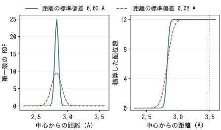

.. _radial-distribution-function:

動径分布関数と局所構造
======================

動径分布関数（radial distribution function, RDF）は、原子を中心に見たとき、
周囲の原子がどの距離に集まりやすいかを表す。結晶を溶かして急冷すると、
遠くまで続く周期配列は失われても、近接原子の配置が残る場合がある。
その違いはRDFの近距離と遠距離に現れる。

前提は\ :ref:`分子動力学の軌跡<molecular-dynamics>`\ と
:ref:`周期境界条件<pbc-allowed-wavevectors>`\ である。
この記事では、RDFから配位数を求め、距離・方向・多面体のつながりを
異なる指標で読み解く。

原子対を球殻で数える
--------------------

3次元の均一なバルクを対象に、原子種 :math:`\alpha` を中心、原子種
:math:`\beta` を近接原子の候補とする。中心から距離 :math:`r` を
下端とし、幅 :math:`\Delta r` の球殻に入る :math:`\beta` 原子を数える。
中心原子1個あたりの平均個数を :math:`\langle n_{\alpha\beta}(r,\Delta r)\rangle`、
候補の平均数密度を :math:`\rho_\beta` とする。

均一で原子間に相関がない基準系では、球殻内の平均個数は数密度と
球殻体積 :math:`\Delta V_r` の積になる。観測した個数をこの値で割ると、
原子種の組ごとの **部分動径分布関数** が得られる [RdfAllenTildesley2017]_。

.. math::
   :label: rdf-shell-normalization

   \Delta V_r = \frac{4\pi}{3}\big[(r+\Delta r)^3-r^3\big],
   \qquad
   g_{\alpha\beta}(r)\simeq
   \frac{\langle n_{\alpha\beta}(r,\Delta r)\rangle}{\rho_\beta\Delta V_r}.

この式は固定体積での有限幅のビンを表す。:math:`\alpha=\beta` のときは
中心原子自身を除外し、有限系ではその分だけ候補原子数を減らして規格化する。
体積が揺らぐ軌跡を扱う場合は、各フレームの体積で規格化してから平均する方法などがある。
比較では体積と時間平均の扱いをそろえる。全原子をまとめて数える全RDFには原子種の
組ごとの寄与が重なる。構造を担う原子対を見つけるには部分RDFが役立つ。

:math:`g_{\alpha\beta}(r)>1` は、その距離にある :math:`\beta` 原子が
無相関の基準系より多いことを表す。幅の狭いビンでは
:math:`\Delta V_r\simeq 4\pi r^2\Delta r` なので、同じ数の原子対を数えても、
近距離と遠距離では規格化後の値が違う。また、周期境界を使う場合は球殻全体を
一意に数えられる距離まで扱う。直方体セルの最小像を使うなら、最短辺の半分が目安である。

.. _coordination-number:

第一ピークと配位数
------------------

第一ピークの位置は、第一近接殻でよく現れる原子間距離を示す。その殻の原子数を
求めるには、ピークの後の第一極小などを殻の境界 :math:`r_{\mathrm c}` として選び、
各球殻に含まれる個数を足す。:eq:`rdf-shell-normalization`\ を個数について解き、
ビン幅を狭くすると、中心原子1個あたりの平均 **配位数** は

.. math::
   :label: rdf-coordination-integral

   C_{\alpha\beta}(r_{\mathrm c}) =
   4\pi\rho_\beta\int_0^{r_{\mathrm c}} r^2g_{\alpha\beta}(r)\,dr

となる。ピークの高さは距離のばらつきやビン幅にも依存する。たとえば配位数が
同じでも、温度上昇で結合距離の分布が広がれば、ピークは低く広がりうる。
第一極小が浅いと、境界を少し動かすだけで隣の殻の一部が積分に入る。
その場合は :math:`r_{\mathrm c}` を前後に動かしたときの配位数も示すと、
構造の違いと殻の切り方による違いを分けて読める。

アモルファスの短距離秩序と長距離秩序
------------------------------------

アモルファス（非晶質）固体では結晶の長距離周期性が失われても、短距離の
配位には秩序が残る。強く結合する原子対には鋭い第一ピークが出る一方、
結晶では遠くまで見られる規則的なピーク列が減衰する。均一な非晶質では
十分遠方で相関が弱まり、:math:`g_{\alpha\beta}(r)` は1に近づく。

`Li₃PO₄の部分RDF <https://example.quloud-platform.quemix.com/li3po4/large-structure-rdf.html>`__
では、急冷後にもP–Oの第一殻が残る。これはリン酸四面体の短距離配位の保持に
対応する [RdfLiPhosphate]_。 小セルでは周期境界による構造の反復や初期結晶の
影響が残ることがある。遠距離側を比較するには、複数のセルサイズや独立な
急冷軌跡で、ピークの減衰が再現するかを見る。

RDFの比較では温度、平均を取る区間と時間、ビン幅をそろえる。温度が違うと
熱揺らぎの幅が変わり、平均時間が短いとまれな構造の寄与や統計的なばらつきが
変わる。ビン幅が違うと、狭いピークの高さや隣り合うピークの分離が変わる。
融解や急冷の途中を調べるなら、温度や構造が大きく変化する区間を一緒に平均すると
別々の状態の特徴が重なる。

.. _bond-orientational-order:

結合配向秩序パラメータ
----------------------

RDFは原子対の距離を球面上でまとめるため、近接原子がどの方向に並ぶかは
別の量で調べる。Steinhardtらの **結合配向秩序パラメータ** は、各原子の
近接原子への方向を球面調和関数で表し、配向の違いを測る [RdfSteinhardt1983]_。

原子 :math:`i` の近接原子集合を :math:`\mathcal N_i`、その個数を
:math:`N_i`、原子 :math:`i` から :math:`j` への単位ベクトルを
:math:`\hat{\boldsymbol r}_{ij}` とする。標準的に規格化した球面調和関数を
:math:`Y_{\ell m}` と書くと、各方向についての値を平均した係数
:math:`q_{\ell m}` と、その大きさをまとめた :math:`q_\ell` は

.. math::
   :label: rdf-steinhardt-local

   q_{\ell m}(i)=\frac{1}{N_i}\sum_{j\in\mathcal N_i}
     Y_{\ell m}(\hat{\boldsymbol r}_{ij}),\qquad
   q_\ell(i)=\left[\frac{4\pi}{2\ell+1}
      \sum_{m=-\ell}^{\ell}|q_{\ell m}(i)|^2\right]^{1/2}

である。座標を回転すると係数の組は変わるが、二乗和は変わらない。
:math:`\ell=6` の指標 :math:`q_6` は融解に伴う配向秩序の変化の目印に
使える。局所 :math:`q_6` の平均と、係数を全体で平均して求める大域的な
秩序指標では、異なる向きの結晶粒の寄与が違う。
近接原子の選び方や対象原子種を変えると、同じ構造でも和に入る方向が変わる。
局所値を平均したのか、係数を先に全体で平均したのかを併せて示すと、
粒の向きのばらつきと、各原子の周りの配列の乱れを区別できる。

.. _polyhedral-connectivity:

配位多面体のつながり
--------------------

局所配位を多面体で記述すると、どの多面体がどのようにつながるかを数えられる。
隣り合う二つの多面体が同じ配位原子を1個共有すれば頂点共有、隣接する
2頂点なら辺共有、同じ面を作る頂点を共有すれば面共有である。八面体の
三角形の面では3個を共有する。

`急冷したBaTiO₃の例 <https://example.quloud-platform.quemix.com/BaTiO3/phase_transition.html>`__
では、各Tiの周りのOから八面体を定め、共有するOに応じてTi–Ti距離の
分布を分ける。すると、Ti–Tiのどの距離域にどの接続が寄与しているかが
分かる。RDFのピークが重なる場合もあるため、接続の判定には元の軌跡上で
共有する原子を特定する。Li₃PO₄では同じ考え方をPO₄四面体に使える。

.. _rdf-first-shell-example:

説明用の事例：面心立方格子の第一殻
----------------------------------

面心立方（FCC）の第一殻では、距離が広く分布してRDFのピークが低くなっても、
殻に含まれる原子数は保たれる。この関係を単元素の理想格子から計算する。
慣用立方胞の辺を :math:`a=4.00\,\text{Å}` とする。第一近接原子は
面対角線の半分、:math:`r_1=a/\sqrt{2}=2.8284\,\text{Å}` に12個ある。
慣用胞あたり4原子なので、数密度は :math:`\rho=4/a^3=0.0625\,\text{Å}^{-3}`
である。第二殻の距離 :math:`a` より手前に積分上限
:math:`r_{\rm c}=3.50\,\text{Å}` を置く。

第一殻の12本の距離が、:math:`r_1` を中心に標準偏差 :math:`s` のガウス分布で
広がる模型を考える。各ビンの距離範囲でガウス分布を積分し、12を掛けると
ビン内の平均個数が得られる。この個数を\ :eq:`rdf-shell-normalization`\ で
規格化してRDFにする。逆に\ :eq:`rdf-coordination-integral`\ の積分では
密度と球殻の面積を掛けるため、元の平均個数を足すことになる。

.. list-table:: 0.02 Å幅のビンで求めた第一殻のピークと配位数
   :header-rows: 1
   :widths: 36 32 32

   * - 距離の標準偏差
     - RDFの最大値
     - 3.50 Åまでの配位数
   * - 0.03 Å
     - 24.9
     - 12.000000
   * - 0.08 Å
     - 9.5
     - 12.000000

:numref:`fig-rdf-first-shell`\ の左でピークは24.9から9.5へ下がる。
右の配位数はどちらも12に達しており、距離の分布が広がっただけで
殻の原子数がほぼ変わっていないことが分かる。表の積分値は表示桁で
丸めた値である。模型には第一殻の寄与だけを入れている。

   FCC第一殻の距離を広げた模型。左はRDF、右は積算した配位数。
   実線は標準偏差0.03 Å、破線は0.08 Å、縦の点線は積分上限3.50 Å。

.. _rdf-angular-example:

説明用の事例：配位方向から求める q₆
-----------------------------------

同じ距離に原子が並んでいても、結合どうしの角度によって :math:`q_6` は変わりうる。
:eq:`rdf-steinhardt-local`\ の絶対値の二乗を二つの近接原子についての和に展開し、
球面調和関数の加法定理を使うと、内積から計算できる。

.. math::
   :label: rdf-steinhardt-pair-form

   q_\ell(i)^2=\frac{1}{N_i^2}
     \sum_{j,k\in\mathcal N_i}
     P_\ell(\hat{\boldsymbol r}_{ij}\cdot\hat{\boldsymbol r}_{ik}).

:math:`P_\ell` はLegendre多項式である。FCCでは面対角線の方向12本を含めると
:math:`q_6=0.5745` となる。体心立方（BCC）で第一殻の体対角線方向8本を
使うと0.6285になる。BCCで第二殻も近接原子に含めた値とは定義が異なるため、
比較の際は殻の範囲をそろえる。

方向を独立かつ一様に選ぶ模型でも、有限個の近接原子の :math:`q_6` は
厳密にはゼロにならない。別々の方向の組では :math:`P_6` の平均が0になり、
同じ方向の組では :math:`P_6(1)=1` となるので、:math:`q_6` の二乗平均平方根は
:math:`1/\sqrt{N_i}` である。12本なら0.2887になる。この値は無相関の方向を
仮定した基準で、実際の液体の値は近接原子どうしの排除体積や相互作用にも依存する。

.. _rdf-interpretation-limits:

解釈と限界
----------

* **距離と方向。** RDFから距離と配位数は読めるが、各結合が向く方向や、
  共有される原子は確定しない。多面体の接続を調べる場合は、元の座標で
  隣接関係を追う。:math:`q_6` も位相や方向そのものを捨てた量なので、
  単一の値だけで結晶型を一意に割り当てることはできない。
* **第一殻の取り方。** 殻の境界が明瞭な模型では積分上限を少し動かしても
  配位数が安定する。液体などで殻が重なる場合は、ビン幅と境界を振って、
  比較したい配位数の差が境界の取り方による変化より大きいかを調べる。
* **分布と時間発展。** RDFは各時刻で数えた距離の平均である。
  ピークが残っていても、同じ原子が配位している時間までは求まらない。
  寿命や拡散を調べるには、同じ原子を時間に沿って追う解析が必要になる。
* **規格化の前提。** バルクの式は球殻が系内の一様な参照に含まれると仮定する。
  表面や空孔の近くでは球殻の一部が占有できないこともあり、値の低下には
  幾何学的な欠損も含まれる。対象となる体積や集計する原子の選び方に合わせて
  規格化を定める。

関連資料
--------

* `Li₃PO₄のMD軌跡の部分RDF <https://example.quloud-platform.quemix.com/li3po4/partial-rdf.html>`__
* `Li₃PO₄の溶融・急冷後の構造 <https://example.quloud-platform.quemix.com/li3po4/melt-quench-structure.html>`__

参考文献
--------

.. [RdfSteinhardt1983] P. J. Steinhardt, D. R. Nelson, and M. Ronchetti,
   *Phys. Rev. B* **28**, 784–805 (1983).
   `doi:10.1103/PhysRevB.28.784 <https://doi.org/10.1103/PhysRevB.28.784>`_.
.. [RdfLiPhosphate] W. Li, Y. Ando, E. Minamitani, and S. Watanabe,
   *J. Chem. Phys.* **147**, 214106 (2017).
   `doi:10.1063/1.4997242 <https://doi.org/10.1063/1.4997242>`_.
.. [RdfAllenTildesley2017] M. P. Allen and D. J. Tildesley,
   *Computer Simulation of Liquids*, 2nd ed., Oxford University Press (2017).
   `doi:10.1093/oso/9780198803195.001.0001 <https://doi.org/10.1093/oso/9780198803195.001.0001>`_.
