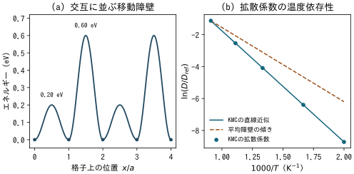

熱活性化過程とホッピング拡散
============================

粒子が隣のサイトへ移るには、途中にあるエネルギー障壁を越える必要がある。
障壁と試行頻度が一定なら、温度が上がると障壁を越える頻度が増える。離れた場所まで拡散できるかは、
各ホップの速さに加え、経路のつながり方や空孔の割合で決まる。

前提は\ :ref:`平均二乗変位と拡散係数<mean-squared-displacement>`、
:ref:`統計アンサンブル<statistical-ensembles>`、\ :ref:`調和近似<harmonic-approximation>`\ である。

学習目標
--------

* 拡散係数の温度依存性から活性化エネルギーを求め、どの温度範囲を表す値かを説明する。
* 移動障壁から遷移の速さを求め、ホップをつないで拡散を計算する。
* 空孔の数や経路のつながり方が、拡散の活性化エネルギーに及ぼす影響を判断する。

.. _arrhenius-equation:

アレニウス式とプロットの傾き
----------------------------

絶対温度\ :math:`T`\ における拡散係数\ :math:`D(T)`\ が、温度によらない
**前指数因子**\ :math:`D_0`\ と\ **活性化エネルギー**\ :math:`E_{\mathrm a}`\ で表せるとき、
この温度依存性を\ **アレニウス式**\ で書ける。:math:`k_{\mathrm B}`\ はボルツマン定数である。

.. math::
   :label: thermal-arrhenius

   \begin{aligned}
   D(T)&=D_0\exp\!\left(-\frac{E_{\mathrm a}}{k_{\mathrm B}T}\right),\\
   \ln\frac{D}{D_{\mathrm{ref}}}
   &=\ln\frac{D_0}{D_{\mathrm{ref}}}-\frac{E_{\mathrm a}}{k_{\mathrm B}}\frac{1}{T} .
   \end{aligned}

:math:`D_{\mathrm{ref}}`\ は対数の中身を無次元にするための定数で、例えば
1 Ų/ps を使う。横軸を\ :math:`1/T`、縦軸を\ :math:`\ln(D/D_{\mathrm{ref}})`\ とすると、
直線の傾きに\ :math:`-k_{\mathrm B}`\ を掛けて活性化エネルギーが得られる。
横軸が\ :math:`1000/T`\ なら傾きに\ :math:`-1000k_{\mathrm B}`\ を掛ける。
縦軸が常用対数の場合は、これらにさらに\ :math:`\ln 10`\ を掛ける。

直線の傾きは、採用した温度範囲で拡散係数がどれだけ温度に敏感かを表す。
各温度での拡散係数には、有限な軌跡から傾きを取る際の\ :ref:`不確かさ<msd-interpretation-limits>`\ がある。
直線近似の残差から求めた傾きの標準誤差は、採用した点と直線近似を前提とした値である。
各点の拡散係数の推定誤差も伝えるには、その不確かさを回帰に反映する。
曲がりのあるデータに直線を当てはめると、温度範囲によって傾きが変わる。

.. _transition-state-theory:

遷移状態理論と移動障壁
----------------------

ホップの前後で原子配置がそれぞれポテンシャルエネルギーの極小にあるとする。
始状態\ :math:`i`\ のエネルギーを\ :math:`E_i`、終状態\ :math:`j`\ のエネルギーを\ :math:`E_j`\ とする。
両者を結ぶ最小エネルギー経路が一つの一次の鞍点を通る場合を考え、そのエネルギーを
:math:`E^\ddagger`\ と書く。鞍点では経路に沿ってどちらへ進んでもエネルギーが下がり、
経路に垂直な安定方向では上がる。ここを通って移動する際は、出発した極小から
鞍点までのエネルギー差が\ **移動障壁**\ になる。

.. math::
   :label: thermal-forward-backward-barriers

   E_{\mathrm m,ij}=E^\ddagger-E_i,\qquad E_{\mathrm m,ji}=E^\ddagger-E_j .

**遷移状態理論**\ は、始状態の内部で熱平衡が保たれ、鞍点を通る境界面を正方向に横切った軌跡が
終状態へ進むと仮定する。横切った後で引き返す軌跡が多いと、通過数は実際の遷移数を上回る。
この近似では、境界面を通過する平衡時の流束を始状態の占有で割ると、一つの経路の遷移速度が得られる
[HopVoter2007]_。鞍点までのエネルギー差はボルツマン因子として現れる。

.. _attempt-frequency:

調和近似と試行頻度
------------------

始状態の極小と鞍点の近くでポテンシャルを二次まで展開する。
剛体並進などの零モードを両側で同じように除き、始状態に\ :math:`d`\ 個の振動モードがあるとする。
各モードの振動数を\ :math:`f_{i,r}`\ と書く。鞍点では不安定な方向を境界面の法線とし、
面内の安定な\ :math:`d-1`\ 個の振動数を\ :math:`f_{\ddagger,r}`\ と書く。

古典調和振動子1個の分配関数は\ :math:`k_{\mathrm B}T/(hf)`\ である。:math:`h`\ は
プランク定数、:math:`f`\ はそのモードの振動数である。これを極小・鞍点についてそれぞれ
安定な振動モードの分だけ掛け合わせ、平衡分布での重み\ :math:`Z_i`\ と\ :math:`Z_\ddagger`
を得る。それぞれの点のポテンシャルエネルギーを基準にした、振動の分配関数である。

.. math::
   :label: thermal-vineyard-partitions

   Z_i=\prod_{r=1}^{d}\frac{k_{\mathrm B}T}{h f_{i,r}},
   \qquad
   Z_\ddagger=\prod_{r=1}^{d-1}\frac{k_{\mathrm B}T}{h f_{\ddagger,r}} .

面に垂直な運動を、運動量\ :math:`p_\perp`\ と質量\ :math:`m_\perp`\ で表す。
正方向への平衡流束は、正の運動量だけを取り、その速度\ :math:`p_\perp/m_\perp`\ で
ボルツマン重みを掛けて積分する。

.. math::
   :label: thermal-normal-flux

   \frac{1}{h}\int_0^\infty\frac{p_\perp}{m_\perp}
       \exp\!\left(-\frac{p_\perp^2}{2m_\perp k_{\mathrm B}T}\right)\mathrm d p_\perp
       =\frac{k_{\mathrm B}T}{h} .

この因子に振動分配関数の比\ :math:`Z_\ddagger/Z_i`\ を掛けると温度の因子が消え、
振動数の積の比が残る。これが\ **Vineyardの式**\ であり、
:math:`\nu_{ij}`\ をその遷移の\ **試行頻度**\ と呼ぶ [HopVineyard1957]_。

.. math::
   :label: thermal-vineyard-rate

   \begin{aligned}
   k_{ij}&=\frac{k_{\mathrm B}T}{h}\frac{Z_\ddagger}{Z_i}
      \exp\!\left(-\frac{E_{\mathrm m,ij}}{k_{\mathrm B}T}\right)
      =\nu_{ij}\exp\!\left(-\frac{E_{\mathrm m,ij}}{k_{\mathrm B}T}\right),\\
   \nu_{ij}&=\frac{\prod_{r=1}^{d}f_{i,r}}{\prod_{r=1}^{d-1}f_{\ddagger,r}} .
   \end{aligned}

:math:`k_{ij}`\ と\ :math:`\nu_{ij}`\ の単位はいずれも時間の逆数である。
等価な隣接サイトが\ :math:`z`\ 個あり、同じ障壁\ :math:`E_{\mathrm m}`\ と試行頻度
:math:`\nu`\ を持つとき、粒子1個の全方向へのホップ頻度は\ :math:`\Gamma=z k_{ij}`\ である。
三次元でホップの向きが互いに独立、跳躍距離が\ :math:`a`\ なら、\ :eq:`diffusion-random-walk-d`\ を使って

.. math::
   :label: thermal-arrhenius-from-hops

   D=\frac{\Gamma a^2}{6}
    =\frac{z\nu a^2}{6}\exp\!\left(-\frac{E_{\mathrm m}}{k_{\mathrm B}T}\right) .

この模型では\ :math:`D_0=z\nu a^2/6`、:math:`E_{\mathrm a}=E_{\mathrm m}`\ である。

.. _detailed-balance-barriers:

順方向・逆方向の障壁と詳細つり合い
----------------------------------

同じ鞍点を通る場合、順方向と逆方向の障壁の差は、\ :eq:`thermal-forward-backward-barriers`\ から
:math:`E_{\mathrm m,ij}-E_{\mathrm m,ji}=E_j-E_i`\ となる。例えば終状態が高エネルギーなら、
そこへ上る順方向の障壁のほうが大きい。遷移の頻度を比べる際は、各状態に滞在する確率も要る。

熱平衡で状態\ :math:`i`\ にいる確率\ :math:`\pi_i`\ は、調和近似で
:math:`Z_i\exp[-E_i/(k_{\mathrm B}T)]`\ に比例する。
これと\ :eq:`thermal-vineyard-rate`\ を組み合わせると、次の関係が得られる。

.. math::
   :label: thermal-detailed-balance

   \pi_i k_{ij}=\pi_j k_{ji},
   \qquad \frac{k_{ij}}{k_{ji}}
      =\frac{Z_j}{Z_i}\exp\!\left(-\frac{E_j-E_i}{k_{\mathrm B}T}\right) .

左の等式を\ **詳細つり合い**\ と呼ぶ。両辺の振動とエネルギーの因子は、同じ鞍点の
:math:`Z_\ddagger\exp[-E^\ddagger/(k_{\mathrm B}T)]`\ に帰着する。
このため、平衡では各経路の順方向と逆方向の平均遷移数が等しい。
各状態の振動分配関数の違いを無視する模型では、全遷移に共通の試行頻度を置いても
エネルギーのボルツマン重みとつり合う。ただし、サイトごとの振動を扱う模型では
試行頻度の違いも速度比に効く [HopVoter2007]_。

.. _kinetic-monte-carlo:

速度論的モンテカルロ（KMC）
---------------------------

各経路の遷移速度が分かれば、**速度論的モンテカルロ**\ （kinetic Monte Carlo, KMC）で
サイト間を移る軌跡を作れる。ここでは、各状態に滞在している間に内部が平衡化し、次の遷移は
現在の状態だけで決まると仮定する。状態\ :math:`i`\ から出る全遷移の速度を足し合わせた値を
:math:`K_i=\sum_j k_{ij}`\ とする。時刻\ :math:`t`\ まで滞在している確率\ :math:`S(t)`\ は、
短い時間\ :math:`\mathrm dt`\ の間に\ :math:`K_i S(t)\,\mathrm dt`\ だけ減る。

.. math::
   :label: thermal-kmc-survival

   \frac{\mathrm d S}{\mathrm dt}=-K_i S,\qquad
   S(0)=1,\qquad S(t)=\exp(-K_i t) .

したがって、次の遷移先の確率\ :math:`P_{ij}`\ と、次の遷移までの待ち時間\ :math:`\Delta t`
を次のように求める。:math:`u`\ は0と1の間の一様乱数である。

.. math::
   :label: thermal-kmc-event

   P_{ij}=\frac{k_{ij}}{K_i},\qquad \Delta t=-\frac{\ln u}{K_i} .

#. 現在の状態から可能な遷移について、障壁と試行頻度から遷移速度\ :math:`k_{ij}`\ を求める。
#. 一様乱数を使い、累積確率が乱数を初めて上回る遷移を選ぶ。
#. 独立な一様乱数から待ち時間を得て時刻に加え、次の状態で遷移候補と遷移速度を更新する。

時間を進める手順は、待ち時間を遷移速度から得る KMC の滞在時間法である
[HopBortz1975]_ [HopVoter2007]_。これを繰り返すと、障壁付近の短い運動を積分せずに
ホップ後の位置と経過時間が得られる。追跡する粒子の変位を集計し、
\ :ref:`Einstein関係<einstein-relation>`\ から拡散係数に換算できる。

.. _activation-energy-and-barriers:

空孔機構の拡散と活性化エネルギー
--------------------------------

隣接した原子が空孔へ移ると、原子がいた位置に空孔ができる。したがって、空孔は原子と逆向きに
1サイト移る。この機構で原子が動く頻度は、空孔が隣にある確率と、空孔へ向かう遷移速度で
決まる。直前の移動で生じた空孔は元の位置にあるので、同じ原子は逆向きに戻りやすい。
このような相関が拡散係数をどれだけ変えるかを表すのが\ **相関因子**\ :math:`f`\ である。
トレーサー拡散係数を、ホップの頻度と距離をそろえ、向きの相関を無視した場合の
拡散係数で割った比として定義する [HopMehrer2007]_。

等価な格子位置を持つ三次元系で、空孔の割合\ :math:`c_{\mathrm v}`\ が小さく、空孔どうしの相互作用を
無視できるとする。跳躍距離が\ :math:`a`、等価な隣接サイトが\ :math:`z`\ 個なら、各隣接サイトが
空いている確率を\ :math:`c_{\mathrm v}`\ とみなせる。したがって、原子1個の総ホップ頻度は
:math:`zc_{\mathrm v}\nu\exp[-E_{\mathrm m}/(k_{\mathrm B}T)]`\ であり、
\ :eq:`diffusion-random-walk-d`\ の結果を相関因子で補正すると

.. math::
   :label: thermal-vacancy-diffusion

   D^*\simeq f\frac{za^2}{6}\,c_{\mathrm v}\nu
                     \exp\!\left(-\frac{E_{\mathrm m}}{k_{\mathrm B}T}\right) .

:math:`D^*`\ は原子のトレーサー拡散係数である。この希薄空孔と等価な移動障壁の模型で、
空孔の割合を固定し、:math:`f`\ と\ :math:`\nu`\ の温度依存性が小さければ、
活性化エネルギーはほぼ移動障壁になる。
一方、熱平衡で生じる希薄な空孔では、空孔の形成ギブス自由エネルギーを
:math:`\Delta G_{\mathrm f}=\Delta H_{\mathrm f}-T\Delta S_{\mathrm f}`\ として、
:math:`c_{\mathrm v}\simeq\exp[-\Delta G_{\mathrm f}/(k_{\mathrm B}T)]`\ となる。
:math:`\Delta H_{\mathrm f}`\ と\ :math:`\Delta S_{\mathrm f}`\ は空孔1個の形成エンタルピーと
形成エントロピーである。一定圧力でそれらの温度変化を無視すると、
\ :eq:`thermal-vacancy-diffusion`\ に代入して

.. math::
   :label: thermal-vacancy-equilibrium

   D^*\simeq f\frac{za^2\nu}{6}\exp\!\left(\frac{\Delta S_{\mathrm f}}{k_{\mathrm B}}\right)
              \exp\!\left(-\frac{E_{\mathrm m}+\Delta H_{\mathrm f}}{k_{\mathrm B}T}\right) .

相関因子、試行頻度、跳躍距離の温度依存性が小さければ、この式から得る活性化エネルギーに
空孔の形成エンタルピーが加わる。
圧力による仕事や振動の寄与による違いが小さいとき、:math:`\Delta H_{\mathrm f}`\ は
静的な空孔形成エネルギー\ :math:`E_{\mathrm f}`\ で近似できる。

説明用の事例：交互に異なる障壁が並ぶ格子
----------------------------------------

格子間隔\ :math:`a`\ が3 Åの一次元格子で、同じエネルギーのサイトを、0.20 eV と0.60 eVの障壁が
交互に結ぶとする。各遷移の試行頻度を10 ps⁻¹と置き、低い障壁と高い障壁を越える遷移速度を
それぞれ\ :math:`k_{\mathrm{lo}}`、:math:`k_{\mathrm{hi}}`\ とする。粒子は低い障壁を何度も
往復できるが、格子全体を移動するには高い障壁も越える必要がある。

各サイトからの二つの遷移の確率を\ :math:`P_{\mathrm{lo}}`、:math:`P_{\mathrm{hi}}`\ とする。
低い障壁が右側にあるサイトでの1ホップの変位は\ :math:`+a`\ または\ :math:`-a`\ なので、
変位の平均は\ :math:`a(P_{\mathrm{lo}}-P_{\mathrm{hi}})`\ である。次のサイトでは低い障壁が
左側にあるため、平均の符号が反転する。どちらのサイトでも1ホップの変位の分散は
:math:`4a^2P_{\mathrm{lo}}P_{\mathrm{hi}}`\ になる。

左右の配置は一歩ごとに入れ替わり、各歩で独立に乱数を引く。偶数回の遷移を重ねると
平均変位は相殺し、MSDは1ホップの分散とホップ数の積になる。どのサイトでも遷移速度の合計が
同じなので、平均経過時間も平均待ち時間\ :math:`1/(k_{\mathrm{lo}}+k_{\mathrm{hi}})`\ と
ホップ数の積になる。平均経過時間当たりのMSDをさらに一次元の係数2で割ると、
長時間の拡散係数が求まる。

.. math::
   :label: thermal-alternating-exact-d

   D_{\mathrm{1D}}=2a^2\frac{k_{\mathrm{lo}} k_{\mathrm{hi}}}{k_{\mathrm{lo}}+k_{\mathrm{hi}}} .

低温で\ :math:`k_{\mathrm{hi}}\ll k_{\mathrm{lo}}`\ なら、:math:`D_{\mathrm{1D}}\simeq 2a^2 k_{\mathrm{hi}}`
となる。拡散係数の温度依存性は、高い障壁を越える遷移速度でほぼ決まる。

500、600、750、900、1100 Kで、各温度につき8192本の独立な軌跡をKMCで計算した。
各軌跡を4096ホップまで追い、軌跡の平均二乗変位を平均経過時間の2倍で割った。
\ :numref:`thermal-kmc-figure`\ の右の傾きから、活性化エネルギーは0.5992 eVとなり、
\ :eq:`thermal-alternating-exact-d`\ の値を同じ温度点で近似した0.5990 eVと一致した。
この値は、高いほうの障壁0.60 eVに近い。障壁を0.40 eVと平均した場合の傾きは図の破線である。

.. _thermal-kmc-figure:

   \(a) サイト（丸印）と交互に並ぶ障壁の模式図。横軸は格子間隔を単位とする位置。
   (b) KMCの拡散係数（丸印）と直線近似（実線）。破線の傾きは障壁の算術平均0.40 eVに
   対応し、高温端で直線近似に重ねた。縦軸の基準\ :math:`D_{\mathrm{ref}}`\ は1 Ų/ps。

.. _thermal-activation-limits:

解釈と限界
----------

**障壁の分布と経路のつながり。**\ 非晶質では、サイトの安定性も移動障壁も場所によって変わる。
低い障壁を持つ経路だけで遠くまで移動できる場合も、高い障壁を途中で越える必要がある場合もある。
\ :numref:`thermal-kmc-figure`\ の格子では、低い障壁を往復する区間から抜ける速さが
長距離の拡散を決めた。一つの経路の障壁は一回の移動の量であり、拡散の活性化エネルギーは
多数回の移動を含む拡散係数の温度依存性を表す。Li₃PO₄事例の
`Li空孔移動障壁 <https://example.quloud-platform.quemix.com/li3po4/vacancy-barriers.html>`__
と `拡散係数の温度依存性 <https://example.quloud-platform.quemix.com/li3po4/diffusivity-temperature.html>`__
でも、この二つの量をそれぞれ求めている。

**試行頻度と温度範囲。** LiらのKMCでは全遷移に共通の試行頻度を置いた [RdfLiPhosphate]_。
共通の試行頻度を全温度で同じ倍率だけ変えると、各遷移の選択確率は保たれ、待ち時間は
その倍率の逆数になる。拡散係数は全温度で同じ倍率で変わるため、アレニウスプロットの
傾きと、そこから求める活性化エネルギーは変わらない。したがって、KMCとMDを比較する
際に、共通の試行頻度の値は主に拡散係数の絶対値に効く。経路ごとに試行頻度が異なる
場合は、選択確率も変わり、拡散係数の温度依存性を通じて傾きにも影響しうる。
高温と低温で移動機構や空孔の割合が変わる系では、高温で得たアレニウス直線を低温へ
延ばすと、拡散係数を誤って見積もることがある。

関連資料
--------

* :ref:`平均二乗変位<mean-squared-displacement>`\ から、物理時間を持つ軌跡の拡散係数を求める。
* `大規模モデルのLi拡散係数 <https://example.quloud-platform.quemix.com/li3po4/large-model-diffusivity.html>`__
  は、縦軸に拡散係数の常用対数を使い、薄膜実験の活性化エネルギーと比較する。

参考文献
--------

.. [HopVineyard1957] G. H. Vineyard, “Frequency factors and isotope effects in solid state rate processes,”
   *J. Phys. Chem. Solids* **3**, 121–127 (1957).
   `doi:10.1016/0022-3697(57)90059-8 <https://doi.org/10.1016/0022-3697(57)90059-8>`__.
.. [HopBortz1975] A. B. Bortz, M. H. Kalos, and J. L. Lebowitz,
   “A New Algorithm for Monte Carlo Simulation of Ising Spin Systems,”
   *J. Comput. Phys.* **17**, 10–18 (1975).
   `doi:10.1016/0021-9991(75)90060-1 <https://doi.org/10.1016/0021-9991(75)90060-1>`__.
.. [HopVoter2007] A. F. Voter, “Introduction to the Kinetic Monte Carlo Method,”
   *Radiation Effects in Solids*, Springer, 1–23 (2007).
   `doi:10.1007/978-1-4020-5295-8_1 <https://doi.org/10.1007/978-1-4020-5295-8_1>`__.
.. [HopMehrer2007] H. Mehrer, *Diffusion in Solids*, Springer (2007), §4.1.4, Eq. (4.28).
   `doi:10.1007/978-3-540-71488-0 <https://doi.org/10.1007/978-3-540-71488-0>`__.
