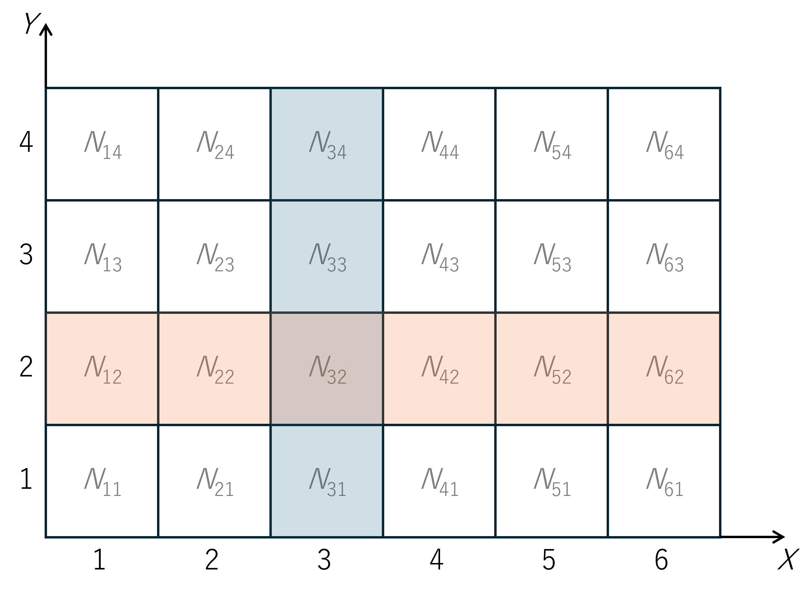

.. _bayes_theorem:

------------------------------------
ベイズの定理
------------------------------------

説明のために以下のような絵を考える。

|

上図のマス内にある :math:`N_{ij}` は、「\ :math:`X=i` かつ :math:`Y=j`\ 」という事象が起きた回数を表すものとする。\
青く色が付いた部分の和を取れば「\ :math:`X=3`\ 」という事象が起きた回数になり、\
オレンジ色の部分の和を取れば「\ :math:`Y=2`\ 」という事象が起きた回数となる。\
いま、全てのマスの総和を :math:`N` と表すと、「\ :math:`X=i` かつ :math:`Y=j`\ 」という事象が起こる確率は、\

.. math::
  P(X=i, Y=j) = \frac{N_{ij}}{N}

と計算できる事になる。以上を踏まえ、つぎに条件付き確率を考える。\ :math:`X=3`
が起こったと知っているとき、\ :math:`Y=2` が起こる条件付き確率 :math:`P(Y=2|X=3)` は、上図より

.. math::
  P(Y=2|X=3) = \frac{N_{32}}{N_{X=3}}
  :label: app-bayes1

と計算できることがわかる。ここで :math:`N_{X=3}` は、上図の青い部分の和

.. math::
  N_{X=3} = \sum_{j=1}^4 N_{3j}

である。\ :eq:`app-bayes1` を少し変形していく

.. math::
  P(Y=2|X=3)
  = \frac{N_{32}}{N_{X=3}}
  = \frac{N_{32}/N}{N_{X=3}/N}
  = \frac{P(X=3, Y=2)}{P(X=3)} .
  :label: app-bayes2

ここで、上図のオレンジ部分の和

.. math::
  N_{Y=2} = \sum_{i=1}^6 N_{i2}

を用いて :eq:`app-bayes2` をさらに変形する。

.. math::
  P(Y=2|X=3)
  = \frac{N_{32}/N}{N_{X=3}/N}
  = \frac{(N_{32}/N_{Y=2})(N_{Y=2}/N)}{N_{X=3}/N}
  = \frac{P(X=3|Y=2) P(Y=2)}{P(X=3)}

したがって、

.. math::
  P(Y=2|X=3)
  = \frac{P(X=3|Y=2) P(Y=2)}{P(X=3)}

という関係が成り立つことがわかる。これがベイズの定理である。
