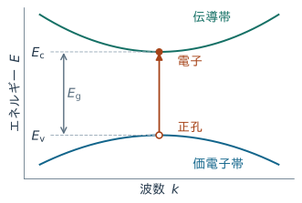
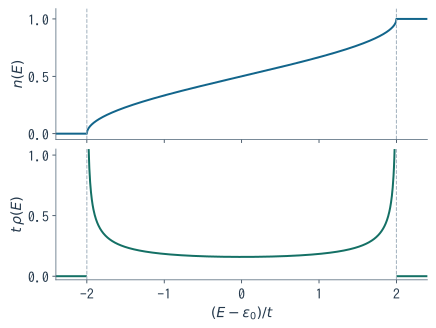

.. _bandstructure:

==============================
バンド構造と状態密度
==============================

孤立した原子の離散的な準位が、原子を並べるとエネルギーバンドになることを見る。続いて、半導体や絶縁体の
価電子帯・伝導帯・バンドギャップを定義する。最後に、許される波数についての和をブリルアンゾーン（BZ）積分に
置き換え、状態数と状態密度を導く。

**前提知識**: :ref:`ブロッホの定理と周期境界条件<blochstheorem>`、:ref:`第1ブリルアンゾーン<first-brillouin-zone>`。

**学習目標**:

* 原子軌道の準位からバンドができることと、バンドの幅が軌道間の結びつきで決まることを説明する。
* 価電子帯・伝導帯・バンドギャップを定義する。
* 波数の和の積分極限から、1バンド・1スピン・単位胞あたりの状態数が1であることを示し、状態密度を定義する。

.. _atomic-levels-to-band:

------------------------------------
原子軌道からエネルギーバンドへ
------------------------------------

孤立した原子では、電子は離散的なエネルギーをもつ原子軌道に入る。同じ原子を
二つ近づけると、対応する軌道の重なりによって二つの準位が生じる。固体を
:math:`N` 個の原子で記述し、各原子から一つずつ軌道をとると、同じ考え方で
:math:`N` 個の準位ができる。巨視的な固体では :math:`N` が非常に大きいので、
準位はある幅をもった範囲に密に並ぶ。この準位の集まりがエネルギーバンドである。

:numref:`fig-atomic-levels-to-band`\ では、原子の数が増えると一つの軌道から生じる準位の
数が増え、無限鎖ではバンドを連続的に埋める。

.. figure:: images/atomic_levels_to_band.svg
   :name: fig-atomic-levels-to-band
   :alt: 一つの原子軌道から、原子数1、2、6に対応する1本、2本、6本の準位ができ、無限鎖では連続した帯になる。
   :width: 100%
   :align: center

   同じ原子を等間隔に並べ、最近接ホッピング :math:`t` のみを含めた模型。
   横線は開放端の :math:`N` 原子の鎖の準位 :math:`E_j=\varepsilon_0-2t\cos\bigl(j\pi/(N+1)\bigr)`\ （:math:`j=1,\ldots,N`）、
   色をつけた帯は無限鎖の連続バンド :math:`E(k)=\varepsilon_0-2t\cos ka` を表す。
   開放端の鎖の準位は「\ :ref:`finite-chain`\ 」（式 :eq:`tb-open-levels`）、無限鎖のバンドは「\ :ref:`tightbinding`\ 」（式 :eq:`tb-band`）で導く。

軌道間の結びつきが強いほど、準位の広がりは大きくなる。原子の外殻軌道は、
内殻軌道より隣の原子の軌道と重なりやすい。1次元鎖の\ :ref:`タイト・バインディング模型<tightbinding>`\ では、
軌道間のホッピングからバンドの形と幅が決まる。

.. |band-gap| replace:: 価電子帯・伝導帯とバンドギャップ

.. _valence-conduction-band-gap:

--------------------
|band-gap|
--------------------

半導体や絶縁体では、絶対零度で満たされた最上部のバンドを価電子帯、その上に
ある空のバンドを伝導帯と呼ぶ。価電子帯上端 :math:`E_{\mathrm v}` と伝導帯下端
:math:`E_{\mathrm c}` のエネルギー差 :math:`E_{\mathrm g}=E_{\mathrm c}-E_{\mathrm v}`
がバンドギャップである。構造の異なる計算で状態密度を比べるときは、価電子帯上端を
:ref:`エネルギーの基準<pdos-energy-alignment>`\ に揃えることが多い。

熱や光で電子を価電子帯から伝導帯へ励起すると、伝導帯に電子、価電子帯に正孔が
生じる。ギャップが大きいほど、同じ温度での熱励起は起こりにくい。

:numref:`fig-band-gap-excitation`\ では、一つの電子が伝導帯へ移り、価電子帯に空いた
状態が一つ残る。縦の間隔 :math:`E_{\mathrm g}` がバンドギャップである。

   価電子帯上端と伝導帯下端が同じ波数にある場合の模式図。
   茶色の矢印はバンド端間の励起、塗りつぶした丸は電子、白抜きの丸は正孔を表す。

熱平衡での電子状態の占有数は\ :ref:`フェルミ–ディラック分布<fermi-dirac-distribution>`\ に従う。
励起された電子と正孔は電流を運び、その密度と移動度が\ :ref:`半導体の電気伝導率<semiconductor-conductivity>`\ を決める。

.. _bz-average:

------------------------------------
状態の和とBZ積分
------------------------------------

単位胞を :math:`N` 個並べて\ :ref:`周期境界条件<pbc-allowed-wavevectors>`\ を課すと、式 :eq:`pbc-allowed` の
:math:`N` 個の波数が許され、第1ブリルアンゾーンの中に一様に分布する。波数の関数 :math:`A(\boldsymbol k)` を
許される波数について足し、単位胞の数で割った平均を :math:`\bar A=\frac1N\sum_{\boldsymbol k}A(\boldsymbol k)` とする。
許される波数は、BZの体積 :math:`\Omega_{\mathrm{BZ}}`\ （式 :eq:`OmegaBZ`）を :math:`N` 等分した体積ごとに1点ずつ
あるので、:math:`N\to\infty` では和を積分に置き換えられ
（:math:`\sum_{\boldsymbol k}\to(N/\Omega_\mathrm{BZ})\int_\mathrm{BZ}\mathrm d\boldsymbol k`\ ）、

.. math::
   :label: kps-integral

   \bar A=\frac{1}{\Omega_\mathrm{BZ}}\int_\mathrm{BZ}A(\boldsymbol k)\,\mathrm d\boldsymbol k

となる。巨視的な結晶では :math:`N` が非常に大きいので、この置き換えが使える。数値計算で積分を有限個の波数の和で
近似するときの誤差は、「\ :ref:`kpoint_sampling`\ 」で扱う。

.. _density-of-states:

------------------------------------
状態数と状態密度（DOS）
------------------------------------

1バンド・1スピンについて、エネルギー :math:`E` 以下にある状態数を単位胞あたりで
数える。バンドのエネルギーを :math:`\varepsilon(\boldsymbol k)` とし、式 :eq:`kps-integral` の
:math:`A(\boldsymbol k)` に階段関数 :math:`\Theta(E-\varepsilon(\boldsymbol k))` を選ぶと、

.. math::
   :label: state-count

   n(E)=\frac{1}{\Omega_{\mathrm{BZ}}}
        \int_{\mathrm{BZ}}\Theta(E-\varepsilon(\boldsymbol k))\,\mathrm d\boldsymbol k

となる。:math:`\Theta` は単位ステップ関数である。すべての波数で
:math:`\varepsilon(\boldsymbol k)<E` なら、積分は :math:`\Omega_{\mathrm{BZ}}`
になり、単位胞あたりの状態数は1になる。これは、1本のバンドに1スピンあたり単位胞の数 :math:`N` と同じ数の
状態がある（\ :ref:`独立な波数の個数<pbc-wavevector-count>`）ことに対応する。

状態密度（density of states, DOS）は、単位エネルギー幅あたりの状態数である。
上の状態数をエネルギーで微分して求める。

.. math::
   :label: rho(E)

   \rho(E)=\frac{\mathrm dn(E)}{\mathrm dE}
   =\frac{1}{\Omega_{\mathrm{BZ}}}
    \int_{\mathrm{BZ}}\delta(E-\varepsilon(\boldsymbol k))\,\mathrm d\boldsymbol k

ここで :math:`\delta` はディラックのデルタ関数である。式 :eq:`rho(E)` の
:math:`\rho(E)` は1バンド・1スピン・単位胞あたりの状態密度である。
複数のバンドやスピンを扱うときは、それぞれの寄与を足す。

:numref:`fig-band-state-count-and-dos`\ では、累積状態数の曲線が急なところほど
状態密度が大きい。バンドの全状態を数え終えると、累積状態数は1になる。

   一次元バンド :math:`\varepsilon(k)=\varepsilon_0-2t\cos ka`\ （最近接ホッピングだけのタイト・バインディング模型、
   式 :eq:`tb-band`）について、1スピン・単位胞あたりの累積状態数
   :math:`n(E)` とその傾き :math:`\rho(E)` を示す。縦の破線はバンド端で、
   下段の曲線はバンド端へ内側から近づくと発散する。

:ref:`フェルミ–ディラック分布<fermi-dirac-distribution>` :math:`f(E)` は、エネルギー :math:`E` の
1状態に電子が入る平均占有数である。:math:`f(E)\rho(E)` は占有された状態の
エネルギーあたりの密度を与える。これをエネルギーで積分すると、同じ規格化での電子数
が得られる。数値計算では、有限個の\ :ref:`k点のメッシュ<kpoint-meshes>`\ を使い、BZ積分を和で近似する。
状態密度を原子や軌道ごとに分けたものを\ :ref:`射影状態密度<projected-dos>`\ と呼ぶ。

.. _bandstructure-references:

------------------------------------
参考文献
------------------------------------

* MIT Materials Science, `Lecture 7 <https://wikis.mit.edu/confluence/display/MSEDG/Lecture%2B7>`_.

.. raw:: html

   
