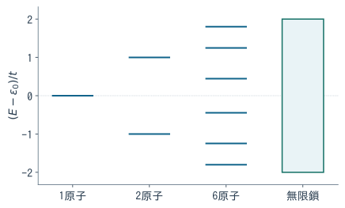

.. _bandstructure:

==============================
バンド構造
==============================

------------------------------------
原子軌道からエネルギーバンドへ
------------------------------------

孤立した原子では、電子は離散的なエネルギーをもつ原子軌道に入る。同じ原子を
二つ近づけると、対応する軌道の重なりによって二つの準位が生じる。固体を
:math:`N` 個の原子で記述し、各原子から一つずつ軌道をとると、同じ考え方で
:math:`N` 個の準位ができる。巨視的な固体では :math:`N` が非常に大きいので、
準位はある幅をもった範囲に密に並ぶ。この準位の集まりがエネルギーバンドである。

:numref:`fig-atomic-levels-to-band`\ では、原子の数が増えると一つの軌道から生じる準位の
数が増え、無限鎖ではバンドを連続的に埋める。

   同じ原子を等間隔に並べ、最近接ホッピング :math:`t` のみを含めた模型。
   横線は開放端の鎖の準位（式 :eq:`tb-open-levels`）、色をつけた帯は無限鎖の
   連続バンド（式 :eq:`tb-band`）を表す。

軌道間の結びつきが強いほど、準位の広がりは大きくなる。原子の外殻軌道は、
内殻軌道より隣の原子の軌道と重なりやすい。1次元鎖の\ :ref:`タイト・バインディング模型<tightbinding>`\ では、
軌道間のホッピングからバンドの形と幅が決まる。

.. |band-gap| replace:: 価電子帯・伝導帯とバンドギャップ

.. _valence-conduction-band-gap:

--------------------
|band-gap|
--------------------

半導体や絶縁体では、絶対零度で満たされた最上部のバンドを価電子帯、その上に
ある空のバンドを伝導帯と呼ぶ。価電子帯上端 :math:`E_{\mathrm v}` と伝導帯下端
:math:`E_{\mathrm c}` のエネルギー差 :math:`E_{\mathrm g}=E_{\mathrm c}-E_{\mathrm v}`
がバンドギャップである。

熱や光で電子を価電子帯から伝導帯へ励起すると、伝導帯に電子、価電子帯に正孔が
生じる。ギャップが大きいほど、同じ温度での熱励起は起こりにくい。

:numref:`fig-band-gap-excitation`\ では、一つの電子が伝導帯へ移り、価電子帯に空いた
状態が一つ残る。縦の間隔 :math:`E_{\mathrm g}` がバンドギャップである。

.. figure:: images/band_gap_excitation.svg
   :name: fig-band-gap-excitation
   :alt: 価電子帯の頂点Evから伝導帯の底Ecへの励起。価電子帯の白丸は正孔、伝導帯の塗った丸は励起された電子を示す。
   :width: 92%
   :align: center

   価電子帯上端と伝導帯下端が同じ波数にある場合の模式図。
   茶色の矢印はバンド端間の励起、塗りつぶした丸は電子、白抜きの丸は正孔を表す。

熱平衡での電子状態の占有数は\ :ref:`フェルミ–ディラック分布<fermi-dirac-distribution>`\ に従う。
励起された電子と正孔は電流を運び、その密度と移動度が\ :ref:`半導体の電気伝導率<semiconductor-conductivity>`\ を決める。

.. raw:: html

   
