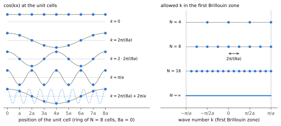

.. _blochstheorem:

==============================
ブロッホの定理と周期境界条件
==============================

結晶のポテンシャルは格子と同じ周期をもつ。このとき一電子状態は、格子並進で波動関数に掛かる位相、
すなわち波数で分類できる。本稿では、単位胞を有限個並べて両端をつなぐ周期境界条件を定義し、
その上でブロッホの定理を導く。続いて、一周したときの位相の条件から許される波数を求め、独立な波数の
個数が単位胞の数に等しいことを示す。

**前提知識**: :ref:`格子と基本並進ベクトル<lattice-translations>`、:ref:`逆格子<reciprocal-lattice>`
（式 :eq:`ortho`）、:ref:`周期関数のフーリエ級数<periodic-fourier-series>`、量子力学の固有値問題。

**学習目標**:

* 周期境界条件のもとで、ハミルトニアンと格子並進の共通固有状態からブロッホの定理を導く。
* 波動関数を、平面波と格子と同じ周期の関数の積で表す。
* 一周したときの位相の条件から許される波数を求め、独立な波数の個数が単位胞の数に等しいことを示す。

.. _bloch-periodic-potential:

周期ポテンシャルと格子並進
--------------------------

格子ベクトル :math:`\boldsymbol R` は、:ref:`基本並進ベクトル<lattice-translations>`
:math:`\boldsymbol a_i` の整数結合 :math:`\boldsymbol R=\sum_i n_i\boldsymbol a_i` である。
結晶中の一電子ポテンシャル :math:`V(\boldsymbol r)` は\ :ref:`格子と同じ周期<periodic>`\ をもち、

.. math::
  :label: V(r+R)

  V(\boldsymbol r+\boldsymbol R)=V(\boldsymbol r)

が成り立つ。一電子状態の波動関数を :math:`\psi`、そのエネルギーを :math:`E` とする。
一電子ハミルトニアン :math:`H` に対するシュレーディンガー方程式は

.. math::
  :label: Schrodinger

  H\psi(\boldsymbol r)=E\psi(\boldsymbol r)

である。電子の質量を :math:`m`、換算プランク定数を :math:`\hbar` とすると、

.. math::
  :label: Hamiltonian

  H=-\frac{\hbar^2}{2m}\nabla^2+V(\boldsymbol r)

である。格子並進の演算子 :math:`T_{\boldsymbol R}` を
:math:`(T_{\boldsymbol R}\psi)(\boldsymbol r)=\psi(\boldsymbol r+\boldsymbol R)` と定義する。

.. _pbc-allowed-wavevectors:

周期境界条件
------------

巨視的な結晶を、表面の影響を除いて扱うために、:ref:`基本並進ベクトル<lattice-translations>`
:math:`\boldsymbol a_i` の方向に単位胞を :math:`N_i` 個並べ、各方向の両端をつないで

.. math::
  :label: pbc-condition

  \psi(\boldsymbol r+N_i\boldsymbol a_i)=\psi(\boldsymbol r)\qquad(i=1,2,3)

を課す。これをBorn–von Kármánの\ **周期境界条件**\ と呼ぶ。結晶は
:math:`N=N_1N_2N_3` 個の単位胞からなる、端の無い輪のような系になる。

この条件を満たす波動関数に格子並進を施しても、条件はそのまま満たされる。運動エネルギーの微分演算子は
並進で変わらず、ポテンシャルには式 :eq:`V(r+R)` の周期性があるので、:math:`H` と :math:`T_{\boldsymbol R}` は
可換である。格子並進どうしも可換なので、エネルギーと格子並進の共通固有状態を選べる。
エネルギーが縮退していれば、同じエネルギーをもつ状態の線形結合から共通固有状態を選ぶ。

.. _bloch-theorem:

ブロッホの定理
--------------

共通固有状態に格子並進を施すと、波動関数に位相因子が掛かる。並進は周期境界のもとで
波動関数のノルムを保つため、固有値 :math:`\lambda(\boldsymbol R)` の絶対値は1である。
:math:`T_{\boldsymbol R+\boldsymbol R'}=T_{\boldsymbol R}T_{\boldsymbol R'}` なので、
:math:`\lambda(\boldsymbol R+\boldsymbol R')=\lambda(\boldsymbol R)\lambda(\boldsymbol R')` が成り立つ。

.. _wave-vector:

基本並進の固有値を :math:`\lambda(\boldsymbol a_i)=e^{i\theta_i}` と書き、3方向の位相を
**波数ベクトル** :math:`\boldsymbol k=\sum_i(\theta_i/2\pi)\boldsymbol b_i` にまとめる。
実格子と逆格子の関係 :math:`\boldsymbol a_i\cdot\boldsymbol b_j=2\pi\delta_{ij}`
（式 :eq:`ortho`）から、:math:`\boldsymbol k\cdot\boldsymbol R=\sum_i n_i\theta_i` となる。
固有値の積の規則とこの内積から :math:`\lambda(\boldsymbol R)=e^{i\boldsymbol k\cdot\boldsymbol R}` となり、
任意の格子ベクトル :math:`\boldsymbol R` に対して

.. math::
  :label: Bloch

  \psi_{\boldsymbol k}(\boldsymbol r+\boldsymbol R)
  =e^{i\boldsymbol k\cdot\boldsymbol R}\psi_{\boldsymbol k}(\boldsymbol r)

が成り立つ。これがブロッホの定理である。式 :eq:`Bloch` から位相因子をくくり出すと、
波動関数は平面波と格子と同じ周期をもつ関数の積

.. math::
  :label: bloch-periodic-part

  \psi_{\boldsymbol k}(\boldsymbol r)
  =e^{i\boldsymbol k\cdot\boldsymbol r}u_{\boldsymbol k}(\boldsymbol r),\qquad
  u_{\boldsymbol k}(\boldsymbol r+\boldsymbol R)=u_{\boldsymbol k}(\boldsymbol r)

として表せる。

:numref:`fig-bloch-phase-translation`\ の上段では、隣の単位胞の同じ胞内位置へ移るたびに
位相が同じ角度だけ進む。下段では、実部が胞ごとに異なる形をとる一方、周期関数
:math:`u_k(x)` と波動関数の大きさは胞ごとに同じ形を繰り返す。

.. figure:: images/bloch_phase_translation.svg
   :name: fig-bloch-phase-translation
   :alt: 上段の複素振幅は右の胞へ移るごとに長さを保ってπ/3ずつ回転する。下段では周期関数と波動関数の大きさを重ねた破線が各胞で繰り返し、波動関数の実部を描いた実線は位相とともに変化する。
   :width: 100%
   :align: center

   :math:`ka=\pi/3`、
   :math:`u_k(x)=1+0.3\cos[2\pi(x-x_0)/a]` とした一次元の例。
   上段の矢印は :math:`\psi_k(x_0+na)/\psi_k(x_0)` を複素平面上に表し、破線は一つ前の胞での
   向きを示す。下段の縦の点線は胞の境界、丸は上段で位相を比べた位置である。
   この例の :math:`u_k` は実数かつ正なので、下段では :math:`|\psi_k|` と同じ破線に重なる。

.. _pbc-wavevector-count:

許される波数とその個数
----------------------

周期境界条件 :eq:`pbc-condition` は、並進 :math:`N_i\boldsymbol a_i` で波動関数が元に戻ることを求める。
式 :eq:`Bloch` から、一周したときの位相因子は :math:`e^{iN_i\boldsymbol k\cdot\boldsymbol a_i}=1` となる。
:math:`\boldsymbol k=\sum_j x_j\boldsymbol b_j` と書くと、:math:`\boldsymbol k\cdot\boldsymbol a_i=2\pi x_i` なので、
各方向で :math:`N_ix_i` が整数 :math:`m_i` となる波数が許される。

.. math::
   :label: pbc-allowed

   \boldsymbol k=\sum_{i=1}^{3}\frac{m_i}{N_i}\,\boldsymbol b_i\qquad(m_i\ \text{は整数})

:ref:`逆格子ベクトル<reciprocal-lattice>` :math:`\boldsymbol G` だけ異なる :math:`\boldsymbol k` と
:math:`\boldsymbol k+\boldsymbol G` は、すべての格子ベクトルに対して同じ位相
:math:`e^{i\boldsymbol k\cdot\boldsymbol R}` を与える（:math:`e^{i\boldsymbol G\cdot\boldsymbol R}=1`\ ）
ので、同じ並進の性質を表す。式 :eq:`pbc-allowed` では、:math:`m_i` に
:math:`N_i` を足すと波数に :math:`\boldsymbol b_i` が加わる。したがって各方向で
:math:`m_i=0,1,\ldots,N_i-1` を数えれば、独立な波数は全部で
:math:`N=N_1N_2N_3` 個になる。これは単位胞の数に等しい。等価な波数の組から代表を一つずつ選ぶ
領域が、次の記事の\ :ref:`第1ブリルアンゾーン<first-brillouin-zone>`\ である。

格子定数 :math:`a` の単位胞を :math:`N` 個並べた1次元結晶では、
:math:`k=2\pi m/(Na)` が許される。:math:`k=0` なら単位胞間で位相は変化しない。
:math:`k=\pi/a` は :math:`m=N/2` にあたり、:math:`N` が偶数のときに許される。
この波数では、隣の単位胞に移るたびに波動関数の符号が反転する。

:numref:`fig-pbc-allowed`\ の左では、波数が :math:`2\pi/a` だけ異なる二つの曲線が、
単位胞の位置では同じ値になることに注目する。曲線は位相因子の実部を表している。
右では、:math:`N` を増やすと波数の間隔 :math:`2\pi/(Na)` が狭くなる。
:math:`N\to\infty` の極限で、波数は :math:`-\pi/a<k\le\pi/a` の範囲を連続的に埋める。

   格子定数 :math:`a` の単位胞 :math:`N` 個を輪につないだ1次元の結晶で許される波数 :math:`k`\ 。
   左： :math:`N=8` のときの、各単位胞の位置での :math:`\cos kx` （位相因子 :math:`e^{ikx}` の実部、
   青い点）と、それを結ぶ曲線（灰色）。いちばん下の行の破線は、 :math:`k=2\pi/(8a)` に逆格子ベクトル :math:`2\pi/a` を足した波数の :math:`\cos kx` で、単位胞の位置では実線
   （:math:`k=2\pi/(8a)`\ ）と同じ値をとる。右： :math:`N` = 4、8、16のときに :math:`-\pi/a<k\le\pi/a` の範囲で許される
   :math:`k`\ 。 :math:`-\pi/a` と :math:`\pi/a` は逆格子ベクトルだけ異なる同じ点なので、
   :math:`\pi/a` だけを描いた。 :math:`N\to\infty` では、許される :math:`k` がこの範囲全体を埋める。

.. _bloch-related:

関連資料
--------

* :ref:`brillouinzone`
* :ref:`periodic_boundary`
* :ref:`tightbinding`

.. _bloch-references:

参考文献
--------

* N. W. Ashcroft and N. D. Mermin, *Solid State Physics* (Holt, Rinehart and
  Winston, 1976), Chap. 8.

.. raw:: html

   
