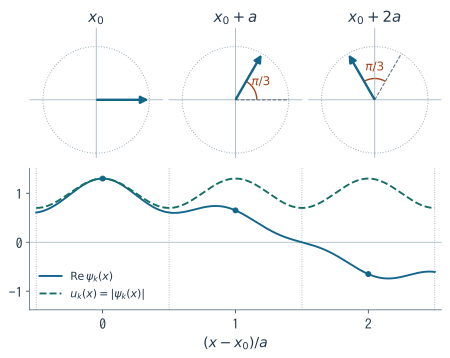

.. _blochstheorem:

==============================
ブロッホの定理
==============================

------------------------------------
周期ポテンシャルと波動関数
------------------------------------

結晶のポテンシャルが格子と同じ周期をもつとき、一電子状態を波数で分類できる。
格子ベクトル :math:`\boldsymbol R` は、:ref:`基本並進ベクトル<lattice>`
:math:`\boldsymbol a_i` の整数結合 :math:`\boldsymbol R=\sum_i n_i\boldsymbol a_i` である。
結晶中の一電子ポテンシャルを :math:`V(\boldsymbol r)` とすると、

.. math::
  :label: V(r+R)

  V(\boldsymbol r+\boldsymbol R)=V(\boldsymbol r)

が成り立つ。一電子状態の波動関数を :math:`\psi`、そのエネルギーを :math:`E` とする。
一電子ハミルトニアン :math:`H` に対するシュレーディンガー方程式は

.. math::
  :label: Schrodinger

  H\psi(\boldsymbol r)=E\psi(\boldsymbol r)

である。電子の質量を :math:`m`、換算プランク定数を :math:`\hbar` とすると、

.. math::
  :label: Hamiltonian

  H=-\frac{\hbar^2}{2m}\nabla^2+V(\boldsymbol r)

である。

格子並進の演算子 :math:`T_{\boldsymbol R}` を
:math:`(T_{\boldsymbol R}\psi)(\boldsymbol r)=\psi(\boldsymbol r+\boldsymbol R)` と定義する。
後で扱う :ref:`周期境界条件<periodic_boundary>` のもとで考えると、運動エネルギーの微分演算子は
並進で変わらず、ポテンシャルには式 :eq:`V(r+R)` の周期性がある。
そのため、:math:`H` と :math:`T_{\boldsymbol R}` は可換である。
格子並進どうしも可換なので、エネルギーと格子並進の共通固有状態を選べる。
エネルギーが縮退していれば、同じエネルギーをもつ状態の線形結合から共通固有状態を選ぶ。

共通固有状態に格子並進を施すと、波動関数に位相因子が掛かる。並進は周期境界のもとで
波動関数のノルムを保つため、固有値 :math:`\lambda(\boldsymbol R)` の絶対値は1である。
:math:`T_{\boldsymbol R+\boldsymbol R'}=T_{\boldsymbol R}T_{\boldsymbol R'}` なので、
:math:`\lambda(\boldsymbol R+\boldsymbol R')=\lambda(\boldsymbol R)\lambda(\boldsymbol R')` が成り立つ。

基本並進の固有値を :math:`\lambda(\boldsymbol a_i)=e^{i\theta_i}` と書き、3方向の位相を
波数ベクトル :math:`\boldsymbol k=\sum_i(\theta_i/2\pi)\boldsymbol b_i` にまとめる。
実格子と逆格子の関係 :math:`\boldsymbol a_i\cdot\boldsymbol b_j=2\pi\delta_{ij}`
（式 :eq:`ortho`）から、:math:`\boldsymbol k\cdot\boldsymbol R=\sum_i n_i\theta_i` となる。
固有値の積の規則とこの内積から :math:`\lambda(\boldsymbol R)=e^{i\boldsymbol k\cdot\boldsymbol R}` となり、
任意の格子ベクトル :math:`\boldsymbol R` に対して

.. math::
  :label: Bloch

  \psi_{\boldsymbol k}(\boldsymbol r+\boldsymbol R)
  =e^{i\boldsymbol k\cdot\boldsymbol R}\psi_{\boldsymbol k}(\boldsymbol r)

が成り立つ。これがブロッホの定理である。式 :eq:`Bloch` から位相因子をくくり出すと、
波動関数は平面波と格子と同じ周期をもつ関数の積

.. math::

  \psi_{\boldsymbol k}(\boldsymbol r)
  =e^{i\boldsymbol k\cdot\boldsymbol r}u_{\boldsymbol k}(\boldsymbol r),\qquad
  u_{\boldsymbol k}(\boldsymbol r+\boldsymbol R)=u_{\boldsymbol k}(\boldsymbol r)

として表せる。

:numref:`fig-bloch-phase-translation`\ の上段では、隣の単位胞の同じ胞内位置へ移るたびに
位相が同じ角度だけ進む。下段では、実部が胞ごとに異なる形をとる一方、周期関数
:math:`u_k(x)` と波動関数の大きさは胞ごとに同じ形を繰り返す。

   :math:`ka=\pi/3`、
   :math:`u_k(x)=1+0.3\cos[2\pi(x-x_0)/a]` とした一次元の例。
   上段の矢印は :math:`\psi_k(x_0+na)/\psi_k(x_0)` を複素平面上に表し、破線は一つ前の胞での
   向きを示す。下段の縦の点線は胞の境界、丸は上段で位相を比べた位置である。
   この例の :math:`u_k` は実数かつ正なので、下段では :math:`|\psi_k|` と同じ破線に重なる。

どの範囲から独立な波数を選べばよいかは :ref:`brillouinzone` で考える。
