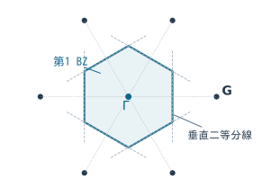

.. _brillouinzone:

==============================
ブリルアンゾーン
==============================

\ :ref:`ブロッホの定理と周期境界条件<blochstheorem>`\ で、逆格子ベクトルだけ異なる波数が同じ並進の性質を表すことを見た。
本稿では、等価な波数から代表を一つずつ選ぶ領域として第1ブリルアンゾーンを定め、その中で特別な役割をもつ
Γ点、ゾーン境界、高対称点を導入する。

**前提知識**: :ref:`ブロッホの定理と周期境界条件<blochstheorem>`、:ref:`逆格子<reciprocal-lattice>`、
:ref:`基本単位胞<lattice-unit-cells>`。

**学習目標**:

* 第1ブリルアンゾーンを逆格子のウィグナー・ザイツ胞として定め、その体積を実格子の単位胞の体積から求める。
* Γ点とゾーン境界で、格子並進の位相因子がどうなるかを説明する。
* 高対称点の記号が、ブリルアンゾーンの形ごとに決まる位置を指すことを説明する。

.. _first-brillouin-zone:

------------------------------------------------
第1ブリルアンゾーンとウィグナー・ザイツ胞
------------------------------------------------

\ :ref:`ブロッホの定理<bloch-theorem>`\ （式 :eq:`Bloch`）によると、格子並進 :math:`\boldsymbol R` で波動関数に掛かる位相因子は
:math:`e^{i\boldsymbol k\cdot\boldsymbol R}` である。\ :ref:`逆格子ベクトル<reciprocal-lattice>`
:math:`\boldsymbol G` に対して :math:`e^{i\boldsymbol G\cdot\boldsymbol R}=1` なので、
:math:`\boldsymbol k` と :math:`\boldsymbol k+\boldsymbol G` は同じ位相因子を与える。
そこで、逆格子並進で等価な波数の組から一つずつ代表を取れる領域を選ぶ。

第1ブリルアンゾーンは、他のどの逆格子点よりも原点に近い波数と、その境界からなる領域である。
これは逆格子のウィグナー・ザイツ胞（Wigner–Seitz cell）にあたり、

.. math::

   |\boldsymbol k|\leq |\boldsymbol k-\boldsymbol G|
   \quad \text{for all }\boldsymbol G\ne\boldsymbol 0

で定まる。つまり、各逆格子点と原点の間の垂直二等分面を考え、それぞれで原点側を
取る。境界にある点どうしが逆格子ベクトルだけ異なる場合は、一方だけを代表とする。
例えば格子定数 :math:`a` の1次元格子なら、最も近い逆格子点は
:math:`G=\pm 2\pi/a` なので、第1ブリルアンゾーンを :math:`-\pi/a<k\leq\pi/a`
と取れる。

:numref:`fig-brillouin-zone-bisectors`\ は、二次元で垂直二等分線の原点側を集める例である。
色のついた領域では、原点までの距離がどの逆格子点までの距離よりも大きくならない。

   三角格子状に並んだ逆格子点について、原点 :math:`\Gamma` に最も近い六点を描いた。
   破線は垂直二等分線、青い六角形はその原点側が重なる第1ブリルアンゾーンである。

逆格子の基本並進ベクトル :math:`\boldsymbol b_1,\boldsymbol b_2,\boldsymbol b_3`
で張る平行六面体も逆格子の\ :ref:`基本単位胞<lattice-unit-cells>`\ である。形は一般に第1ブリルアンゾーンと
異なるが、どちらも逆格子並進で空間を隙間なく埋め、体積は同じである。
実格子の基本単位胞の体積を :math:`\Omega` とすると、

.. math::
   :label: OmegaBZ

   \Omega_{\mathrm{BZ}}=
   \left|\boldsymbol b_1\cdot(\boldsymbol b_2\times\boldsymbol b_3)\right|
   =\frac{(2\pi)^3}{\Omega}

となる。逆格子並進に対して周期的な量については、第1ブリルアンゾーンの各部分を
逆格子並進で移して集めれば平行六面体を構成できるため、どちらで積分しても同じ値になる。

.. _high-symmetry-points:

Γ点・ゾーン境界・高対称点
--------------------------

.. _gamma-point:

第1ブリルアンゾーンの中心 :math:`\boldsymbol k=0` を **Γ点** と呼ぶ。Γ点では位相因子
:math:`e^{i\boldsymbol k\cdot\boldsymbol R}` がすべての格子ベクトルで1になるので、式 :eq:`bloch-periodic-part` の
波動関数は周期部分 :math:`u_{\boldsymbol 0}` そのものであり、どの単位胞でも同じ形をとる。

.. _zone-boundary:

第1ブリルアンゾーンの境界を **ゾーン境界** と呼ぶ。境界上の波数 :math:`\boldsymbol k` は、ある逆格子ベクトル
:math:`\boldsymbol G\ne\boldsymbol 0` について :math:`|\boldsymbol k|=|\boldsymbol k-\boldsymbol G|`、すなわち

.. math::
   :label: bz-boundary

   \boldsymbol k\cdot\boldsymbol G=\frac{|\boldsymbol G|^2}{2}

を満たし、:math:`\boldsymbol k` と :math:`\boldsymbol k-\boldsymbol G` は等価な波数である。格子定数 :math:`a` の1次元格子では
ゾーン境界は :math:`k=\pm\pi/a` で、隣の単位胞に移るたびに位相因子 :math:`e^{ika}=-1` が掛かり、波動関数の符号が
反転する。:math:`k=\pi/a` と :math:`-\pi/a` は等価なので、右向きと左向きに進む波が同じ状態として扱われる。
結晶の周期が2倍になると、新しいゾーン境界でバンドの間にギャップが開きうること（\ :ref:`SSH模型<tb-ssh>`）や、
ゾーン境界のフォノンで隣の胞の原子が逆向きに動くこと（\ :ref:`1次元二原子鎖<ph-diatomic-chain>`）は、この性質による。

.. _high-symmetry-k:

Γ点のほかにも、結晶の点群の多くの操作で、逆格子ベクトルの差を除いて自分自身に移る波数がある。これを
**高対称点** と呼び、高対称点を結ぶ線のうち同じように対称操作で保たれるものを **対称線** と呼ぶ。
バンド構造やフォノン分散は、高対称点を結ぶ対称線に沿って描くことが多い（SetyawanとCurtarolo、2010年）。高対称点には、
ブリルアンゾーンの形ごとに慣用の記号が付いている（Bouckaert、Smoluchowski、Wigner、1936年）。立方晶の単純立方格子と面心立方格子（FCC）の例を
:numref:`tbl-cubic-high-symmetry-points` に示す。

.. list-table:: 立方晶の高対称点（格子定数 :math:`a` の立方慣用単位胞の軸によるCartesian成分、単位 :math:`2\pi/a`）
   :name: tbl-cubic-high-symmetry-points
   :header-rows: 1
   :widths: 22 13 65

   * - 格子
     - 記号
     - 位置
   * - 単純立方
     - Γ
     - :math:`(0,0,0)`
   * -
     - X
     - :math:`(0,1/2,0)`\ （面の中心）
   * -
     - M
     - :math:`(1/2,1/2,0)`\ （辺の中点）
   * -
     - R
     - :math:`(1/2,1/2,1/2)`\ （頂点）
   * - 面心立方
     - Γ
     - :math:`(0,0,0)`
   * -
     - X
     - :math:`(0,1,0)`\ （正方形の面の中心）
   * -
     - L
     - :math:`(1/2,1/2,1/2)`\ （六角形の面の中心）
   * -
     - W
     - :math:`(1,1/2,0)`\ （頂点）
   * -
     - K
     - :math:`(3/4,3/4,0)`\ （六角形の面どうしが接する辺の中点）

同じ記号でも、ブリルアンゾーンの形が違えば位置は違う。例えば単純立方格子のX点と面心立方格子のX点は、
それぞれの格子定数 :math:`a` で :math:`2\pi/a` を単位にした座標が2倍違う。文献や計算プログラムの高対称点を読むときは、どの格子のどの単位胞の
記号かを確かめる。

.. _bz-references:

参考文献
--------

* MIT Materials Science, `Lecture 7 <https://wikis.mit.edu/confluence/display/MSEDG/Lecture%2B7>`_.
* L. P. Bouckaert, R. Smoluchowski, and E. Wigner,
  `“Theory of Brillouin Zones and Symmetry Properties of Wave Functions in Crystals” <https://doi.org/10.1103/PhysRev.50.58>`_,
  *Physical Review* **50**, 58–67 (1936).
* W. Setyawan and S. Curtarolo,
  `“High-throughput electronic band structure calculations: Challenges and tools” <https://doi.org/10.1016/j.commatsci.2010.05.010>`_,
  *Computational Materials Science* **49**, 299–312 (2010).

.. raw:: html

   
