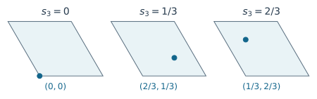

.. _lt-cell-shape-bravais:

胞の形とブラベー格子型
======================

構造ファイルの胞が直交・六方・菱面体・体心正方の形に見えても、それだけでは\ :ref:`ブラベー格子型<bravais-lattice-types>`\ は決まらない。
同じ格子点の集合を、形の違う胞で表せるからである。本稿では4つの例で、胞の形と格子型が食い違う場合を見て、
胞の取り直しと、計量を変えて対称性を上げる格子の特殊化を区別する。最後に、例の格子点と計量を数値で確かめる。

**前提知識**: :ref:`格子の基底変換<lt-primitive-basis>`、:ref:`基本単位胞と慣用単位胞<lattice-unit-cells>`、
:ref:`中心並進<centring-translation>`、:ref:`ブラベー格子型<bravais-lattice-types>`、:ref:`計量行列<lattice-metric>`、
:ref:`FCCの慣用単位胞と基本単位胞<lt-fcc-cell>`。

**学習目標**:

* 同じ格子点の集合を別の胞で表す「胞の取り直し」と、計量を変えて対称性を上げる「格子の特殊化」を区別する。
* R格子の六方軸表示、六方P格子の直交C中心化胞、FCC格子の体心正方胞、菱面体形状の基本単位胞の例で、胞の形だけではブラベー格子型が決まらないことを説明する。
* 胞に含まれる格子点と計量を数値で求め、格子型を確かめる。

.. _lt-special-cells:

胞の取り直しと格子の特殊化
--------------------------

.. _lattice-specialization:

:ref:`基本単位胞や慣用単位胞<lattice-unit-cells>`\ の辺の形と、中心並進を含む格子点集合のブラベー格子型は区別する。
胞を取り直しても、中心の格子点や周期像を含めれば同じ並進格子を表す。格子点の集合が変わらないので、
ブラベー格子型も変わらない。これに対し、辺長や角度を特殊な値へ\ **変形**\ すると、格子点の集合そのものが変わり、
格子の対称性が高まってブラベー格子型が変わることがある。このように計量を変えて、より対称性の高い格子型へ移ることを
**格子の特殊化** と呼ぶ。格子型の間のこうした関係は `Grimmer (2015) <https://doi.org/10.1107/S2053273314027351>`_ が整理している。

以下の4つの例は、どれも胞の取り直しである。胞の形からは別の格子型に見えるが、格子点の集合とブラベー格子型は変わらない。

.. _lt-rhombohedral-hexagonal:

R格子の菱面体基本単位胞と六方軸表示
----------------------------------------------------

三方晶系のR格子は、菱面体基本単位胞を使う表示と、R中心化された六方軸の胞を使う表示の両方がある。六方軸で書いても六方P格子になるわけではない。IUCr International Tables for Crystallography, Volume A はR格子の菱面体基本単位胞と体積が3倍のR中心化六方軸セルを区別し、ブラベー格子型を格子系ごとに定義している（`§1.3.2.4 <https://it.iucr.org/Ac/ch1o3v0001/sec1o3o2o4.pdf>`_, `§1.3.4.4.3 <https://it.iucr.org/Ac/ch1o3v0001/sec1o3o4o4o3.pdf>`_）。

菱面体基本単位胞の列格子行列を :math:`A_R=(\boldsymbol a_1,\boldsymbol a_2,\boldsymbol a_3)` とし、各ベクトルの長さを :math:`a_R`、共通角を :math:`\alpha_R` とする。次の軸を選ぶ。

.. math::

   \begin{aligned}
   \boldsymbol a_{R,H}&=\boldsymbol a_1-\boldsymbol a_2,\\
   \boldsymbol b_{R,H}&=\boldsymbol a_2-\boldsymbol a_3,\\
   \boldsymbol c_{R,H}&=\boldsymbol a_1+\boldsymbol a_2+\boldsymbol a_3.
   \end{aligned}

すると :math:`A_{R,H}=A_RP_{R,H}` で、

.. math::

   P_{R,H}=\begin{pmatrix}
   1&0&1\\-1&1&1\\0&-1&1
   \end{pmatrix},\qquad \det P_{R,H}=3.

:math:`q=\cos\alpha_R` とすれば、六方軸胞の格子定数と角度は

.. math::

   a_{R,H}=b_{R,H}=a_R\sqrt{2(1-q)},\qquad
   c_{R,H}=a_R\sqrt{3(1+2q)},

.. math::

   \alpha_{R,H}=\beta_{R,H}=90^\circ,\qquad \gamma_{R,H}=120^\circ.

この胞の体積は菱面体基本単位胞の3倍で、分率座標 :math:`(0,0,0)` に加えて :math:`(2/3,1/3,1/3)` と :math:`(1/3,2/3,2/3)` にR中心並進による格子点を持つ。したがって、六方軸表示を六方P格子と読み替えると格子点を取り落とす。

:numref:`fig-rhombohedral-hexagonal-layers`\ では、六方軸胞を底面に平行な三つの
高さで切って、R中心並進による格子点の横方向のずれを示す。

   各パネルの :math:`s_3` は六方軸胞での高さ。丸が格子点、下の座標が底面内の分率座標
   :math:`(s_1,s_2)` である。整数の並進で移る格子点は省略した。

.. _lt-hexagonal-orthogonal:

六方P格子を直交C中心化胞で表す
--------------------------------------------

底面の長さが :math:`a`、角が :math:`120^\circ` の六方P格子の基本並進ベクトルの組 :math:`A_{\rm hexP}` から、次の胞を作る。

.. math::

   \begin{aligned}
   \boldsymbol a_o&=\boldsymbol a_1+\boldsymbol a_2,\\
   \boldsymbol b_o&=-\boldsymbol a_1+\boldsymbol a_2,\\
   \boldsymbol c_o&=\boldsymbol a_3.
   \end{aligned}

.. math::

   A_o=A_{\rm hexP}M_{\rm hexP},\qquad
   M_{\rm hexP}=\begin{pmatrix}
   1&-1&0\\1&1&0\\0&0&1
   \end{pmatrix},\qquad \det M_{\rm hexP}=2.

ここで :math:`A_{\rm hexP}` は直前のR格子の六方軸セルとは異なり、六方P格子の\ **基本単位胞**\ である。新しい辺は直交し、長さは :math:`a_o=a`、:math:`b_o=\sqrt3a`、:math:`c_o=c`。旧格子ベクトル :math:`\boldsymbol a_2` は新胞の分率座標 :math:`(1/2,1/2,0)` に来るため、この胞はC中心化している。胞の体積は2倍で、中心の格子点と周期像を含めれば六方Pと同じ格子点集合を表す。したがって、直交形状だけを根拠に直交P格子として扱ってはならない。

.. _lt-fcc-tetragonal:

FCC格子を体心正方胞で表す
------------------------------------

一辺 :math:`a` のFCC慣用単位胞 :math:`A_c=aI` に対し、次の辺を選ぶ。

.. math::

   \begin{aligned}
   \boldsymbol a_t&=\tfrac a2(1,1,0),\\
   \boldsymbol b_t&=\tfrac a2(-1,1,0),\\
   \boldsymbol c_t&=a(0,0,1).
   \end{aligned}

.. math::

   A_t=A_cP_{F,t},\qquad
   P_{F,t}=\begin{pmatrix}
   1/2&-1/2&0\\1/2&1/2&0\\0&0&1
   \end{pmatrix},\qquad \det P_{F,t}=1/2.

この胞は :math:`a_t=b_t=a/\sqrt2`、:math:`c_t=a`、したがって :math:`c_t/a_t=\sqrt2` の体心正方形状である。FCCの面心並進 :math:`\tfrac a2(0,1,1)` は新しい胞の分率座標 :math:`(1/2,1/2,1/2)_t` に移る。体心点を含めれば、FCC慣用単位胞の半分の体積で同じFCC格子を表せる。この特殊な軸比ではブラベー格子型は立方Fである。

一般の体心正方格子では :math:`c_t/a_t=1` が立方I（BCC）、:math:`c_t/a_t=\sqrt2` が立方F（FCC）に対応する。一般の体心正方格子をこれらの比へ\ **変形**\ することは、単位胞の表現を変えることではなく、格子の特殊化である。

.. _lt-rhombohedral-cubic:

菱面体形状の基本単位胞から立方格子を見分ける
------------------------------------------------------------------

等長の3ベクトルが等しい相互角で張る菱面体形状は、三方晶R格子に限らない。角度が特別な値なら、より高い立方対称性を持つ基本単位胞にもなる。

.. list-table:: 菱面体形状の基本単位胞と対応する立方ブラベー格子
   :name: lt-rhombohedral-cubic-table
   :header-rows: 1
   :widths: 40 60

   * - 基本並進ベクトル間の角度
     - ブラベー格子型
   * - :math:`60^\circ`
     - 立方F（FCC）
   * - :math:`90^\circ`
     - 立方P（単純立方）
   * - :math:`\arccos(-1/3)\simeq109.47^\circ`
     - 立方I（BCC）

例えば\ :ref:`FCCの基本並進ベクトル<lt-fcc-cell>`\ は互いに :math:`60^\circ` で、菱面体形状を持つが、ブラベー格子型は三方Rではなく立方Fである。一般のR格子からこの角度条件へ計量を変える場合は、同一格子の基底変換ではなく格子の特殊化となる。

.. _lt-cell-shape-judgement:

胞の形から格子型を判断するとき
------------------------------

以上の例では、胞の形が直交・六方・菱面体・体心正方に見えることだけでブラベー格子型は決まらない。
格子型を判断するときは、胞の辺と角度だけでなく、中心並進を含む格子点集合を調べる。
実際の構造では、格子還元や対称性探索（\ :ref:`構造の標準化<lt-standardize-cell>`）で標準的な胞を求めてから格子型を読むとよい。
また、胞の取り直しと、計量を変える格子の特殊化を区別する。前者では格子型は変わらず、後者では変わりうる。
さらに、原子配置を含む結晶の空間群は格子型だけでは決まらない。

.. _lt-cell-shape-numerical-check:

数値での確認
------------

次のNumPy例は、4つの例の格子点と計量を確かめる。``lattice_points`` は、整数行列 :math:`P` で作った胞の中に、
元の格子の格子点が分率座標でどこに来るかを返す。:math:`P` の行列式の絶対値が胞に含まれる格子点の数になる。
格子ベクトルは\ :ref:`基底変換<lt-primitive-basis>`\ の式と同様に\ **列**\ で保持する。

.. code-block:: python

   from itertools import product
   import numpy as np

   def lattice_points(P):
       """整数行列 P で作った胞に入る、元の格子の格子点の分率座標。"""
       Pinv = np.linalg.inv(P)
       points = {tuple(np.round((Pinv @ n) % 1.0, 6) % 1.0)
                 for n in product(range(-3, 4), repeat=3)}
       return sorted(points)

   def cell_parameters(A):
       G = A.T @ A
       lengths = np.sqrt(np.diag(G))
       cosines = [G[1, 2] / (lengths[1] * lengths[2]),
                  G[0, 2] / (lengths[0] * lengths[2]),
                  G[0, 1] / (lengths[0] * lengths[1])]
       return lengths, np.degrees(np.arccos(cosines))

   # R格子: 菱面体基本単位胞から六方軸の胞へ
   aR, alpha = 5.0, np.radians(50.0)
   q = np.cos(alpha)
   x = np.sqrt((1 + 2 * q) / 3)          # 3本が[111]となす角の余弦
   r = np.sqrt(1 - x**2)
   AR = aR * np.array([[r * np.cos(phi), r * np.sin(phi), x]
                       for phi in (0, 2 * np.pi / 3, 4 * np.pi / 3)]).T
   PRH = np.array([[1, 0, 1], [-1, 1, 1], [0, -1, 1]])
   lengths, angles = cell_parameters(AR @ PRH)
   assert np.isclose(round(np.linalg.det(PRH)), 3)
   assert np.allclose(lengths, [aR * np.sqrt(2 * (1 - q))] * 2 + [aR * np.sqrt(3 * (1 + 2 * q))])
   assert np.allclose(angles, [90, 90, 120])
   assert np.allclose(lattice_points(PRH), [(0, 0, 0), (1/3, 2/3, 2/3), (2/3, 1/3, 1/3)])

   # 六方P格子: 直交C中心化胞
   a, c = 3.0, 5.0
   Ahex = np.array([[a, -a / 2, 0], [0, np.sqrt(3) * a / 2, 0], [0, 0, c]])
   M = np.array([[1, -1, 0], [1, 1, 0], [0, 0, 1]])
   lengths, angles = cell_parameters(Ahex @ M)
   assert np.allclose(lengths, [a, np.sqrt(3) * a, c]) and np.allclose(angles, 90)
   assert np.allclose(lattice_points(M), [(0, 0, 0), (0.5, 0.5, 0)])

   # FCC格子: 体心正方胞（基本単位胞からの変換は整数行列）
   PF = 0.5 * np.array([[0, 1, 1], [1, 0, 1], [1, 1, 0]])
   PFt = np.array([[0.5, -0.5, 0], [0.5, 0.5, 0], [0, 0, 1]])
   Q = np.linalg.solve(PF, PFt)
   assert np.allclose(Q, np.round(Q))
   lengths, angles = cell_parameters(4.0 * PFt)
   assert np.isclose(lengths[2] / lengths[0], np.sqrt(2)) and np.allclose(angles, 90)
   assert np.allclose(lattice_points(np.round(Q)), [(0, 0, 0), (0.5, 0.5, 0.5)])

   # 菱面体形状の基本単位胞と立方格子
   bcc = 0.5 * np.array([[-1, 1, 1], [1, -1, 1], [1, 1, -1]])
   for P, expected in ((PF, 60.0), (np.eye(3), 90.0), (bcc, np.degrees(np.arccos(-1 / 3)))):
       lengths, angles = cell_parameters(P)
       assert np.allclose(lengths, lengths[0]) and np.allclose(angles, expected)

R格子の六方軸の胞には、原点と :math:`(2/3,1/3,1/3)`、:math:`(1/3,2/3,2/3)` の3つの格子点が入り、角度は :math:`90^\circ`、:math:`90^\circ`、:math:`120^\circ` になる。
六方P格子の直交胞には原点と :math:`(1/2,1/2,0)` の2つ、FCC格子の体心正方胞には原点と :math:`(1/2,1/2,1/2)` の2つが入る。
FCC格子の体心正方胞は、FCCの基本単位胞から整数行列で作れるので、格子の特殊化ではなく胞の取り直しである。
基本並進ベクトルの角度が :math:`60^\circ`、:math:`90^\circ`、:math:`109.47^\circ` の菱面体形状の胞は、それぞれFCC、単純立方、BCCの基本単位胞と同じ計量を持つ。

この例は格子点と計量の代数を確かめるものであり、対称性探索のプログラムの代わりにはならない。
実際の構造では、原子配置を含めて対称性を調べる。

.. _lt-cell-shape-related:

関連資料
--------

* :ref:`lt-cell-transform` — FCCの慣用単位胞と基本単位胞の間の変換。
* :ref:`pseudocubic-cell` — 歪んだ結晶を高対称相の軸で表す。R格子の六方軸の胞も使う。
* :ref:`lt-structure-input` — 格子還元と結晶学的標準化。

.. _lt-cell-shape-references:

参考文献
--------

* IUCr, *International Tables for Crystallography*, Vol. A, §§1.3.2.4 and 1.3.4.4.3, `Section 1.3.2.4 <https://it.iucr.org/Ac/ch1o3v0001/sec1o3o2o4.pdf>`_, `Section 1.3.4.4.3 <https://it.iucr.org/Ac/ch1o3v0001/sec1o3o4o4o3.pdf>`_.
* H\. Grimmer, “Partial order among the 14 Bravais types of lattices: basics and applications,” *Acta Crystallographica A* **71**, 143–149 (2015), `doi:10.1107/S2053273314027351 <https://doi.org/10.1107/S2053273314027351>`_.
