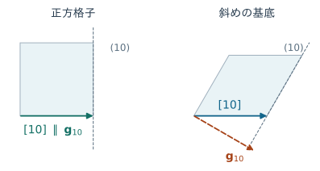

.. _crystal-directions-planes:

==================
結晶の方向と格子面
==================

結晶の向きを指定するときは、格子ベクトルに沿った方向と、格子点を含む平行な面の組を使う。
前者は方向指数 :math:`[uvw]`、後者はMiller指数 :math:`(hkl)` で表す。ここでは両者を定義し、
面の組の法線が逆格子ベクトルの向きで、隣り合う面の間隔が逆格子ベクトルの長さから決まることを示す。
同じ指数を使っても、方向と面法線は一般には平行にならない。

**前提知識**: :ref:`格子行列<lattice-translations>` :math:`A`、:ref:`分率座標<coordinates>`、
:ref:`計量行列<lattice-metric>` :math:`G`、:ref:`逆格子<reciprocal-lattice>` :math:`B`。

この記事では、断らない限り :math:`A` を基本並進ベクトルの組とする。

.. _crystal-direction-index:

結晶方向と方向指数
------------------

格子ベクトル :math:`\boldsymbol R=A\boldsymbol u`\ （:math:`\boldsymbol u=(u,v,w)^\top\in\mathbb Z^3`）の向きを
結晶方向と呼び、:math:`[uvw]` と書く。負の成分は数字の上に線を引き、:math:`[1\bar10]` のように書く。
向きだけを表すときは成分を共通因子で割り、互いに素な整数にそろえる。例えば :math:`[220]` と
:math:`[110]` は同じ向きを指す。互いに素な :math:`[uvw]` の :math:`A\boldsymbol u` は、原点からその向きに
進んで最初に当たる格子点を指す。

方向指数は格子基底の係数なので、同じ向きでも基底を取り替えれば指数が変わる。その変換則は
:ref:`方向と面の指数の変換<lt-index-transform>`\ で扱う。

.. _lattice-planes-miller:

格子面とMiller指数
------------------

互いに素な整数の組 :math:`\boldsymbol h=(h,k,l)^\top` をとり、分率座標 :math:`\boldsymbol s` が

.. math::
   :label: lattice-plane-family

   \boldsymbol h^\top\boldsymbol s=hs_1+ks_2+ls_3=m\qquad(m\in\mathbb Z)

を満たす点の集合を考える。:math:`m` を一つ決めると1枚の平面になり、:math:`m` を変えると互いに
平行な面の組になる。格子点 :math:`\boldsymbol s=\boldsymbol n\in\mathbb Z^3` では :math:`\boldsymbol h^\top\boldsymbol n`
が整数なので、どの格子点もいずれかの面に乗る。:math:`h,k,l` が互いに素なら
:math:`\boldsymbol h^\top\boldsymbol n=1` を満たす整数の組 :math:`\boldsymbol n` があり、その :math:`m` 倍を
考えれば、どの面にも格子点が乗る。このように格子点をすべて含み、各面に格子点が並ぶ平行な面の組を
格子面と呼び、:math:`\boldsymbol h` をMiller指数として :math:`(hkl)` と書く。

:math:`m=1` の面は、:math:`\boldsymbol a_1` 軸と :math:`s_1=1/h`、すなわち :math:`\boldsymbol a_1/h` で交わる。
同様に :math:`\boldsymbol a_2` 軸とは :math:`\boldsymbol a_2/k`、:math:`\boldsymbol a_3` 軸とは :math:`\boldsymbol a_3/l` で
交わる。成分が0なら、面はその軸に平行である。つまりMiller指数は、面が3本の軸を切る切片を
格子ベクトルの長さを単位に測り、その逆数を互いに素な整数にそろえたものである。例えば
:math:`(110)` の :math:`m=1` の面は :math:`\boldsymbol a_1` と :math:`\boldsymbol a_2` を切片1で切り、
:math:`\boldsymbol a_3` に平行である。

分率座標は :math:`\boldsymbol s=B^\top\boldsymbol r/2\pi`\ （式 :eq:`inverse`）なので、
:math:`\boldsymbol g=B\boldsymbol h` とおくと :math:`\boldsymbol h^\top\boldsymbol s=\boldsymbol g\cdot\boldsymbol r/2\pi` である。
したがって式 :eq:`lattice-plane-family` の面は :math:`\boldsymbol g\cdot\boldsymbol r=2\pi m` と書け、
逆格子ベクトル :math:`\boldsymbol g` に垂直である。隣り合う面の間隔は

.. math::
   :label: interplanar-spacing

   d_{hkl}=\frac{2\pi}{|\boldsymbol g|},\qquad
   \frac1{d_{hkl}^2}=\boldsymbol h^\top G^{-1}\boldsymbol h

となる。2つ目の式は、式 :eq:`lattice-metric-volume` の :math:`G=A^\top A` を使って
:math:`B^\top B=4\pi^2A^{-1}A^{-\top}=4\pi^2G^{-1}` と書けることから得られる。面間隔は格子定数だけで決まる。
例えば単純立方格子の立方基本胞では :math:`G=a^2I` なので :math:`d_{hkl}=a/\sqrt{h^2+k^2+l^2}`、:math:`d_{111}=a/\sqrt3` である。
:numref:`fig-lattice-reciprocal-vectors` の平行線は、二次元の :math:`(10)` の格子面にあたる。

.. _index-common-factor:

指数の共通因子
--------------

:math:`\boldsymbol h` の成分に共通因子があっても、式 :eq:`lattice-plane-family` は平行な面の組を表す。
例えば :math:`(200)` の面 :math:`2s_1=m` は、:math:`(100)` の面の間に :math:`s_1=1/2` の面を挟み、
面間隔は半分になる。挟んだ面には格子点が乗らない。法線の向きだけを表すなら約分して
:math:`(100)` と書けるが、:math:`\boldsymbol g=B\boldsymbol h` の大きさと面間隔は変わる。回折では
反射ごとに逆格子ベクトル :math:`\boldsymbol g` そのものを指定するので、:math:`(100)` と :math:`(200)` は
別の反射であり、指数を約分しない。

中心並進のある慣用単位胞の指数では、互いに素な指数でも式 :eq:`lattice-plane-family` の面が
格子面にならないことがある。FCCの慣用単位胞では、\ :ref:`面心並進<centring-translation>`\ のため
格子点の第1成分 :math:`s_1` は整数と半整数の両方をとる。:math:`(100)_{\rm c}` の面 :math:`s_1=m` は
:math:`s_1=1/2` にある面心の格子点を含まない。格子点をすべて含む面の組は、面間隔 :math:`a/2` の
:math:`(200)_{\rm c}` である。これは、\ :ref:`中心並進のある胞の逆格子<centred-reciprocal-lattice>`\ で
:math:`B_{\rm c}(1,0,0)^\top` が逆格子ベクトルにならず、:math:`B_{\rm c}(2,0,0)^\top` がなることに対応する。

.. _direction-and-plane-normal:

方向と面法線が平行になる条件
----------------------------

同じ指数 :math:`\boldsymbol u=(u,v,w)^\top` を方向 :math:`[uvw]` と面 :math:`(uvw)` に用いたとき、
方向ベクトル :math:`A\boldsymbol u` と面法線 :math:`B\boldsymbol u=2\pi AG^{-1}\boldsymbol u` が平行になる条件は、
:math:`\boldsymbol u` が計量行列 :math:`G` の固有ベクトルであること。:math:`G\propto I` なら任意の指数について
平行だが、:math:`G\not\propto I` でも特定の指数では平行になりうる。したがって平行かどうかは晶系名だけでは
決まらず、基底と指数の組による。立方晶の直交慣用基底では、任意の同じ指数の方向と面法線が平行になる。

:numref:`fig-crystal-direction-and-plane-normal`\ の二次元の例では、横方向の
:math:`[10]` を保ったまま基底のもう一方を傾けると、:math:`(10)` の向きとその法線が変わる。

   灰色の破線は :math:`(10)` にあたる線、:math:`\boldsymbol g_{10}` はその法線を表す。
   :math:`[10]` の矢印は格子ベクトル :math:`\boldsymbol a_1` の全長で描き、
   法線の長さは模式的に示した。

参考資料
--------

* IUCr, *International Tables for Crystallography*, Vol. A (2006), `§1.1.4 <https://it.iucr.org/Ab/ch1o1v0001/sec1o1o4.pdf>`__.
