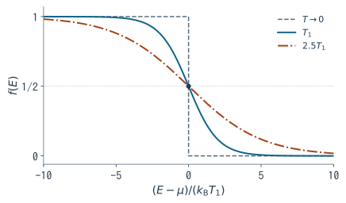

.. _fermi-level-and-occupation:

フェルミ準位と占有数
====================

:ref:`エネルギーバンド<bandstructure>`\ に、電子がどのように入るかを考える。
電子数と温度から占有数を決め、金属のフェルミ面と半導体のキャリア密度の計算につなげる。

.. _fermi-dirac-distribution:

フェルミ–ディラック分布
------------------------

エネルギー :math:`E` の1電子状態を考える。熱平衡での平均占有数 :math:`f(E)` は、
電子の化学ポテンシャルを :math:`\mu`、温度を :math:`T`、ボルツマン定数を
:math:`k_{\mathrm B}` とすると、次のフェルミ–ディラック分布に従う。

.. math::
   :label: f(E)

   f(E)=\frac{1}{1+\exp[(E-\mu)/(k_{\mathrm B}T)]}

ここでの1電子状態はスピンを含めて区別し、各状態には電子が最大1個入る。
所定の電子数になるよう :math:`\sum_\alpha f(E_\alpha)` を合わせることで
:math:`\mu` が決まる。:math:`\alpha` は波数、バンド、スピンで指定した状態を表す。
:ref:`状態密度<density-of-states>`\ が分かれば、状態の和をエネルギー積分に置き換えられる。
有限温度で :math:`E=\mu` の状態があれば、その平均占有数は :math:`1/2` である。

:numref:`fig-fermi-occupation-temperature`\ では、温度が高いほど占有数が変わる
エネルギー範囲が広い。有限温度の曲線はすべて :math:`(E,f)=(\mu,1/2)` を通る。

   式 :eq:`f(E)` を、横軸のエネルギーを :math:`k_{\mathrm B}T_1` で割って描いた。
   実線は温度 :math:`T_1`、一点鎖線は :math:`2.5T_1`、灰色の破線は絶対零度に近づけた極限。
   黒丸は有限温度での :math:`f(\mu)=1/2` を示す。

.. _fermi-surface:

絶対零度とフェルミ面
--------------------

:math:`T\to0` では、:math:`E<\mu` の占有数は1に、:math:`E>\mu` の占有数は0に
近づく。絶対零度での化学ポテンシャルをフェルミエネルギーと呼ぶ。半導体では有限温度の
:math:`\mu` もフェルミ準位と呼ぶことが多い。絶対零度で化学ポテンシャルが
:ref:`バンドギャップ<valence-conduction-band-gap>`\ 内にあるとき、ギャップ内でその値を動かしても各状態の占有は変わらない。

金属では、少なくとも一つのバンドがフェルミ準位を横切る。波数空間で
:math:`E_j(\boldsymbol k)=\mu` を満たす面がフェルミ面である。
等間隔な\ :ref:`1次元のタイト・バインディング鎖<tightbinding>`\ で最近接ホッピングだけを含めると、1原子1軌道の
バンドに、スピンを含めて
原子数の2倍の状態がある。原子1個あたり電子1個の\ :ref:`半充填<half-filling>`\ では、
フェルミ面に相当する境界は2つのフェルミ点 :math:`k=\pm\pi/(2a)` になる。
金属では、この\ :ref:`占有数の段差<kpoint-fermi-surface>`\ がk点メッシュによる積分誤差に影響する。

.. _fermi-boltzmann-limit:

ボルツマン近似
--------------

:math:`E-\mu\gg k_{\mathrm B}T` では、式 :eq:`f(E)` の分母で指数項が支配的になる。
したがって伝導帯の電子のように、この条件を満たす状態の占有数は

.. math::
   :label: f(E)_2

   f(E)\simeq \exp\!\left[-\frac{E-\mu}{k_{\mathrm B}T}\right]

と近似できる。価電子帯の正孔の確率は、その電子状態が空である確率 :math:`1-f(E)`
である。:math:`\mu-E\gg k_{\mathrm B}T` では、分母の
:math:`\exp[(E-\mu)/(k_{\mathrm B}T)]` が小さいため、

.. math::
   :label: f(E)_3

   f(E)\simeq 1-\exp\!\left[-\frac{\mu-E}{k_{\mathrm B}T}\right]

となり、正孔の確率は

.. math::
   :label: 1-f(E)

   1-f(E)\simeq \exp\!\left[-\frac{\mu-E}{k_{\mathrm B}T}\right]

となる。これらの近似から\ :ref:`伝導帯の電子密度<conduction-band-electrons>`\ と
:ref:`価電子帯の正孔密度<valence-band-holes>`\ を求められる。フェルミ準位がバンド端に近づくと近似の条件が
崩れるので、その場合は式 :eq:`f(E)` を状態密度との積分に使う。

参考資料
--------

* Jesús A. del Alamo, MIT OpenCourseWare, `Integrated Microelectronic Devices, Lecture 3 <https://ocw.mit.edu/courses/6-720j-integrated-microelectronic-devices-spring-2007/1bccffbfa7b4487be99b8af8b46186ef_lecture3.pdf>`_.
