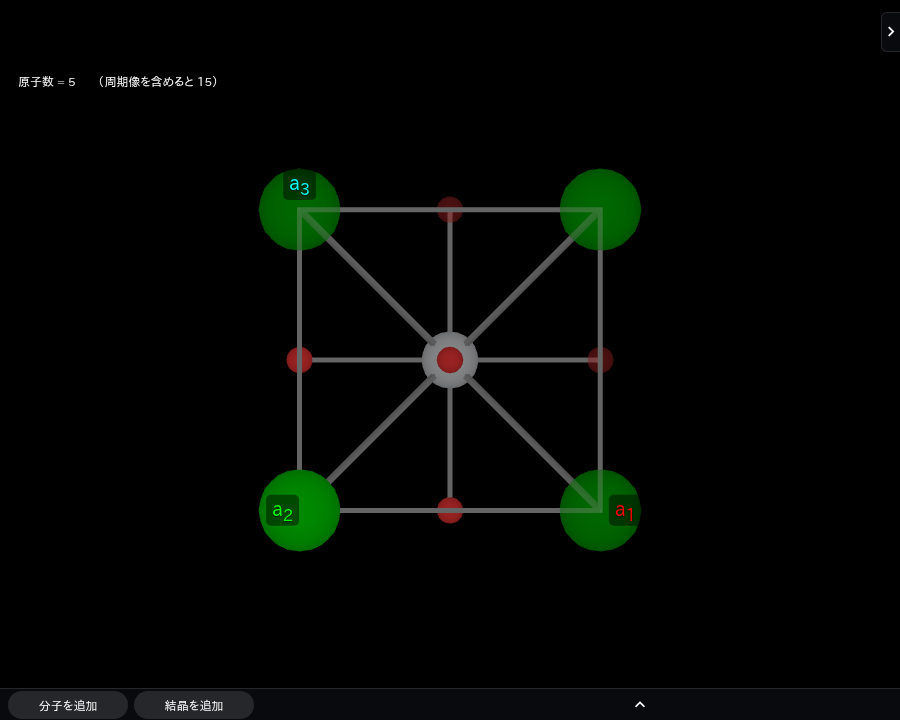
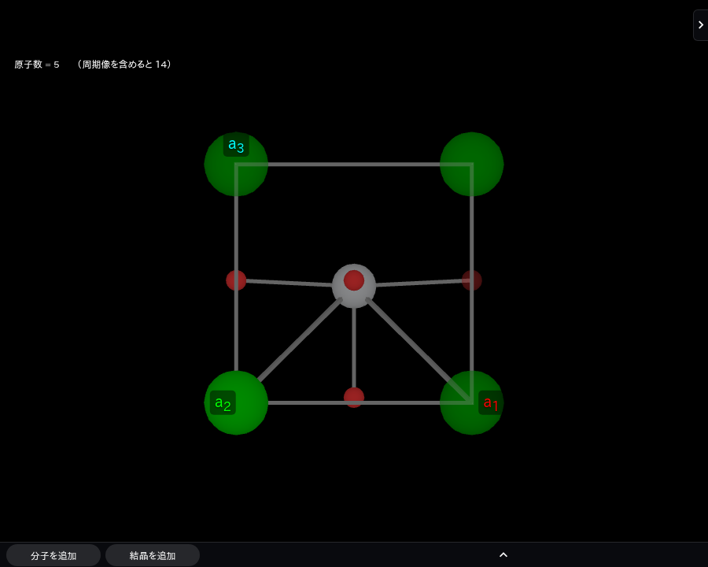
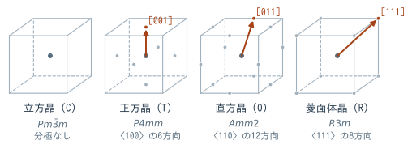

.. _ferroelectricity:

==============================
強誘電性と結晶構造
==============================

強誘電体は、\ :ref:`自発分極<spontaneous-polarization>`\ をもち、外部電場によってその向きを反転できる物質である。
代表例のチタン酸バリウム（BaTiO\ :sub:`3`\ ）を通して、結晶の対称性と
原子変位がどのように分極につながるかを見ていく。

ここでは、結晶構造から強誘電性を理解するための基本を扱う。BaTiO\ :sub:`3`\ の
計算条件やQuloudでの操作手順は扱わない。具体的な計算事例と操作手順は、
それぞれQuloud Examplesとオンラインマニュアルで扱う。周期結晶の分極の値の求め方は「\ :ref:`periodic-polarization`\ 」、
立方晶が極性の変位に対して不安定になる理由は「\ :ref:`ferroelectric-origin`\ 」で扱う。自由エネルギーの展開からの導出は
「\ :ref:`landau-theory`\ 」にまとめた。

**前提知識**: :ref:`反転対称性と自発分極<inversion-and-polarization>`、:ref:`等価な方向の族<equivalent-directions>`、:ref:`ペロブスカイトの擬立方格子<pseudocubic-cell>`、:ref:`ソフトモードと構造相転移<soft-mode>`\ （とくに\ :ref:`秩序変数としてのモードの振幅<sm-landau>`）、:ref:`Landau理論と相転移の次数<landau-theory>`。

**学習目標**:

* 常誘電相の誘電率がCurie–Weissの法則に従うことと、1次転移では転移温度とCurie–Weiss温度がずれることを説明し、BaTiO\ :sub:`3`\ の二重ヒステリシスの観測から転移の次数を読む。
* BaTiO\ :sub:`3`\ の4つの相の空間群と分極の向きを、擬立方格子の方向で説明する。
* 分極の方位状態の数（分域がとりうる分極の向きの数）を点群の位数から求め、隣り合う分域の分極がなす角を挙げる。
* 回折で決まる平均構造と、各単位胞の局所的な変位の違いを説明する。

.. _spontaneous-polarization:

------------------------------
自発分極と強誘電性
------------------------------

分極は、電気双極子モーメントを体積で割った量であり、単位体積あたりの
電荷の偏りを表す。結晶では、正負のイオンの変位に加えて電子密度の変化も
分極に寄与する。

結晶構造が極性をもつと、自発分極が許される。ただし、極性があることだけで
強誘電体とは限らない。強誘電体と呼ぶには、自発分極の向きを外部電場で
可逆に切り替えられることが必要である。

.. _paraelectric-phase:

------------------------------
常誘電相とキュリー温度
------------------------------

強誘電体を加熱すると、ある温度で自発分極が消え、電場をかけている間だけ分極が生じる相に移る。
この高温の相を\ **常誘電相**\ （paraelectric phase）、転移温度を\ **キュリー温度**
:math:`T_{\mathrm C}` と呼ぶ（\ :ref:`ソフトモードの記事<sm-definition>`\ の転移温度 :math:`T_{\mathrm c}` にあたる）。常誘電相では、弱い電場 :math:`E` に比例して分極が生じ、
電気感受率 :math:`\chi` を使って :math:`P=\varepsilon_0\chi E` と書ける。強誘電体の常誘電相では、
:math:`T_{\mathrm C}` に近づくと :math:`\chi` が大きくなり、

.. math::
   :label: fe-curie-weiss

   \chi=\frac{C}{T-T_0}

に従う。これを\ **Curie–Weissの法則**\ 、:math:`C` をCurie定数、:math:`T_0` をCurie–Weiss温度と呼ぶ。:ref:`極性ソフトモード<polar-soft-mode>`\ の振動数が下がると静的な誘電率が発散するので、
この法則は格子振動の側からも導ける。その場合の :math:`T_0` は、Cochranの法則 :eq:`sm-cochran` でソフトモードの振動数が0に外挿される温度である。
分極で展開した自由エネルギーからの導出は\ :ref:`共役な場への応答<landau-curie-weiss>`\ にある。

:math:`T_0` と :math:`T_{\mathrm C}` の関係は、分極で展開した自由エネルギーから分かる [Devonshire1949]_。導出は
「\ :ref:`landau-theory`\ 」で扱い、ここでは結論だけを述べる。分極の4次の係数が正なら、分極は :math:`T_0` から連続的に育つ
\ :ref:`2次転移<second-order-transition>`\ になり、:math:`T_{\mathrm C}=T_0` である。4次の係数が負なら\ :ref:`1次転移<first-order-transition>`\ になり、
分極は :math:`T_{\mathrm C}` で有限の値へ跳び、常誘電相の :math:`\chi` から外挿した :math:`T_0` は :math:`T_{\mathrm C}` より低い。1次転移では、
冷却と加熱で常誘電相と強誘電相がそれぞれ\ :ref:`準安定な状態として残りうる<landau-metastability>`\ ので、転移温度が加熱と冷却でずれうる。

BaTiO\ :sub:`3`\ では、Merzが :math:`T_{\mathrm C}` のすぐ上で、弱い電場では直線、強い電場では両端に
ヒステリシスが開く分極–電場曲線（二重ヒステリシス）を観測し、4次の係数が負であること、
つまり立方晶から正方晶への転移が1次であることを示した [Merz1953]_\ （\ :ref:`読み方<landau-batio3-example>`）。BaTiO\ :sub:`3`\ の三つの転移は
いずれも1次である [Zhong1995]_。

.. _batio3-crystal-phases:

--------------------------------------------------
BaTiO\ :sub:`3`\ の立方晶相と正方晶相
--------------------------------------------------

BaTiO\ :sub:`3`\ は、理想的なペロブスカイト構造をもつ。高温の立方晶相では、
平均構造としてTi原子が周囲の6個の酸素原子が作る八面体の中心に位置する。この構造には
:ref:`反転中心<inversion-and-polarization>`\ があり、結晶全体として特定の向きの自発分極は生じない。
立方晶相はBaTiO\ :sub:`3`\ の常誘電相である。

バルクのBaTiO\ :sub:`3`\ を冷却すると、約393 Kで立方晶相から正方晶相へ移る。
正方晶相ではTiと酸素の相対位置が変わり、反転対称性が失われる。結晶の
長軸方向に極性が生じ、自発分極をもつ。この構造変化が強誘電性の起源を
理解するための基本例となる [Zhong1995]_ [Bull2021]_。

.. |batio3-experimental-structures| replace:: 実験構造から見る対称性と格子ひずみ

--------------------------------
|batio3-experimental-structures|
--------------------------------

   立方晶相（413 K）の平均構造。格子定数は :math:`a=b=c=4.0097` Å。
   Quloudのモデラーに実験構造を読み込み、表示した。色はBa（緑）、Ti（灰色）、
   O（赤）を示す。表示には隣接する周期像も含まれる。

   正方晶相（303 K）。格子定数は :math:`a=b=3.9925` Å、:math:`c=4.0371` Å。
   Tiと酸素の相対変位、および :math:`c>a` の格子ひずみが見られる。

図の座標はNakataniらの単結晶X線回折による実験構造に基づく。2つの温度の構造を
並べているため、図は相転移をその場で追跡したものではない。また、高温立方晶相
では局所的なTi変位が残りうることが報告されており、立方晶の図は平均構造を表す
[Nakatani2016]_。

.. list-table:: 立方晶相と正方晶相の構造上の違い
   :name: tbl-batio3-cubic-tetragonal
   :header-rows: 1

   * - 観点
     - 立方晶相
     - 正方晶相
   * - 代表的な空間群
     - :math:`Pm\bar{3}m`
     - :math:`P4mm`
   * - 格子の形
     - :math:`a=b=c`
     - :math:`a=b\ne c`
   * - 反転対称性
     - ある
     - ない
   * - 自発分極
     - ない
     - ある

正方晶相の格子ひずみは、格子定数を使って :math:`c/a` で表せる。立方晶からの
ずれは :math:`c/a-1` で見積もれる。ただし、この比だけでは分極の大きさは
求まらない。分極には単位胞内の各原子の変位と電子状態も関係する（\ :ref:`分極の評価<polarization-evaluation>`）。

.. _batio3-four-phases:

------------------------------
4つの相と分極の向き
------------------------------

正方晶相をさらに冷やすと、BaTiO\ :sub:`3`\ は約278 Kで直方晶（斜方晶ともいう）相へ、約183 Kで菱面体晶相へ移る
[Kwei1993]_ [Shi2018]_。以下では、立方晶・正方晶・直方晶・菱面体晶の相をそれぞれC・T・O・Rと書く。Merzは、
低温側の二つの転移で分極の向きが変わることを測定し、これを、酸素八面体の中でTiの変位の向きが :math:`[001]` から :math:`[011]` へ、
さらに :math:`[111]` へ変わることと対応づけた [Merz1949]_。方向は、どの相でも\ :ref:`擬立方胞<pseudocubic-cell>`\ の軸で書く（各相の胞と擬立方胞の関係は :numref:`lt-batio3-pseudocubic-table`）。
:numref:`tbl-batio3-four-phases` と :numref:`fig-batio3-polar-directions` に4相をまとめる。

.. list-table:: BaTiO\ :sub:`3`\ の4つの相（温度は常圧での目安）
   :name: tbl-batio3-four-phases
   :header-rows: 1
   :widths: 16 20 16 12 18 18

   * - 相
     - 温度範囲
     - 空間群
     - 点群
     - 分極の向き（擬立方）
     - 0でない分極の成分の数
   * - 立方晶（C）
     - 約393 K以上
     - :math:`Pm\bar3m`
     - :math:`m\bar3m`
     - なし
     - 0
   * - 正方晶（T）
     - 約278〜393 K
     - :math:`P4mm`
     - :math:`4mm`
     - :math:`\langle100\rangle`
     - 1
   * - 直方晶（O）
     - 約183〜278 K
     - :math:`Amm2`
     - :math:`mm2`
     - :math:`\langle110\rangle`
     - 2
   * - 菱面体晶（R）
     - 約183 K以下
     - :math:`R3m`
     - :math:`3m`
     - :math:`\langle111\rangle`
     - 3

転移温度は1次転移の性質上、\ :ref:`加熱と冷却でずれうる<apparent-transition-temperature>`。立方晶–正方晶の転移を403 Kとする文献もある [Zhong1995]_。

   BaTiO\ :sub:`3`\ の4相の分極の向き。左から高温側の順に並べた。立方体は擬立方胞、中央の点はTiの平均位置を表す。
   矢印は分極の向きの一例で、正方晶は面の中心、直方晶は辺の中点、菱面体晶は頂点へ向かう。
   灰色の点は、立方晶の対称操作で矢印の向きと移り合う方向（同じ族の残りの方向）を示す。破線は奥に隠れた辺である。

表の最後の列は、相を見分ける指標になる。\ :ref:`等価な方向の族<equivalent-directions>`\ で見たとおり、立方晶の点群
:math:`m\bar3m` の操作は、分極の成分の並べ替えと符号の反転である。これらの操作で、どの軸の成分が0でないかや
その符号は変わるが、0でない成分の数は変わらない。したがって、次節の分域のどれを選んでも、0でない成分の数は相ごとに3・2・1・0の決まった値になる。
`計算事例「構造相転移」 <https://example.quloud-platform.quemix.com/BaTiO3/phase_transition.html#batio3-phase-distributions>`_\ も、Tiの変位の分布で、0からずれたピークをもつ軸の数を\ :ref:`相の判定<heating-phase-indicators>`\ に使っている。ただし、反対向きの分域が同じ領域に
混じっていると、平均した成分は打ち消し合う。この指標は、一つの分域の中で平均した変位に使う。

分極をもつ3つの相では、どれも格子が分極の方向に伸びている。正方晶では :math:`c>a`、直方晶では極性軸に沿う胞の辺が
垂直な辺より長く（\ :ref:`直方晶の胞との換算<pseudocubic-orthorhombic>`）、菱面体晶では擬立方胞の角が90°よりわずかに小さく（約89.8° [Kwei1993]_）、
:math:`[111]` 方向に伸びた形になる。Merzは、正方晶の変形が自発分極の2乗に比例することを示した [Merz1949]_。
どの向きが最も低いエネルギーを与えるかは、立方晶の対称性が許す4次以上の項で決まる（式 :eq:`sm-cubic-quartic`）。

.. _ferroelectric-domains:

------------------------------
分域と分域壁
------------------------------

電場やひずみがなく、結晶が立方晶の対称性を保つ条件では、分極が族の中のどの方向を向いてもエネルギーは等しい。立方晶の対称操作で移り合う向きは、:ref:`+Qと−Qの等価性<sm-inversion-equivalence>`\ と同じ理由で、同じエネルギーをもつからである。
このエネルギーの等しい向きの数は、点群の位数（操作の数）から求められる。立方晶の点群 :math:`G=m\bar3m` の48個の操作のうち、
選んだ分極の向きを変えない操作の集まりは、低温相の点群 :math:`F` になる。正方晶の :math:`[001]` を変えないのは、
:math:`z` 軸のまわりの回転と、:math:`z` 軸を含む鏡映の8個（:math:`4mm`）である。:math:`G` の残りの操作は
:math:`[001]` を別の向きへ移し、同じ向きへ移す操作は :math:`F` の位数だけある。したがって、向きの数は

.. math::
   :label: fe-domain-count

   n=\frac{|G|}{|F|}

で、正方晶 :math:`48/8=6`、直方晶 :math:`48/4=12`、菱面体晶 :math:`48/6=8` となり、:math:`\langle100\rangle`・
:math:`\langle110\rangle`・:math:`\langle111\rangle` の族の方向の数に一致する（:numref:`fig-batio3-polar-directions`\ の点の数）。Aizuは、このように対称性の高い相から生じる同等な状態を方位状態（orientation state）と呼び、強誘電体などを分類した [Aizu1970]_。

どの向きもエネルギーが等しいので、電場をかけずに冷やした結晶では、場所ごとに異なる向きが選ばれうる。分極の向きがそろった領域を\ **分域**\ （ドメイン）、
その境界を\ **分域壁**\ と呼ぶ。:eq:`fe-domain-count` の :math:`n` は分域がとりうる向き（方位状態）の数で、実際に現れる分域の数や体積の割合は、
表面や電極の状態、応力、冷却の履歴などにも依存する。隣り合う分域の分極がなす角は、二つの方向ベクトルの内積から求まり、相によって決まった値をとる。

.. list-table:: 隣り合う分域の分極がなす角
   :name: tbl-domain-wall-angles
   :header-rows: 1
   :widths: 20 20 60

   * - 相
     - 分極の方位状態の数
     - 分極がなす角
   * - 正方晶
     - 6
     - 90°、180°
   * - 直方晶
     - 12
     - 60°、90°、120°、180°
   * - 菱面体晶
     - 8
     - 約71°（:math:`\cos^{-1}(1/3)`）、約109°（:math:`\cos^{-1}(-1/3)`）、180°

180°の分域壁を挟む二つの分域は、分極の符号だけが異なり、格子の伸びる方向は同じである。
それ以外の分域壁では、格子が伸びる方向も変わる。正方晶の90°分域壁では、両側で :math:`c` 軸の向きが90°異なる。

分域ができる理由の一つは、表面に現れる電荷である。分極 :math:`\boldsymbol P` の結晶の表面（外向きの法線 :math:`\boldsymbol n`）には、
面密度 :math:`\boldsymbol P\cdot\boldsymbol n` の分極電荷が現れる。分極に垂直な板状の結晶で、表面の電荷を打ち消す電荷が外から
供給されないと、内部では電束密度 :math:`D=\varepsilon_0E+P` が0になり、:math:`E=-P/\varepsilon_0` の電場が生じる
（電子の分極による遮蔽は無視した）。:math:`P=0.26\ \mathrm{C/m^2}` なら :math:`|E|\simeq3\times10^{10}\ \mathrm{V/m}` である。
電場のエネルギー密度 :math:`\varepsilon_0E^2/2=P^2/(2\varepsilon_0)` は、化学式単位の体積（約64 Å\ :sup:`3`）あたり約1.5 eVで、
立方晶から極性の構造へ移って下がるエネルギー（転移温度の熱エネルギー程度 [CohenKrakauer1990]_）より桁違いに大きい。逆向きの分域が交互に並ぶか、電極や吸着物が表面の電荷を打ち消すと、この電場は小さくなる。

電場をかけると、電場の向きに近い分極をもつ分域が広がり、結晶全体の分極が反転する。Merzは、BaTiO\ :sub:`3`\ の単結晶で
分極を反転させるとき、既存の180°分域壁が横に動くことはまれで、逆向きの薄い分域が多数生まれ、主に分極の方向へ伸びて
反転が進むことを観察した。分域壁の厚さは格子定数の1〜数倍と見積もられている [Merz1954]_。

周期境界条件の小さな胞の計算では、胞の中で分極の向きが一つにそろい、一つの分域だけからなる結晶を表す。
分域壁を含む構造を調べるには、壁を収める大きさの超胞が要る。

.. _fe-local-average:

--------------------------------------------------------
説明用の事例：局所的なTiの変位と平均構造
--------------------------------------------------------

Bragg反射の回折で決まる構造は、空間と時間について平均した\ **平均構造**\ である。各単位胞の瞬間的な原子配置
（局所構造）は、散漫散乱、\ :ref:`二体分布関数<radial-distribution-function>`\ （PDF）、X線吸収微細構造（XAFS）などで調べる。BaTiO\ :sub:`3`\ では、
以下の測定が示すように、両者が一致しない。

二つの描像がある [Shi2018]_。変位型の描像では、Tiは各相の分極の向きに変位し、立方晶相では八面体の中心にいる。8サイト模型と呼ばれる秩序–無秩序型の描像では、どの相でもTiは八面体の中心から8つの :math:`\langle111\rangle` 方向の
どれかにずれており、相ごとにその選び方の偏りが違う [Bersuker1966]_ [Comes1968]_。変位を :math:`(\pm d,\pm d,\pm d)` と書くと、
菱面体晶相では全ての胞が同じ符号の組を選ぶ。直方晶相では2成分の符号がそろい、残る1成分の符号が胞ごとに
ばらばらなので、その成分は平均すると0になり、平均の変位は :math:`\langle110\rangle` を向く。正方晶相では
そろう成分が1つ、立方晶相では0個である。平均の変位の0でない成分の数3・2・1・0は、ここではそろった符号の数として現れ、
変位型の描像と同じ平均構造を与える。二つの描像は、局所構造で区別される。

Comèsらは、Tiの変位が鎖状に相関すると考えると説明できる散漫散乱を観測した [Comes1968]_
（鎖状にそろいやすい理由は\ :ref:`双極子どうしの相互作用<ferroelectric-instability-origin>`）。Sennらは、PDFの解析から、Tiの局所的な変位が既知のすべての相で菱面体晶的（:math:`\langle111\rangle` 方向に近い）であることを示した。
局所的な変位の相関だけを入れたモンテカルロ模型で相の順序を再現し、秩序–無秩序型の描像を支持しつつ、
ソフトモードの描像とも両立しうると述べている [Senn2016]_。XAFSでも、変位型と秩序–無秩序型の成分が共存すると報告されている
[Stern2004]_。どちらの成分がどれだけ寄与するかの一般論は、\ :ref:`変位型と秩序–無秩序型の相転移<displacive-order-disorder>`\ にある。

このことから、立方晶の平均構造 :math:`Pm\bar3m` は、ある瞬間の原子配置ではない。有限温度の\ :ref:`分子動力学法<molecular-dynamics>`\ の
スナップショットでは、立方晶相でもTiは中心からずれ、平均を取って初めて立方晶の対称性が現れる。0 Kの\ :ref:`構造最適化<structure-optimization>`\ で
対称性を課した立方晶は、極性の変位に対して不安定な\ :ref:`鞍点の構造<phonon-batio3-example>`\ である。0 Kの計算は、局所的な極性不安定性がなぜ生じるかを調べるのに向き、その変位が温度とともにどうそろい、
どう乱れるかは\ :ref:`有限温度の計算<apparent-transition-temperature>`\ で調べる。

.. _fe-reading-optimization:

------------------------------
構造最適化の結果を読むとき
------------------------------

立方晶構造と正方晶構造をそれぞれ計算し、全エネルギーや原子位置を比較すると、
どちらの構造が計算条件のもとで安定かを調べられる。原子位置の変化からは、
対称性が保たれているか、極性を生む変位が現れているかを確認できる。

ただし、ゼロ温度近似の\ :ref:`構造最適化<structure-optimization>`\ だけで、実験で観測される温度ごとの相転移を
再現したことにはならない。相転移温度や相の安定性には、有限温度での振動や
エントロピーなども関わる。また、構造が極性を許すことと、電場で分極を反転
できることは別の性質である。

イオンの部分電荷と変位の積を足す方法は、分極の直感的な見積もりには使えるが、
周期結晶の分極を厳密に評価するには電子状態を含む扱いが必要である（\ :ref:`分極の評価<polarization-evaluation>`）。したがって、
構造図や :math:`c/a` のみから分極の値を断定しない。

.. _fe-related:

------------------------------
関連資料
------------------------------

* :ref:`格子と単位胞<lattice>`
* :ref:`ブラベー格子と結晶系<unitcell>`
* :ref:`ペロブスカイトの擬立方格子<pseudocubic-cell>`
* :ref:`soft-mode`
* :ref:`phonon`
* :ref:`ferroelectric-origin`

.. _fe-references:

------------------------------
参考文献
------------------------------

.. [Zhong1995] W. Zhong, D. Vanderbilt, and K. M. Rabe, “First-principles theory
   of ferroelectric phase transitions for perovskites: The case of BaTiO\ :sub:`3`,”
   *Physical Review B* **52**, 6301–6312 (1995),
   `doi:10.1103/PhysRevB.52.6301 <https://doi.org/10.1103/PhysRevB.52.6301>`_.
.. [Bull2021] C. L. Bull, C. J. Ridley, K. S. Knight, N. P. Funnell, and A. S. Gibbs,
   “Comprehensive determination of the high-pressure structural behaviour of
   BaTiO\ :sub:`3`,” *Materials Advances* **2**, 6094–6103 (2021),
   `doi:10.1039/D1MA00651G <https://doi.org/10.1039/D1MA00651G>`_.
.. [Nakatani2016] T. Nakatani, A. Yoshiasa, A. Nakatsuka, T. Hiratoko, T. Mashimo,
   M. Okube, and S. Sasaki, “Variable-temperature single-crystal X-ray diffraction
   study of tetragonal and cubic perovskite-type barium titanate phases,”
   *Acta Crystallographica Section B* **72**, 151–159 (2016),
   `doi:10.1107/S2052520615022544 <https://doi.org/10.1107/S2052520615022544>`_.
.. [Merz1953] W. J. Merz, “Double hysteresis loop of BaTiO\ :sub:`3` at the Curie point,”
   *Physical Review* **91**, 513–517 (1953),
   `doi:10.1103/PhysRev.91.513 <https://doi.org/10.1103/PhysRev.91.513>`_.
.. [Kwei1993] G. H. Kwei, A. C. Lawson, S. J. L. Billinge, and S.-W. Cheong, “Structures of the
   ferroelectric phases of barium titanate,” *Journal of Physical Chemistry* **97**, 2368–2377 (1993),
   `doi:10.1021/j100112a043 <https://doi.org/10.1021/j100112a043>`_.
.. [Shi2018] C. Shi, S. J. L. Billinge, E. Puma, S. H. Bang, N. J. H. Bean, J.-C. de Sugny,
   R. G. Gambee, R. C. Haskell, A. Hightower, and T. C. Monson, “Barium titanate nanoparticles:
   Short-range lattice distortions with long-range cubic order,” *Physical Review B* **98**, 085421 (2018),
   `doi:10.1103/PhysRevB.98.085421 <https://doi.org/10.1103/PhysRevB.98.085421>`_.
.. [Merz1949] W. J. Merz, “The electric and optical behavior of BaTiO\ :sub:`3` single-domain crystals,”
   *Physical Review* **76**, 1221–1225 (1949),
   `doi:10.1103/PhysRev.76.1221 <https://doi.org/10.1103/PhysRev.76.1221>`_.
.. [Aizu1970] K. Aizu, “Possible species of ferromagnetic, ferroelectric, and ferroelastic crystals,”
   *Physical Review B* **2**, 754–772 (1970),
   `doi:10.1103/PhysRevB.2.754 <https://doi.org/10.1103/PhysRevB.2.754>`_.
.. [Merz1954] W. J. Merz, “Domain formation and domain wall motions in ferroelectric BaTiO\ :sub:`3`
   single crystals,” *Physical Review* **95**, 690–698 (1954),
   `doi:10.1103/PhysRev.95.690 <https://doi.org/10.1103/PhysRev.95.690>`_.
.. [Bersuker1966] I. B. Bersuker, “On the origin of ferroelectricity in perovskite-type crystals,”
   *Physics Letters* **20**, 589–590 (1966),
   `doi:10.1016/0031-9163(66)91127-9 <https://doi.org/10.1016/0031-9163(66)91127-9>`_.
.. [Senn2016] M. S. Senn, D. A. Keen, T. C. A. Lucas, J. A. Hriljac, and A. L. Goodwin, “Emergence of
   long-range order in BaTiO\ :sub:`3` from local symmetry-breaking distortions,”
   *Physical Review Letters* **116**, 207602 (2016),
   `doi:10.1103/PhysRevLett.116.207602 <https://doi.org/10.1103/PhysRevLett.116.207602>`_.

.. raw:: html

   

.. raw:: html

   
