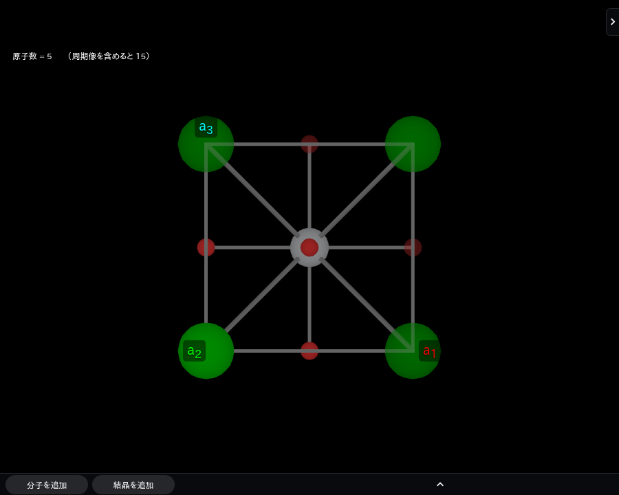
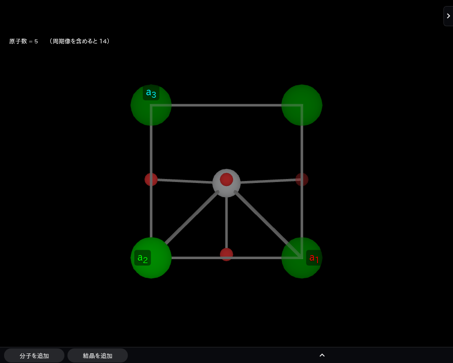

.. _ferroelectricity:

==============================
強誘電性と結晶構造
==============================

強誘電体は、自発分極をもち、外部電場によってその向きを反転できる物質である。
代表例のチタン酸バリウム（BaTiO\ :math:`_3`\ ）を通して、結晶の対称性と
原子変位がどのように分極につながるかを見ていく。

ここでは、結晶構造から強誘電性を理解するための基本を扱う。BaTiO\ :math:`_3`\ の
計算条件やQuloudでの操作手順は扱わない。具体的な計算事例と操作手順は、
それぞれQuloud Examplesとオンラインマニュアルで扱う。

------------------------------
自発分極と強誘電性
------------------------------

分極は、電気双極子モーメントを体積で割った量であり、単位体積あたりの
電荷の偏りを表す。結晶では、正負のイオンの変位に加えて電子密度の変化も
分極に寄与する。

結晶構造が極性をもつと、自発分極が許される。ただし、極性があることだけで
強誘電体とは限らない。強誘電体と呼ぶには、自発分極の向きを外部電場で
可逆に切り替えられることが必要である。

--------------------------------------------------
BaTiO\ :math:`_3`\ の立方晶相と正方晶相
--------------------------------------------------

BaTiO\ :math:`_3`\ は、理想的なペロブスカイト構造をもつ。高温の立方晶相では、
平均構造としてTi原子が周囲の6個の酸素原子が作る八面体の中心に位置する。この構造には
反転中心があり、結晶全体として特定の向きの自発分極は生じない。

バルクのBaTiO\ :math:`_3`\ を冷却すると、約393 Kで立方晶相から正方晶相へ移る。
正方晶相ではTiと酸素の相対位置が変わり、反転対称性が失われる。結晶の
長軸方向に極性が生じ、自発分極をもつ。この構造変化が強誘電性の起源を
理解するための基本例となる [Zhong1995]_ [Bull2021]_。

   立方晶相（413 K）の平均構造。格子定数は :math:`a=b=c=4.0097` Å。
   Quloudのモデラーに実験構造を読み込み、表示した。色はBa（緑）、Ti（灰色）、
   O（赤）を示す。表示には隣接する周期像も含まれる。

   正方晶相（303 K）。格子定数は :math:`a=b=3.9925` Å、:math:`c=4.0371` Å。
   Tiと酸素の相対変位、および :math:`c>a` の格子ひずみが見られる。

図の座標はNakataniらの単結晶X線回折による実験構造に基づく。2つの温度の構造を
並べているため、図は相転移をその場で追跡したものではない。また、高温立方晶相
では局所的なTi変位が残りうることが報告されており、立方晶の図は平均構造を表す
[Nakatani2016]_。

.. list-table:: 立方晶相と正方晶相の構造上の違い
   :header-rows: 1

   * - 観点
     - 立方晶相
     - 正方晶相
   * - 代表的な空間群
     - :math:`Pm\bar{3}m`
     - :math:`P4mm`
   * - 格子の形
     - :math:`a=b=c`
     - :math:`a=b\ne c`
   * - 反転対称性
     - ある
     - ない
   * - 自発分極
     - ない
     - ある

正方晶相の格子ひずみは、格子定数を使って :math:`c/a` で表せる。立方晶からの
ずれは :math:`c/a-1` で見積もれる。ただし、この比だけでは分極の大きさは
求まらない。分極には単位胞内の各原子の変位と電子状態も関係する。

------------------------------
構造最適化の結果を読むとき
------------------------------

立方晶構造と正方晶構造をそれぞれ計算し、全エネルギーや原子位置を比較すると、
どちらの構造が計算条件のもとで安定かを調べられる。原子位置の変化からは、
対称性が保たれているか、極性を生む変位が現れているかを確認できる。

ただし、ゼロ温度近似の構造最適化だけで、実験で観測される温度ごとの相転移を
再現したことにはならない。相転移温度や相の安定性には、有限温度での振動や
エントロピーなども関わる。また、構造が極性を許すことと、電場で分極を反転
できることは別の性質である。

イオンの部分電荷と変位の積を足す方法は、分極の直感的な見積もりには使えるが、
周期結晶の分極を厳密に評価するには電子状態を含む扱いが必要である。したがって、
構造図や :math:`c/a` のみから分極の値を断定しない。

------------------------------
関連項目
------------------------------

* :ref:`格子ベクトルと逆格子ベクトル<lattice>`
* :ref:`格子座標<coordinates>`
* :ref:`ブラべ格子と結晶系<unitcell>`

参考文献
--------

.. [Zhong1995] W. Zhong, D. Vanderbilt, and K. M. Rabe, “First-principles theory
   of ferroelectric phase transitions for perovskites: The case of BaTiO\ :math:`_3`\ ,”
   *Physical Review B* **52**, 6301 (1995),
   `doi:10.1103/PhysRevB.52.6301 <https://doi.org/10.1103/PhysRevB.52.6301>`_.
.. [Bull2021] C. L. Bull, C. J. Ridley, K. S. Knight, N. P. Funnell, and A. S. Gibbs,
   “Comprehensive determination of the high-pressure structural behaviour of
   BaTiO\ :math:`_3`\ ,” *Materials Advances* **2**, 6094–6103 (2021),
   `doi:10.1039/D1MA00651G <https://doi.org/10.1039/D1MA00651G>`_.
.. [Nakatani2016] T. Nakatani, A. Yoshiasa, A. Nakatsuka, T. Hiratoko, T. Mashimo,
   M. Okube, and S. Sasaki, “Variable-temperature single-crystal X-ray diffraction
   study of tetragonal and cubic perovskite-type barium titanate phases,”
   *Acta Crystallographica Section B* **72**, 151–159 (2016),
   `doi:10.1107/S2052520615022544 <https://doi.org/10.1107/S2052520615022544>`_.
