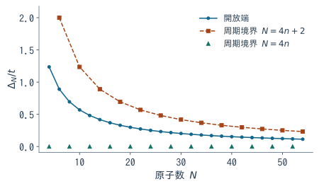

.. _finite-chain:

有限鎖の準位と有限サイズギャップ
================================

分子や有限の長さの鎖を計算すると、準位は離散的で、最高被占有軌道（HOMO）と
最低空軌道（LUMO）の間に隙間（HOMO–LUMOギャップ）が開く。この隙間が結晶のバンドギャップに
対応するのか、原子数が有限であるために生じたものなのかは、ギャップの大きさだけでは決まらない。
本稿では、\ :ref:`タイト・バインディング近似<tightbinding>`\ の1次元鎖を両端が開いた境界条件で解き、
離散準位が周期鎖のバンドとどう対応するか、ギャップが原子数と境界条件でどう変わるかを確かめる。

本稿では、両端が開いた :math:`N` 原子の鎖を **開放端の鎖**、:math:`N` 原子に周期境界条件を
課した鎖（環）を **有限の周期鎖** と呼ぶ。両者を合わせて有限鎖と呼ぶ。

**前提知識**: :ref:`タイト・バインディング近似<tightbinding>`\ の模型（式 :eq:`tb-recursion`、:eq:`tb-band`）、
:ref:`半充填<half-filling>`、:ref:`SSH模型<tb-ssh>`。

**学習目標**:

* 開放端の鎖の固有状態を求め、擬似波数の意味を説明する。
* 半充填の開放端の鎖のHOMO–LUMOギャップが、原子数が大きいとき、およそ原子数に反比例して閉じることを示す。
* 計算で得たギャップが、有限サイズによるものか、無限鎖でも残るものかを、原子数と境界条件への依存から判断する。

.. _open-boundary:

開放端の境界条件
----------------

開放端の鎖では、:math:`n=1` と :math:`n=N` の原子は片側に
しか隣接原子をもたない。これは、仮想的な :math:`n=0` と :math:`n=N+1` の位置に
係数0の軌道を置き、

.. math::
   :label: fc-open-boundary

   c_0=c_{N+1}=0

という境界条件で\ :ref:`タイト・バインディング近似<tightbinding>`\ の連立方程式 :eq:`tb-recursion` を解くことと同じである。
これを **開放境界条件** と呼ぶ。周期境界条件 :math:`c_{n+N}=c_n` と違い、並進 :math:`n\to n+1` は
鎖を自分自身に重ねないので、ブロッホ和は固有状態にならない。

.. _fc-standing-waves:

定在波と擬似波数
----------------

周期鎖の進行波 :math:`e^{\pm ikna}` を重ね合わせた定在波 :math:`c_n=\sin(n\theta)` を
試すと、

.. math::

   c_{n+1}+c_{n-1}=\sin\bigl((n+1)\theta\bigr)+\sin\bigl((n-1)\theta\bigr)
   =2\cos\theta\,\sin(n\theta)

より :math:`E=\varepsilon_0-2t\cos\theta` を得る。:math:`c_0=0` は自動的に
満たされ、:math:`c_{N+1}=\sin\bigl((N+1)\theta\bigr)=0` から :math:`\theta` は

.. math::

   \theta_j=\frac{j\pi}{N+1},\qquad j=1,\ldots,N

に量子化される。:math:`\sum_{n=1}^{N}\sin^2(n\theta_j)=(N+1)/2` を使って
規格化すると、固有ベクトルと固有値は

.. math::
   :label: tb-open-vec

   \phi_j(n)=\sqrt{\frac{2}{N+1}}\sin\left(\frac{nj\pi}{N+1}\right),

.. math::
   :label: tb-open-levels

   E_j=\varepsilon_0-2t\cos\left(\frac{j\pi}{N+1}\right),\qquad j=1,\ldots,N

となる。

.. _pseudo-wavenumber:

:eq:`tb-open-levels` は、周期鎖の分散 :eq:`tb-band` に
:math:`k_ja=j\pi/(N+1)` を代入した形をしている。この :math:`k_j` を開放端の鎖の
**擬似波数** と呼ぶ。開放端の鎖は並進対称性をもたないので :math:`k_j` は厳密な
量子数ではないが、:eq:`tb-open-vec` が示すように、:math:`j` 番目の固有状態は
波数 :math:`k_j` で空間的に振動する定在波である。:math:`N` を増やすと
:math:`k_j` は :math:`0<ka<\pi` を細かく埋め、準位の集合は周期鎖のバンドに
近づく。

定在波は :math:`+k` と :math:`-k` の進行波を重ねた形をしている。
:math:`k_j` の符号を反転すると定在波全体の符号が変わるので、独立な状態には
正の擬似波数だけを割り当てればよい。開放端で許される擬似波数は
:math:`j=1,\ldots,N` に対応するため、固有状態の数は周期鎖と同じ :math:`N` 個である。

.. _homo-lumo-gap-open-chain:

開放端の鎖のHOMO–LUMOギャップ
-----------------------------

開放端の鎖で :math:`N` が偶数、半充填のとき、:math:`j=1,\ldots,N/2` の準位が占有される。
HOMOは :math:`j=N/2`、LUMOは :math:`j=N/2+1`
なので、その差は

.. math::

   \Delta_N=E_{N/2+1}-E_{N/2}
   =2t\left[\cos\frac{N\pi}{2(N+1)}-\cos\frac{(N+2)\pi}{2(N+1)}\right]

である。和積公式 :math:`\cos A-\cos B=2\sin\frac{A+B}{2}\sin\frac{B-A}{2}` に
:math:`A+B=\pi`、:math:`B-A=\pi/(N+1)` を使うと

.. math::
   :label: tb-finite-gap

   \Delta_N=4t\sin\left(\frac{\pi}{2(N+1)}\right)
   \simeq\frac{2\pi t}{N+1}\qquad(N\gg1)

を得る。開放端の等間隔鎖では、有限の長さで準位が離散的になるため、HOMOとLUMOの間に
隙間が生じる。この **有限サイズギャップ** は大きな :math:`N` でおよそ :math:`1/N` に比例し、
無限鎖の極限でゼロになる。

開放端の鎖の準位全体の幅は :math:`E_N-E_1=4t\cos\bigl(\pi/(N+1)\bigr)` であり、
:math:`N\to\infty` で\ :ref:`バンド幅<band-width>` :math:`4t` に近づく。:eq:`tb-finite-gap` と
準位の幅は、計算で得た有限鎖の準位から有効的なホッピング :math:`t` を
見積もる手がかりになる。

.. _fc-periodic-comparison:

有限の周期鎖との比較
--------------------

有限の周期鎖の準位は :eq:`tb-band` の離散的な点 :math:`k=2\pi m/(Na)` に乗る。
半充填では、:math:`N` を4で割った余りによってギャップが変わる。
:math:`N=4n+2` の場合、無限鎖の正の\ :ref:`フェルミ波数<fermi-wavenumber>` :math:`\pi/(2a)` の両隣の波数は
:math:`\pi/(2a)\pm\pi/(Na)` である。式 :eq:`tb-band` に代入すると、
最高被占有準位と最低空準位の差は :math:`\Delta_N=4t\sin(\pi/N)` となる。
例えば :math:`N=6` で :math:`2t` になる。大きな :math:`N` では
:math:`\Delta_N\simeq4\pi t/N` で、同じ原子数の開放端のギャップの約2倍である。

:math:`N=4n` の場合は :math:`k=\pm\pi/(2a)` が許される。この二つの縮退した準位には、
スピンを含む4状態のうち2個分だけ電子が入るため、同じエネルギーに空状態が残り、
ギャップはゼロである。

:numref:`fig-tightbinding-finite-chain-gaps`\ では、開放端と、周期境界でギャップが開く場合の
点列がどちらもゼロへ近づく。周期境界では、原子数によってギャップが最初からゼロの点もある。
同じ等間隔の鎖でも、ギャップの大きさから :math:`t` を見積もる式は境界条件と原子数によって変わる。

   等間隔・半充填で原子数が偶数の鎖。丸は開放端（式 :eq:`tb-finite-gap`）、四角は
   :math:`N=4n+2` の周期鎖、三角は :math:`N=4n` の周期鎖を表す。
   線は同じ条件の点を結ぶ目安で、原子数は離散値を取る。

.. _finite-chain-ssh:

ホッピングが交替する開放端の鎖
------------------------------

\ :ref:`SSH模型<tb-ssh>`\ のように隣接する結合の強さが :math:`t_1`、:math:`t_2` と交替すると、
無限鎖でもバンドギャップ :math:`\Delta_{\mathrm{SSH}}=2|t_1-t_2|`\ （式 :eq:`tb-ssh-gap`）が残る。
鎖の内部の周期構造で決まるこのギャップを、端の影響と区別して **バルクのギャップ** と呼ぶ。
原子数 :math:`N` が偶数の開放端の鎖では、両端の結合はどちらも胞内の :math:`t_1` になる。
半充填のHOMO–LUMOギャップは、この端の結合が強いか弱いかで振る舞いが変わる。

* **端の結合が強い**\ （:math:`t_1>t_2`）: 準位はバルクのバンドに対応するものだけで、HOMO–LUMOギャップは
  鎖を長くすると上から :math:`2|t_1-t_2|` に近づく。
* **端の結合が弱い**\ （:math:`t_1<t_2`）: 十分に長い鎖では、バルクのギャップの中央 :math:`\varepsilon_0` 付近に、
  両端に局在する二つの準位が現れる。HOMO–LUMOギャップはこの二準位の間隔であり、
  原子数を2つ増やすごとにおよそ :math:`t_1/t_2` 倍に縮む。つまり鎖を長くすると指数関数的にゼロに近づく。

例えば :math:`t_1=1.2t,\ t_2=0.8t` の40原子の鎖ではHOMO–LUMOギャップは約 :math:`0.84t` で、
バルクのギャップ :math:`0.8t` に近い。端を入れ替えた :math:`t_1=0.8t,\ t_2=1.2t` では約 :math:`4\times10^{-4}t` になる。
したがって、有限鎖の計算でギャップが原子数とともに閉じても、それだけでバルクが金属的とは結論できない。
閉じ方が :math:`1/N` か指数関数的か、閉じずに一定値へ近づくかを見て、
有限サイズギャップ、端の準位、バルクのギャップを区別する。

.. _fc-hydrogen-chain-example:

説明用の事例：水素原子鎖
------------------------

`水素原子を並べると電子バンドは生まれるのか <https://example.quloud-platform.quemix.com/hydrogen_chain/band_formation.html>`_
では、原子間隔1.8 Åで等間隔に並べた中性の水素原子鎖 :math:`\mathrm H_N` を、
STO-3G基底（水素1原子あたり1個の1s型基底関数）で計算している（Psi4 1.10、
原子核位置固定、開放端）。1原子1軌道・半充填という点で、本稿の模型と同じ構成である。
:numref:`tbl-fc-hydrogen-gaps` は、原子数を2倍ずつ変えたときのHOMO–LUMOギャップである。

.. list-table:: 水素原子鎖のHOMO–LUMO軌道ギャップ（eV、計算事例の表から抜粋）
   :name: tbl-fc-hydrogen-gaps
   :header-rows: 1
   :widths: 16 28 28 28

   * - :math:`N`
     - RKS-PBE
     - :math:`11.75/(N+1)`
     - RHF
   * - 16
     - 0.691
     - 0.691
     - 5.679
   * - 32
     - 0.356
     - 0.356
     - 5.007
   * - 64
     - 0.181
     - 0.181
     - 4.764

スピン制限のKohn–Sham計算（RKS-PBE）では、原子数を2倍にするとギャップはほぼ半分になり、
:math:`11.75\ \mathrm{eV}/(N+1)` に3桁まで一致する。これを :eq:`tb-finite-gap` の
大きな :math:`N` での形 :math:`2\pi t/(N+1)` と比べると、有効ホッピング
:math:`t\approx11.75/(2\pi)\approx1.87` eVが得られ、バンド幅は
:math:`4t\approx7.5` eVと見積もられる。:math:`N=64` の軌道エネルギーの幅
（約8.0 eV）はこれに近いが、:eq:`tb-band` の形だけでは準位の並びを再現しきれず、
:math:`\cos(2ka)` の項を加えると当てはまりが大きく改善する。第2近接ホッピングの分散 :eq:`tb-band-t2` と、
軌道の重なりを含む分散 :eq:`tb-band-overlap` は、その理由の候補を示している。

一方、スピン制限のHartree–Fock計算（RHF）では、原子数を2倍にしてもギャップは約12%（16→32）、
約5%（32→64）しか減らず、:math:`N=64` でも約4.8 eVが残る。調べた範囲で :eq:`tb-finite-gap` の :math:`1/N` 則に従わない。
このときRHFの電子状態では、隣接原子間の結合次数が鎖に沿って強・弱と交替しており、SSH模型の描像と整合する。
前の節の区別に当てはめると、RKSのギャップは有限サイズギャップとして振る舞い、RHFのギャップは
有限サイズギャップでは説明できない。
これらの数値は上記の計算条件（STO-3G、原子間隔1.8 Å、有限鎖）に対するものであり、
水素鎖の真の基底状態の性質を決めるものではない。

.. _fc-interpretation-limits:

解釈と限界
----------

本稿の式は、\ :ref:`タイト・バインディング近似<tb-interpretation-limits>`\ と同じ単純化
（直交基底、1原子1軌道、最近接ホッピング、電子間相互作用なし）に基づく。
実際の分子では、端の原子の軌道エネルギーやホッピングが内部と異なることがあり、
端の準位の位置や有限サイズギャップの係数が変わる。

第一原理計算の軌道エネルギーに :eq:`tb-band` や :eq:`tb-finite-gap` を当てはめて
得た :math:`t` は、その計算の準位の並びを再現する有効パラメータである。異なる手法
（例えばHartree–Fock法とKohn–Sham法）の軌道エネルギーは同じ物理量ではないため、
フィットした :math:`t` の大小をそのまま比較することはできない。

.. _fc-related:

関連資料
--------

* :ref:`tightbinding`
* :ref:`bandstructure`
* :ref:`bond_order`
* :ref:`projected-dos`
* :ref:`peierls-instability`
* `水素原子を並べると電子バンドは生まれるのか <https://example.quloud-platform.quemix.com/hydrogen_chain/band_formation.html>`_

.. _fc-references:

参考文献
--------

* J\. K\. Asbóth, L. Oroszlány, and A. Pályi, `A Short Course on Topological Insulators <https://arxiv.org/abs/1509.02295>`_, Chap. 1.
