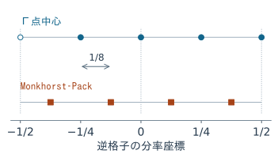

.. _kpoint_sampling:

k点メッシュと積分誤差
=====================

結晶の電子状態計算では、全エネルギーや電子密度を求めるために、ブリルアンゾーン（BZ）全体に
わたる積分を、有限個の波数ベクトル（ **k点** ）での値の和で近似する。この和に使う点の集まりを
**k点メッシュ** と呼ぶ。本稿では、状態の和がBZ積分になることを確かめ、
等間隔の点の和で積分を近似したときの誤差を、被積分関数のフーリエ成分で表す。
誤差の減り方は被積分関数の滑らかさで決まり、絶縁体では指数関数的に減る。
:ref:`フェルミ面<fermi-surface>`\ で占有数が跳ぶ金属の扱いは、次の記事
「\ :ref:`metal-bz-integration`\ 」で説明する。

**前提知識**: :ref:`ブリルアンゾーン<first-brillouin-zone>`、
:ref:`周期境界条件<pbc-allowed-wavevectors>`、:ref:`フーリエ級数<periodic-fourier-series>`。

**学習目標**:

* 状態についての和が、結晶が大きい極限でBZ積分になることを示す。
* Γ点を含む等間隔メッシュと、単位胞を有限個並べて周期境界条件を課した模型の波数を対応づける。
* フーリエ係数から積分誤差を導き、被積分関数が解析的な絶縁体では誤差が指数関数的に減る
  理由を説明する。

状態の和からBZ積分へ
--------------------

単位胞を :math:`N` 個並べて\ :ref:`周期境界条件<pbc-allowed-wavevectors>`\ を課すと、
:eq:`pbc-allowed` の :math:`N` 個の波数が許され、BZの中に一様に分布する。
単位胞あたりの量、例えばバンドエネルギーや電子数は、すべての状態からの寄与を占有数で重み付けて
足し、単位胞の数で割って求める。バンド :math:`j`\ 、波数 :math:`\boldsymbol k` の状態からの
寄与を :math:`a_j(\boldsymbol k)`\ 、占有数を :math:`f_j(\boldsymbol k)` とすると、1スピンあたり

.. math::
   :label: kps-sum

   \bar A=\frac{1}{N}\sum_{\boldsymbol k}A(\boldsymbol k),\qquad
   A(\boldsymbol k)=\sum_j f_j(\boldsymbol k)\,a_j(\boldsymbol k)

である。k点はBZの体積 :math:`\Omega_\mathrm{BZ}` を :math:`N` 等分した
体積ごとに1点ずつあるので、 :math:`N\to\infty` では和を積分に置き換えられ
（:math:`\sum_{\boldsymbol k}\to(N/\Omega_\mathrm{BZ})\int_\mathrm{BZ}\mathrm d\boldsymbol k`\ ）、

.. math::
   :label: kps-integral

   \bar A=\frac{1}{\Omega_\mathrm{BZ}}\int_\mathrm{BZ}A(\boldsymbol k)\,\mathrm d\boldsymbol k

となる。状態数 :math:`n(E)` と\ :ref:`状態密度<density-of-states>` :math:`\rho(E)` の式は、
:math:`A(\boldsymbol k)` にそれぞれ階段関数とデルタ関数を選んだ場合にあたる。
全エネルギーには、このようなバンドごとの和のほかに電子間相互作用の項も含まれるが、
それらも状態の和から求めた電子密度などを通じてBZ積分に依存する。

.. _kpoint-meshes:
.. _id1:

Γ点中心メッシュとMonkhorst–Packメッシュ
----------------------------------------

実際の計算では、 :eq:`kps-integral` を有限個のk点の和で近似する。最も基本的な選び方は、
BZを各方向に :math:`n_i` 等分した等間隔のメッシュ

.. math::
   :label: kps-mesh

   \boldsymbol k=\sum_{i=1}^{3}\frac{m_i}{n_i}\,\boldsymbol b_i\qquad(m_i=0,1,\ldots,n_i-1)

である。これらの波数は、各方向に単位胞を :math:`n_i` 個並べた有限の結晶に周期境界条件を
課したときの波数に一致する（式 :eq:`pbc-allowed`）。電子密度とポテンシャルが元の単位胞の
周期を保つ限り、Γ点を含む :math:`n_1\times n_2\times n_3` メッシュでの計算と、
この有限の周期結晶の計算は、単位胞あたりで同じ結果を与える。メッシュによる積分誤差は、
周期境界を課した有限の結晶と無限結晶との差にあたる。

同じ結晶をスーパーセルで計算するときは、\ :ref:`バンドの折り返し<pbc-band-folding>`\ が起こり、
BZが小さくなるので、同じ細かさのメッシュに必要な分割数は減る。BZの各方向のk点の間隔
:math:`|\boldsymbol b_i|/n_i` がそろうように、セルの辺の長さに反比例して分割数 :math:`n_i`
を選ぶのが目安になる。

Monkhorst–Packの方法 [Monkhorst1976]_ では、 :math:`r_i=1,\ldots,n_i` として
:math:`\boldsymbol k=\sum_i\frac{2r_i-n_i-1}{2n_i}\boldsymbol b_i` の点を使う。 :math:`n_i` が奇数なら
:eq:`kps-mesh` と同じ点の集まりになり、偶数なら点の間隔の半分だけずれてΓ点を含まない。
例えば1方向を4分割すると、逆格子の分率座標でΓ点中心メッシュは
:math:`0,\pm1/4,1/2`、Monkhorst–Packメッシュは :math:`\pm1/8,\pm3/8`
になる。どちらも間隔は同じで、点の位置が半目盛ずれている。

:numref:`fig-kpoint-gamma-and-monkhorst-pack`\ で、同じ間隔の点列が互いに
:math:`1/8` だけずれる様子を比べられる。

   丸はΓ点中心、四角はMonkhorst–Packの点。境界の :math:`-1/2` と :math:`1/2` は
   等価なので、本文と同じく右の :math:`1/2` を数える。左の白抜きの丸は等価な位置を示す。

.. |mesh-fourier-error| replace:: メッシュの誤差とフーリエ成分

|mesh-fourier-error|
--------------------

等間隔の和の誤差は、被積分関数のフーリエ成分で表せる。1次元で
:math:`A(k)` は周期 :math:`2\pi/a` の関数なので、

.. math::
   :label: kps-fourier

   A(k)=\sum_{l=-\infty}^{\infty}A_l\,e^{ikla},\qquad
   \frac{1}{\Omega_\mathrm{BZ}}\int_\mathrm{BZ}A(k)\,\mathrm dk=A_0

と展開できる。メッシュ :math:`k=2\pi m/(na)` での平均をとると、
:math:`\frac1n\sum_{m=0}^{n-1}e^{2\pi iml/n}` は :math:`l` が :math:`n` の倍数なら1、
そうでなければ0なので、

.. math::
   :label: kps-error

   \frac1n\sum_{m=0}^{n-1}A\!\left(\frac{2\pi m}{na}\right)
   =A_0+\sum_{p\neq0}A_{pn}
   \;\approx\;A_0+A_n+A_{-n}

となる。誤差は、メッシュの分割数 :math:`n` の倍数番目のフーリエ成分だけから生じる。
:math:`A_l` は実空間で距離 :math:`la` 離れた単位胞どうしの関係を表すので、誤差は、
単位胞を :math:`n` 個並べた有限の周期結晶で、周期的に繰り返された隣の像との関係から生じると
読むこともできる。3次元でも同様に、誤差は :math:`n_i\boldsymbol a_i` を辺とする
スーパーセルの格子ベクトルでのフーリエ成分から生じる。

したがって、収束の速さは :math:`A_l` が :math:`|l|` とともにどれだけ速く減るかで決まる。
周期関数 :math:`A(k)` が実軸を含む複素平面の帯状領域で解析的なら、フーリエ係数の大きさが
指数関数的に減るため、等間隔メッシュの積分誤差も指数関数的に減る
（TrefethenとWeideman、2014年）。

例えば :math:`A(k)=1/(1.5-\cos ka)` では
:math:`A_l=q^{|l|}/\sqrt{1.25}`\ （:math:`q=1.5-\sqrt{1.25}\approx0.382`\ ）なので、
誤差の主要項は :math:`2q^n/\sqrt{1.25}` で、指数関数的に減る。 :math:`n=8` では
:math:`8.11\times10^{-4}`\ 、 :math:`n=16` では :math:`3.67\times10^{-7}` で、等間隔の和を直接
計算した値と3桁一致する。

周期ポテンシャルの一電子ハミルトニアンで記述する絶対零度の絶縁体では、電子密度や占有バンドの
エネルギーの和を求めるBZ積分の誤差は、等間隔メッシュを細かくすると指数関数的に減る。
フェルミ準位がギャップ内にあれば、占有状態の成分を取り出す射影演算子は、複素波数に拡張しても
実軸近くで解析的である（GontierとLahbabi、2016年）。占有バンド内に交差点があっても、
占有状態全体で和をとったこれらの量の被積分関数は解析的である。この射影を実空間で表した
密度行列は、二点間の距離とともに指数関数的に減衰する [Kohn1996]_。

金属では、バンドがフェルミ準位を横切り、フェルミ面で占有数が1から0へ跳ぶ。被積分関数に段差が
あるとフーリエ係数は :math:`1/|l|` 程度でしか減らないので、誤差は振れながらゆっくり減る。
その様子と対処法は「\ :ref:`metal-bz-integration`\ 」で扱う。

.. |mesh-symmetry| replace:: 対称性によるk点の削減

|mesh-symmetry|
---------------

結晶に回転などの対称操作があると、全エネルギーのようなスカラー量の
被積分関数は、対称操作で互いに移り合うk点で等しい。そこでメッシュの点を対称操作で移り合う組に
分け、各組から1点（\ :ref:`既約k点<irreducible-kpoint-orbits>`\ ）だけを計算して、組の点の数に比例する
重みをかけて足す（式 :eq:`kps-irreducible`）。計算する点の数は、細かいメッシュでは点群の位数の
逆数に近い割合まで減る。メッシュ自体が結晶の対称性を保つように選ぶ必要がある。重みの導出と、
電子密度のように代表点の和を対称化して使う量は「\ :ref:`irreducible-kpoints`\ 」で扱う。

.. _kps-si-example:

説明用の事例：Siのk点収束
-------------------------

`k点はいくつ必要か：金属Cuと半導体Siの収束 <https://example.quloud-platform.quemix.com/kpoints/kpoint_convergence.html>`_
では、fccのCu（金属）とダイヤモンド構造のSi（半導体）の原始胞について、k点メッシュを細かく
しながら全エネルギーと圧力を計算している（Quantum ESPRESSO 7.5、PBE、PAW、カットオフ
60/600 Ry、Γ点を含むメッシュ）。Siはフェルミ準位がバンドギャップの中にあり、占有状態の和をとる
被積分関数は解析的である。

Siの全エネルギーの誤差は、この計算で調べた範囲では、各方向の分割数 :math:`n` を2増やす
ごとにおよそ1/5〜1/8になった（:math:`8^3` で1.9 meV/atom、:math:`12^3` で0.07 meV/atom）。
分割数を2増やすごとに誤差が同じ程度の比で減り続けるのは、:eq:`kps-error` の主要項が
指数関数的に減る場合に期待される振る舞いである。同じ事例のCuでは誤差が振れながら減る
（\ :ref:`metal-cu-example`）。

.. _kps-interpretation-limits:

解釈と限界
----------

誤差が指数関数的に減るという結論は、周期ポテンシャルの一電子ハミルトニアンで記述する
絶対零度の絶縁体のように、被積分関数がBZで解析的な場合に限る。:math:`A(k)=1/(1.5-\cos ka)` の
誤差の数値はこの関数に対するもので、必要な分割数の一般的な目安ではない。

必要なk点メッシュは、物質だけでなく、求めたい量と精度で変わる。格子定数を少し変えたときの
エネルギー差のように、近い条件の計算どうしの差をとる量では、メッシュによる誤差が打ち消し合い、
全エネルギーそのものより粗いメッシュで収束することが多い。いずれの場合も、求めたい量について
メッシュを変えて収束を確かめる必要がある。

.. _kps-related:

関連項目
--------

* :ref:`blochstheorem`
* :ref:`brillouinzone`
* :ref:`metal-bz-integration`
* :ref:`irreducible-kpoints`
* `k点はいくつ必要か：金属Cuと半導体Siの収束 <https://example.quloud-platform.quemix.com/kpoints/kpoint_convergence.html>`_

.. _kps-references:

参考資料
--------

* N. W. Ashcroft and N. D. Mermin, *Solid State Physics* (Holt, Rinehart and
  Winston, 1976), Chap. 8.
* R. M. Martin, *Electronic Structure: Basic Theory and Practical Methods*, 2nd ed.
  (Cambridge University Press, 2020).
* L. N. Trefethen and J. A. C. Weideman,
  `“The Exponentially Convergent Trapezoidal Rule” <https://doi.org/10.1137/130932132>`_,
  *SIAM Review* **56**, 385–458 (2014).
* D. Gontier and S. Lahbabi,
  `“Convergence rates of supercell calculations in the reduced Hartree–Fock model” <https://doi.org/10.1051/m2an/2015084>`_,
  *ESAIM: M2AN* **50**, 1403–1424 (2016), Sect. 5.3.

.. [Monkhorst1976] H. J. Monkhorst and J. D. Pack, “Special points for Brillouin-zone
   integrations,” *Physical Review B* **13**, 5188–5192 (1976),
   `doi:10.1103/PhysRevB.13.5188 <https://doi.org/10.1103/PhysRevB.13.5188>`_.
.. [Kohn1996] W. Kohn, “Density Functional and Density Matrix Method Scaling Linearly with
   the Number of Atoms,” *Physical Review Letters* **76**, 3168–3171 (1996),
   `doi:10.1103/PhysRevLett.76.3168 <https://doi.org/10.1103/PhysRevLett.76.3168>`_.

.. raw:: html

   
