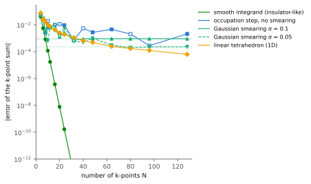
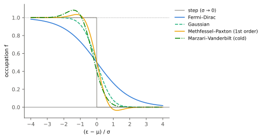

.. _kpoint_sampling:

k点サンプリングとブリルアンゾーン積分
======================================

結晶の電子状態計算では、全エネルギーや電子密度を求めるために、ブリルアンゾーン（BZ）全体に
わたる積分を、有限個の波数ベクトル（ **k点** ）での値の和で近似する。この和に使う点の集まりを
**k点メッシュ** と呼ぶ。本稿では、状態の和がBZ積分になることを確かめ、
等間隔の点の和で積分を近似したときの誤差が、被積分関数の滑らかさでどう決まるかを導く。
そのうえで、金属でフェルミ面に生じる占有数の段差を扱う2つの方法、 **スメアリング** と
**テトラヘドロン法** を説明する。

**前提知識**: :ref:`ブリルアンゾーン<brillouinzone>`、
:ref:`周期境界条件とバンドの折り返し<periodic_boundary>`、フーリエ級数。

**学習目標**:

* 状態についての和が、結晶が大きい極限でBZ積分になることを示す。
* Γ点を含む等間隔メッシュでの計算が、有限の周期的な結晶の計算と同じであることを説明する。
* 等間隔メッシュの和の誤差を被積分関数のフーリエ成分で表し、絶縁体では指数関数的に、
  金属では振れながらゆっくり収束する理由を説明する。
* スメアリングで最小化される自由エネルギー :math:`F` と、幅 :math:`\sigma\to0` の極限との関係を説明する。
* テトラヘドロン法の考え方と、スメアリングと比べた長所・短所を説明する。

状態の和からBZ積分へ
--------------------

:ref:`周期境界条件とバンドの折り返し<periodic_boundary>` で見たように、単位胞を :math:`N` 個
並べた周期的な結晶では、 :eq:`pbc-allowed` の :math:`N` 個の波数が許され、BZの中に一様に分布する。
単位胞あたりの量、例えばバンドエネルギーや電子数は、すべての状態からの寄与を占有数で重み付けて
足し、単位胞の数で割って求める。バンド :math:`j`\ 、波数 :math:`\boldsymbol k` の状態からの
寄与を :math:`a_j(\boldsymbol k)`\ 、占有数を :math:`f_j(\boldsymbol k)` とすると、1スピンあたり

.. math::
   :label: kps-sum

   \bar A=\frac{1}{N}\sum_{\boldsymbol k}A(\boldsymbol k),\qquad
   A(\boldsymbol k)=\sum_j f_j(\boldsymbol k)\,a_j(\boldsymbol k)

である。k点はBZの体積 :math:`\Omega_\mathrm{BZ}` を :math:`N` 等分した
体積ごとに1点ずつあるので、 :math:`N\to\infty` では和を積分に置き換えられ
（:math:`\sum_{\boldsymbol k}\to(N/\Omega_\mathrm{BZ})\int_\mathrm{BZ}\mathrm d\boldsymbol k`\ ）、

.. math::
   :label: kps-integral

   \bar A=\frac{1}{\Omega_\mathrm{BZ}}\int_\mathrm{BZ}A(\boldsymbol k)\,\mathrm d\boldsymbol k

となる。:ref:`ブリルアンゾーン<brillouinzone>` の状態数 :math:`n(E)` と状態密度
:math:`\rho(E)` の式は、 :math:`A(\boldsymbol k)` に階段関数やデルタ関数を選んだ場合にあたる。
全エネルギーには、このようなバンドごとの和のほかに電子間相互作用の項も含まれるが、
それらも状態の和から求めた電子密度などを通じてBZ積分に依存する。

等間隔メッシュによる近似
------------------------

実際の計算では、 :eq:`kps-integral` を有限個のk点の和で近似する。最も基本的な選び方は、
BZを各方向に :math:`n_i` 等分した等間隔のメッシュ

.. math::
   :label: kps-mesh

   \boldsymbol k=\sum_{i=1}^{3}\frac{m_i}{n_i}\,\boldsymbol b_i\qquad(m_i=0,1,\ldots,n_i-1)

である。これは :eq:`pbc-allowed` で :math:`N_i=n_i` とおいたものと同じなので、
**Γ点を含む** :math:`n_1\times n_2\times n_3` **メッシュでの計算は、単位胞を**
:math:`n_1\times n_2\times n_3` **個並べた周期的な結晶の計算と同じ** である。メッシュの誤差は、
有限の大きさの結晶を使ったことによる誤差と言い換えられる。

同じ結晶をスーパーセルで計算するときは、 :ref:`バンドの折り返し<periodic_boundary>` によって
BZが小さくなるので、同じ細かさのメッシュに必要な分割数は減る。BZの各方向のk点の間隔
:math:`|\boldsymbol b_i|/n_i` がそろうように、セルの辺の長さに反比例して分割数 :math:`n_i`
を選ぶのが目安になる。

Monkhorst–Packの方法 [Monkhorst1976]_ では、 :math:`r_i=1,\ldots,n_i` として
:math:`\boldsymbol k=\sum_i\frac{2r_i-n_i-1}{2n_i}\boldsymbol b_i` の点を使う。 :math:`n_i` が奇数なら
:eq:`kps-mesh` と同じ点の集まりになり、偶数なら点の間隔の半分だけずれてΓ点を含まない。
このようにずらしたメッシュも広く使われる。

**誤差とフーリエ成分。** 等間隔の和の誤差は、被積分関数のフーリエ成分で表せる。1次元で
:math:`A(k)` は周期 :math:`2\pi/a` の関数なので、

.. math::
   :label: kps-fourier

   A(k)=\sum_{l=-\infty}^{\infty}A_l\,e^{ikla},\qquad
   \frac{1}{\Omega_\mathrm{BZ}}\int_\mathrm{BZ}A(k)\,\mathrm dk=A_0

と展開できる。メッシュ :math:`k=2\pi m/(na)` での平均をとると、
:math:`\frac1n\sum_{m=0}^{n-1}e^{2\pi iml/n}` は :math:`l` が :math:`n` の倍数なら1、
そうでなければ0なので、

.. math::
   :label: kps-error

   \frac1n\sum_{m=0}^{n-1}A\!\left(\frac{2\pi m}{na}\right)
   =A_0+\sum_{p\neq0}A_{pn}
   \;\approx\;A_0+A_n+A_{-n}

となる。誤差は、メッシュの分割数 :math:`n` の倍数番目のフーリエ成分だけから生じる。
:math:`A_l` は実空間で距離 :math:`la` 離れた単位胞どうしの関係を表すので、誤差は、
上で述べた :math:`n` 個の単位胞の結晶で、周期的に繰り返された隣の像との関係から生じると
読むこともできる。3次元でも同様に、誤差は :math:`n_i\boldsymbol a_i` を辺とする
スーパーセルの格子ベクトルでのフーリエ成分から生じる。

したがって、収束の速さは :math:`A_l` が :math:`|l|` とともにどれだけ速く減るか、つまり
:math:`A(k)` がどれだけ滑らかかで決まる。例えば :math:`A(k)=1/(1.5-\cos ka)` では
:math:`A_l=q^{|l|}/\sqrt{1.25}`\ （:math:`q=1.5-\sqrt{1.25}\approx0.382`\ ）なので、
誤差は :math:`2q^n/\sqrt{1.25}` で指数関数的に減る。 :math:`n=8` では
:math:`8.11\times10^{-4}`\ 、 :math:`n=16` では :math:`3.67\times10^{-7}` で、等間隔の和を直接
計算した値と3桁一致する。

絶縁体・半導体では、占有バンドはBZ全体で占有されたままなので、 :math:`A(\boldsymbol k)` は
滑らかな周期関数になる。これは、密度行列が実空間で指数関数的に局在すること
[Kohn1996]_ と対応しており、k点メッシュに対して全エネルギーは指数関数的に速く収束する。

**対称性と既約k点。** 結晶に回転などの対称操作があると、全エネルギーのようなスカラー量の
被積分関数は、対称操作で互いに移り合うk点で等しい。そこでメッシュの点を対称操作で移り合う組に
分け、各組から1点（既約k点） :math:`\boldsymbol k_i` だけを計算して、組の点の数に比例する
重み :math:`w_i` をかけて足す。

.. math::
   :label: kps-irreducible

   \frac{1}{n_1n_2n_3}\sum_{\boldsymbol k\in\text{メッシュ}}A(\boldsymbol k)=\sum_i w_i\,A(\boldsymbol k_i),
   \qquad\sum_i w_i=1

計算する点の数は、細かいメッシュでは点群の位数の逆数に近い割合まで減る。メッシュ自体が
結晶の対称性を保つように選ぶ必要がある。波数の対応と重みの導出は
:ref:`既約k点と結晶の対称性<irreducible-kpoints>` で説明する。

金属：フェルミ面と占有数の段差
------------------------------

絶対零度でスメアリングを使わない場合、占有数 :math:`f_j(\boldsymbol k)` は、フェルミ準位
:math:`\mu` より低い状態では1、高い状態では0である。金属ではバンドがフェルミ準位を横切るので、
:math:`\varepsilon_j(\boldsymbol k)=\mu` の等エネルギー面（ **フェルミ面** ）を境に、
:math:`A(\boldsymbol k)` に段差が生じる。段差のある関数のフーリエ成分は :math:`|l|` に反比例する
程度にしか減らないので、 :eq:`kps-error` の誤差はゆっくりとしか減らず、符号も変わる。
メッシュの点がフェルミ面のどちら側に入るかは :math:`n` によって不規則に変わるためである。
フェルミ準位も電子数に合わせて決まるので、有限のメッシュで求まる値自体もメッシュによって動く。

1次元の模型で確かめる。バンド :math:`\varepsilon(k)=-\cos ka` と、 :math:`k_F\approx0.405\pi/a`
を与えるフェルミ準位 :math:`\mu` を固定し、 :math:`\int\theta(\mu-\varepsilon)\,\varepsilon\,\mathrm dk`
（1スピンあたりのバンドエネルギー）を :math:`N` 点の等間隔メッシュで近似した誤差を
:numref:`fig-kps-model` に示す。 :math:`k_F` は :math:`\pi/a` の簡単な有理数倍にならないように選んだ。
滑らかな関数（緑）の誤差が指数関数的に減るのに対し、段差のある被積分関数（青）では、
:math:`N=128` でも :math:`2\times10^{-3}` 程度の誤差が符号を変えながら残る。

   1次元模型での、 :math:`N` 点の等間隔メッシュによる和の誤差の絶対値（片対数）。緑：滑らかな
   被積分関数 :math:`1/(1.5-\cos ka)`\ 。青：バンド :math:`-\cos ka` の占有状態のエネルギーの和
   （段差あり）。アクア：同じ和をガウシアンスメアリング（実線 :math:`\sigma=0.1`\ 、破線
   :math:`\sigma=0.05`\ 、エネルギーの単位はホッピング積分の2倍）で求めたもので、細い水平線は
   それぞれの :math:`N\to\infty` の値。黄：1次元の線形テトラヘドロン法。塗りつぶしの点は厳密値
   より大きく、白抜きの点は小さい値。誤差はどれも、段差のある本来の積分の厳密値との差である。

段差の扱い方には、占有数をなめらかにする **スメアリング** と、段差を含んだまま積分を精度よく
近似する **テトラヘドロン法** がある。

スメアリング
------------

スメアリングでは、占有数を幅 :math:`\sigma` のなめらかな関数
:math:`f\big((\varepsilon-\mu)/\sigma\big)` に置き換える（:numref:`fig-kps-smearing`\ ）。
:math:`x=(\varepsilon-\mu)/\sigma` として、よく使われる関数は次のとおりである。

* **フェルミ–ディラック分布** :math:`f(x)=1/(e^x+1)`\ 。 :math:`\sigma=k_\mathrm BT` とすると、
  有限温度の電子の占有数そのものである。
* **ガウシアン** :math:`f(x)=\tfrac12\operatorname{erfc}(x)`\ 。段差をガウス関数で
  ぼかしたもので、裾がフェルミ–ディラック分布より速く減る。
* **Methfessel–Paxton（MP）** [Methfessel1989]_\ 。ガウシアンにエルミート多項式の補正を加えた
  もので、1次では :math:`f(x)=\tfrac12\operatorname{erfc}(x)-x\,e^{-x^2}/(2\sqrt\pi)`\ 。
  占有数は0〜1の範囲を両側にわずかにはみ出す（1次で −0.036〜1.036）。
* **Marzari–Vanderbilt（MV、コールドスメアリング）** [Marzari1999]_\ 。
  :math:`y=-x-1/\sqrt2` として :math:`f=\tfrac12\{1+\operatorname{erf}(y)\}+e^{-y^2}/\sqrt{2\pi}`\ 。
  占有数は負にならず、1を超える側だけにはみ出す（最大1.083）。

   占有数 :math:`f` を :math:`(\varepsilon-\mu)/\sigma` の関数として描いたもの。灰色は
   :math:`\sigma\to0` の段差。同じ :math:`\sigma` でも関数によって広がりが違うので、幅の値を
   異なる関数のあいだでそのまま比べることはできない。

スメアリングを使うと、 :math:`A(\boldsymbol k)` はフェルミ面の付近でなめらかに変化する。
その変化の幅は、k空間では :math:`\sigma` をバンドの傾き :math:`|\nabla_{\boldsymbol k}\varepsilon|`
で割った程度である。k点の間隔がこの幅より十分細かくなれば、 :math:`A(\boldsymbol k)` は
メッシュから見て滑らかな関数になり、和は速く収束する。
:numref:`fig-kps-model` のガウシアンスメアリング（アクア）では、 :math:`\sigma=0.1` が
:math:`N=40` 前後で、 :math:`\sigma=0.05` が :math:`N=100` 前後で、それぞれの極限値に落ち着く。
その極限値は本来の積分からずれ、模型ではずれが :math:`0.091\,\sigma^2` と :math:`\sigma^2` に
比例した。幅を広げるほど少ないk点で収束するが、収束する先が本来の値から離れる。この兼ね合いが、
スメアリング幅を選ぶときの基本である。

**自由エネルギー。** スメアリングを使った自己無撞着計算で最小化されるのは、全エネルギー
:math:`E` そのものではなく、エントロピーに相当する項を引いた自由エネルギー

.. math::
   :label: kps-free-energy

   F=E-\sigma S[f]

である。フェルミ–ディラック分布では、これは有限温度の電子系の自由エネルギー（Mermin
[Mermin1965]_ ）で、 :math:`S` は電子のエントロピー
:math:`-\sum_{j\boldsymbol k}\{f\ln f+(1-f)\ln(1-f)\}` （:math:`k_\mathrm B` 単位、平均の規格化は
:eq:`kps-sum` と同じ）である。ほかの関数にも、 :math:`F` が占有数について変分的になるような
一般化されたエントロピー :math:`S[f]` が対応する。 :math:`F` が変分的なので、原子に働く力や
応力は :math:`F` の微分として整合的に求まり、構造最適化では :math:`F` が最小化される。

:math:`\sigma\to0` では、 :math:`F` も :math:`E` もスメアリングのない本来の全エネルギー
:math:`E_0` に近づく。フェルミ–ディラック分布やガウシアンでは、小さな :math:`\sigma` で
:math:`E` が :math:`\sigma^2` に比例して上がり、 :math:`F` はほぼ同じだけ下がるので、
:math:`E_0\approx(E+F)/2` と見積もれる [Gillan1989]_\ 。MPやMVの関数は、 :math:`F` の
:math:`\sigma^2` に比例する主要なずれが消えるように作られており、 :math:`F` 自体の幅依存が小さい。
このとき :math:`\sigma\to0` の値に近いのは :math:`F` のほうで、 :math:`E` はより大きくずれる。
MPやMVの :math:`-\sigma S` は負にも正にもなり、物理的なエントロピーではない。
スメアリングは、フェルミ–ディラック分布を実際の電子温度として使う場合を除けば、
積分を速く収束させるための数値的な手段である。

テトラヘドロン法
----------------

テトラヘドロン法 [Jepsen1971]_ [Lehmann1972]_ では、メッシュの点を頂点とする四面体
（テトラヘドロン）でBZを埋める。 :eq:`kps-mesh` のメッシュの小さな平行六面体を6個の四面体に
分けるので、四面体は全部で :math:`6n_1n_2n_3` 個ある。各四面体の中では、バンドのエネルギーを
頂点の値から線形に補間し、 :math:`\theta(\mu-\varepsilon)` や :math:`\delta(E-\varepsilon)` を
含む積分を四面体ごとに解析的に行う。フェルミ面が四面体のどこを通るかを補間から見積もるので、
占有数をなめらかにせずに、 :math:`\sigma=0` の積分を直接近似する。状態密度 :math:`\rho(E)` の
ようにデルタ関数を含む積分にも向いている。

1次元では、四面体は隣り合うメッシュの点を結ぶ線分にあたる。点の間のバンドを線分でつなぎ、
フェルミ準位との交点の位置で占有を切り替えて積分する。各点を「占有か非占有か」で数えるのでは
なく、点と点の間のどこでフェルミ面を横切るかまで見積もるので、段差による不規則な振れが
抑えられる。残る誤差は線形補間の誤差で、点の間隔の2乗に比例する。 :numref:`fig-kps-model` の
線形テトラヘドロン法（黄）では、誤差は一定の符号のまま、 :math:`N` を2倍にするごとに約1/4に
なった（ :math:`N=12` で :math:`7.6\times10^{-3}`\ 、 :math:`N=48` で :math:`4.9\times10^{-4}`\ ）。

3次元では、線形補間の主要な誤差を補正する項を加えたBlöchlらの方法 [Blochl1994]_ が広く
使われてきた。さらに、四面体の外の点の値も使って補間を改良し、誤差を小さくしたものが最適化
テトラヘドロン法 [Kawamura2014]_ である。テトラヘドロン法には次の注意がある。

* BZ全体を覆う規則的なメッシュが必要で、任意に選んだk点の一覧には使えない。
* Blöchlの補正を加えたエネルギーは占有数について変分的でないため、それから求めた力や応力は
  スメアリングの場合ほど信頼できない。構造最適化にはスメアリングが使われることが多い。
* メッシュ全体の四面体について占有の重みを計算するので、同じメッシュではスメアリングより
  計算時間がかかることがある。

説明用の事例：CuとSiのk点収束
------------------------------

`k点はいくつ必要か：金属Cuと半導体Siの収束 <https://example.quloud-platform.quemix.com/kpoints/kpoint_convergence.html>`_
では、fccのCu（金属）とダイヤモンド構造のSi（半導体）の原始胞について、k点メッシュを細かく
しながら全エネルギーと圧力を計算している（Quantum ESPRESSO 7.5、PBE、PAW、カットオフ
60/600 Ry、Γ点を含むメッシュ）。結果は本稿の模型と同じ傾向を示す。

* Siの全エネルギーは、 :math:`n` を2増やすごとに誤差がおよそ1/5〜1/8になり、指数関数的に
  収束する（:math:`8^3` で1.9 meV/atom、 :math:`12^3` で0.07 meV/atom）。
* Cuの全エネルギー（MVスメアリング、幅0.02 Ry）は、 :math:`16^3` で0.5 meV/atomまで近づいたあと
  参照値の反対側に振れ、 :math:`24^3` の誤差が :math:`20^3` より大きい。
* Cuでスメアリング幅を広げると収束は速くなるが、幅0.04 Ryでは収束する :math:`F` が1.3 meV/atom
  ずれ、 :math:`E` のずれ（7.5 meV/atom）はそれよりずっと大きい。
* 2つのテトラヘドロン法（Blöchl、最適化）の :math:`48^3` の全エネルギーは0.003 meV/atomの差で
  一致し、MVスメアリング（0.02 Ry）の :math:`F` はそれより0.12 meV/atom高い。テトラヘドロン法の
  全エネルギーは振れずに一方向から収束した。

解釈と限界
----------

本稿の1次元模型は、フェルミ準位を固定し、バンドの形も自己無撞着に変わらないとした単純化である。
実際の計算では、フェルミ準位は電子数に合わせて決まり、電子密度を通じてバンドの形も変わる。
模型の数値（収束に必要な :math:`N`\ 、ずれの係数）は、この模型と選んだ :math:`k_F` に対するもので、
一般的な目安ではない。

必要なk点メッシュは、物質だけでなく、求めたい量と精度で変わる。格子定数を少し変えたときの
エネルギー差のように、近い条件の計算どうしの差をとる量では、メッシュによる誤差が打ち消し合い、
全エネルギーそのものより粗いメッシュで収束することが多い。いずれの場合も、求めたい量について
メッシュとスメアリング幅を変えて収束を確かめる必要がある。

関連項目
--------

* :ref:`blochstheorem`
* :ref:`brillouinzone`
* :ref:`bandstructure`
* :ref:`tightbinding`
* `k点はいくつ必要か：金属Cuと半導体Siの収束 <https://example.quloud-platform.quemix.com/kpoints/kpoint_convergence.html>`_

参考資料
--------

* N. W. Ashcroft and N. D. Mermin, *Solid State Physics* (Holt, Rinehart and
  Winston, 1976), Chap. 8.
* R. M. Martin, *Electronic Structure: Basic Theory and Practical Methods*, 2nd ed.
  (Cambridge University Press, 2020).

.. [Monkhorst1976] H. J. Monkhorst and J. D. Pack, “Special points for Brillouin-zone
   integrations,” *Physical Review B* **13**, 5188–5192 (1976),
   `doi:10.1103/PhysRevB.13.5188 <https://doi.org/10.1103/PhysRevB.13.5188>`_.
.. [Kohn1996] W. Kohn, “Density Functional and Density Matrix Method Scaling Linearly with
   the Number of Atoms,” *Physical Review Letters* **76**, 3168–3171 (1996),
   `doi:10.1103/PhysRevLett.76.3168 <https://doi.org/10.1103/PhysRevLett.76.3168>`_.
.. [Methfessel1989] M. Methfessel and A. T. Paxton, “High-precision sampling for
   Brillouin-zone integration in metals,” *Physical Review B* **40**, 3616–3621 (1989),
   `doi:10.1103/PhysRevB.40.3616 <https://doi.org/10.1103/PhysRevB.40.3616>`_.
.. [Marzari1999] N. Marzari, D. Vanderbilt, A. De Vita, and M. C. Payne, “Thermal
   Contraction and Disordering of the Al(110) Surface,” *Physical Review Letters* **82**,
   3296–3299 (1999), `doi:10.1103/PhysRevLett.82.3296 <https://doi.org/10.1103/PhysRevLett.82.3296>`_.
.. [Mermin1965] N. D. Mermin, “Thermal Properties of the Inhomogeneous Electron Gas,”
   *Physical Review* **137**, A1441–A1443 (1965),
   `doi:10.1103/PhysRev.137.A1441 <https://doi.org/10.1103/PhysRev.137.A1441>`_.
.. [Gillan1989] M. J. Gillan, “Calculation of the vacancy formation energy in aluminium,”
   *Journal of Physics: Condensed Matter* **1**, 689–711 (1989),
   `doi:10.1088/0953-8984/1/4/005 <https://doi.org/10.1088/0953-8984/1/4/005>`_.
.. [Jepsen1971] O. Jepsen and O. K. Andersen, “The electronic structure of h.c.p.
   Ytterbium,” *Solid State Communications* **9**, 1763–1767 (1971),
   `doi:10.1016/0038-1098(71)90313-9 <https://doi.org/10.1016/0038-1098(71)90313-9>`_.
.. [Lehmann1972] G. Lehmann and M. Taut, “On the Numerical Calculation of the Density of
   States and Related Properties,” *physica status solidi (b)* **54**, 469–477 (1972),
   `doi:10.1002/pssb.2220540211 <https://doi.org/10.1002/pssb.2220540211>`_.
.. [Blochl1994] P. E. Blöchl, O. Jepsen, and O. K. Andersen, “Improved tetrahedron method
   for Brillouin-zone integrations,” *Physical Review B* **49**, 16223–16233 (1994),
   `doi:10.1103/PhysRevB.49.16223 <https://doi.org/10.1103/PhysRevB.49.16223>`_.
.. [Kawamura2014] M. Kawamura, Y. Gohda, and S. Tsuneyuki, “Improved tetrahedron method
   for the Brillouin-zone integration applicable to response functions,” *Physical Review B*
   **89**, 094515 (2014),
   `doi:10.1103/PhysRevB.89.094515 <https://doi.org/10.1103/PhysRevB.89.094515>`_.
