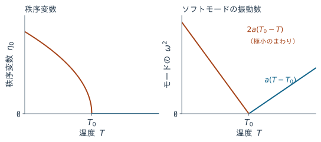
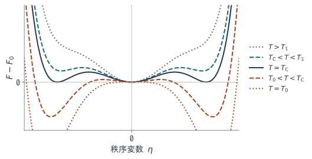

.. _landau-theory:

Landau理論と相転移の次数
========================

高温相で0、低温相で0でない量を **秩序変数** と呼ぶ。構造相転移では\ :ref:`ソフトモードの振幅<sm-landau>`\ が、
強誘電転移では\ :ref:`自発分極<spontaneous-polarization>`\ が秩序変数になる。Landau理論では、自由エネルギーを
秩序変数の多項式で展開し、2次の係数だけが温度とともに符号を変えると仮定する。本稿では、この展開から、
秩序変数が連続的に育つ2次転移と、転移点で跳ぶ1次転移を導き、1次転移で現れる準安定な状態と、加熱と冷却で
転移温度がずれる理由を説明する。最後に、秩序変数に共役な場への応答から、Curie–Weissの法則を導く。

**前提知識**: :ref:`ソフトモードと構造相転移<soft-mode>`\ （とくに\ :ref:`秩序変数としてのモードの振幅<sm-landau>`\ と
\ :ref:`+Qと−Qの等価性<sm-inversion-equivalence>`）、
一定温度では自由エネルギーが最小の状態が実現すること。

**学習目標**:

* 秩序変数で自由エネルギーを展開し、2次転移で秩序変数が転移温度から連続的に育つことを導く。
* 4次の係数が負のとき1次転移になることを示し、転移温度 :math:`T_{\mathrm C}` と :math:`T_0` の差、転移点での秩序変数の跳びを導く。
* 過冷却・過熱が起こりうる温度範囲を求め、加熱と冷却で転移温度がずれる理由を説明する。
* 秩序変数に共役な場への応答から、Curie–Weissの法則を導く。

.. _landau-expansion:

秩序変数による自由エネルギーの展開
----------------------------------

秩序変数を :math:`\eta` と書く。高温相のまわりで、単位体積あたりの自由エネルギーを :math:`\eta` で展開して

.. math::
   :label: landau-expansion

   F(\eta,T)=F_0(T)+\frac12a(T-T_0)\,\eta^2+\frac14\beta\,\eta^4+\frac16\gamma\,\eta^6\qquad(a>0,\ \gamma>0)

と置く。奇数次の項がないのは、高温相の対称性で :math:`\eta` と :math:`-\eta` が\ :ref:`等価になる<sm-inversion-equivalence>`\ からである。
Landau理論の仮定は、2次の係数だけが :math:`a(T-T_0)` と温度に比例して符号を変え、:math:`\beta` と :math:`\gamma` は
転移の近くで温度によらないとすることである。各温度で :math:`F` を最小にする :math:`\eta=\eta_0` が、その温度で実現する
状態を表す。

:math:`\eta` をソフトモードの振幅 :math:`Q` とすると、0 Kのエネルギーの展開 :eq:`sm-landau` の2次の係数 :math:`\kappa` は、
調和近似でのモードの振動数の2乗 :math:`\omega_{\mathrm s}^2` である。ただし :eq:`sm-landau` は単位胞あたりのエネルギーで、
:math:`Q` も単位胞あたりの質量重み付きの振幅なので、単位体積あたりの :math:`F` と比べるときは単位胞の体積 :math:`\Omega` を掛ける。
体積を固定すると :math:`\omega_{\mathrm s}^2=\Omega\,\partial^2F/\partial Q^2` である。Landau理論は :math:`\kappa=\Omega a(T-T_0)` と置き、
有限温度の平均的な復元力が温度とともに変わることを表す。:math:`\eta` を分極 :math:`P` とすると、Devonshireが強誘電体に
用いた展開になる [Devonshire1949]_。

.. _second-order-transition:

2次転移
-------

:math:`\beta>0` の場合を考え、6次の項を省く。:math:`\partial F/\partial\eta=a(T-T_0)\eta+\beta\eta^3=0` から、
:math:`T>T_0` では極小は :math:`\eta_0=0` だけで、高温相が安定である。:math:`T<T_0` では :math:`\eta=0` が極大になり、

.. math::
   :label: landau-second-order

   \eta_0^2=\frac{a(T_0-T)}{\beta}

に極小が現れる。秩序変数は :math:`T_0` から :math:`\sqrt{T_0-T}` に比例して連続的に育つ。このように秩序変数が連続的に
変わる転移を **2次転移**\ （連続転移）と呼び、転移温度は :math:`T_{\mathrm C}=T_0` である。

:math:`\eta=Q` のとき、極小のまわりの曲率に単位胞の体積を掛けた :math:`\Omega\,\partial^2F/\partial Q^2` が、ソフトモードの振動数の2乗を与える。
:math:`T>T_0` では :math:`\omega_{\mathrm s}^2=\Omega a(T-T_0)` で、\ :ref:`Cochranの法則<sm-definition>`\ （式 :eq:`sm-cochran`）に従って転移温度に向かって下がる。
:math:`T<T_0` では :math:`\partial^2F/\partial\eta^2=a(T-T_0)+3\beta\eta_0^2=2a(T_0-T)` なので :math:`\omega_{\mathrm s}^2=2\Omega a(T_0-T)` で、振動数の2乗は2倍の傾きで
再び増える（:numref:`fig-landau-second-order`）。

   :math:`\beta>0` の2次転移。左：秩序変数 :math:`\eta_0`\ （式 :eq:`landau-second-order`）。右：極小のまわりの曲率に単位胞の体積を掛けた
   :math:`\Omega\,\partial^2F/\partial\eta^2`\ （:math:`\eta=Q` ならソフトモードの :math:`\omega^2`）。:math:`T_0` の上（青）は :math:`\Omega a(T-T_0)`、下（赤）は :math:`2\Omega a(T_0-T)`。
   係数は説明用で、特定の物質の値ではない。

.. _first-order-transition:

1次転移
-------

:math:`\beta<0` では、6次の項が大きい :math:`|\eta|` での壁を作る。:math:`T` が :math:`T_0` に下がる前に、:math:`\eta\ne0` の極小の
自由エネルギーが :math:`\eta=0` と等しくなる。その温度が転移温度 :math:`T_{\mathrm C}` で、:math:`F-F_0=0` と
:math:`\partial F/\partial\eta=0` が同じ :math:`\eta\ne0` で成り立つ。それぞれを :math:`\eta^2`、:math:`\eta` で割ると

.. math::

   \frac12a(T_{\mathrm C}-T_0)+\frac14\beta\eta^2+\frac16\gamma\eta^4=0,\qquad
   a(T_{\mathrm C}-T_0)+\beta\eta^2+\gamma\eta^4=0

となる。第1式の2倍から第2式を引くと :math:`-\frac12\beta\eta^2-\frac23\gamma\eta^4=0`、すなわち :math:`\eta^2=-3\beta/(4\gamma)` で、
これを第2式に戻すと

.. math::
   :label: fe-first-order

   T_{\mathrm C}-T_0=\frac{3\beta^2}{16a\gamma}>0,\qquad
   \eta_0(T_{\mathrm C})=\sqrt{-\frac{3\beta}{4\gamma}}

を得る。秩序変数は :math:`T_{\mathrm C}` で0から有限の値へ跳ぶ。このように秩序変数が不連続に変わる転移を **1次転移** と呼ぶ。
:math:`T_{\mathrm C}` での :math:`\eta=0` の曲率 :math:`a(T_{\mathrm C}-T_0)` は正なので、ソフトモードの振動数は
:math:`T_{\mathrm C}` で0にならないまま転移が起こる。高温相の振動数から外挿して0になる温度 :math:`T_0` は、:math:`T_{\mathrm C}` より
低い。

.. _landau-metastability:

過冷却・過熱と転移温度のずれ
----------------------------

1次転移では、:math:`T_{\mathrm C}` の上下に、二つの状態の一方が極小として残る温度範囲がある（:numref:`fig-landau-first-order`）。
:math:`T_0<T<T_{\mathrm C}` では :math:`\eta=0` の曲率 :math:`a(T-T_0)` が正なので、:math:`\eta=0` は自由エネルギーの最小ではないが、
極小として残る。冷却では、高温相がこの範囲まで **過冷却** されうる。逆に加熱では、:math:`\eta\ne0` の極小が、
:math:`a(T-T_0)+\beta\eta^2+\gamma\eta^4=0` が正の実数解 :math:`\eta^2` をもつ温度、すなわち

.. math::
   :label: landau-superheating

   T<T_1=T_0+\frac{\beta^2}{4a\gamma}

まで残り、低温相が **過熱** されうる。最小ではない極小にある状態を準安定な状態と呼ぶ。

   :math:`a=1`、:math:`\beta=-1`、:math:`\gamma=1`、:math:`T_0=0` の式 :eq:`landau-expansion` を、5つの温度で描いた
   （:math:`T_{\mathrm C}=3/16`、:math:`T_1=1/4`）。青は :math:`\eta\ne0` の状態が準安定な範囲、赤は :math:`\eta=0` の状態が準安定な範囲。
   係数は説明用で、特定の物質の値ではない。

準安定な状態から最小の状態へ移るには、二つの極小の間の山を越える必要がある。実際の結晶では、新しい相が核を作って
広がるまで、準安定な状態が残ることがある。そのため、冷却では :math:`T_{\mathrm C}` と :math:`T_0` の間、加熱では
:math:`T_{\mathrm C}` と :math:`T_1` の間で状態が切り替わり、加熱と冷却で転移温度がずれうる（転移温度のヒステリシス）。
ずれの大きさは、この範囲の中で、核の生成の起こりやすさや加熱・冷却の速さで決まる。分子動力学で加熱と冷却の
転移温度を比べるときの注意は、\ :ref:`見かけの転移温度<apparent-transition-temperature>`\ で扱う。

.. _landau-curie-weiss:

共役な場への応答とCurie–Weissの法則
------------------------------------

秩序変数が分極 :math:`P` のとき、電場 :math:`E` を加えると自由エネルギーに :math:`-EP` が加わる。

.. math::
   :label: fe-devonshire

   F(P,T)=F_0+\frac12a(T-T_0)P^2+\frac14\beta P^4+\frac16\gamma P^6-EP

高温相の :math:`P=0` のまわりで :math:`\partial F/\partial P=0` を :math:`P` の1次まで残して解くと :math:`a(T-T_0)P=E` となり、
電気感受率は

.. math::
   :label: fe-curie-constant

   \chi=\frac{P}{\varepsilon_0E}=\frac{1}{\varepsilon_0a(T-T_0)},\qquad C=\frac{1}{\varepsilon_0a}

となる。:math:`T_0` に近づくと発散するこの温度依存 :math:`\chi=C/(T-T_0)` を **Curie–Weissの法則**、:math:`C` をCurie定数、
:math:`T_0` をCurie–Weiss温度と呼ぶ。Curie–Weiss温度は、2次の係数が0になる温度である。強誘電体の常誘電相での観測は
「\ :ref:`ferroelectricity`\ 」の\ :ref:`常誘電相とキュリー温度<paraelectric-phase>`\ で扱う。2次転移ならこれは転移温度 :math:`T_{\mathrm C}` に等しく、1次転移なら
:math:`T_{\mathrm C}` より低い。1次転移では、:math:`\chi` は :math:`T_{\mathrm C}` で有限のまま転移する。
極性ソフトモードの振動数とCurie–Weissの法則のつながりは、\ :ref:`Lyddane–Sachs–Tellerの関係<polar-soft-mode>`\ で扱った。

.. _landau-batio3-example:

説明用の事例：BaTiO\ :sub:`3`\ の立方晶–正方晶転移
--------------------------------------------------------

BaTiO\ :sub:`3`\ の立方晶–正方晶転移は1次転移である。Merzは、転移温度のすぐ上で、弱い電場では分極が電場に比例し、
強い電場では分極–電場曲線の両端にヒステリシスが開くこと（二重ヒステリシス）を観測した [Merz1953]_。
:math:`T>T_{\mathrm C}` でも、:numref:`fig-landau-first-order` の青の曲線のように :math:`P\ne0` の極小が近くにあれば、
電場で :math:`-EP` を加えたときにその極小が最小になり、分極が跳ぶ。電場を戻すと分極が0に戻るので、正負の電場の側に
一つずつヒステリシスが開く。この観測は、式 :eq:`fe-devonshire` の4次の係数 :math:`\beta` が負であることを示す。
BaTiO\ :sub:`3`\ の三つの転移は、いずれも1次転移である [Zhong1995]_。

1次転移では、\ :ref:`極性ソフトモード<polar-soft-mode>`\ の振動数は :math:`T_{\mathrm C}` で0にならず、誘電率は
:math:`T_{\mathrm C}` で有限のまま転移する。:math:`T_0` は、転移温度より上の誘電率や振動数を外挿して決まる温度で、
転移温度そのものではない。

.. _landau-limits:

解釈と限界
----------

Landau理論は、秩序変数の空間的な揺らぎを無視し、平均の秩序変数だけで自由エネルギーを表す平均場の理論である。
2次転移の近くで揺らぎが大きくなる系では、秩序変数が :math:`(T_0-T)^{1/2}` に比例するという予測（臨界指数1/2）が
実験と一致しないことがある。展開は秩序変数が小さい範囲で使えるもので、係数 :math:`a`、:math:`\beta`、:math:`\gamma` は
実験や計算に合わせて決める現象論的な量である。

秩序変数が複数の成分をもつ場合（立方晶の3方向に縮退した極性モードなど）や、ひずみと結合する場合は、
対称性が許す項を展開に加える。その例は\ :ref:`二重井戸ポテンシャル<double-well-potential>`\ の式
:eq:`sm-strain` と :eq:`sm-cubic-quartic` にある。

.. _landau-related:

関連資料
--------

* :ref:`soft-mode`
* :ref:`ferroelectricity`
* :ref:`heating-simulation`

.. _landau-references:

参考文献
--------

* L\. D. Landau and E. M. Lifshitz, *Statistical Physics*, Part 1, 3rd ed. (Pergamon, 1980), Chap. XIV.
