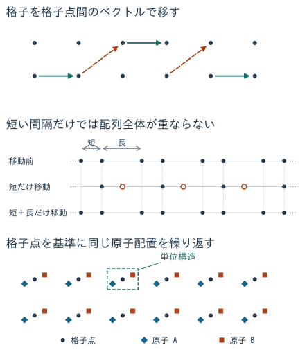
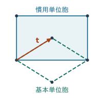
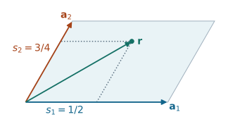

.. _lattice:

==============
格子と単位胞
==============

結晶を格子と単位構造に分けて表し、格子を基本並進ベクトルで記述する。続いて、繰り返しの単位となる
単位胞の選び方と、単位胞の中の位置を表す分率座標を導入する。最後に、慣用単位胞で必要になる
中心並進を扱う。

.. _lattice-points:

格子と格子点
------------

離散的な点の集合で、任意の二点を結ぶベクトルだけ全体を平行移動しても元の集合に重なるものを
格子（並進格子、lattice）と呼ぶ。集合の各点が格子点（lattice point）である。
:numref:`fig-lattice-points-motif`\ の上段では、異なる格子点から同じベクトルだけ移動すると、
いずれも別の格子点に重なる。

周期的に並ぶ点の集合がすべて格子になるわけではない。図の中段では、点の間隔が
短・長と交互に並ぶ。隣り合う二点の短い間隔だけ右にずらすと、元の点に重ならない点が
現れる。したがって、この点の配列そのものは格子ではない。短・長の一組分を格子点の間隔に
とり、各格子点を基準に同じ二点を置けば、元の配列を表せる。

結晶構造は、格子の各格子点を基準に同じ原子配置を繰り返して表す。この原子配置を
単位構造（motif）と呼ぶ。格子点は繰り返しの基準点であり、原子の位置と一致するとは
限らない。図の下段では、黒丸で示す格子点が二原子の間にある。結晶構造を
指定するには、格子に加えて、単位構造をつくる原子の種類と格子点に対する位置が必要である。

   上段では、横向きの実線の矢印どうし、斜めの破線の矢印どうしが、それぞれ同じ並進を表す。
   中段は元の配列と、移動量の異なる二つの配列を比べたもの。縦の点線は重なる点を結び、
   白抜きの丸は、移動後に元の点と重ならない点を表す。
   下段の黒丸は格子点、青いひし形と茶色の四角は原子で、破線の枠は格子点一つと
   その単位構造を囲む。

.. _lattice-translations:

格子並進と基本並進ベクトル
--------------------------

3次元の格子では、互いに独立な3本のベクトル :math:`\boldsymbol a_1,\boldsymbol a_2,\boldsymbol a_3` をうまく選ぶと、格子点の1つを原点としたとき、すべての格子点を整数 :math:`n_i` を用いて :math:`n_1\boldsymbol a_1+n_2\boldsymbol a_2+n_3\boldsymbol a_3` と過不足なく表せる。このような3本を基本並進ベクトル（primitive translation vectors）と呼び、その組を格子の基底という（原子の単位構造を「基底」と呼ぶ文献もあるので、両者を混同しないよう注意する）。直交座標の成分で書くと

.. math::
  \boldsymbol{a}_1 =
  \begin{pmatrix}
  a_{1}^x \\
  a_{1}^y \\
  a_{1}^z
  \end{pmatrix}
  , \quad
  \boldsymbol{a}_2 =
  \begin{pmatrix}
  a_{2}^x \\
  a_{2}^y \\
  a_{2}^z
  \end{pmatrix}
  , \quad
  \boldsymbol{a}_3 =
  \begin{pmatrix}
  a_{3}^x \\
  a_{3}^y \\
  a_{3}^z
  \end{pmatrix}
  :label: avec

である。これらを列に並べた3×3行列

.. math::
  A \equiv
  (\boldsymbol a_1,\boldsymbol a_2,\boldsymbol a_3)
  =
  \begin{pmatrix}
  a_{1}^x & a_{2}^x & a_{3}^x \\
  a_{1}^y & a_{2}^y & a_{3}^y \\
  a_{1}^z & a_{2}^z & a_{3}^z
  \end{pmatrix}
  :label: amat

を格子行列と呼ぶ。:math:`A` を用いれば、格子点の位置ベクトル全体は

.. math::
  \Lambda(A)=\{A\boldsymbol n\mid\boldsymbol n\in\mathbb Z^3\}
  :label: translation-lattice

と書ける。:math:`A\boldsymbol n` は格子全体を自分自身に重ねる並進も表すので、格子並進ベクトル（単に格子ベクトルとも）と呼ぶ。本ノートでは格子ベクトルを :math:`A` の列に置く規約を用いる。

:ref:`基本並進ベクトルの選び方<lt-primitive-basis>`\ は一意ではない。例えば
:math:`\boldsymbol a_1,\ \boldsymbol a_1+\boldsymbol a_2,\ \boldsymbol a_3` も同じ格子を生成する。

.. _lattice-unit-cells:

基本単位胞と慣用単位胞
----------------------

3本の独立な格子ベクトルを辺とする平行六面体は、辺の整数結合だけ平行移動した複製で、空間を隙間も重なりもなく埋める。このように繰り返しの単位となる領域を単位胞（unit cell）と呼ぶ。以下では平行六面体の単位胞を扱う。

基本並進ベクトルを辺とする平行六面体は、格子点を1個だけ含む。頂点の8個の格子点はそれぞれ隣接する8つの胞に共有されるので、:math:`8\times1/8=1` 個と数える。格子点を1個だけ含む単位胞を基本単位胞（primitive cell）と呼ぶ。基本胞、原始胞、原始単位胞ともいう。基本単位胞の体積は単位胞の中で最小である。平行六面体でない基本単位胞もあり、Wigner–Seitz胞がその例である。逆格子に同じ構成を適用したものが
:ref:`第1ブリルアンゾーン<first-brillouin-zone>`\ である。

慣用単位胞（conventional cell）は、格子の対称性が分かりやすい軸を辺に選んだ単位胞である。
立方格子系の\ :ref:`ブラベー格子型<bravais-lattice-types>`\ である単純立方・体心立方（BCC）・面心立方（FCC）では、
いずれも立方体を慣用単位胞にとる。
含まれる格子点はそれぞれ1個、2個、4個である。単純立方の慣用単位胞は基本単位胞でもあり、
BCCとFCCの慣用単位胞は基本単位胞のそれぞれ2倍、4倍の体積をもつ。
BCCとFCCでは、立方体の頂点から体心や面心の格子点への移動も\ :ref:`中心並進<centring-translation>`\ として表せる。

:numref:`fig-centred-rectangular-cells`\ の二次元の例では、長方形の慣用単位胞の頂点と
中心に格子点がある。ひし形の基本単位胞を選ぶと、同じ格子を半分の面積の胞で表せる。
三次元のFCCでは、立方体の慣用単位胞と菱面体の基本単位胞が
:numref:`lt-fcc-cell-figure` のように対応する。

   実線の長方形は慣用単位胞で、頂点の4分の1ずつと中心を合わせて格子点2個分を含む。
   破線のひし形は基本単位胞で、四つの頂点の格子点を内角の割合で分け合い、合わせて格子点1個分を含む。
   矢印 :math:`\boldsymbol t` は長方形の頂点から中心への並進を表す。

.. _coordinates:

格子座標（分率座標）
--------------------

結晶中の位置は、直交座標（Cartesian座標、XYZ座標）の成分

.. math::
  \boldsymbol{r}
  =
  \begin{pmatrix}
  x \\
  y \\
  z
  \end{pmatrix}
  :label: rpos

で表すほか、格子ベクトルを基底にとって

.. math::
  \boldsymbol{r}
  =
  s_1 \boldsymbol{a}_1 +
  s_2 \boldsymbol{a}_2 +
  s_3 \boldsymbol{a}_3
  :label: rlat

とも表せる。係数 :math:`s_i` を格子座標または分率座標（fractional coordinates）と呼ぶ。列ベクトル :math:`\boldsymbol{s}=(s_1,s_2,s_3)^\top` にまとめれば、格子行列 :eq:`amat` を使って

.. math::
  \boldsymbol r=A\boldsymbol s,\qquad
  \boldsymbol s=A^{-1}\boldsymbol r
  :label: fractional-cartesian-matrix

である。本ノートでは分率座標を列ベクトルで表す。\ :ref:`格子ベクトルを行に格納するAPI<lt-array-conventions>`\ へ渡すときは、格子行列を転置する。

:numref:`fig-lattice-fractional-coordinates`\ では、斜めの基底に沿った二つの成分を
足して位置を求める。点線はそれぞれの基底ベクトルに平行である。

   二次元の例。矢印 :math:`\boldsymbol r` の終点は、分率座標 :math:`(1/2,3/4)` にある。

格子ベクトルだけ離れた点どうしは周期性により同等なので、同等な点の中から単位胞内の代表を1つ選ぶときは、\ :math:`s_i` を

.. math::
  0 \leq s_i < 1
  :label: alpha

の半開区間にとる。\ :math:`s_i = 1` の点は :math:`s_i = 0` の点から :math:`\boldsymbol a_i` だけずれた同等な点なので、範囲から除く。

分率座標の値は、どの単位胞の辺を基準にするかで変わる。:math:`A` の代わりに慣用単位胞の辺を並べた行列を使えば、慣用単位胞に対する分率座標が得られる。

.. _centring-translation:

中心並進
--------

BCC格子の立方慣用単位胞には、8つの頂点に加えて体心にも格子点がある。慣用単位胞の辺を :math:`\boldsymbol c_1,\boldsymbol c_2,\boldsymbol c_3` とすると、頂点から体心へのベクトル

.. math::
  \boldsymbol t=\tfrac12(\boldsymbol c_1+\boldsymbol c_2+\boldsymbol c_3)

も格子ベクトルであり、この並進で格子全体は自分自身に重なる。しかし :math:`\boldsymbol t` は :math:`\boldsymbol c_i` の整数結合では書けない。このように、慣用単位胞の辺の整数結合に含まれない格子並進を中心並進（centring translation）と呼ぶ。:math:`A_{\rm c}=(\boldsymbol c_1,\boldsymbol c_2,\boldsymbol c_3)` とし、原点と中心並進を慣用単位胞の分率座標で書いた集合を :math:`T` とすれば、格子は

.. math::
  \Lambda=\{A_{\rm c}(\boldsymbol n+\boldsymbol\tau)\mid\boldsymbol n\in\mathbb Z^3,\ \boldsymbol\tau\in T\}
  :label: centred-lattice

と表せる。BCCでは :math:`T=\{(0,0,0),(1/2,1/2,1/2)\}`、FCCでは :math:`T=\{(0,0,0),(0,1/2,1/2),(1/2,0,1/2),(1/2,1/2,0)\}` で、FCCには3つの面心並進がある。:math:`T` の要素数が慣用単位胞内の格子点の数である。慣用単位胞の辺だけを並進とみなすと中心の格子点を落とすが、基本並進ベクトルを選び直せば式 :eq:`translation-lattice` の形に戻り、中心並進を別に考える必要はない。

二次元では :numref:`fig-centred-rectangular-cells` のように、長方形の頂点から中心への
並進を加えると、頂点の並びと中心の並びが互いに入れ替わり、格子全体が重なる。

中心並進は格子点についての性質である。単位胞の中心に原子があるだけでは中心並進にならず、結晶構造全体がその並進で重なる必要がある。例えばCsCl型構造では立方体の頂点にCs、体心にClがあり、体心への並進はCsをClに移すので結晶構造を保たない。この構造の格子は単純立方である。

.. raw:: html

   
