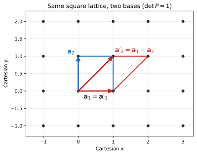
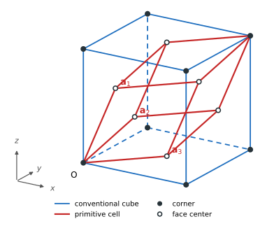
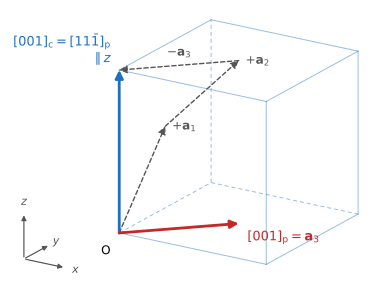

.. _lattice-transform:

==================================
格子基底と座標系の変換
==================================

結晶構造は、並進周期を表す格子（またはそれを稜とする単位胞）と、単位胞内の原子配置で記述される。同じ結晶でも、原始胞と慣用胞、異なる基底、異なる座標、異なる原点をとれば、格子ベクトルや原子座標の数値は変わる。本稿では、物理的な構造とその座標表現を分け、どの量をどう変換すれば同じ構造を保てるかを行列で整理する。

**前提知識**: 3次元線形代数、格子ベクトル、原子の分率座標。

**学習目標**:

* 基底変更と超胞化を区別する。
* Cartesian回転や原点移動に伴う変換を導く。
* FCCの慣用胞と原始胞を結び、結晶方向とMiller指数を正しく移す。
* 構造データや計算ソフトの座標規約を確認する。

本章は前の3章を受けて、すでに定義した量の変換を扱う。第1章で格子・逆格子行列 :math:`A,B` と計量 :math:`G`\ （:ref:`格子ベクトルと逆格子ベクトル<lattice>`）、第2章で列形式の分率座標 :math:`\boldsymbol s` とCartesian位置の関係（:ref:`格子座標<coordinates>`）、第3章で原始胞・慣用胞と中心化格子（:ref:`ブラべ格子と結晶系<unitcell>`）を確認する。以下ではこれらの定義を再掲せず、基底変換に必要な関係を導く。ソフトウェアAPIの行・列配列の違いは :ref:`実装上の配列規約<lt-array-conventions>` を参照。

不変量と表現上の変化を先にまとめる。

.. list-table:: 構造の記述を変えたときの主な量
   :header-rows: 1
   :widths: 24 36 40

   * - 操作
     - 変換する量
     - 条件と保存されるもの
   * - 原始基底の変更 :math:`A'=AP`
     - :math:`\boldsymbol s'=P^{-1}\boldsymbol s`, :math:`B'=BP^{-\mathsf T}`
     - :math:`P\in GL(3,\mathbb Z)` なら並進格子、体積、距離を保つ。
   * - 慣用胞から原始胞への変更
     - 格子、原子座標、周期的に等価な原子の整理
     - 同じ結晶をより小さい胞で表す。単位胞当たりの原子数は変わる。
   * - 超胞 :math:`A_{\rm sup}=AM`
     - 原子の周期像と座標
     - :math:`M` が整数なら元の周期構造を再現するが、選んだ胞の体積・原子数は :math:`|\det M|` 倍。
   * - Cartesian回転 :math:`A'=QA`
     - Cartesian位置とベクトルも :math:`Q` で回す
     - :math:`Q^{\mathsf T}Q=I` なら長さ・角度・体積を保つ。
   * - 原点移動
     - 原子の分率座標
     - 原子間変位と格子は保つ。分率座標の数値は変わる。
   * - 対称性への理想化
     - 格子や原子座標を許容差に基づき調整する場合がある
     - 入力と厳密に同じ数値構造とは限らない。許容差と設定を記録する。

格子基底の変更、胞の拡大・縮小、Cartesian空間全体の回転、対称性を使った構造の理想化は別の操作である。これらを一つの「座標変換」として扱わないことが、誤入力や物理量の向きの取り違えを防ぐ。

原始基底の変更
--------------

正則行列 :math:`P` を用いて格子行列 :eq:`abmat` を

.. math::

   A'=AP

のように変換することを考える。同じCartesian位置を新しい基底で記述するには

.. math::

   A\boldsymbol s=A'\boldsymbol s'
   \quad\Longrightarrow\quad
   \boldsymbol s'=P^{-1}\boldsymbol s,

計量行列と体積は

.. math::

   G'=P^{\mathsf T}GP,\qquad V'=|\det P|V,

となっている必要がある。すなわち、元の原始基底と同じ並進格子を生成する必要十分条件は、:math:`P` が整数行列で :math:`\det P=\pm1`、すなわちユニモジュラ行列 :math:`P\in GL(3,\mathbb Z)` となっている事である。このとき、整数格子点は一対一に対応し、物理的な格子と胞体積は変わらない。

また :math:`\det P=-1` なら、基底ベクトルの向き（右手系・左手系）は反転する。体積は絶対値で同じだが、右手系を要求する入力形式では、さらに1本の軸の符号を反転するなどして右手系へ戻す。

例えば2次元正方格子で :math:`\boldsymbol a'_1=\boldsymbol a_1`、:math:`\boldsymbol a'_2=\boldsymbol a_1+\boldsymbol a_2` としても格子点は同じである。基本平行四辺形の形だけが変わる。

   基底を :math:`P=\begin{pmatrix}1&1\\0&1\end{pmatrix}` で変えても、格子点の集合は変わらない。平行四辺形は選んだ基底が囲む胞を示す。

一般の正則行列 :math:`P` は同じ格子を表すとは限らない。整数行列で :math:`|\det P|>1` なら、元の原始格子の部分格子を生成する超胞になる。

FCCの慣用胞と原始胞
-------------------

一辺 :math:`a` の立方慣用胞をCartesian軸に沿って置くと :math:`A_{\rm c}=aI` である。FCC（F中心立方）格子の原始基底の一例は

.. math::

   A_{\rm p}=A_{\rm c}P_{\rm F},\qquad
   P_{\rm F}=\frac12
   \begin{pmatrix}
   0&1&1\\
   1&0&1\\
   1&1&0
   \end{pmatrix}.

この列はそれぞれ :math:`\frac a2(0,1,1)`、:math:`\frac a2(1,0,1)`、:math:`\frac a2(1,1,0)` である。:math:`\det P_{\rm F}=1/4` なので :math:`V_{\rm c}=a^3`、:math:`V_{\rm p}=a^3/4`。3本の原始ベクトルの長さは :math:`a/\sqrt2`、相互の角度は :math:`60^\circ` である。

F中心慣用胞には、原点に加えて分率座標 :math:`(0,1/2,1/2)`、:math:`(1/2,0,1/2)`、:math:`(1/2,1/2,0)` の格子点がある。したがって慣用立方胞の3辺だけを並進ベクトルと見なすと、面心並進を落とす。単原子FCCでは慣用胞に4格子点、原始胞に1格子点が含まれる。

   青線は慣用立方胞（破線は奥の辺）、赤線は同じFCC格子を張る原始胞。黒丸は立方体の頂点、白丸は6つの面心の格子点で、原始胞の頂点 :math:`\boldsymbol a_1+\boldsymbol a_2` などは反対側の面心に一致する。表示は三次元構造の正射影である。

慣用胞の面心位置を原始胞座標へ移す例では

.. math::

   P_{\rm F}^{-1}\begin{pmatrix}0\\1/2\\1/2\end{pmatrix}
   =\begin{pmatrix}1\\0\\0\end{pmatrix}
   \equiv\begin{pmatrix}0\\0\\0\end{pmatrix}
   \pmod{\mathbb Z^3}.

原点と整数格子並進だけ異なるため、原始胞内では同じ格子点に重なる。胞を小さくする際にはこの周期同値性を用いて重複を除く。

方向の指数も基底に依存する。慣用立方軸に沿う方向 :math:`[001]_{\rm c}` の旧基底成分は :math:`\boldsymbol u_{\rm c}=(0,0,1)^{\mathsf T}` であり、原始基底では

.. math::

   \boldsymbol u_{\rm p}=P_{\rm F}^{-1}\boldsymbol u_{\rm c}
   =(1,1,-1)^{\mathsf T}.

すなわち :math:`[001]_{\rm c}` は :math:`[11\bar{1}]_{\rm p}` である。これは方向そのものが変わったのではなく、同じ方向ベクトルを異なる格子基底の係数で書いた結果である。Cartesian :math:`z` 軸と慣用軸が揃うこの例では :math:`[001]_{\rm c}` は :math:`z_{\rm Cartesian}` に平行だが、原始基底の :math:`[001]_{\rm p}` とは平行でない。

   青矢印は :math:`[001]_{\rm c}` で、Cartesian :math:`z` 軸に平行。原始基底では :math:`\boldsymbol a_1+\boldsymbol a_2-\boldsymbol a_3`（灰色の破線）と書けるので :math:`[11\bar{1}]_{\rm p}` である。赤矢印の :math:`[001]_{\rm p}=\boldsymbol a_3=\frac a2(1,1,0)` は別の方向を指す。

超胞（スーパーセル）と周期像
--------------------------------

整数行列 :math:`M` で

.. math::

   A_{\rm sup}=AM

とすると、:math:`|\det M|=N` の超胞は元の原始胞の体積の :math:`N` 倍の胞となる。同じ周期構造を表すには、元の胞内の各原子について :math:`\mathbb Z^3/M\mathbb Z^3` の剰余類代表に対応する :math:`N` 個の周期像を作り、超胞へ折り畳む。例えば、対角行列 :math:`M=\mathrm{diag}(2,3,2)` なら :math:`N=12` で、原子数も12倍になる。

超胞は元の格子と同じ周期点集合を持つが、超胞ベクトルが生成する格子点は疎になる（元の格子の部分格子となる）。したがって「結晶の物理的な周期性は同じ」と「選んだ周期境界の並進格子が同じ」は区別する。非対角 :math:`M` でも行列式の絶対値が胞数を与えるが、周期像の列挙は対角ケースの単純な3重ループでは一般に足りない。

特殊な単位胞表現とBravais格子型
-------------------------------

単位胞の辺の形と、中心化並進を含む格子点集合のBravais格子型は区別する（原始胞・慣用胞の定義は :ref:`unitcell`）。異なる胞でも中心化点や周期像を含めれば同じ並進格子を表せる。一方、辺長や角度を特殊な値へ**変形**すると格子の対称性が高まり、Bravais格子型自体が変わることがある。このような格子型間の特殊関係は `Grimmer (2015) <https://doi.org/10.1107/S2053273314027351>`_ が整理している。

R格子の原始菱面体と六方軸表示
^^^^^^^^^^^^^^^^^^^^^^^^^^^^^

三方晶系のR格子は、原始菱面体胞を使う表示と、R中心化された六方軸の胞を使う表示の両方がある。六方軸で書いても六方P格子になるわけではない。IUCr International Tables for Crystallography, Volume A はR格子の原始菱面体と体積が3倍のR中心化六方軸セルを区別し、Bravais格子型を格子系ごとに定義している（`§1.3.2.4 <https://it.iucr.org/Ac/ch1o3v0001/sec1o3o2o4.pdf>`_, `§1.3.4.4.3 <https://it.iucr.org/Ac/ch1o3v0001/sec1o3o4o4o3.pdf>`_）。

原始菱面体胞の列格子行列を :math:`A_R=(\boldsymbol a_1,\boldsymbol a_2,\boldsymbol a_3)` とし、各ベクトルの長さを :math:`a_R`、共通角を :math:`\alpha_R` とする。次の軸を選ぶ。

.. math::

   \begin{aligned}
   \boldsymbol a_{R,H}&=\boldsymbol a_1-\boldsymbol a_2,\\
   \boldsymbol b_{R,H}&=\boldsymbol a_2-\boldsymbol a_3,\\
   \boldsymbol c_{R,H}&=\boldsymbol a_1+\boldsymbol a_2+\boldsymbol a_3.
   \end{aligned}

すると :math:`A_{R,H}=A_RP_{R,H}` で、

.. math::

   P_{R,H}=\begin{pmatrix}
   1&0&1\\-1&1&1\\0&-1&1
   \end{pmatrix},\qquad \det P_{R,H}=3.

:math:`q=\cos\alpha_R` とすれば、六方軸胞の格子定数と角度は

.. math::

   a_{R,H}=b_{R,H}=a_R\sqrt{2(1-q)},\qquad
   c_{R,H}=a_R\sqrt{3(1+2q)},

.. math::

   \alpha_{R,H}=\beta_{R,H}=90^\circ,\qquad \gamma_{R,H}=120^\circ.

この胞の体積は原始菱面体胞の3倍で、分率座標 :math:`(0,0,0)` に加えて :math:`(2/3,1/3,1/3)` と :math:`(1/3,2/3,2/3)` にR中心化並進点を持つ。したがって、六方軸表示を六方P格子と読み替えると格子点を取り落とす。

六方P格子を直交C中心化胞で表す
^^^^^^^^^^^^^^^^^^^^^^^^^^^^^^^

底面の長さが :math:`a`、角が :math:`120^\circ` の六方P原始格子 :math:`A_{\rm hexP}` から、次の胞を作る。

.. math::

   \begin{aligned}
   \boldsymbol a_o&=\boldsymbol a_1+\boldsymbol a_2,\\
   \boldsymbol b_o&=-\boldsymbol a_1+\boldsymbol a_2,\\
   \boldsymbol c_o&=\boldsymbol a_3.
   \end{aligned}

.. math::

   A_o=A_{\rm hexP}M_{\rm hexP},\qquad
   M_{\rm hexP}=\begin{pmatrix}
   1&-1&0\\1&1&0\\0&0&1
   \end{pmatrix},\qquad \det M_{\rm hexP}=2.

ここで :math:`A_{\rm hexP}` は直前のR格子の六方軸セルとは異なり、六方P格子の**原始胞**である。新しい辺は直交し、長さは :math:`a_o=a`、:math:`b_o=\sqrt3a`、:math:`c_o=c`。旧格子ベクトル :math:`\boldsymbol a_2` は新胞の分率座標 :math:`(1/2,1/2,0)` に来るため、この胞はC中心化している。胞の体積は2倍で、中心化点と周期像を含めれば六方Pと同じ格子点集合を表す。したがって、直交形状だけを根拠に直交P格子として扱ってはならない。

FCC格子を体心正方胞で表す
^^^^^^^^^^^^^^^^^^^^^^^^^

一辺 :math:`a` のFCC慣用胞 :math:`A_c=aI` に対し、次の辺を選ぶ。

.. math::

   \begin{aligned}
   \boldsymbol a_t&=\tfrac a2(1,1,0),\\
   \boldsymbol b_t&=\tfrac a2(-1,1,0),\\
   \boldsymbol c_t&=a(0,0,1).
   \end{aligned}

.. math::

   A_t=A_cP_{F,t},\qquad
   P_{F,t}=\begin{pmatrix}
   1/2&-1/2&0\\1/2&1/2&0\\0&0&1
   \end{pmatrix},\qquad \det P_{F,t}=1/2.

この胞は :math:`a_t=b_t=a/\sqrt2`、:math:`c_t=a`、したがって :math:`c_t/a_t=\sqrt2` の体心正方形状である。FCCの面心並進 :math:`\tfrac a2(0,1,1)` は新しい胞の分率座標 :math:`(1/2,1/2,1/2)_t` に移る。体心点を含めれば、FCC慣用胞の半分の体積で同じFCC格子を表せる。この特殊な軸比ではBravais格子型は立方Fである。

一般の体心正方格子では :math:`c_t/a_t=1` が立方I（BCC）、:math:`c_t/a_t=\sqrt2` が立方F（FCC）に対応する。一般の体心正方格子をこれらの比へ**変形**することは、単位胞の表現を変えるだけではない。

菱面体形状の原始胞から立方格子を見分ける
^^^^^^^^^^^^^^^^^^^^^^^^^^^^^^^^^^^^^^^^^

等長の3ベクトルが等しい相互角で張る菱面体形状は、三方晶R格子に限らない。角度が特別な値なら、より高い立方対称性を持つ原始胞にもなる。

.. list-table:: 菱面体形状の原始胞と対応する立方Bravais格子
   :header-rows: 1
   :widths: 40 60

   * - 原始ベクトル間の角度
     - Bravais格子型
   * - :math:`60^\circ`
     - 立方F（FCC）
   * - :math:`90^\circ`
     - 立方P（単純立方）
   * - :math:`\arccos(-1/3)\simeq109.47^\circ`
     - 立方I（BCC）

例えば前節のFCC原始胞ベクトルは互いに :math:`60^\circ` で、菱面体形状を持つが、Bravais格子型は三方Rではなく立方Fである。一般のR格子からこの角度条件へ計量を変える場合は、同一格子の基底変換ではなく格子の特殊化となる。

以上の例では、胞の形が直交・六方・菱面体・体心正方に見えることだけでBravais格子型は決まらない。中心化並進を含む格子点集合を調べ、単位胞の取り直しと計量を変える格子変形を区別する。さらに、原子配置を含む結晶の空間群は格子型だけでは決まらない。

Cartesian座標の回転
-------------------

右手系のまま向きの異なるCartesian座標系へ移り、Cartesian成分を回転行列 :math:`Q\in SO(3)` で変換するとき

.. math::

   A'=QA,\qquad \boldsymbol r'=Q\boldsymbol r.

座標軸のほうを回転 :math:`R` で回すと見るなら成分の変換は :math:`Q=R^{\mathsf T}` で、物体を :math:`R` で回すと見るなら :math:`Q=R` である。どちらの見方でも、以下の関係は成分を変換する行列 :math:`Q` で書ける。

同じ基底番号を保つなら分率座標は変わらない。直交性 :math:`Q^{\mathsf T}Q=I` により :math:`G'=A'^{\mathsf T}A'=G` で、長さ・角度・体積が保たれる。Cartesian成分で表す磁化、磁場、電場、力、速度などのベクトルも :math:`\boldsymbol v'=Q\boldsymbol v` とする。2階テンソルは座標表現として :math:`T'=QTQ^{\mathsf T}` と変換する。

これは結晶と、全てのベクトル・テンソルを一緒に回して座標軸を取り替える場合である。実験室で、外部磁場を固定したまま結晶だけを回す操作では、相対方向が変わり、同じ物理条件とは見なせなくなる。

CIFなどに記録された3つの長さと3つの角度は、Cartesian空間での絶対的な向きを定めない（\ :ref:`格子ベクトルの独立な成分<lattice-dof>`\ ）。右手系の一つの配置として :math:`\boldsymbol a` を :math:`x` 軸、:math:`\boldsymbol b` を :math:`xy` 面に置けば

.. math::

   \begin{aligned}
   \boldsymbol a&=(a,0,0),\\
   \boldsymbol b&=(b\cos\gamma,b\sin\gamma,0),\\
   c_x&=c\cos\beta,\\
   c_y&=c\frac{\cos\alpha-\cos\beta\cos\gamma}{\sin\gamma},\\
   \boldsymbol c&=(c_x,c_y,c_z),\qquad
   c_z=\sqrt{c^2-c_x^2-c_y^2}>0.
   \end{aligned}

これは非退化な計量と :math:`\sin\gamma\ne0` を仮定した座標選択であり、測定された絶対方位ではない。

原点移動と原子座標
------------------

新しい原点を旧基底の分率座標 :math:`\boldsymbol t` に置き、同時に基底を :math:`A'=AP` にする。新しい位置座標は

.. math::

   \boldsymbol s'=P^{-1}(\boldsymbol s-\boldsymbol t).

必要なら各成分から整数を引き、:math:`[0,1)` に折り返す（wrap）。原点移動は原子間変位や格子を変えないが、原子の分率座標は変える。原始胞への縮約では周期同値な原子の重複同定、超胞化では周期像の生成が必要なので、原子を単にwrapするだけでは不十分である。

原点移動後にCartesian回転 :math:`Q` も施すと、

.. math::

   A'=QAP,\qquad \boldsymbol r'=Q(\boldsymbol r-A\boldsymbol t),\qquad
   \boldsymbol s'=P^{-1}(\boldsymbol s-\boldsymbol t).

原点位置を回転後の座標系で定義する場合は平行移動ベクトルの書き方が変わるため、変換の順序と原点の定義を明記する。

逆格子、方向、面指数
--------------------

逆格子行列を :math:`B=2\pi A^{-\mathsf T}` とすると :math:`A^{\mathsf T}B=2\pi I`。基底変換 :math:`A'=AP` に対して

.. math::

   B'=B P^{-\mathsf T}.

Cartesian回転も含めれば :math:`B'=QBP^{-\mathsf T}` である。

実空間方向を基底ベクトルの係数 :math:`\boldsymbol u` で表すと、同じCartesian方向を保つ係数変換は

.. math::

   \boldsymbol u'=P^{-1}\boldsymbol u.

一方、逆格子ベクトル（面法線）を :math:`\boldsymbol g=B\boldsymbol h` と書けば、同じ :math:`\boldsymbol g` を保つ指数は

.. math::

   \boldsymbol h'=P^{\mathsf T}\boldsymbol h.

方向は基底ベクトルの係数、面指数は双対基底での係数であり、変換則が逆向きになる。得られた方向や指数を整数表記にする際は、分母の有無や共通因子を別に処理する。

ここで、慣用胞の辺ベクトルを双対化した :math:`B_{\rm c}=2\pi A_{\rm c}^{-\mathsf T}` と、結晶全体の真の逆格子点集合は区別が必要である。F中心立方格子では :math:`A_{\rm c}` の辺だけでは全並進を生成しないため、整数の慣用指数 :math:`\boldsymbol h_{\rm c}` に対しても :math:`B_{\rm c}\boldsymbol h_{\rm c}` が必ず逆格子点になるわけではない。原始基底との関係は

.. math::

   \boldsymbol h_{\rm p}=P_{\rm F}^{\mathsf T}\boldsymbol h_{\rm c},
   \qquad B_{\rm c}\boldsymbol h_{\rm c}=B_{\rm p}\boldsymbol h_{\rm p}.

真の逆格子点となる条件は :math:`\boldsymbol h_{\rm p}` が整数であること、すなわち慣用指数 :math:`(hkl)` がすべて偶数またはすべて奇数であること。このF中心化の反射条件は、格子並進による構造因子の消滅条件でもある（`IUCrの反射条件 <https://dictionary.iucr.org/Reflection_conditions>`_）。4つのF中心並進による寄与は

.. math::

   S_{\rm F}(hkl)=1+(-1)^{k+l}+(-1)^{h+l}+(-1)^{h+k}.

例えば :math:`(100)_{\rm c}` は :math:`\boldsymbol h_{\rm p}=(0,1/2,1/2)` で逆格子点でなく、:math:`S_{\rm F}=0` となって消滅する。一方 :math:`(200)_{\rm c}` は :math:`\boldsymbol h_{\rm p}=(0,1,1)` で逆格子点となり、:math:`S_{\rm F}=4` でF中心化の条件では許される（原子基底による追加の消滅はありうる）。

指数の共通因子は、何を保つかで扱いが異なる。方向指数は向きだけを示すなら最大公約数で約分できるが、対応するベクトルの長さは変わる。Miller指数も法線の向きだけなら約分できる一方、面間隔は変わる。回折指数は逆格子ベクトルそのもの :math:`\boldsymbol g=B\boldsymbol h` を指定するので、例えば :math:`(100)` と :math:`(200)` は同じ法線方向でも波数の大きさが異なる。基底変換後に同じ :math:`\boldsymbol g` を表す :math:`\boldsymbol h'=P^{\mathsf T}\boldsymbol h` は、分数成分を含む場合も含めてそのまま保ち、共通因子で約分してはならない。

同じ指数 :math:`\boldsymbol u=(u,v,w)^{\mathsf T}` を方向 :math:`[uvw]` と面 :math:`(uvw)` に用いたとき、方向ベクトル :math:`A\boldsymbol u` と面法線 :math:`B\boldsymbol u=2\pi A G^{-1}\boldsymbol u` が平行になる条件は、:math:`\boldsymbol u` が計量行列 :math:`G` の固有ベクトルであること。:math:`G\propto I` なら任意の指数について平行だが、特定の指数では :math:`G\not\propto I` でも平行になりうる。これは晶系名だけでは決まらず、基底と指数の組による。立方晶の直交慣用基底では任意の同じ指数が平行になる一方、FCC原始基底では例えば :math:`[11\bar{1}]_{\rm p}` と :math:`(11\bar{1})_{\rm p}` の法線は平行でなく、なす角の余弦は約0.905である。

格子還元と結晶学的標準化
------------------------

Niggli還元は格子の計量に基づき、同じ格子を簡潔な基底で表す手続きである。原子配置を含む結晶学的標準化は対称性を探索し、選んだ空間群設定に基づく標準慣用胞または原始胞を構成する。目的と入力情報が異なる。

spglibの `standardize_cell <https://spglib.readthedocs.io/en/stable/api/autodoc/spglib.cell.html#spglib.cell.standardize_cell>`_ は ``to_primitive=True`` で原始胞、``to_primitive=False``（既定値）で標準慣用胞を返す。``no_idealize=False``（既定値）では、対称性に合わせて格子定数や原子位置が調整されることがある。歪みや緩和後の数値を保持したい場合は ``no_idealize=True`` を検討する。ただしこの指定は理想化を止めるもので、対称性探索を止めるものではない。入力構造に対して ``symprec`` と ``angle_tolerance`` が適切か、許容差を変えたときに検出対称性が安定するかも確認する。

spglibは対称性判定結果に基づいて原子順序やCartesianの向きを変える場合があり、標準化結果だけで物理的同一性を完全に判定できるわけではない。spglibのPython APIは格子ベクトルを**行**として受け取るため、列ベクトル規約との対応を明示する。

計算ソフトと構造ファイル
------------------------

CIF
^^^

CIFは通常、セルの長さ・角度と分率座標を記録し、空間群情報や対称操作を含む場合は非対称単位から原子を展開できる。提供された座標がすでに完全な単位胞なのか、非対称単位だけなのかを確認する。部分占有は通常の整数個の原子配置とは異なり、組成や無秩序をどうモデル化するか別途決める。セル定数だけからCartesianの絶対方位は定まらない。慣用胞の定義は `IUCr Online Dictionary <https://dictionary.iucr.org/Conventional_cell>`_ を参照。

Quantum ESPRESSO
^^^^^^^^^^^^^^^^^

Quantum ESPRESSO 7.5の公式 `INPUT_PW <https://www.quantum-espresso.org/Doc/INPUT_PW.html>`_ によると、``ibrav=0`` は ``CELL_PARAMETERS`` でセルを与え、``ibrav>0`` はQEが定義するBravais格子のベクトルを使う。``ATOMIC_POSITIONS crystal`` は、``ibrav`` または ``CELL_PARAMETERS`` によって指定された計算セルの3本の格子ベクトルに対する分率座標である。``ibrav=0`` では超胞を直接指定することもできる。例えば ``ibrav=2`` のベクトルは :math:`\frac a2(-1,0,1)`、:math:`\frac a2(0,1,1)`、:math:`\frac a2(-1,1,0)` であり、FCC原始セルを使うが、本稿の :math:`P_{\rm F}` の取り方とは軸向きが異なる。引数が負の設定もあり、例えば ``ibrav=-3`` は体心立方格子の別の対称的な軸設定を表す。符号だけからベクトルの向きや原点を推測せず、公式表の定義を使う。計算セルを変更したときは、分率座標や方向指数をそのまま引き継がず、対応する基底変換を行う。格子成分、原子位置の単位、格子定数の単位を明示し、Bohr、Å、``alat`` を混ぜない。

SPR-KKR
^^^^^^^

SPR-KKRは結晶・薄膜・表面などの計算形態に応じた構造入力を持つ。公開されている `SPR-KKR User Guide <https://sprkkr.org/?download_id=3257&sdm_process_download=1>`_ の層構造の例では、格子ベクトルと原子位置の記述がバルク結晶のポテンシャル入力と同じ形式ではない。したがって、ファイル種別・マニュアル版・計算モードを特定せずに、ベクトルの行列配置や角度パラメータを一律に断定しない。

実際の入力では対象バージョンのマニュアルと動作例を確認し、結晶方向（例えば :math:`[001]_{\rm c}`）、Cartesian方向、磁化方向のどれを指定しているかを特定する。MAEやtorqueの方向を扱う際は、格子の軸変換だけでなくCartesian磁化ベクトルも同じ座標変換と整合させる。

LAMMPS
^^^^^^

LAMMPSの `triclinic box documentation <https://docs.lammps.org/Howto_triclinic.html>`_ は一般三斜セルとrestricted triclinic boxを区別する。一般形式は右手系の任意方向の辺ベクトルで与えられ、restricted形式では :math:`\boldsymbol a=(l_x,0,0)`、:math:`\boldsymbol b=(xy,l_y,0)`、:math:`\boldsymbol c=(xz,yz,l_z)` と軸を揃える。LAMMPSは一般形式からrestricted形式へ移す際、箱を回転し、原子座標や速度などのCartesian量にも同じ回転を適用する。内部計算ではrestricted形式を使う。:math:`xy,xz,yz` はtilt factorsである。

入力・出力形式やコマンドによって一般形式を指定できる範囲が異なる。超胞生成は別途行列 :math:`M` に基づいて周期像を作る。箱だけを回して原子位置・速度・その他のベクトルを据え置くと、元の構造を保たない。テンソルや外場を含む計算では、どの量がセル座標系とともに変換されるかを個別に確認する。

.. _lt-array-conventions:

実装上の配列規約
----------------

本稿の列規約では :math:`A` の各列が格子ベクトルで、Cartesian位置は :math:`\boldsymbol r=A\boldsymbol s`。spglibのPython APIやASEの `Cell <https://docs.ase-lib.org/ase/cell.html>`_ は3本の格子ベクトルを行として並べるため、対応は ``lattice_rows = A.T`` である。原子座標を行配列 ``positions_rows`` として渡す場合、Cartesian座標の行配列は ``positions_rows @ lattice_rows`` になる。

列形式の式をNumPyの行配列へ移すときは転置も式の一部として扱う。格子行配列 :math:`L=A^{\mathsf T}` の基底変更は :math:`L'=P^{\mathsf T}L`、分率座標の行配列は :math:`S'=SP^{-\mathsf T}` となる。配列のshapeだけを見て乗算順を推測しない。

数値検証
--------

次の短いNumPy例は、FCC変換、回転、超胞、逆格子の双対性をまとめて検算する。格子ベクトルは本稿どおり**列**で保持し、原子座標も列ベクトルとする。ASEやspglibなど行に格子ベクトルを持つAPIへ渡すときは、:ref:`前節<lt-array-conventions>` のとおり ``A.T`` とする。

.. code-block:: python

   from itertools import product
   import numpy as np

   a = 4.0  # Angstrom
   A = a * np.eye(3)
   P = 0.5 * np.array([[0, 1, 1], [1, 0, 1], [1, 1, 0]])
   Ap = A @ P
   assert np.isclose(np.linalg.det(A), 64.0)
   assert np.isclose(abs(np.linalg.det(Ap)), 16.0)

   # 原始ベクトルの長さと相互の角度
   G = Ap.T @ Ap
   assert np.allclose(np.sqrt(np.diag(G)), 2 * np.sqrt(2))
   assert np.isclose(np.degrees(np.arccos(G[0, 1] / G[0, 0])), 60.0)

   # 面心位置と方向の原始基底表示
   s_primitive = np.linalg.solve(P, np.array([0.0, 0.5, 0.5]))
   u_primitive = np.linalg.solve(P, np.array([0.0, 0.0, 1.0]))
   assert np.allclose(s_primitive, [1, 0, 0])
   assert np.allclose(u_primitive, [1, 1, -1])

   # 逆格子
   Bp = 2 * np.pi * np.linalg.inv(Ap).T
   assert np.allclose(Ap.T @ Bp, 2 * np.pi * np.eye(3))

   # z軸まわりの任意角の回転
   theta = 0.37
   Q = np.array([[np.cos(theta), -np.sin(theta), 0],
                 [np.sin(theta),  np.cos(theta), 0],
                 [0, 0, 1]])
   assert np.allclose(Q.T @ Q, np.eye(3))
   assert np.allclose((Q @ Ap).T @ (Q @ Ap), G)

   # 超胞: 12個の周期像と、周期境界込みの最短原子間距離
   M = np.diag([2, 3, 2])
   As = Ap @ M
   assert np.isclose(abs(np.linalg.det(As)), 12 * 16.0)
   S = [np.linalg.solve(M, n) for n in product(range(2), range(3), range(2))]
   assert len(S) == 12
   d_min = min(np.linalg.norm(As @ (sj - si + np.array(n)))
               for i, si in enumerate(S) for j, sj in enumerate(S)
               for n in product(range(-1, 2), repeat=3)
               if not (i == j and n == (0, 0, 0)))
   assert np.isclose(d_min, 2 * np.sqrt(2))

行列式から慣用胞 :math:`64\,\mathrm{\mathring{A}}^3`、原始胞 :math:`16\,\mathrm{\mathring{A}}^3`、超胞 :math:`192\,\mathrm{\mathring{A}}^3` を得る。FCC原始ベクトル長は :math:`4/\sqrt2=2\sqrt2\,\mathrm{\mathring{A}}`、相互の角度は :math:`60^\circ`、面心点は原始座標 :math:`(1,0,0)`、方向は :math:`(1,1,-1)` となる。任意角（例では :math:`\theta=0.37` rad）の回転で計量行列は変わらず、逆格子は :math:`A_{\rm p}^{\mathsf T}B_{\rm p}=2\pi I` を満たす。12個の周期像を作ると原子数が12倍になり、超胞周期境界も含めた最短原子間距離は :math:`2\sqrt2\,\mathrm{\mathring{A}}` で元のFCC最近接距離と一致する。

この例は代数恒等式を検算するものであり、特定の計算コードのファイル読込や、任意の非対角超胞での周期像列挙までは検証しない。実計算に接続するときは、原子種・占有率・単位・境界条件も含む構造全体で照合する。

よくある誤り
------------

* 慣用胞の3辺だけを原始並進とみなし、F中心・I中心・底心の格子点を落とす。
* :math:`A'=AP` を使いながら、分率座標を :math:`P^{-1}` で変換しない。
* 方向指数 :math:`\boldsymbol u` とMiller指数 :math:`\boldsymbol h` に同じ変換則を適用する。
* 格子だけ回し、Cartesian磁化・外場・速度・応力などを対応させない。
* 原点シフトを忘れる、またはwrapだけで原始胞縮約・超胞化が済むと思う。
* 対称性標準化による理想化を、緩和後構造を保つ単なる基底変更とみなす。
* 行ベクトルAPIへ列行列をそのまま渡す、あるいはÅ・Bohr・``alat`` を混同する。

関連ノート
----------

* :ref:`lattice` — 格子・逆格子ベクトルと計量。
* :ref:`coordinates` — Cartesian座標と格子分率座標。
* :ref:`unitcell` — 結晶系とBravais格子。
* :ref:`brillouinzone` — 逆格子とブリルアンゾーン。

参考資料
--------

* IUCr, `Conventional cell <https://dictionary.iucr.org/Conventional_cell>`_.
* IUCr, `Reflection conditions <https://dictionary.iucr.org/Reflection_conditions>`_.
* IUCr, *International Tables for Crystallography*, Vol. A, §§1.3.2.4 and 1.3.4.4.3, `Section 1.3.2.4 <https://it.iucr.org/Ac/ch1o3v0001/sec1o3o2o4.pdf>`_, `Section 1.3.4.4.3 <https://it.iucr.org/Ac/ch1o3v0001/sec1o3o4o4o3.pdf>`_.
* H. Grimmer, “Partial order among the 14 Bravais types of lattices: basics and applications,” *Acta Crystallographica A* **71**, 143–149 (2015), `doi:10.1107/S2053273314027351 <https://doi.org/10.1107/S2053273314027351>`_.
* spglib, `Python API: standardize_cell <https://spglib.readthedocs.io/en/stable/api/autodoc/spglib.cell.html#spglib.cell.standardize_cell>`_ および `Definitions and conventions <https://spglib.readthedocs.io/en/stable/definition.html>`_.
* ASE, `Cell <https://docs.ase-lib.org/ase/cell.html>`_.
* Quantum ESPRESSO 7.5, `pw.x input description <https://www.quantum-espresso.org/Doc/INPUT_PW.html>`_.
* LAMMPS, `Triclinic simulation boxes <https://docs.lammps.org/Howto_triclinic.html>`_.
* SPR-KKR, `User Guide (19 October 2023) <https://sprkkr.org/?download_id=3257&sdm_process_download=1>`_. 入力仕様はファイル種別と版に依存する。

本稿は基底変換と座標規約をまとめて扱うため、長くなっている。今後は「超胞・構造標準化」と「計算ソフトごとの入力座標」を独立したノートへ分割する余地がある。各エンジンの網羅的な入力手順やQuloudの操作は対象外であり、ソフトウェア版ごとの公式説明を参照する。

