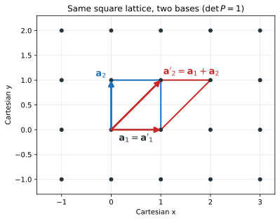

.. _lattice-transform:

==================================
格子基底と座標系の変換
==================================

結晶構造は、並進周期を表す格子と、単位胞内の原子配置で記述される。同じ結晶でも、基本単位胞と慣用単位胞、異なる基底、座標、原点をとれば、格子ベクトルや原子座標の数値は変わる。ここでは、格子基底の変更、Cartesian座標の回転、原点移動を行列で表し、分率座標・逆格子ベクトル・方向と面の指数がどう変わるかを確認する。

**前提知識**: 3次元線形代数、:ref:`lattice` で導入した格子・逆格子行列
:math:`A,B`、分率座標、計量行列 :math:`G`。

**学習目標**:

* 同じ格子を保つ基本並進ベクトルの取り直しの条件を導く。
* Cartesian回転や原点移動に伴う座標の変換を求める。
* 逆格子ベクトル、結晶方向、Miller指数の変換を区別する。

構造の記述を変えるときの主な操作を下表にまとめる。胞の選び方と周期像の扱いは
:ref:`lt-cell-transform`、構造データや計算ソフトでの座標規約は
:ref:`lt-structure-input` で扱う。

.. list-table:: 構造の記述を変えたときの主な量
   :name: lt-transform-summary
   :header-rows: 1
   :widths: 24 36 40

   * - 操作
     - 変換する量
     - 条件と保存されるもの
   * - 基本並進ベクトルの組の変更 :math:`A'=AP`
     - :math:`\boldsymbol s'=P^{-1}\boldsymbol s`, :math:`B'=BP^{-\mathsf T}`
     - :math:`P\in GL(3,\mathbb Z)` なら並進格子、体積、距離を保つ。
   * - 慣用単位胞から基本単位胞への変更
     - 格子、原子座標、周期的に等価な原子の整理
     - 同じ結晶をより小さい胞で表す。単位胞当たりの原子数は変わる。
   * - 超胞 :math:`A_{\rm sup}=AM`
     - 原子の周期像と座標
     - :math:`M` が整数なら元の周期構造を再現するが、選んだ胞の体積・原子数は :math:`|\det M|` 倍。
   * - Cartesian回転 :math:`A'=QA`
     - Cartesian位置とベクトルも :math:`Q` で回す
     - :math:`Q^{\mathsf T}Q=I` なら長さ・角度・体積を保つ。
   * - 原点移動
     - 原子の分率座標
     - 原子間変位と格子は保つ。分率座標の数値は変わる。
   * - 対称性への理想化
     - 格子や原子座標を許容差に基づき調整する場合がある
     - 入力と厳密に同じ数値構造とは限らない。許容差と設定を記録する。

格子基底の変更、胞の拡大・縮小、Cartesian空間全体の回転、対称性を使った構造の理想化は別の操作である。これらを一つの「座標変換」として扱わないことが、誤入力や物理量の向きの取り違えを防ぐ。

.. _lt-primitive-basis:

基本並進ベクトルの取り直し
---------------------------------------

正則行列 :math:`P` を用いて格子行列 :eq:`amat` を

.. math::

   A'=AP

のように変換することを考える。\ :math:`A`\ 系でのカルテシアン座標 :math:`A\boldsymbol{s}` が、
:math:`A'`\ 系で :math:`A'\boldsymbol{s'}` と書けるとすると :math:`\boldsymbol s \rightarrow \boldsymbol s'` の変換は

.. math::

   A\boldsymbol s=A'\boldsymbol s'
   \quad\Longrightarrow\quad
   \boldsymbol s'=P^{-1}\boldsymbol s,

となり、計量行列と体積は

.. math::

   G'=P^{\mathsf T}GP,\qquad V'=|\det P|V

に変わる。

.. |same-lattice-condition| replace:: 同じ格子を保つ基底変換の条件

|same-lattice-condition|
------------------------

:math:`A` が基本並進ベクトルの組のとき、:math:`A'` も同じ格子の基本並進ベクトルの組となる必要十分条件は、:math:`P` が整数行列で :math:`\det P=\pm1`、すなわちユニモジュラ行列 :math:`P\in GL(3,\mathbb Z)` となっている事である。\ :math:`P` が整数なら :math:`A'` の列は格子ベクトルであり、さらに :math:`P^{-1}` も整数なら :math:`A` の列も :math:`A'` の整数結合で書ける。整数行列の逆行列が整数になるのは :math:`\det P=\pm1` のときに限る。このとき整数の組 :math:`\boldsymbol n` と :math:`P^{-1}\boldsymbol n` が一対一に対応し、物理的な格子と胞体積は変わらない。この条件は両方が基本並進ベクトルの組である場合のものであり、中心並進を持つ慣用単位胞との変換（:ref:`lt-fcc-cell` の :math:`P_{\rm F}`）や超胞化には当てはまらない。

また :math:`\det P=-1` なら、基底ベクトルの向き（右手系・左手系）は反転する。体積は絶対値で同じだが、右手系を要求する入力形式では、さらに1本の軸の符号を反転するなどして右手系へ戻す。

例えば2次元正方格子で :math:`\boldsymbol a'_1=\boldsymbol a_1`、:math:`\boldsymbol a'_2=\boldsymbol a_1+\boldsymbol a_2` としても格子点は同じである。基本平行四辺形の形だけが変わる。

   基底を :math:`P=\begin{pmatrix}1&1\\0&1\end{pmatrix}` で変えても、格子点の集合は変わらない。平行四辺形は選んだ基底が囲む胞を示す。

一般の正則行列 :math:`P` は同じ格子を表すとは限らない。整数行列で :math:`|\det P|>1` なら、元の格子の部分格子を生成する超胞になる。周期像の作り方は :ref:`lt-supercell` を参照。

.. _lt-cartesian-rotation:

Cartesian座標の回転
------------------------

右手系のまま向きの異なるCartesian座標系へ移り、Cartesian成分を回転行列 :math:`Q\in SO(3)` で変換するとき

.. math::

   A'=QA,\qquad \boldsymbol r'=Q\boldsymbol r.

座標軸のほうを回転 :math:`R` で回すと見るなら成分の変換は :math:`Q=R^{\mathsf T}` で、物体を :math:`R` で回すと見るなら :math:`Q=R` である。どちらの見方でも、以下の関係は成分を変換する行列 :math:`Q` で書ける。

同じ基底番号を保つなら分率座標は変わらない。直交性 :math:`Q^{\mathsf T}Q=I` により :math:`G'=A'^{\mathsf T}A'=G` で、長さ・角度・体積が保たれる。Cartesian成分で表す磁化、磁場、電場、力、速度などのベクトルも :math:`\boldsymbol v'=Q\boldsymbol v` とする。2階テンソルは座標表現として :math:`T'=QTQ^{\mathsf T}` と変換する。

これは結晶と、全てのベクトル・テンソルを一緒に回して座標軸を取り替える場合である。実験室で、外部磁場を固定したまま結晶だけを回す操作では、相対方向が変わり、同じ物理条件とは見なせなくなる。

.. |cell-parameters-to-cartesian| replace:: 格子定数から格子ベクトルを求める

|cell-parameters-to-cartesian|
------------------------------

CIFなどに記録された3つの長さと3つの角度は、Cartesian空間での絶対的な向きを定めない（\ :ref:`格子ベクトルの独立な成分<lattice-dof>`\ ）。右手系の一つの配置として :math:`\boldsymbol a` を :math:`x` 軸、:math:`\boldsymbol b` を :math:`xy` 面に置けば

.. math::

   \begin{aligned}
   \boldsymbol a&=(a,0,0),\\
   \boldsymbol b&=(b\cos\gamma,b\sin\gamma,0),\\
   c_x&=c\cos\beta,\\
   c_y&=c\frac{\cos\alpha-\cos\beta\cos\gamma}{\sin\gamma},\\
   \boldsymbol c&=(c_x,c_y,c_z),\qquad
   c_z=\sqrt{c^2-c_x^2-c_y^2}>0.
   \end{aligned}

これは非退化な計量と :math:`\sin\gamma\ne0` を仮定した座標選択であり、測定された絶対方位ではない。

.. _lt-origin-shift:

原点移動と原子座標
---------------------------

新しい原点を旧基底の分率座標 :math:`\boldsymbol t` に置き、同時に基底を :math:`A'=AP` にする。新しい位置座標は

.. math::

   \boldsymbol s'=P^{-1}(\boldsymbol s-\boldsymbol t).

必要なら各成分から整数を引き、:math:`[0,1)` に折り返す（wrap）。原点移動は原子間変位や格子を変えないが、原子の分率座標は変える。基本単位胞への縮約では周期同値な原子の重複同定、超胞化では周期像の生成が必要なので、原子を単にwrapするだけでは不十分である。

原点移動後にCartesian回転 :math:`Q` も施すと、

.. math::

   A'=QAP,\qquad \boldsymbol r'=Q(\boldsymbol r-A\boldsymbol t),\qquad
   \boldsymbol s'=P^{-1}(\boldsymbol s-\boldsymbol t).

原点位置を回転後の座標系で定義する場合は平行移動ベクトルの書き方が変わるため、変換の順序と原点の定義を明記する。

.. _lt-reciprocal-transform:

逆格子行列の変換
------------------------------

逆格子行列を :math:`B=2\pi A^{-\mathsf T}` とすると :math:`A^{\mathsf T}B=2\pi I`。基底変換 :math:`A'=AP` に対して

.. math::

   B'=B P^{-\mathsf T}.

Cartesian回転も含めれば :math:`B'=QBP^{-\mathsf T}` である。

.. |direction-and-plane-indices| replace:: 結晶方向と面指数の変換

|direction-and-plane-indices|
-----------------------------

実空間方向を基底ベクトルの係数 :math:`\boldsymbol u` で表すと、同じCartesian方向を保つ係数変換は

.. math::

   \boldsymbol u'=P^{-1}\boldsymbol u.

一方、逆格子ベクトル（面法線）を :math:`\boldsymbol g=B\boldsymbol h` と書けば、同じ :math:`\boldsymbol g` を保つ指数は

.. math::

   \boldsymbol h'=P^{\mathsf T}\boldsymbol h.

方向は基底ベクトルの係数、面指数は双対基底での係数であり、変換則が逆向きになる。得られた方向や指数を整数表記にする際は、分母の有無や共通因子を別に処理する。

指数の共通因子は、何を保つかで扱いが異なる。方向指数は向きだけを示すなら最大公約数で約分できるが、対応するベクトルの長さは変わる。Miller指数も法線の向きだけなら約分できる一方、面間隔は変わる。回折指数は逆格子ベクトルそのもの :math:`\boldsymbol g=B\boldsymbol h` を指定するので、例えば :math:`(100)` と :math:`(200)` は同じ法線方向でも波数の大きさが異なる。基底変換後に同じ :math:`\boldsymbol g` を表す :math:`\boldsymbol h'=P^{\mathsf T}\boldsymbol h` は、分数成分を含む場合も含めてそのまま保ち、共通因子で約分してはならない。

.. |direction-and-plane-normal| replace:: 結晶方向と面法線が平行になる条件

|direction-and-plane-normal|
----------------------------

同じ指数 :math:`\boldsymbol u=(u,v,w)^{\mathsf T}` を方向 :math:`[uvw]` と面 :math:`(uvw)` に用いたとき、方向ベクトル :math:`A\boldsymbol u` と面法線 :math:`B\boldsymbol u=2\pi A G^{-1}\boldsymbol u` が平行になる条件は、:math:`\boldsymbol u` が計量行列 :math:`G` の固有ベクトルであること。:math:`G\propto I` なら任意の指数について平行だが、特定の指数では :math:`G\not\propto I` でも平行になりうる。これは晶系名だけでは決まらず、基底と指数の組による。立方晶の直交慣用基底では任意の同じ指数が平行になる一方、:ref:`FCC基本単位胞<lt-fcc-cell>` では例えば :math:`[11\bar{1}]_{\rm p}` と :math:`(11\bar{1})_{\rm p}` の法線は平行でなく、なす角の余弦は約0.905である。

.. _lt-transform-related:

関連ノート
---------------

* :ref:`lattice` — 格子・逆格子ベクトル、分率座標と計量。
* :ref:`unitcell` — ブラベー（Bravais）格子型と結晶系。
* :ref:`brillouinzone` — 逆格子とブリルアンゾーン。
* :ref:`lt-cell-transform` — 慣用単位胞と基本単位胞の変換、超胞、反射条件。
* :ref:`lt-structure-input` — 構造の標準化、ファイル形式、配列規約。

.. raw:: html

   
