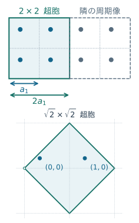

.. _lattice-transform:

==================================
格子基底と座標系の変換
==================================

結晶構造は、並進周期を表す格子と、単位胞内の原子配置で記述される。同じ結晶でも、基本単位胞と慣用単位胞、異なる基底、座標、原点をとれば、格子ベクトルや原子座標の数値は変わる。ここでは、格子基底の変更と超胞、Cartesian座標の回転、原点移動を行列で表し、分率座標・逆格子ベクトル・方向と面の指数がどう変わるかを確認する。

**前提知識**: 3次元線形代数、:ref:`格子行列<lattice-translations>` :math:`A`、
:ref:`逆格子行列<reciprocal-lattice>` :math:`B`、:ref:`分率座標<coordinates>`、
:ref:`計量行列<lattice-metric>` :math:`G`、:ref:`方向指数とMiller指数<crystal-directions-planes>`。

**学習目標**:

* 同じ格子を保つ基本並進ベクトルの取り直しの条件を導き、慣用単位胞や超胞への変換と区別する。
* Cartesian回転や原点移動に伴う座標の変換を求める。
* 逆格子ベクトル、結晶方向、Miller指数の変換を区別する。

構造の記述を変えるときの主な操作を下表にまとめる。変換した構造を計算に使うときは、
入力先の\ :ref:`格子ベクトルの配列規約<lt-array-conventions>`\ も必要になる。

.. list-table:: 構造の記述を変えたときの主な量
   :name: lt-transform-summary
   :header-rows: 1
   :widths: 24 36 40

   * - 操作
     - 変換する量
     - 条件と保存されるもの
   * - 基本並進ベクトルの組の変更 :math:`A'=AP`
     - :math:`\boldsymbol s'=P^{-1}\boldsymbol s`, :math:`B'=BP^{-\mathsf T}`
     - :math:`P\in GL(3,\mathbb Z)` なら並進格子、体積、距離を保つ。
   * - 慣用単位胞から基本単位胞への変更
     - 格子、原子座標、周期的に等価な原子の整理
     - 同じ結晶をより小さい胞で表す。単位胞当たりの原子数は変わる。
   * - 超胞 :math:`A_{\rm sup}=AM`
     - 原子の周期像と座標
     - :math:`M` が整数なら元の周期構造を再現するが、選んだ胞の体積・原子数は :math:`|\det M|` 倍。
   * - Cartesian回転 :math:`A'=QA`
     - Cartesian位置とベクトルも :math:`Q` で回す
     - :math:`Q^{\mathsf T}Q=I` なら長さ・角度・体積を保つ。
   * - 原点移動
     - 原子の分率座標
     - 原子間変位と格子は保つ。分率座標の数値は変わる。
   * - 対称性への理想化
     - 格子や原子座標を許容差に基づき調整する場合がある
     - 入力と厳密に同じ数値構造とは限らない。許容差と設定を記録する。

格子基底の変更、胞の拡大・縮小、Cartesian空間全体の回転、対称性を使った構造の理想化は別の操作である。これらを一つの「座標変換」として扱わないことが、誤入力や物理量の向きの取り違えを防ぐ。

.. _lt-primitive-basis:

基本並進ベクトルの取り直し
---------------------------------------

正則行列 :math:`P` を用いて格子行列 :eq:`amat` を

.. math::

   A'=AP

のように変換することを考える。\ :math:`A`\ 系でのカルテシアン座標 :math:`A\boldsymbol{s}` が、
:math:`A'`\ 系で :math:`A'\boldsymbol{s'}` と書けるとすると :math:`\boldsymbol s \rightarrow \boldsymbol s'` の変換は

.. math::

   A\boldsymbol s=A'\boldsymbol s'
   \quad\Longrightarrow\quad
   \boldsymbol s'=P^{-1}\boldsymbol s,

となり、計量行列と体積は

.. math::

   G'=P^{\mathsf T}GP,\qquad V'=|\det P|V

に変わる。

.. |same-lattice-condition| replace:: ユニモジュラ変換と格子の保存

|same-lattice-condition|
------------------------

:math:`A` を基本並進ベクトルの組とする。格子ベクトルはすべて :math:`A` の列の整数結合なので、
新しい胞の辺を格子ベクトルから選ぶ限り :math:`P` は整数行列になる。:math:`A'=AP` も同じ格子の基本並進ベクトルの
組となるには、:math:`P` が整数行列で :math:`\det P=\pm1` であることが必要十分である。
このような行列をユニモジュラ行列（:math:`P\in GL(3,\mathbb Z)`）と呼ぶ。

:math:`P` が整数なら、新しい基底ベクトルは古い基底ベクトルの整数結合になる。
同じ格子を保つには、逆に古い基底ベクトルも新しい基底ベクトルの整数結合で書ける必要がある。
そのため、:math:`P^{-1}` も整数行列でなければならない。整数行列の逆行列が整数になるのは
:math:`\det P=\pm1` のときである。このとき整数の組 :math:`\boldsymbol n` と
:math:`P^{-1}\boldsymbol n` が一対一に対応し、格子点の集合と胞体積が保たれる。

また :math:`\det P=-1` なら、基底ベクトルの向き（右手系・左手系）は反転する。体積は絶対値で同じだが、右手系を要求する入力形式では、さらに1本の軸の符号を反転するなどして右手系へ戻す。

例えば2次元正方格子で :math:`\boldsymbol a'_1=\boldsymbol a_1`、:math:`\boldsymbol a'_2=\boldsymbol a_1+\boldsymbol a_2` としても格子点は同じである。基本平行四辺形の形だけが変わる。

.. figure:: images/lattice_basis_2d.svg
   :name: lt-basis-figure
   :alt: 2次元正方格子の同じ格子点を表す標準基底とユニモジュラ変換後の基底
   :width: 80%
   :align: center

   基底を :math:`P=\begin{pmatrix}1&1\\0&1\end{pmatrix}` で変えても、格子点の集合は変わらない。平行四辺形は選んだ基底が囲む胞を示す。

:math:`P` が整数行列で :math:`|\det P|=N>1` なら、:math:`A'` の列の整数結合は元の格子の一部（部分格子）しか
生成せず、:math:`A'` の胞は元の格子点を :math:`N` 個含む。この胞で元の結晶を表す方法は二つある。
一つは、胞内の :math:`N` 個の格子点への並進を\ :ref:`中心並進<centring-translation>`\ として加え、元の格子を
そのまま表す方法で、慣用単位胞がこれにあたる。例えばFCCの基本単位胞から慣用単位胞へ移る行列
:math:`P_{\rm F}^{-1}`\ （:ref:`lt-fcc-cell`）は整数行列で、行列式は4である。もう一つは、:math:`A'` の並進だけを
周期とみなし、胞内の :math:`N` 個の格子点に置いた単位構造の複製を周期像として胞に入れる方法で、
次節の\ :ref:`超胞<lt-supercell>`\ がこれにあたる。

逆向きに、中心並進をもつ慣用単位胞から出発すると、基本単位胞への :math:`P` は整数行列にならず、
:math:`|\det P|<1` となる。例えば慣用単位胞から基本単位胞への :math:`P_{\rm F}` は成分に :math:`1/2` を含み、
:math:`\det P_{\rm F}=1/4` である。どの場合も :math:`|\det P|` は新しい胞と元の胞の体積の比である。

.. |supercell-periodic-images| replace:: 超胞（スーパーセル）と周期像

.. _lt-supercell:

|supercell-periodic-images|
---------------------------

基本並進ベクトルの組 :math:`A` と整数行列 :math:`M` で

.. math::

   A_{\rm sup}=AM

とすると、:math:`|\det M|=N` の超胞は元の胞の体積の :math:`N` 倍の胞となる。同じ周期構造を表すには、元の胞内の各原子について :math:`\mathbb Z^3/M\mathbb Z^3` の剰余類代表に対応する :math:`N` 個の周期像を作り、超胞へ折り畳む。例えば、対角行列 :math:`M=\mathrm{diag}(2,3,2)` なら :math:`N=12` で、原子数も12倍になる。

超胞は元の格子と同じ周期点集合を持つが、超胞ベクトルが生成する格子点は疎になる（元の格子の部分格子となる）。したがって「結晶の物理的な周期性は同じ」と「選んだ周期境界の並進格子が同じ」は区別する。非対角 :math:`M` でも行列式の絶対値が胞数を与えるが、周期像の列挙は対角ケースの単純な3重ループでは一般に足りない。

:numref:`fig-supercell-periodic-images`\ では、超胞で表し直しても原子の並びが保たれる。
繰り返す枠を大きくした分だけ、枠の内側に元の胞の周期像を入れている。
正方格子をもとにした下段の例では、非対角の変換 :math:`M=\bigl(\begin{smallmatrix}1&1\\-1&1\end{smallmatrix}\bigr)`
で面積が2倍になり、:math:`(0,0)` と :math:`(1,0)` の整数並進に対応する二つの像が入る。

   上段の点線の小枠が元の単位胞、実線の大枠が :math:`2\times2` の超胞、破線の大枠が隣の周期像。
   下段では、元の正方形の単位胞に対して超胞の辺は :math:`\sqrt{2}` 倍である。
   青い丸は原子を表し、下段の座標は原子に加えた元の格子の整数並進を示す。白抜きの丸は原点である。

.. _lt-cartesian-rotation:

Cartesian座標の回転
------------------------

右手系のまま向きの異なるCartesian座標系へ移り、Cartesian成分を回転行列 :math:`Q\in SO(3)` で変換するとき

.. math::

   A'=QA,\qquad \boldsymbol r'=Q\boldsymbol r.

座標軸のほうを回転 :math:`R` で回すと見るなら成分の変換は :math:`Q=R^{\mathsf T}` で、物体を :math:`R` で回すと見るなら :math:`Q=R` である。どちらの見方でも、以下の関係は成分を変換する行列 :math:`Q` で書ける。

同じ基底番号を保つなら分率座標は変わらない。直交性 :math:`Q^{\mathsf T}Q=I` により :math:`G'=A'^{\mathsf T}A'=G` で（\ :ref:`格子ベクトルの独立な成分<lattice-dof>`）、長さ・角度・体積が保たれる。Cartesian成分で表す磁化、磁場、電場、力、速度などのベクトルも :math:`\boldsymbol v'=Q\boldsymbol v` とする。2階テンソルは座標表現として :math:`T'=QTQ^{\mathsf T}` と変換する。

これは結晶と、全てのベクトル・テンソルを一緒に回して座標軸を取り替える場合である。実験室で、外部磁場を固定したまま結晶だけを回す操作では、相対方向が変わり、同じ物理条件とは見なせなくなる。

.. _lt-origin-shift:

原点移動と原子座標
---------------------------

新しい原点を旧基底の分率座標 :math:`\boldsymbol t` に置き、同時に基底を :math:`A'=AP` にする。新しい位置座標は

.. math::

   \boldsymbol s'=P^{-1}(\boldsymbol s-\boldsymbol t).

必要なら各成分から整数を引き、:math:`[0,1)` に折り返す（wrap）。原点移動は原子間変位や格子を変えないが、原子の分率座標は変える。基本単位胞への縮約では周期同値な原子の重複同定、超胞化では周期像の生成が必要なので、原子を単にwrapするだけでは不十分である。

原点移動後にCartesian回転 :math:`Q` も施すと、

.. math::

   A'=QAP,\qquad \boldsymbol r'=Q(\boldsymbol r-A\boldsymbol t),\qquad
   \boldsymbol s'=P^{-1}(\boldsymbol s-\boldsymbol t).

原点位置を回転後の座標系で定義する場合は平行移動ベクトルの書き方が変わるため、変換の順序と原点の定義を明記する。

.. _lt-reciprocal-transform:

逆格子行列の変換
------------------------------

逆格子行列を :math:`B=2\pi A^{-\mathsf T}` とすると :math:`A^{\mathsf T}B=2\pi I`。基底変換 :math:`A'=AP` に対して

.. math::

   B'=B P^{-\mathsf T}.

Cartesian回転も含めれば :math:`B'=QBP^{-\mathsf T}` である。

.. |direction-and-plane-indices| replace:: 結晶方向と面指数の変換

.. _lt-index-transform:

|direction-and-plane-indices|
-----------------------------

:ref:`方向指数<crystal-direction-index>` :math:`\boldsymbol u` は基底ベクトルの係数なので、同じCartesian方向を保つ係数変換は

.. math::

   \boldsymbol u'=P^{-1}\boldsymbol u.

一方、\ :ref:`Miller指数<lattice-planes-miller>` :math:`\boldsymbol h` は逆格子ベクトル（面法線）\ :math:`\boldsymbol g=B\boldsymbol h` の係数なので、同じ :math:`\boldsymbol g` を保つ指数は

.. math::

   \boldsymbol h'=P^{\mathsf T}\boldsymbol h.

方向は基底ベクトルの係数、面指数は双対基底での係数であり、変換則が逆向きになる。

変換後の指数は整数になるとは限らない。方向や面の向きだけを表すなら、分母を払って
:ref:`互いに素な整数<index-common-factor>`\ にそろえてよい。回折指数のように同じ :math:`\boldsymbol g` を表す
:math:`\boldsymbol h'=P^{\mathsf T}\boldsymbol h` は、分数成分を含む場合も含めてそのまま保ち、共通因子で約分してはならない。

この変換則は、\ :ref:`等価な方向と面の族<equivalent-directions>`\ を作る点群の操作と同じ形をしている。
:math:`U=P^{-1}` と置けば :math:`\boldsymbol u'=U\boldsymbol u`、:math:`\boldsymbol h'=U^{-\mathsf T}\boldsymbol h` と書け、
点群の操作の :math:`\boldsymbol u\mapsto W\boldsymbol u`、:math:`\boldsymbol h\mapsto W^{-\mathsf T}\boldsymbol h`\ （式 :eq:`equivalent-direction-family`）と
対応する。ただし基底変換は同じベクトルを別の基底で書き直す操作で、:math:`W` は同じ基底のまま別の方向へ移す操作である。

.. _lt-transform-related:

関連ノート
---------------

* :ref:`lattice` — 格子ベクトル、単位胞、分率座標、中心並進。
* :ref:`lattice-parameters` — 計量行列と、格子定数から格子ベクトルを求める方法。
* :ref:`crystal-directions-planes` — 方向指数とMiller指数、面間隔。
* :ref:`lt-cell-transform` — FCCの慣用単位胞と基本単位胞、胞の形とブラベー格子型。
* :ref:`pseudocubic-cell` — 歪んだ結晶を高対称相の軸で表す。
* :ref:`lt-structure-input` — 構造の標準化、ファイル形式、配列規約。

.. raw:: html

   
