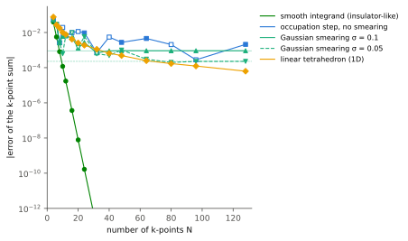
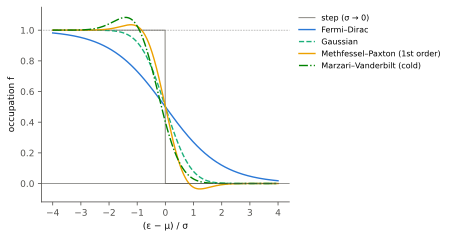
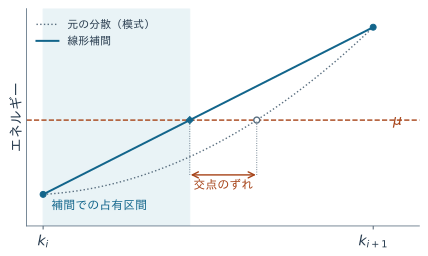

.. _metal-bz-integration:

金属のブリルアンゾーン積分
==========================

金属ではバンドがフェルミ準位を横切るので、絶対零度の占有数は\ :ref:`フェルミ面<fermi-surface>`\ を境に
1から0へ跳ぶ。「\ :ref:`kpoint_sampling`\ 」で見たように、ブリルアンゾーン（BZ）積分を等間隔メッシュの和で
近似したときの誤差は被積分関数のフーリエ成分で決まるので、この段差があると誤差は振れながらゆっくり減る。
本稿では、1次元の模型でその様子を確かめ、段差を扱う2つの方法、スメアリングとテトラヘドロン法を説明する。

**前提知識**: :ref:`k点メッシュと積分誤差<kpoint_sampling>`、
:ref:`フェルミ–ディラック分布<fermi-dirac-distribution>`、:ref:`フェルミ面<fermi-surface>`。

**学習目標**:

* フェルミ面で占有数に段差がある被積分関数では、等間隔メッシュの誤差が振れながらゆっくり減る
  理由を説明する。
* スメアリング関数の違いと、スメアリング幅を選ぶときの兼ね合いを説明する。
* スメアリングで最小化される自由エネルギー :math:`F` と、幅 :math:`\sigma\to0` の極限との関係を説明する。
* テトラヘドロン法の考え方と、スメアリングと比べた長所・短所を説明する。

.. _kpoint-fermi-surface:

フェルミ面と占有数の段差
------------------------

絶対零度でスメアリングを使わない場合、占有数 :math:`f_j(\boldsymbol k)` はフェルミ準位
:math:`\mu` より低い状態では1、高い状態では0である。金属ではバンドがフェルミ準位を横切るので、
:math:`\varepsilon_j(\boldsymbol k)=\mu` の等エネルギー面（:ref:`フェルミ面<fermi-surface>`）を境に、
占有状態からの寄与に段差が生じることがある。1次元では、段差があるとフーリエ係数に
:math:`1/|l|` 程度でしか減らない成分が現れ、それが :eq:`kps-error` の誤差に残る。メッシュの点がフェルミ面のどちら側に
入るかは分割数によって変わるため、誤差の符号が変わることもある。
フェルミ準位も電子数に合わせて決まるので、有限のメッシュで求まる値自体もメッシュによって動く。

1次元の模型で確かめる。バンド :math:`\varepsilon(k)=-\cos ka` と、 :math:`k_F\approx0.405\pi/a`
を与えるフェルミ準位 :math:`\mu` を固定し、 :math:`\int\theta(\mu-\varepsilon)\,\varepsilon\,\mathrm dk`
（1スピンあたりのバンドエネルギー）を :math:`N` 点の等間隔メッシュで近似した誤差を
:numref:`fig-kps-model` に示す。 :math:`k_F` は :math:`\pi/a` の簡単な有理数倍にならないように選んだ。
前の記事で調べた滑らかな関数 :math:`1/(1.5-\cos ka)`\ （緑）の誤差が指数関数的に減るのに対し、段差のある被積分関数（青）では、
:math:`N=128` でも :math:`2\times10^{-3}` 程度の誤差が符号を変えながら残る。

   1次元模型での、 :math:`N` 点の等間隔メッシュによる和の誤差の絶対値（片対数）。緑：滑らかな
   被積分関数 :math:`1/(1.5-\cos ka)`\ 。青：バンド :math:`-\cos ka` の占有状態のエネルギーの和
   （段差あり）。アクア：同じ和をガウシアンスメアリング（実線 :math:`\sigma=0.1`\ 、破線
   :math:`\sigma=0.05`\ 、エネルギーの単位はホッピング積分の2倍）で求めたもので、細い水平線は
   それぞれの :math:`N\to\infty` の値。黄：1次元の線形テトラヘドロン法。塗りつぶしの点は厳密値
   より大きく、白抜きの点は小さい値。誤差はどれも、段差のある本来の積分の厳密値との差である。

段差の扱い方には、占有数をなめらかにする **スメアリング** と、段差を含んだまま積分を精度よく
近似する **テトラヘドロン法** がある。

.. _smearing:

スメアリング
------------

スメアリングでは、占有数を幅 :math:`\sigma` のなめらかな関数
:math:`f\big((\varepsilon-\mu)/\sigma\big)` に置き換える（:numref:`fig-kps-smearing`\ ）。
:math:`x=(\varepsilon-\mu)/\sigma` として、よく使われる関数は次のとおりである。

* **フェルミ–ディラック分布** :math:`f(x)=1/(e^x+1)`\ 。 :math:`\sigma=k_\mathrm BT` とすると、
  有限温度の電子の占有数そのものである。
* **ガウシアン** :math:`f(x)=\tfrac12\operatorname{erfc}(x)`\ 。段差をガウス関数で
  ぼかしたもので、裾がフェルミ–ディラック分布より速く減る。\ :ref:`状態密度の図を描くときのぼかし<dos-broadening>`\ とは、
  同じ記号 :math:`\sigma` でも幅の定義が異なる。
* **Methfessel–Paxton（MP）** [Methfessel1989]_\ 。ガウシアンにエルミート多項式の補正を加えた
  もので、1次では :math:`f(x)=\tfrac12\operatorname{erfc}(x)-x\,e^{-x^2}/(2\sqrt\pi)`\ 。
  占有数は0〜1の範囲を両側にわずかにはみ出す（1次で −0.036〜1.036）。
* **Marzari–Vanderbilt（MV、コールドスメアリング）** [Marzari1999]_\ 。
  :math:`y=-x-1/\sqrt2` として :math:`f=\tfrac12\{1+\operatorname{erf}(y)\}+e^{-y^2}/\sqrt{2\pi}`\ 。
  占有数は負にならず、1を超える側だけにはみ出す（最大1.083）。

   占有数 :math:`f` を :math:`(\varepsilon-\mu)/\sigma` の関数として描いたもの。灰色は
   :math:`\sigma\to0` の段差。同じ :math:`\sigma` でも関数によって広がりが違うので、幅の値を
   異なる関数のあいだでそのまま比べることはできない。

.. _smearing-width:

スメアリング幅とk点収束
-----------------------

スメアリングを使うと、 :math:`A(\boldsymbol k)` はフェルミ面の付近でなめらかに変化する。
その変化の幅は、k空間では :math:`\sigma` をバンドの傾き :math:`|\nabla_{\boldsymbol k}\varepsilon|`
で割った程度である。k点の間隔がこの幅より十分細かくなれば、 :math:`A(\boldsymbol k)` は
メッシュから見て滑らかな関数になり、和は速く収束する。
:numref:`fig-kps-model` のガウシアンスメアリング（アクア）では、 :math:`\sigma=0.1` が
:math:`N=40` 前後で、 :math:`\sigma=0.05` が :math:`N=100` 前後で、それぞれの極限値に落ち着く。
その極限値は本来の積分からずれ、模型ではずれが :math:`0.091\,\sigma^2` と :math:`\sigma^2` に
比例した。幅を広げるほど少ないk点で収束するが、収束する先が本来の値から離れる。この兼ね合いが、
スメアリング幅を選ぶときの基本である。

.. _smearing-and-free-energy:

スメアリングと自由エネルギー
----------------------------

スメアリングを使った自己無撞着計算で最小化されるのは、全エネルギー
:math:`E` そのものではなく、エントロピーに相当する項を引いた自由エネルギー

.. math::
   :label: kps-free-energy

   F=E-\sigma S[f]

である。フェルミ–ディラック分布では、これは有限温度の電子系の自由エネルギー（Mermin
[Mermin1965]_ ）で、 :math:`S` は電子のエントロピー
:math:`-\sum_{j\boldsymbol k}\{f\ln f+(1-f)\ln(1-f)\}` （:math:`k_\mathrm B` 単位、平均の規格化は
:eq:`kps-sum` と同じ）である。ほかの関数にも、 :math:`F` が占有数について変分的になるような
一般化されたエントロピー :math:`S[f]` が対応する。 :math:`F` が変分的なので、原子に働く力や
応力は :math:`F` の微分として整合的に求まり、構造最適化では :math:`F` が最小化される。

.. _zero-smearing-limit:

スメアリング幅をゼロにした極限
------------------------------

:math:`\sigma\to0` では、 :math:`F` も :math:`E` もスメアリングのない本来の全エネルギー
:math:`E_0` に近づく。フェルミ–ディラック分布やガウシアンでは、小さな :math:`\sigma` で
:math:`E` が :math:`\sigma^2` に比例して上がり、 :math:`F` はほぼ同じだけ下がるので、
:math:`E_0\approx(E+F)/2` と見積もれる [Gillan1989]_\ 。MPやMVの関数は、 :math:`F` の
:math:`\sigma^2` に比例する主要なずれが消えるように作られており、 :math:`F` 自体の幅依存が小さい。
このとき :math:`\sigma\to0` の値に近いのは :math:`F` のほうで、 :math:`E` はより大きくずれる。
MPやMVの :math:`-\sigma S` は負にも正にもなり、物理的なエントロピーではない。
スメアリングは、フェルミ–ディラック分布を実際の電子温度として使う場合を除けば、
積分を速く収束させるための数値的な手段である。

.. _tetrahedron-method:

テトラヘドロン法
----------------

テトラヘドロン法 [Jepsen1971]_ [Lehmann1972]_ では、メッシュの点を頂点とする四面体
（テトラヘドロン）でBZを埋める。 :eq:`kps-mesh` のメッシュの小さな平行六面体を6個の四面体に
分けるので、四面体は全部で :math:`6n_1n_2n_3` 個ある。各四面体の中では、バンドのエネルギーを
頂点の値から線形に補間し、 :math:`\theta(\mu-\varepsilon)` や :math:`\delta(E-\varepsilon)` を
含む積分を四面体ごとに解析的に行う。フェルミ面が四面体のどこを通るかを補間から見積もるので、
占有数をなめらかにせずに、 :math:`\sigma=0` の積分を直接近似する。状態密度 :math:`\rho(E)` の
ようにデルタ関数を含む積分にも向いている。

1次元では、四面体は隣り合うメッシュの点を結ぶ線分にあたる。点の間のバンドを線分でつなぎ、
フェルミ準位との交点の位置で占有を切り替えて積分する。各点を「占有か非占有か」で数えるのでは
なく、点と点の間のどこでフェルミ面を横切るかまで見積もるので、段差による不規則な振れが
抑えられる。残る誤差は線形補間の誤差で、点の間隔の2乗に比例する。 :numref:`fig-kps-model` の
線形テトラヘドロン法（黄）では、誤差は一定の符号のまま、 :math:`N` を2倍にするごとに約1/4に
なった（ :math:`N=12` で :math:`7.6\times10^{-3}`\ 、 :math:`N=48` で :math:`4.9\times10^{-4}`\ ）。

:numref:`fig-kpoint-linear-interpolation`\ のように、元の分散が下に凸な区間では、
線形補間はエネルギーを高めに見積もる。補間した線がフェルミ準位より下にある区間は、
元の分散で占有される区間より短い。この例では、占有区間の長さの誤差は同じ符号に保たれる。
交点で分散の傾きがゼロでなく、交点が区間内の同じ相対位置にある場合、点の間隔を
半分にすると交点のずれはおよそ4分の1になる。

   青い丸はメッシュの点、青い実線は線形補間、灰色の点線は元の分散の模式例。
   フェルミ準位 :math:`\mu` と交わる位置を、補間ではひし形、元の分散では白抜きの丸で示す。
   両矢印は交点のずれ、薄青の範囲は補間で得た占有区間である。

.. _tetrahedron-corrections:

Blöchl補正と適用条件
--------------------

3次元では、線形補間の主要な誤差を補正する項を加えたBlöchlらの方法 [Blochl1994]_ が広く
使われてきた。さらに、四面体の外の点の値も使って補間を改良し、誤差を小さくしたものが最適化
テトラヘドロン法 [Kawamura2014]_ である。テトラヘドロン法には次の注意がある。

* BZ全体を覆う規則的なメッシュが必要で、任意に選んだk点の一覧には使えない。
* Blöchlの補正を加えたエネルギーは占有数について変分的でないため、それから求めた力や応力は
  スメアリングの場合ほど信頼できない。構造最適化にはスメアリングが使われることが多い。
* メッシュ全体の四面体について占有の重みを計算するので、同じメッシュではスメアリングより
  計算時間がかかることがある。

.. _metal-cu-example:

説明用の事例：Cuのk点収束
-------------------------

`k点はいくつ必要か：金属Cuと半導体Siの収束 <https://example.quloud-platform.quemix.com/kpoints/kpoint_convergence.html>`_
では、fccのCuの原始胞について、k点メッシュとスメアリングの条件を変えて全エネルギーを計算している
（Quantum ESPRESSO 7.5、PBE、PAW、カットオフ60/600 Ry、Γ点を含むメッシュ）。同じ事例の半導体Siでは
分割数を増やすごとに誤差が同じ程度の比で減り続けた（\ :ref:`kps-si-example`）のに対し、Cuの誤差は振れる。これは、フェルミ面を
横切る占有数の段差が、小さなスメアリング幅では急な変化として残ることと整合する。

* Cuの全エネルギー（MVスメアリング、幅0.02 Ry）は、 :math:`16^3` で0.5 meV/atomまで近づいたあと
  参照値の反対側に振れ、 :math:`24^3` の誤差が :math:`20^3` より大きい。
* スメアリング幅を広げると収束は速くなるが、幅0.04 Ryでは収束する :math:`F` が1.3 meV/atom
  ずれ、 :math:`E` のずれ（7.5 meV/atom）はそれよりずっと大きい。
* 2つのテトラヘドロン法（Blöchl、最適化）の :math:`48^3` の全エネルギーは0.003 meV/atomの差で
  一致し、MVスメアリング（0.02 Ry）の :math:`F` はそれより0.12 meV/atom高い。テトラヘドロン法の
  全エネルギーは振れずに一方向から収束した。

.. _metal-interpretation-limits:

解釈と限界
----------

本稿の1次元模型は、フェルミ準位を固定し、バンドの形も自己無撞着に変わらないとした単純化である。
実際の計算では、フェルミ準位は電子数に合わせて決まり、電子密度を通じてバンドの形も変わる。
模型の数値（収束に必要な :math:`N`\ 、ずれの係数）は、この模型と選んだ :math:`k_F` に対するもので、
一般的な目安ではない。

金属では、k点メッシュとスメアリング幅の両方が結果に効く。求めたい量について、メッシュと幅を
変えて収束を確かめる。近い条件の計算どうしの差をとる量では、絶縁体の場合
（\ :ref:`k点メッシュと積分誤差の解釈と限界<kps-interpretation-limits>`）と同じく、メッシュによる誤差が
打ち消し合うことが多い。

.. _metal-related:

関連資料
--------

* :ref:`kpoint_sampling`
* :ref:`fermi-level-and-occupation`
* :ref:`irreducible-kpoints`
* :ref:`structure-optimization`
* `k点はいくつ必要か：金属Cuと半導体Siの収束 <https://example.quloud-platform.quemix.com/kpoints/kpoint_convergence.html>`_

.. _metal-references:

参考文献
--------

* N. W. Ashcroft and N. D. Mermin, *Solid State Physics* (Holt, Rinehart and
  Winston, 1976), Chap. 8.
* R. M. Martin, *Electronic Structure: Basic Theory and Practical Methods*, 2nd ed.
  (Cambridge University Press, 2020).

.. [Methfessel1989] M. Methfessel and A. T. Paxton, “High-precision sampling for
   Brillouin-zone integration in metals,” *Physical Review B* **40**, 3616–3621 (1989),
   `doi:10.1103/PhysRevB.40.3616 <https://doi.org/10.1103/PhysRevB.40.3616>`_.
.. [Marzari1999] N. Marzari, D. Vanderbilt, A. De Vita, and M. C. Payne, “Thermal
   Contraction and Disordering of the Al(110) Surface,” *Physical Review Letters* **82**,
   3296–3299 (1999), `doi:10.1103/PhysRevLett.82.3296 <https://doi.org/10.1103/PhysRevLett.82.3296>`_.
.. [Mermin1965] N. D. Mermin, “Thermal Properties of the Inhomogeneous Electron Gas,”
   *Physical Review* **137**, A1441–A1443 (1965),
   `doi:10.1103/PhysRev.137.A1441 <https://doi.org/10.1103/PhysRev.137.A1441>`_.
.. [Gillan1989] M. J. Gillan, “Calculation of the vacancy formation energy in aluminium,”
   *Journal of Physics: Condensed Matter* **1**, 689–711 (1989),
   `doi:10.1088/0953-8984/1/4/005 <https://doi.org/10.1088/0953-8984/1/4/005>`_.
.. [Jepsen1971] O. Jepsen and O. K. Andersen, “The electronic structure of h.c.p.
   Ytterbium,” *Solid State Communications* **9**, 1763–1767 (1971),
   `doi:10.1016/0038-1098(71)90313-9 <https://doi.org/10.1016/0038-1098(71)90313-9>`_.
.. [Lehmann1972] G. Lehmann and M. Taut, “On the Numerical Calculation of the Density of
   States and Related Properties,” *physica status solidi (b)* **54**, 469–477 (1972),
   `doi:10.1002/pssb.2220540211 <https://doi.org/10.1002/pssb.2220540211>`_.
.. [Blochl1994] P. E. Blöchl, O. Jepsen, and O. K. Andersen, “Improved tetrahedron method
   for Brillouin-zone integrations,” *Physical Review B* **49**, 16223–16233 (1994),
   `doi:10.1103/PhysRevB.49.16223 <https://doi.org/10.1103/PhysRevB.49.16223>`_.
.. [Kawamura2014] M. Kawamura, Y. Gohda, and S. Tsuneyuki, “Improved tetrahedron method
   for the Brillouin-zone integration applicable to response functions,” *Physical Review B*
   **89**, 094515 (2014),
   `doi:10.1103/PhysRevB.89.094515 <https://doi.org/10.1103/PhysRevB.89.094515>`_.
