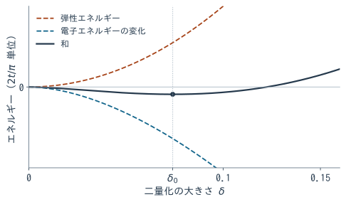
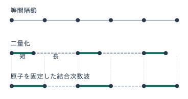

.. _peierls-instability:

Peierls不安定性
===============

1次元の\ :ref:`半充填<half-filling>`\ の鎖を例に、原子の変位によって\ :ref:`バンドギャップ<valence-conduction-band-gap>`\ が開き、格子が自発的に
変形する仕組みを見る。二量化による電子エネルギーの低下をSSH模型のバンドから求め、弾性エネルギーとの釣り合いから、
二量化の大きさとギャップを導く。最後に、原子核を固定した鎖に現れる結合次数波との違いを扱う。

**前提知識**: :ref:`SSH模型<tb-ssh>`、:ref:`半充填<half-filling>`、:ref:`状態の和とBZ積分<bz-average>`、:ref:`結合次数<bond_order>`。

**学習目標**:

* 格子の二量化でゾーン境界にギャップが開き、半充填の鎖の電子エネルギーが下がることを説明する。
* 二量化による電子エネルギーの低下が :math:`\delta^2\ln(1/\delta)` の形になることを示し、弾性エネルギーとの釣り合いから、
  半充填の1次元鎖が弱い結合でも二量化することと、二量化の大きさを導く。
* 原子変位を伴うPeierls歪みと、原子を固定した鎖の結合次数波を区別する。

格子の二量化とバンドギャップ
----------------------------

等間隔に並んだ原子の間隔が長短交互になる変形を考える。この変形を二量化と呼ぶ。
鎖の周期は2倍になり、隣接原子間のホッピングも交替する。\ :ref:`SSH模型<tb-ssh>`\ では、
この交替によって元の鎖のフェルミ波数にギャップが開く（式 :eq:`tb-ssh-gap`）。
:numref:`fig-tightbinding-ssh-bulk-gap`\ の右では、二量化後のゾーン境界にギャップが開いている。
半充填では下側のバンドが占有され、占有状態のエネルギーが下がる。

格子を変形させるには弾性エネルギーが必要である。電子エネルギーの低下が弾性エネルギーの
増加を上回ると、全エネルギーが下がり、鎖は自発的に二量化する。これが1次元鎖の
**Peierls不安定性** である [Heeger1988]_。以下の2節で、二つのエネルギーを式で比べる。

.. _peierls-electronic-energy:

二量化による電子エネルギーの低下
--------------------------------

二量化の大きさを、交替するホッピング :math:`t_{1,2}=t(1\pm\delta)`\ （:math:`\delta>0`）の相対的な変化 :math:`\delta` で表す。
SSH模型のバンド :eq:`tb-ssh-band` に代入すると、:math:`t_1^2+t_2^2=2t^2(1+\delta^2)`、:math:`2t_1t_2=2t^2(1-\delta^2)` から、
:math:`\varepsilon_0` を基準にした下側のバンドは

.. math::
   :label: peierls-lower-band

   E_-(k)=-2t\sqrt{\cos^2ka+\delta^2\sin^2ka}

となる。:math:`\delta=0` では一様な鎖のバンド :math:`-2t|\cos ka|` を縮小ゾーンに折り返したものに戻り、
:math:`\delta>0` ではゾーン境界 :math:`k=\pm\pi/(2a)` の付近の準位が下がる。

半充填では、縮小ゾーン :math:`-\pi/(2a)<k\le\pi/(2a)` の下側のバンドに、各波数でスピンを含めて2個の電子が入る。
原子 :math:`N` 個の鎖には単位胞が :math:`N/2` 個あるので、波数の和を\ :ref:`積分に置き換える<bz-average>`\ と
（縮小ゾーンの幅は :math:`\pi/a`）、1原子あたりの電子エネルギーは

.. math::
   :label: peierls-electronic-energy

   E_{\mathrm{el}}(\delta)=\frac{a}{\pi}\int_{-\pi/(2a)}^{\pi/(2a)}E_-(k)\,\mathrm dk
   =-\frac{2t}{\pi}\int_{-\pi/2}^{\pi/2}\sqrt{\cos^2x+\delta^2\sin^2x}\,\mathrm dx

である。:math:`\delta=0` では :math:`E_{\mathrm{el}}(0)=-4t/\pi` で、一様な鎖の半充填の値に一致する。積分は第2種完全楕円積分で、
:math:`\delta` が小さいときに展開すると

.. math::
   :label: peierls-electronic-expansion

   \Delta E_{\mathrm{el}}(\delta)=E_{\mathrm{el}}(\delta)-E_{\mathrm{el}}(0)
   \simeq-\frac{2t}{\pi}\,\delta^2\left(\ln\frac4\delta-\frac12\right)

を得る。数値積分と比べると、:math:`\delta=0.1` で0.3%、:math:`\delta=0.2` で約1%の差である。

電子エネルギーは :math:`\delta^2` に比例するだけでなく、:math:`\ln(1/\delta)` が掛かって下がる。:math:`\delta^2` の係数
:math:`-(2t/\pi)\ln(4/\delta)` は、:math:`\delta\to0` で負に発散する。ギャップが開くと、フェルミ準位の近くの状態は、
ギャップの大きさ :math:`4t\delta` より離れたエネルギーのものまで少しずつ下がる。1次元の半充填の鎖では、フェルミ準位の
2点 :math:`\pm k_{\mathrm F}` がちょうど新しいゾーン境界に重なるので、フェルミ準位の近くのすべての状態がこの低下に加わり、
その和が対数になる。

.. _peierls-energy-balance:

弾性エネルギーとの釣り合い
--------------------------

隣り合う原子 :math:`n` と :math:`n+1` の間のホッピングが、間隔の変化に比例して :math:`t_{n,n+1}=t-\alpha(u_{n+1}-u_n)`\ （:math:`\alpha>0`）と
変わるとする。:math:`u_n` は原子 :math:`n` の変位で、間隔が縮むほどホッピングが大きくなる。二量化 :math:`u_n=(-1)^nu` では、
結合の長さが :math:`\mp2u` だけ交互に変わり、ホッピングは :math:`t\pm2\alpha u` になるので、:math:`\delta=2\alpha u/t` である。
隣り合う原子をばね定数 :math:`K` のばねで結ぶと、1本の結合の弾性エネルギーは :math:`K(2u)^2/2`、結合は1原子あたり1本なので、

.. math::
   :label: peierls-elastic-energy

   E_{\mathrm{lat}}(\delta)=2Ku^2=\frac{2t}{\pi}\,g\,\delta^2,\qquad g=\frac{\pi Kt}{4\alpha^2}

となる。:math:`g` は、ばねの硬さと電子と格子の結合の強さの比を表す無次元の数で、SSHらの結合定数
:math:`\lambda=2\alpha^2/(\pi Kt)` とは :math:`g=1/(2\lambda)` の関係にある [Heeger1988]_。

:eq:`peierls-electronic-expansion` と足すと、1原子あたりのエネルギーの変化は

.. math::
   :label: peierls-total-energy

   \Delta E(\delta)\simeq\frac{2t}{\pi}\,\delta^2\left(g+\frac12-\ln\frac4\delta\right)

である。:math:`\ln(4/\delta)` は :math:`\delta\to0` で限りなく大きくなるので、:math:`g` がどれほど大きくても、十分小さい
:math:`\delta` では括弧の中が負になり、二量化でエネルギーが下がる。弾性エネルギーは :math:`\delta^2` に比例するだけなので、
電子エネルギーの対数の低下にいつかは負ける。これが、半充填の1次元鎖が絶対零度で必ず二量化するという
Peierls不安定性の中身である。:math:`\mathrm d\Delta E/\mathrm d\delta=0` から :math:`\ln(4/\delta_0)=g+1`、すなわち

.. math::
   :label: peierls-delta0

   \delta_0=4\,e^{-1-g},\qquad \Delta_{\mathrm{SSH}}=2|t_1-t_2|=4t\delta_0=16t\,\exp\!\left(-1-\frac{\pi Kt}{4\alpha^2}\right)

で極小になる（:numref:`fig-peierls-energy-balance`）。:math:`\Delta_{\mathrm{SSH}}` は、この二量化で開くギャップ :eq:`tb-ssh-gap` である。ばねが硬いほど、また結合 :math:`\alpha` が弱いほど、二量化とギャップは
指数関数的に小さくなるが、0にはならない。:eq:`peierls-delta0` は :eq:`peierls-electronic-expansion` の展開に基づくので、
:math:`\delta_0` が小さい範囲の近似である。数値積分の :eq:`peierls-electronic-energy` で極小を求めると、:math:`\delta_0\approx0.07`\ （:math:`g=3`）で1%、
:math:`\delta_0\approx0.2`\ （:math:`g=2`）で約6%ずれる。

   :math:`g=3` の弾性エネルギー :eq:`peierls-elastic-energy`\ （赤の破線）、電子エネルギーの変化\ （青の破線、:eq:`peierls-electronic-energy` の数値積分）と、
   その和（黒）。和は :math:`\delta_0\approx0.074` で極小になる。係数は説明用で、特定の物質の値ではない。

2次元・3次元の結晶では、一般にフェルミ面の一部でしかギャップが開かないので、電子エネルギーの低下は対数で発散しない。
その場合は、結合が十分強くなければ周期を変える変形はエネルギーを下げない。1次元の半充填の鎖で、どんなに弱い結合でも
不安定になるのは、フェルミ面（2点）全体がちょうど新しいゾーン境界に重なるためである。

.. _peierls-bond-order-wave:

原子を固定した鎖の結合次数波
----------------------------

原子核を等間隔に固定しても、電子状態の側で結合の強弱が交替することがある。
この状態を **結合次数波** （bond-order wave, BOW）と呼ぶ。Peierls歪みには
原子変位が伴うので、計算結果を読むときは、結合次数の交替と原子間隔の交替を区別する。

:numref:`fig-peierls-dimerization-and-bond-order`\ で、原子の位置が動く二量化と、
原子を固定したまま結合次数が交替する場合を見比べる。

   黒丸は原子位置、太い実線と細い破線は交替する結合の強・弱を示す。
   縦の点線は、原子を固定した鎖での位置の目安である。

Hartree–Fock法などの平均場計算で結合次数波が現れる場合、\ :ref:`結合次数<bond_order>`\ を表す
隣接原子間の密度行列要素の交替が、交換項を通じて有効ハミルトニアンの隣接要素の交替を
生む。それがまた結合次数の交替を支えるという自己無撞着な関係になっている。
SSH模型ではホッピングの交替を与えた上で、その結果として生じるギャップを記述する。

.. _peierls-hydrogen-chain-example:

説明用の事例：等間隔に固定した水素原子鎖の結合次数
--------------------------------------------------

「\ :ref:`bond_order`\ 」の説明用の事例では、計算事例
`水素原子を並べると電子バンドは生まれるのか <https://example.quloud-platform.quemix.com/hydrogen_chain/band_formation.html>`_
の、原子間隔1.8 Åで等間隔に並べた水素原子鎖（STO-3G、Psi4 1.10）について、隣り合う結合の結合次数を比べている。
RHFでは、鎖の中央の結合次数が約0.86と0.38で交替し、交替の大きさは原子数を16、32、64と増やしてもほとんど変わらない。
RKS-PBEの交替は小さく、原子数とともに小さくなり、端の効果として説明できる。スピン非制限計算では、交替はほぼ消える。

原子は等間隔に固定してあるので、RHFで見える交替はPeierls歪みではなく、電子状態の側の結合次数波である。
しかも、交替が現れるかどうかは、計算手法（電子間相互作用の扱い）によって変わる。原子が実際に二量化するかを知るには、
原子位置も最適化して、原子間隔が交替するか、そのときエネルギーが下がるかを調べる必要がある。

.. _peierls-interpretation-limits:

解釈と限界
----------

本稿の模型は、原子を静止させたまま電子状態を求め、そのエネルギーを弾性エネルギーと比べる。原子核の零点振動や、
電子どうしの相互作用は含まない。電子間相互作用が強い鎖では、結合次数波や、スピンが交互に並ぶ状態が、
二量化と競合する（上の事例でも、手法によって結果が変わる）。

絶対零度を考えた。有限温度では、ギャップをまたぐ熱励起が電子エネルギーの利得を減らすので、ある温度より上では
二量化しない（Peierls転移）。厳密な1次元の系では揺らぎが長距離の秩序を壊すので、実際に二量化が観測されるのは、
鎖どうしが弱く結びついた擬1次元の物質である。ポリアセチレンの単結合と二重結合の交替は、SSH模型で説明される代表例である [Heeger1988]_。

.. _peierls-related:

関連資料
--------

* :ref:`tightbinding`
* :ref:`periodic_boundary`
* :ref:`bond_order`
* :ref:`soft-mode`
* `水素原子を並べると電子バンドは生まれるのか <https://example.quloud-platform.quemix.com/hydrogen_chain/band_formation.html>`_

.. _peierls-references:

参考文献
--------

.. [Heeger1988] A. J. Heeger, S. Kivelson, J. R. Schrieffer, and W.-P. Su,
   “Solitons in conducting polymers,” *Reviews of Modern Physics* **60**, 781–850 (1988),
   `doi:10.1103/RevModPhys.60.781 <https://doi.org/10.1103/RevModPhys.60.781>`_.

.. raw:: html

   
