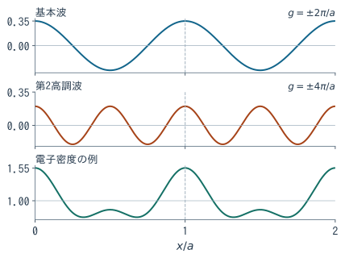

.. _periodic:

==============================
周期性
==============================

関数 :math:`f(x)` が次の関係を満たすとき

.. math::
    f(x + a) = f(x)

\ :math:`f(x)` は周期 :math:`a` を持つという。
結晶の場合を考えると、例えば電子密度やポテンシャルなどは、任意の格子ベクトル

.. math::
    \boldsymbol{R} \equiv n_1 \boldsymbol{a}_1 + n_2 \boldsymbol{a}_2 + n_3 \boldsymbol{a}_3

に対して

.. math::
    \rho(\boldsymbol{r} + \boldsymbol{R}) = \rho(\boldsymbol{r})
    :label: periodic0

が成り立っていると考えられる。

--------------------------------
フーリエ級数表示
--------------------------------

格子と同じ周期をもつ電子密度は、平面波の重ね合わせで表せる。
各平面波の波数ベクトル :math:`\boldsymbol G` は :ref:`逆格子ベクトル<lattice>` で、
:math:`\rho_{\boldsymbol G}` はその平面波がどれだけ含まれるかを表すフーリエ係数である。

.. math::
    \rho(\boldsymbol{r}) = \sum_{\boldsymbol{G}} \rho_{\boldsymbol G}
    \exp\left( {i\boldsymbol{G}\! \cdot\! \boldsymbol{r}} \right)

格子ベクトル :math:`\boldsymbol R` だけ移動すると、各平面波に
:math:`e^{i\boldsymbol G\cdot\boldsymbol R}` が掛かる。内積
:math:`\boldsymbol G\cdot\boldsymbol R` は :math:`2\pi` の整数倍なので、この因子は1である。
したがって和の各項が元に戻り、式 :eq:`periodic0` が得られる。

.. math::
    \rho(\boldsymbol{r} + \boldsymbol{R})
    &= \sum_{\boldsymbol{G}} \rho_{\boldsymbol G}
    \exp\left( {i\boldsymbol{G}\! \cdot\! \boldsymbol{r}} \right)
    \exp\left( {i\boldsymbol{G}\! \cdot\! \boldsymbol{R}} \right) \\
    &= \sum_{\boldsymbol{G}} \rho_{\boldsymbol G}
    \exp\left( {i\boldsymbol{G}\! \cdot\! \boldsymbol{r}} \right) \\
    &= \rho(\boldsymbol{r})

一次元の例を :numref:`fig-periodic-fourier-components` に示す。第2高調波は基本波の
半分の周期をもつが、どちらも :math:`a` だけ平行移動すると元の値に戻る。
このため、二つの成分と定数項を足した密度も :math:`a` ごとに繰り返す。

   上段の :math:`0.35\cos(2\pi x/a)` は :math:`G=\pm2\pi/a`、
   中段の :math:`0.2\cos(4\pi x/a)` は :math:`G=\pm4\pi/a` の平面波の組に対応する。
   下段はこの二成分に :math:`G=0` の定数項1を足した密度の模式例。
   縦の破線が周期一つ分の境界を示す。
