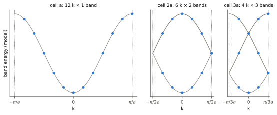

.. _periodic_boundary:

超胞とバンドの折り返し
======================

同じ結晶を、単位胞をいくつかまとめた\ :ref:`超胞（スーパーセル）<lt-supercell>`\ の並びとして記述することがある。
超胞では並進の単位が大きくなるので、ブリルアンゾーン（BZ）が小さくなり、元のバンドがその中に折り返されて
現れる。本稿では、折り返しで波数の数とバンドの本数がどう変わるかを1次元で導き、3次元へ広げる。
そのうえで、折り返しだけでは物理が変わらないこと、結晶の周期が実際に変わるとギャップが開きうることを説明する。

**前提知識**: :ref:`ブロッホの定理と周期境界条件<blochstheorem>`、:ref:`第1ブリルアンゾーン<first-brillouin-zone>`、
:ref:`超胞<lt-supercell>`。

**学習目標**:

* 超胞のブリルアンゾーンに元のバンドを折り返し、波数の数とバンドの本数の関係を示す。
* 折り返されたバンドの交点でギャップが開かない理由と、周期が実際に変わるとギャップが開きうる理由を説明する。

.. _pbc-band-folding:

1次元の超胞での折り返し
------------------------

1次元で、長さ :math:`Ma` の超胞を単位にとると、並進の単位も :math:`Ma` になるので、
状態は並進 :math:`Ma` に対する位相 :math:`e^{iKMa}` で分類されるようになる。元の波数 :math:`k` の状態は、
並進 :math:`Ma` に対して位相 :math:`e^{ikMa}` だけ変わるので、超胞の波数 :math:`K` は

.. math::
   :label: pbc-folding

   K\equiv k\pmod{\frac{2\pi}{Ma}},\qquad
   k\equiv K+\frac{2\pi}{Ma}\,j\pmod{\frac{2\pi}{a}}
   \quad(j=0,1,\ldots,M-1)

で与えられる。超胞のBZ :math:`-\pi/(Ma)<K\le\pi/(Ma)` は元のBZの :math:`1/M` の幅となる。
元の1本のバンド :math:`\varepsilon(k)` は、
超胞のBZでは :math:`\varepsilon_j(K)=\varepsilon(K+2\pi j/(Ma))` の :math:`M` 本のバンドとして
現れる。これを\ **バンドの折り返し**\ （フォールディング）という。

:math:`N` が :math:`M` の倍数なら、:math:`N` 個の単位胞は :math:`N/M` 個の超胞にまとめられる。
式 :eq:`pbc-allowed` から
許される :math:`K` は :math:`N/M` 個である。 :math:`N=12` の結晶を :math:`2a`\ 、 :math:`3a` の
セルで記述すると、波数は12個から6個、4個に減り、そのかわりに各波数のバンドが2本、3本に増える
（:numref:`fig-pbc-folding`\ ）。状態の総数（波数の数 × バンドの本数）は12のままである。

   :math:`N=12` の1次元の結晶の状態（青い点）を、単位胞 :math:`a` （左）、 :math:`2a` の
   超胞（中）、 :math:`3a` の超胞（右）で記述したもの。灰色の曲線は模型の
   バンド :math:`-\cos ka` と、それをセルのBZに折り返したもの。点の数はどれも12個で、BZの境界や
   バンドの交点で重なった点は2つの状態を表す。横軸の幅は、それぞれのセルのBZの幅に比例させた。

.. |three-dimensional-folding| replace:: 3次元の超胞での折り返し

|three-dimensional-folding|
---------------------------

3次元では、\ :ref:`超胞の格子行列<lt-supercell>`\ を整数行列 :math:`M` を用いて :math:`A_\mathrm{sup}=AM` と書くことができる。
超胞の体積は :math:`|\det M|` 倍に、BZの体積は :math:`1/|\det M|` 倍になり、
元の波数 :math:`\boldsymbol k` は超胞の逆格子ベクトル
:math:`\boldsymbol G_\mathrm{sup}` だけずらして小さなBZに折り返される
（:math:`\boldsymbol K=\boldsymbol k-\boldsymbol G_\mathrm{sup}`\ ）。1つの :math:`\boldsymbol K` に
元の :math:`|\det M|` 個の波数が対応し、バンドの本数は :math:`|\det M|` 倍になる。

.. _pbc-folding-meaning:

折り返しの意味
--------------

折り返しは、同じ状態をどの大きさのセルで記述するかの違いであり、それだけでは物理は何も
変わらない。 :numref:`fig-pbc-folding` の折り返されたバンドは、BZの境界や内部で交わったり
接したりするが、ギャップは開かない。元の単位胞の周期 :math:`a` があるかぎり、折り返された
バンドどうしは異なる並進の性質を持ち、混ざらないからである。

一方、原子の変位などで結晶の周期が実際に :math:`Ma` に変わると、元の並進 :math:`a` の対称性が
失われ、同じ :math:`K` に折り返されたバンドどうしが混ざる。このとき、折り返されたバンドの交点で
ギャップが開きうる。\ :ref:`SSH模型<tb-ssh>`\ では、1次元鎖の隣り合う結合の強さが交互に変わって
周期が :math:`2a` になると、:math:`K=\pm\pi/(2a)` でギャップが開く。周期の変化が小さいときには、超胞の
バンドが元のバンドを折り返した形にどれだけ近いかを調べることで、変化の効果を読み取れる。

計算の上では、超胞のバンドの本数が増えるかわりに、BZが小さくなるので、同じ細かさで
BZ積分を行うのに必要な\ :ref:`k点メッシュの分割数<kpoint-meshes>`\ が減る。

.. _pbc-related:

関連資料
--------

* :ref:`blochstheorem`
* :ref:`brillouinzone`
* :ref:`lt-cell-transform`
* :ref:`tightbinding`
* :ref:`kpoint_sampling`

.. _pbc-references:

参考文献
--------

* N. W. Ashcroft and N. D. Mermin, *Solid State Physics* (Holt, Rinehart and
  Winston, 1976), Chap. 8.

.. raw:: html

   
