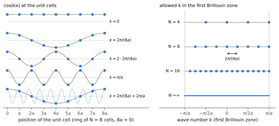
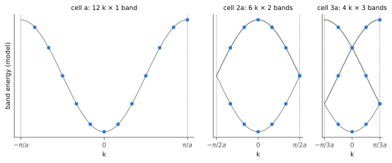

.. _periodic_boundary:

周期境界条件とバンドの折り返し
==============================

.. :ref:`ブロッホの定理<blochstheorem>` は、結晶中の電子状態を波数ベクトル :math:`\boldsymbol k`
.. で分類できることを示す。では、有限の大きさの結晶では、どの :math:`\boldsymbol k` が許され、
.. いくつあるのだろうか。本稿では、結晶の両端をつなぐ **周期境界条件** から許される波数を導き、
.. その数が単位胞の数に等しいことを確かめる。さらに、同じ結晶を大きなセル（スーパーセル）で
.. 記述し直すと、波数の数が減るかわりにバンドの本数が増える **バンドの折り返し** が起きることを示す。

.. **前提知識**: :ref:`ブロッホの定理<blochstheorem>`、:ref:`ブリルアンゾーン<brillouinzone>`、
.. :ref:`超胞（スーパーセル）<lattice-transform>`。

.. **学習目標**:

.. * 周期境界条件から許される波数を導き、波数の数が単位胞の数に等しいことを説明する。
.. * 逆格子ベクトルだけ異なる波数が同じ状態の分類を与える理由を、単位胞の位置での位相から説明する。
.. * スーパーセルで記述すると、波数がセルの数で割った数に減り、各波数のバンドが増えることを導く。
.. * 折り返しは記述の変更にすぎないこと、周期が実際に変わるとギャップが開きうることを区別する。

周期境界条件と許される波数
--------------------------

結晶中の電子の固有状態は、格子ベクトル
:math:`\boldsymbol R` の並進に対して位相 :math:`e^{i\boldsymbol k\cdot\boldsymbol R}`
だけ変化する（\ :ref:`ブロッホの定理<blochstheorem>`\ ）。この波数ベクトル :math:`\boldsymbol k` は、バンドの番号 :math:`j` とともに状態を
指定する量子数となる（並進対称性の群の既約表現に対応する）。ここで扱う位相は、単位胞から単位胞へ移ったときの位相の変化を表すもので、
結晶中の電子の波動関数そのものが単純な正弦波であるという意味ではない
（\ :numref:`fig-pbc-allowed`\ 左図のような正弦波に各格子点に共通の「変調」を乗せたものが実際の波動関数になる）。

:ref:`基本格子ベクトル<lattice>` :math:`\boldsymbol a_i` の方向に単位胞を :math:`N_i` 個並べた有限の結晶を考え、
その両端をつなぐ周期境界条件
:math:`\psi(\boldsymbol r+N_i\boldsymbol a_i)=\psi(\boldsymbol r)` を考える（Born–von Kármánの境界条件）。\ :ref:`ブロッホの定理<blochstheorem>`\ と
合わせると :math:`e^{iN_i\boldsymbol k\cdot\boldsymbol a_i}=1` という要請を課すことと等価である。
:math:`\boldsymbol k` を\ :ref:`基本逆格子ベクトル<lattice>` :math:`\boldsymbol b_j` を基底として表すことにすれば
（\ :math:`\boldsymbol a_i\cdot\boldsymbol b_j=2\pi\delta_{ij}` なので）、

.. :math:`\boldsymbol k=\sum_j x_j\boldsymbol b_j` と展開すると
.. :math:`\boldsymbol k\cdot\boldsymbol a_i=2\pi x_i` なので、条件は :math:`N_ix_i` が整数であること、すなわち

.. math::
   :label: pbc-allowed

   \boldsymbol k=\sum_{i=1}^{3}\frac{m_i}{N_i}\,\boldsymbol b_i\qquad(m_i\ \text{は整数})

と取れば上記の周期境界条件を満たせることがわかる。\ :ref:`逆格子ベクトル<lattice>` :math:`\boldsymbol G` だけ異なる :math:`\boldsymbol k` と
:math:`\boldsymbol k+\boldsymbol G` は、すべての\ :ref:`格子ベクトル<lattice>`\ に対して同じ位相
:math:`e^{i\boldsymbol k\cdot\boldsymbol R}` を与える（:math:`e^{i\boldsymbol G\cdot\boldsymbol R}=1`\ ）
ので、同じ並進の性質を表す。重複を避けて\ :ref:`BZ<brillouinzone>`\ の中から :math:`\boldsymbol k` 選ぶと、
各 :math:`i` の方向について :math:`m_i=0,1,\ldots,N_i-1` となるので、
:math:`N=N_1N_2N_3` 個、つまり **単位胞の個数と同じだけ波数がある** ことになる。

.. 各バンドは、1スピンあたり
.. :math:`N` 個の状態を持つ。許される波数は、\ :ref:`BZ<brillouinzone>`\ の体積 :math:`\Omega_\mathrm{BZ}` を :math:`N`
.. 等分した体積ごとに1点ずつ、一様に分布する。

1次元結晶の場合のイメージを :numref:`fig-pbc-allowed` に示す。格子定数 :math:`a` の単位胞を :math:`N` 個並べた結晶を考えると、許される（独立な）波数は
:math:`k=2\pi m/(Na)` である。 :math:`k=0` は位相が単位胞間で
変化しない状態で、 :math:`k=\pi/a` は単位胞ごとに符号が反転する状態である。
また :numref:`fig-pbc-allowed`\ 左 には、\ :ref:`逆格子ベクトル<lattice>` :math:`2\pi/a` だけ異なる波数が、各単位胞の位置で区別できなくなる様子も示されている。
許される波数の間隔 :math:`2\pi/(Na)` は、 :math:`N` を増やすほど狭くなり、 :math:`N\to\infty`
の極限では、波数が\ :ref:`BZ<brillouinzone>`\ を連続的に埋めることになる（\ :numref:`fig-pbc-allowed`\ 右）。

   格子定数 :math:`a` の単位胞 :math:`N` 個を輪につないだ1次元の結晶で許される波数 :math:`k`\ 。
   左： :math:`N=8` のときの、各単位胞の位置での :math:`\cos kx` （位相因子 :math:`e^{ikx}` の実部、
   青い点）と、それを結ぶ曲線（灰色）。いちばん下の行の破線は、 :math:`k=2\pi/(8a)` に逆格子ベクトル :math:`2\pi/a` を足した波数の :math:`\cos kx` で、単位胞の位置では実線
   （:math:`k=2\pi/(8a)`\ ）と同じ値をとる。右： :math:`N` = 4、8、16のときにBZ内で許される
   :math:`k`\ 。 :math:`-\pi/a` と :math:`\pi/a` は逆格子ベクトルだけ異なる同じ点なので、
   :math:`\pi/a` だけを描いた。 :math:`N\to\infty` では、許される :math:`k` がBZ全体を埋める。

スーパーセルとバンドの折り返し
------------------------------

同じ結晶を、よりサイズの大きな単位胞（スーパーセル）の並びとみなすこともできる。
1次元で、長さ :math:`Ma` のスーパーセルを単位にとると、並進の単位も :math:`Ma` になるので、
状態は並進 :math:`Ma` に対する位相 :math:`e^{iKMa}` で分類されるようになる。元の波数 :math:`k` の状態は、
並進 :math:`Ma` に対して位相 :math:`e^{ikMa}` だけ変わるので、スーパーセルの波数 :math:`K` は

.. math::
   :label: pbc-folding

   K\equiv k\pmod{\frac{2\pi}{Ma}},\qquad
   k=K+\frac{2\pi}{Ma}\,j\quad(j=0,1,\ldots,M-1)

で与えられる。スーパーセルの\ :ref:`BZ<brillouinzone>` :math:`-\pi/(Ma)<K\le\pi/(Ma)` は元の\ :ref:`BZ<brillouinzone>`\ の :math:`1/M` の幅となる。
元の1本のバンド :math:`\varepsilon(k)` は、
スーパーセルの\ :ref:`BZ<brillouinzone>`\ では :math:`\varepsilon_j(K)=\varepsilon(K+2\pi j/(Ma))` の :math:`M` 本のバンドとして
現れる。これを\ **バンドの折り返し**\ （フォールディング）という。

:math:`N` 個の単位胞の結晶は :math:`N/M` 個のスーパーセルが並んだ結晶でもあるので、 :eq:`pbc-allowed` 式から
許される :math:`K` は :math:`N/M` 個である。 :math:`N=12` の結晶を :math:`2a`\ 、 :math:`3a` の
セルで記述すると、波数は12個から6個、4個に減り、そのかわりに各波数のバンドが2本、3本に増える
（:numref:`fig-pbc-folding`\ ）。状態の総数（波数の数 × バンドの本数）は12のままである。

   :math:`N=12` の1次元の結晶の状態（青い点）を、単位胞 :math:`a` （左）、 :math:`2a` の
   スーパーセル（中）、 :math:`3a` のスーパーセル（右）で記述したもの。灰色の曲線は模型の
   バンド :math:`-\cos ka` と、それをセルのBZに折り返したもの。点の数はどれも12個で、BZの境界や
   バンドの交点で重なった点は2つの状態を表す。横軸の幅は、それぞれのセルのBZの幅に比例させた。

3次元では、スーパーセルの\ :ref:`格子ベクトル<lattice>`\ を整数行列 :math:`M` を用いて :math:`A_\mathrm{sup}=AM` と書くことができる
（:ref:`格子基底と座標系の変換<lattice-transform>`\ ）。スーパーセルの体積は :math:`|\det M|` 倍に、
:ref:`BZ<brillouinzone>`\ の体積は :math:`1/|\det M|` 倍になり、元の波数 :math:`\boldsymbol k` はスーパーセルの\ :ref:`逆格子ベクトル<lattice>`
:math:`\boldsymbol G_\mathrm{sup}` だけずらして小さな\ :ref:`BZ<brillouinzone>`\ に折り返される
（:math:`\boldsymbol K=\boldsymbol k-\boldsymbol G_\mathrm{sup}`\ ）。1つの :math:`\boldsymbol K` に
元の :math:`|\det M|` 個の波数が対応し、バンドの本数は :math:`|\det M|` 倍になる。

折り返しの意味
--------------

折り返しは、同じ状態をどの大きさのセルで記述するかの違いであり、それだけでは物理は何も
変わらない。 :numref:`fig-pbc-folding` の折り返されたバンドは、\ :ref:`BZ<brillouinzone>`\ の境界や内部で交わったり
接したりするが、ギャップは開かない。元の単位胞の周期 :math:`a` があるかぎり、折り返された
バンドどうしは異なる並進の性質を持ち、混ざらないからである。

一方、原子の変位などで結晶の周期が実際に :math:`Ma` に変わると、元の並進 :math:`a` の対称性が
失われ、同じ :math:`K` に折り返されたバンドどうしが混ざる。このとき、折り返されたバンドの交点で
ギャップが開きうる。1次元鎖で隣り合う結合の強さが交互に変わり、周期が :math:`2a` になると、
:math:`K=\pm\pi/(2a)` でギャップが開く例を、:ref:`タイト・バインディング近似<tightbinding>` の
ホッピングが交替する鎖（SSH模型）で扱っている。周期の変化が小さいときには、スーパーセルの
バンドが元のバンドを折り返した形にどれだけ近いかを調べることで、変化の効果を読み取れる。

計算の上では、スーパーセルのバンドの本数が増えるかわりに、\ :ref:`BZ<brillouinzone>`\ が小さくなるので、同じ細かさで
BZ積分を行うのに必要な波数の数が減る。この関係は :ref:`kpoint_sampling` で使う。

関連項目
--------

* :ref:`blochstheorem`
* :ref:`brillouinzone`
* :ref:`lattice-transform`
* :ref:`tightbinding`
* :ref:`kpoint_sampling`

参考資料
--------

* N. W. Ashcroft and N. D. Mermin, *Solid State Physics* (Holt, Rinehart and
  Winston, 1976), Chap. 8.
