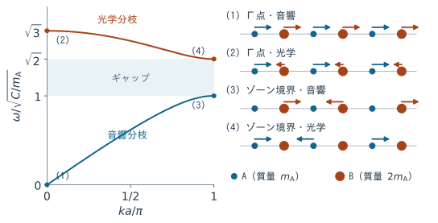

.. _phonon:

調和近似とフォノン
==================

結晶中の原子は、平衡位置のまわりで絶えず振動している。変位が小さければ、ポテンシャル
エネルギーを変位の2次まで展開でき、原子の運動は互いに独立な調和振動子の集まりに分けられる。
この振動の量子を **フォノン** と呼ぶ。本稿では、力定数から動的行列を作り、その固有値として
振動数の分散を求める手順を、1次元二原子鎖で具体的に追う。固有値が負になる場合の意味
（虚数振動数と動的安定性）と、力定数を第一原理計算で求める方法、イオン結晶のLO–TO分裂も扱う。
零点振動、比熱、熱膨張など温度に関わる性質は「\ :ref:`phonon-thermal`\ 」で扱う。

**前提知識**: 古典力学の運動方程式と調和振動子、エルミート行列の固有値問題、
:ref:`ブロッホの定理<blochstheorem>`、:ref:`第1ブリルアンゾーン<first-brillouin-zone>`。

**学習目標**:

* 調和近似のもとで力定数を定義し、結晶の運動方程式から動的行列の固有値問題を導く。
* 1次元二原子鎖の分散を解き、音響分枝と光学分枝、Γ点とゾーン境界の変位パターンを説明する。
* 動的行列の負の固有値が、虚数振動数と負のエネルギー曲率を表すことを説明する。
* 対称性を課した最適化で力が0になった構造が、極小とは限らず鞍点でありうることを、フォノンの固有値から判定する。

.. _harmonic-approximation:

調和近似と力定数
----------------

単位胞 :math:`l` の格子ベクトルを :math:`\boldsymbol R_l`、胞内の原子 :math:`\kappa`
（:math:`\kappa=1,\ldots,n`）の位置を :math:`\boldsymbol\tau_\kappa`、質量を
:math:`m_\kappa` とする。原子が平衡位置 :math:`\boldsymbol R_l+\boldsymbol\tau_\kappa` から
:math:`\boldsymbol u_{l\kappa}` だけ変位したときの全エネルギー :math:`E` を、変位の
デカルト成分 :math:`u_{l\kappa\alpha}`\ （:math:`\alpha=x,y,z`）でTaylor展開すると

.. math::
   :label: ph-expansion

   E=E_0+\sum_{l\kappa\alpha}\frac{\partial E}{\partial u_{l\kappa\alpha}}u_{l\kappa\alpha}
   +\frac12\sum_{l\kappa\alpha}\sum_{l'\kappa'\beta}
   \Phi_{l\kappa\alpha,l'\kappa'\beta}\,u_{l\kappa\alpha}u_{l'\kappa'\beta}+O(u^3),

.. math::
   :label: ph-force-constants

   \Phi_{l\kappa\alpha,l'\kappa'\beta}
   =\left.\frac{\partial^2E}{\partial u_{l\kappa\alpha}\,\partial u_{l'\kappa'\beta}}\right|_{\boldsymbol u=0}

となる。:math:`E_0` は平衡構造のエネルギーである。1次の微分は原子に働く力の符号を
変えたもので、平衡構造ではすべて0になる。:math:`\Phi` を **力定数** と呼ぶ。2次の項までで展開を打ち切る近似を **調和近似** という。このとき原子
:math:`l\kappa` に働く力は変位の1次式

.. math::
   :label: ph-force

   F_{l\kappa\alpha}=-\frac{\partial E}{\partial u_{l\kappa\alpha}}
   =-\sum_{l'\kappa'\beta}\Phi_{l\kappa\alpha,l'\kappa'\beta}\,u_{l'\kappa'\beta}

になり、:math:`\Phi_{l\kappa\alpha,l'\kappa'\beta}` は「原子 :math:`l'\kappa'` を
:math:`\beta` 方向に単位長さだけ動かしたとき、原子 :math:`l\kappa` に働く力の
:math:`\alpha` 成分」の符号を変えたものと読める。

力定数は二つの性質をもつ。第一に、結晶は格子並進で不変なので、:math:`\Phi` は
:math:`l` と :math:`l'` の差 :math:`\boldsymbol R_{l'}-\boldsymbol R_l` だけに依存する。
第二に、すべての原子を同じだけ動かす剛体並進では力が生じないので、
:eq:`ph-force` に :math:`u_{l'\kappa'\beta}=\delta_{\beta\gamma}`\ （:math:`\gamma` 方向へ一様に移動）を入れて

.. math::
   :label: ph-asr

   \sum_{l'\kappa'}\Phi_{l\kappa\alpha,l'\kappa'\gamma}=0

が成り立つ。これを **音響和則** と呼ぶ。後で見るように、この式から振動数0の
音響モードが導かれる。

.. _dynamical-matrix:

動的行列と分散関係
------------------

調和近似での運動方程式は、:eq:`ph-force` から

.. math::
   :label: ph-eom

   m_\kappa\,\ddot u_{l\kappa\alpha}=-\sum_{l'\kappa'\beta}\Phi_{l\kappa\alpha,l'\kappa'\beta}\,u_{l'\kappa'\beta}

である。並進対称性があるので、電子の\ :ref:`ブロッホ状態<blochstheorem>`\ と同じく、
胞を一つ移るごとに位相 :math:`e^{i\boldsymbol k\cdot\boldsymbol R_l}` が掛かる解を探す。

.. math::
   :label: ph-ansatz

   u_{l\kappa\alpha}(t)=\frac{1}{\sqrt{m_\kappa}}\,e_{\kappa\alpha}\,
   e^{i(\boldsymbol k\cdot\boldsymbol R_l-\omega t)}

を :eq:`ph-eom` に代入し、両辺を :math:`\sqrt{m_\kappa}\,e^{i(\boldsymbol k\cdot\boldsymbol R_l-\omega t)}` で割ると、
:math:`\Phi` が差 :math:`\boldsymbol R_{l'}-\boldsymbol R_l` だけに依存することから
:math:`l` によらない式

.. math::
   :label: ph-eigen

   \omega^2 e_{\kappa\alpha}=\sum_{\kappa'\beta}D_{\kappa\alpha,\kappa'\beta}(\boldsymbol k)\,e_{\kappa'\beta},

.. math::
   :label: ph-dmat

   D_{\kappa\alpha,\kappa'\beta}(\boldsymbol k)
   =\frac{1}{\sqrt{m_\kappa m_{\kappa'}}}\sum_{l'}\Phi_{0\kappa\alpha,l'\kappa'\beta}\,
   e^{i\boldsymbol k\cdot\boldsymbol R_{l'}}

を得る。:math:`D(\boldsymbol k)` を **動的行列** と呼ぶ。全原子についての連立方程式
:eq:`ph-eom` は、波数ごとの :math:`3n\times3n` の固有値問題に分かれる。
:math:`\Phi` は実対称なので :math:`D(\boldsymbol k)` はエルミートであり、固有値
:math:`\omega^2` は実数になる。固有値を小さい順に :math:`\omega_s^2(\boldsymbol k)`\ （:math:`s=1,\ldots,3n`）
と並べ、:math:`\boldsymbol k` の関数として描いたものを **フォノン分散** と呼び、
各 :math:`s` を分枝と呼ぶ。:math:`D(\boldsymbol k+\boldsymbol G)=D(\boldsymbol k)` なので、
:math:`\boldsymbol k` は第1ブリルアンゾーンの中だけを考えればよい。
単位胞を :math:`N_{\mathrm c}` 個並べた\ :ref:`周期境界条件<pbc-allowed-wavevectors>`\ では許される波数が
:math:`N_{\mathrm c}` 個あるので、モードの総数は :math:`3nN_{\mathrm c}` で、自由度の数に等しい。

固有ベクトル :math:`\boldsymbol e_s(\boldsymbol k)` は、そのモードで胞内の各原子がどの向きに、
どの比で動くか（原子の変位パターン）を表す。実際の変位は :eq:`ph-ansatz` のとおり :math:`e_{\kappa\alpha}/\sqrt{m_\kappa}`
に比例するので、重い原子ほど固有ベクトルの成分に比べて変位が小さい。計算プログラムが
出力するのが質量で割る前の固有ベクトルか、変位かは、結果を読むときに区別する必要がある
[Ghosez1999]_。

.. _ph-acoustic-optical:

.. |acoustic-optical-branches| replace:: 音響分枝と光学分枝

|acoustic-optical-branches|
~~~~~~~~~~~~~~~~~~~~~~~~~~~

ブリルアンゾーンの中心 :math:`\boldsymbol k=0`\ （\ :ref:`Γ点<gamma-point>`）では、音響和則 :eq:`ph-asr` から、各原子の成分が
:math:`e_{\kappa\alpha}\propto\sqrt{m_\kappa}\,\delta_{\alpha\gamma}` のベクトル（全原子の一様な並進）が
固有値0の固有ベクトルになる。:math:`\gamma=x,y,z` の3本の分枝は :math:`\boldsymbol k\to0` で
振動数が0に近づき、長波長の音波を表すので **音響分枝** と呼ぶ。残りの :math:`3n-3` 本は、
:math:`\boldsymbol k=0` でも胞内の原子が互いに逆向きに動く有限の振動数をもち、
**光学分枝** と呼ぶ。

.. _ph-diatomic-chain:

1次元二原子鎖
--------------

質量 :math:`m_{\mathrm A}` の原子Aと :math:`m_{\mathrm B}` の原子Bを、間隔
:math:`a/2` で交互に並べた鎖を考える。単位胞は長さ :math:`a` で、AとBを1個ずつ含む。
最近接の原子どうしだけが、ばね定数 :math:`C` のばねで結ばれているとする。胞 :math:`l` のAの変位を :math:`u_l`、Bの変位を :math:`v_l` と書くと、Aは同じ胞のBと一つ前の胞のBに、Bは同じ胞のAと次の胞のAに引かれるので、運動方程式は

.. math::
   :label: ph-chain-eom

   m_{\mathrm A}\ddot u_l=C\,(v_l+v_{l-1}-2u_l),\qquad
   m_{\mathrm B}\ddot v_l=C\,(u_{l+1}+u_l-2v_l)

である。:eq:`ph-ansatz` に従って :math:`u_l=e_{\mathrm A}e^{i(kla-\omega t)}/\sqrt{m_{\mathrm A}}`、
:math:`v_l=e_{\mathrm B}e^{i(kla-\omega t)}/\sqrt{m_{\mathrm B}}` とおくと、
:math:`v_{l-1}=v_le^{-ika}`、:math:`u_{l+1}=u_le^{ika}` より、動的行列は

.. math::
   :label: ph-chain-dmat

   D(k)=
   \begin{pmatrix}
   \dfrac{2C}{m_{\mathrm A}} & -\dfrac{C\,(1+e^{-ika})}{\sqrt{m_{\mathrm A}m_{\mathrm B}}}\\[2ex]
   -\dfrac{C\,(1+e^{ika})}{\sqrt{m_{\mathrm A}m_{\mathrm B}}} & \dfrac{2C}{m_{\mathrm B}}
   \end{pmatrix}

になる。固有値は :math:`\det\bigl(D(k)-\omega^2I\bigr)=0` から求まる。
:math:`|1+e^{ika}|^2=2+2\cos ka=4\cos^2(ka/2)` を使うと

.. math::

   \omega^4-2C\left(\frac{1}{m_{\mathrm A}}+\frac{1}{m_{\mathrm B}}\right)\omega^2
   +\frac{4C^2}{m_{\mathrm A}m_{\mathrm B}}\left(1-\cos^2\frac{ka}{2}\right)=0

となり、:math:`1-\cos^2(ka/2)=\sin^2(ka/2)` に注意して2次方程式を解くと

.. math::
   :label: ph-chain-dispersion

   \omega_\pm^2(k)=C\left(\frac{1}{m_{\mathrm A}}+\frac{1}{m_{\mathrm B}}\right)
   \pm C\sqrt{\left(\frac{1}{m_{\mathrm A}}+\frac{1}{m_{\mathrm B}}\right)^2
   -\frac{4\sin^2(ka/2)}{m_{\mathrm A}m_{\mathrm B}}}

を得る。:math:`\omega_-` が音響分枝、:math:`\omega_+` が光学分枝である。

Γ点（:math:`k=0`）では :math:`\omega_-=0` で、固有ベクトルは :math:`u_l=v_l`\ （AとBが同じだけ動く並進）である。
:math:`\omega_+=\sqrt{2C(1/m_{\mathrm A}+1/m_{\mathrm B})}` の光学モードでは、AとBが
:math:`m_{\mathrm A}u_l+m_{\mathrm B}v_l=0` を満たして逆向きに動き、重心は動かない。
:math:`k` が小さいときは :math:`\sin(ka/2)\simeq ka/2` として根号を展開すると
:math:`\omega_-\simeq a\sqrt{C/\{2(m_{\mathrm A}+m_{\mathrm B})\}}\,|k|` となり、音響分枝の傾きが音速を与える。

ゾーン境界（:math:`k=\pi/a`）では :math:`1+e^{\pm i\pi}=0` なので :eq:`ph-chain-dmat` の
非対角要素が消え、二つの固有値は :math:`2C/m_{\mathrm A}` と :math:`2C/m_{\mathrm B}` になる。
それぞれのモードでは一方の種類の原子だけが動き、:math:`e^{i\pi l}=(-1)^l` のため隣の胞の
同じ原子と逆向きに動く。:math:`m_{\mathrm A}\ne m_{\mathrm B}` なら二つの値は異なり、
その間の振動数をもつモードは存在しない（ギャップ）。

:numref:`fig-phonon-diatomic-chain`\ は :math:`m_{\mathrm B}=2m_{\mathrm A}` の場合である。
:math:`\omega_0=\sqrt{C/m_{\mathrm A}}` を単位にすると、Γ点の光学モードは
:math:`\sqrt3\,\omega_0\approx1.73\,\omega_0`、ゾーン境界では音響分枝の上端が
:math:`\omega_0`\ （重いBだけが動く）、光学分枝の下端が :math:`\sqrt2\,\omega_0\approx1.41\,\omega_0`\ （軽いAだけが動く）、
音速は :math:`a\omega_0/\sqrt6\approx0.408\,a\omega_0` である。右の(2)では、AがBの2倍の振幅で
逆向きに動いている。Γ点のモードでは、すべての胞の原子が同じように動く。ゾーン境界のモード
(3)(4)では隣の胞と逆向きに動くので、変位した構造の周期は :math:`2a` になる。

   :math:`m_{\mathrm B}=2m_{\mathrm A}` の二原子鎖（式 :eq:`ph-chain-dispersion`）。左の青線が音響分枝、
   赤線が光学分枝、薄い帯がギャップ。右は左の点(1)〜(4)のモードで、矢印が各原子の変位
   （:math:`e_{\kappa}/\sqrt{m_\kappa}` に比例）を表す。小さい青丸がA、大きい赤丸がBで、3胞分を描いた。

.. _ph-normal-modes:

基準振動とフォノン
------------------

固有ベクトル :math:`\boldsymbol e_s(\boldsymbol k)` は正規直交系をなすので、任意の変位を
各モードの振幅 :math:`Q_s(\boldsymbol k)` で展開できる。この振幅を **基準座標** と呼ぶ。
基準座標で書くと、調和近似のエネルギー（運動エネルギーと :eq:`ph-expansion` の2次の項の和）は
モードごとの和に分かれる。

.. math::
   :label: ph-normal-modes

   H_{\mathrm{harm}}=\sum_{\boldsymbol k,s}\left(\frac12\bigl|\dot Q_s(\boldsymbol k)\bigr|^2
   +\frac12\,\omega_s^2(\boldsymbol k)\bigl|Q_s(\boldsymbol k)\bigr|^2\right)

各項は振動数 :math:`\omega_s(\boldsymbol k)` の独立な調和振動子であり、量子力学では
エネルギーが :math:`\hbar\omega_s(\boldsymbol k)\,(n+1/2)`\ （:math:`n=0,1,2,\ldots`）に量子化される。
励起の数 :math:`n` を、そのモードのフォノンの数と呼ぶ。フォノンは、格子振動のエネルギーを
:math:`\hbar\omega` ずつ運ぶ量子である。振動数は、角振動数 :math:`\omega` のほかに
:math:`\nu=\omega/2\pi`\ （THz）、波数 :math:`\nu/c`\ （cm\ :sup:`−1`）、エネルギー
:math:`\hbar\omega`\ （meV）でも表され、1 THzは33.356 cm\ :sup:`−1`、4.1357 meVにあたる。

:eq:`ph-ansatz` のとおり、格子ベクトル :math:`\boldsymbol R` だけ離れた胞の変位には位相因子 :math:`e^{i\boldsymbol k\cdot\boldsymbol R}` が掛かる。
Γ点のモードではこの因子が1なので、すべての単位胞で原子が同じように動き、変位した後も元の単位胞の
並進対称性が保たれる。変わるのは胞内の原子配置だけである。:math:`\boldsymbol k\cdot\boldsymbol R` が :math:`\pi` の奇数倍になる並進では
因子が :math:`-1` になり、その並進で移った胞では動きが逆になる。1次元鎖のゾーン境界 :math:`k=\pi/a` や、立方晶のX・M・R点がこの場合で、
符号が反転する並進は変位した構造の並進対称性でなくなり、単位胞の体積は元の2倍になる。六方格子のK点のように因子が :math:`e^{\pm2\pi i/3}` になる波数では、
変位が3胞ごとに繰り返し、単位胞の体積は3倍になる。どの波数のモードが
構造の変化に関わるかで、新しい構造の単位胞が元の胞と同じか、大きくなるかが決まる。

.. _imaginary-frequency:

虚数振動数と動的安定性
----------------------

一つのモードの固有ベクトルに沿って原子を動かしたときのエネルギーを考える。
Γ点の実の固有ベクトル :math:`\boldsymbol e_s` を使い、振幅 :math:`Q` に対して
各胞の原子を :math:`u_{l\kappa\alpha}=Q\,e_{s,\kappa\alpha}/\sqrt{m_\kappa}` だけ動かす。
:eq:`ph-expansion` の2次の項に代入すると、:eq:`ph-dmat` と :eq:`ph-eigen` から
単位胞あたりのエネルギー変化は

.. math::
   :label: ph-mode-energy

   \Delta E(Q)=\frac12\,Q^2\sum_{\kappa\alpha,\kappa'\beta}e_{s,\kappa\alpha}\,
   D_{\kappa\alpha,\kappa'\beta}(\boldsymbol 0)\,e_{s,\kappa'\beta}
   =\frac12\,\omega_s^2\,Q^2

となる。:math:`\omega_s^2` は、このモードに沿ったエネルギー曲線の曲率である。
Γ点以外の波数では固有ベクトルが複素数になるが、:math:`\boldsymbol k` と
:math:`-\boldsymbol k` のモードを組み合わせると実の変位が作れ、そのエネルギーも同じく
:math:`\omega_s^2(\boldsymbol k)` に比例する。

力が0の構造で、すべての :math:`\boldsymbol k` と :math:`s` について :math:`\omega_s^2(\boldsymbol k)\ge0` なら、どの方向に
原子を少し動かしても、2次までのエネルギーは下がらない。この状態を **動的に安定** という。
これはセルの形と大きさを固定した、調和近似での安定性である。:math:`\omega^2=0` のモードが一様な並進
（Γ点の音響モード）以外にあれば、その方向のエネルギーは3次以上の項で決まり、2次までの判定では
安定とも不安定とも言えない。セルも変形できる場合は、ひずみに対する安定性（弾性定数が満たす条件 [MouhatCoudert2014]_）も要る。

ある :math:`\omega_s^2` が負なら、そのモードに沿ってエネルギーが下がる。振動数は
:math:`\omega_s=i|\omega_s|` と純虚数になり、これを **虚数振動数** と呼ぶ。運動方程式の解は
:math:`Q(t)\propto e^{\pm|\omega_s|t}` となって振動せず、小さな変位が指数関数的に育つ。
フォノン計算プログラムの多くは、虚数振動数 :math:`i|\omega|` を負の数 :math:`-|\omega|` として
出力する。負の振動数は負の曲率を表す記号の約束であり、振動数が負の値をとるという意味ではない。

高い対称性をもつ構造では、対称性のために各原子に働く力がちょうど0になることがある。
そのような構造は :eq:`ph-expansion` の1次の項が消える停留点ではあるが、エネルギーの極小とは
限らず、虚数振動数をもつ鞍点のこともある。\ :ref:`対称性を保ったまま原子位置を最適化<symmetry-constrained-relaxation>`\ すると、
力が0のまま鞍点にとどまりうる。極小かどうかは、まず2次の項、つまりフォノンの固有値で判定する。
虚数振動数があれば極小ではない。一様な並進を除くすべてのモードで :math:`\omega^2>0` なら、
セルを固定した原子配置について極小である。セルも最適化した構造では、上に述べたひずみに対する安定性も要る。

.. _phonon-force-constant-calculation:

力定数を第一原理計算で求める方法
--------------------------------

力定数 :eq:`ph-force-constants` を第一原理計算で求める方法は、主に二つある。
**有限変位法** では、単位胞を並べた超胞の中で一つの原子を小さく動かし、
各原子に働く力から :eq:`ph-force` を使って :math:`\Phi` の列を読み取る [Parlinski1997]_ [Togo2015]_。
:math:`L_1\times L_2\times L_3` の超胞で得た力定数は、\ :ref:`超胞に折り返される波数<pbc-band-folding>`\ 、
つまり :math:`\boldsymbol k\cdot(L_i\boldsymbol a_i)` が :math:`2\pi` の整数倍になる波数では動的行列を正しく与え、
それ以外の波数では補間になる。超胞の中で一つの原子を動かすと、その周期像も同時に動くので、
読み取った力には周期像からの寄与が足し合わされている。力定数が超胞の大きさの半分程度より
遠くまで及ぶ場合、補間した分散には誤差が残る。
**密度汎関数摂動論** （DFPT）では、原子変位に対する電子状態の線形応答を任意の波数で直接求め、
超胞を作らずに :math:`D(\boldsymbol k)` を計算する [Baroni2001]_。

固有ベクトルに沿ってエネルギーそのものを計算し、:eq:`ph-mode-energy` の曲率から
振動数を読む方法もある [Kunc1982]_。この方法は、虚数振動数をもつモードに沿って
エネルギーがどこまで下がるかを調べるときにも使われる。

.. _lo-to-splitting:

LO–TO分裂
---------

イオン結晶では、正負のイオンが逆向きに動く光学モードが電気双極子を生む。波数が小さい長波長のモードのうち、
変位が波数の方向に平行な縦波（longitudinal optical, LO）では、生じた分極が巨視的な電場を伴い、この電場が変位を押し戻す。
変位が波数に垂直な横波（transverse optical, TO）では、このような電場は生じない。そのため、Γ点に近づく極限で
LOモードの振動数はTOモードより高くなり、二つが分かれる。これを **LO–TO分裂** と呼ぶ。
分裂の大きさは、\ :ref:`Born有効電荷<fo-born-charge>`\ と、電子の分極による遮蔽を表す高周波の誘電率で決まる。
極性モードが一つの場合は、静的な誘電率との比が\ :ref:`Lyddane–Sachs–Tellerの関係<polar-soft-mode>`\ （式 :eq:`sm-lst`）で
:math:`\omega_{\mathrm{LO}}` と :math:`\omega_{\mathrm{TO}}` に結びつく。

この巨視的な電場は、遠くの胞まで :math:`1/R^3` で及ぶ双極子どうしの相互作用から生じる。そのため、短距離の力定数だけで作った
動的行列 :eq:`ph-dmat` ではLO–TO分裂を表せず、Γ点に近づく向きによって値が変わる補正項を加える必要がある [Baroni2001]_。
有限変位法で求めた力定数からイオン結晶の分散を描くときは、この補正を入れたかどうかを確かめる。

.. _phonon-batio3-example:

説明用の科学的事例：立方晶BaTiO\ :sub:`3`\ の不安定なΓ点モード
------------------------------------------------------------------

立方晶BaTiO\ :sub:`3`\ は、対称性の高い構造が虚数振動数をもつ代表例である。ペロブスカイト型のBaTiO\ :sub:`3`\ は、高温の立方晶相（単位胞に5原子）で15本のフォノン分枝をもつ。Ghosezらは立方晶の実験格子定数（4.00 Å）でDFPTを使って全分枝を計算し、最も不安定なモードが
Γ点にあり、Tiが周りの酸素に対して逆向きに動くモードであることを示した [Ghosez1999]_。
BaTiO\ :sub:`3`\ の計算方法と、実験の体積で計算するという選択は、同じグループの1998年の論文 [GhosezGonzeMichenaud1998]_ に従っている。
このモードが凍結すると、\ :ref:`強誘電相の構造<batio3-four-phases>`\ になる。不安定な分枝はΓ点だけでなく、XやMへ向かう方向に
平らに広がり、R点へ向かうと急に安定になる。逆格子空間では不安定な領域がΓ点で交わる3枚の
板状の領域に限られ、実空間ではTiの変位がTi–O–Tiの鎖に沿ってそろう傾向を表す
（理由は\ :ref:`双極子どうしの相互作用<ferroelectric-instability-origin>`）。
これ以外の分枝はすべて安定である。

CohenとKrakauerは線形化補強平面波（LAPW）法の全エネルギー計算で、立方晶BaTiO\ :sub:`3`\ が
Γ点の極性モードに対して不安定であることを示し、その固有ベクトルを求めた [CohenKrakauer1990]_。
`計算事例「二重井戸ポテンシャル Part 2」 <https://example.quloud-platform.quemix.com/BaTiO3/total-energy.html>`_\ では、
この論文の不安定モードを約 :math:`-72\ \mathrm{cm^{-1}}` として引用し、固有ベクトルに沿って
原子を動かした構造のエネルギーをOpenMX（LDA）で計算している。負の符号は、\ :ref:`虚数振動数<imaginary-frequency>`\ を表す約束による。

`計算事例「BaTiO₃の安定性」 <https://example.quloud-platform.quemix.com/BaTiO3/stability.html>`_\ は、
対称性を保って最適化した4相の0 Kの全エネルギーを、OpenMXとQuantum ESPRESSO（GGA-PBE）と3種類の\ :ref:`機械学習原子間ポテンシャル<mlip>`\ で比べている。全エネルギーの比較は、各構造が局所的な極小で
あることまでは示さない。セルを固定した原子配置について極小であることは、その構造のフォノンが、
一様な並進を除いてすべて正の :math:`\omega^2` をもつことで分かる（\ :ref:`動的安定性<imaginary-frequency>`）。
セルも最適化した構造が極小であるには、ひずみに対する安定性も要る。
相どうしのエネルギー差が小さい場合は、零点エネルギー :eq:`ph-zpe` の差も順序に影響しうる。
事例でも、フォノンによる動的安定性の確認と零点振動の評価を、0 Kの順位の先に残る課題に挙げている。

同じ事例集の
`「二重井戸ポテンシャル Part 1」 <https://example.quloud-platform.quemix.com/BaTiO3/total-energy-DFT-MLIP.html>`_\ でも、
基準の格子定数の立方晶でTiを中心からずらすとエネルギーが下がる（OpenMX）。したがって、対称性を課して最適化した
0 Kの立方晶は、極性の変位に対して不安定な鞍点の構造である。この構造の格子定数を有限温度の実験値と比べるときの
注意は、「\ :ref:`phonon-thermal`\ 」の\ :ref:`事例<phonon-thermal-batio3-example>`\ で扱う。

.. _phonon-interpretation-limits:

解釈と限界
----------

計算で虚数振動数が出たとき、それが構造の不安定性を表すとは限らない。原子位置が十分に
緩和されておらず :eq:`ph-expansion` の1次の項が残っている場合、有限変位法の超胞が小さく
力定数が打ち切られている場合、電子状態計算の収束が不十分な場合にも、小さな虚数振動数が
現れる。数値計算で得た力定数は音響和則 :eq:`ph-asr` を厳密には満たさないので、音響分枝の
Γ点付近に小さな虚数振動数が出ることもある。物理的な不安定性かどうかは、計算条件を変えても残るか、固有ベクトルに沿ってエネルギーが
実際に下がるかで判断できる。

調和近似の振動数は、静止した構造のまわりの小さな振動のものである。不安定なモードをもつ
高温相（立方晶BaTiO\ :sub:`3`\ など）が有限温度で存在できるのは、大きな振幅の非調和な運動で
平均構造が対称になるためであり、調和近似の範囲では説明できない。

.. _phonon-related:

関連項目
--------

* :ref:`blochstheorem`
* :ref:`periodic_boundary`
* :ref:`phonon-thermal`
* :ref:`soft-mode`
* :ref:`ferroelectricity`
* :ref:`peierls-instability`

.. _phonon-references:

参考資料
--------

* N. W. Ashcroft and N. D. Mermin, *Solid State Physics* (Holt, Rinehart and
  Winston, 1976), Chaps. 22, 23.

.. _phonon-bibliography:

参考文献
--------

.. [Ghosez1999] Ph. Ghosez, E. Cockayne, U. V. Waghmare, and K. M. Rabe, “Lattice dynamics of
   BaTiO\ :sub:`3`, PbTiO\ :sub:`3`, and PbZrO\ :sub:`3`: A comparative first-principles study,”
   *Physical Review B* **60**, 836–843 (1999),
   `doi:10.1103/PhysRevB.60.836 <https://doi.org/10.1103/PhysRevB.60.836>`_.
.. [GhosezGonzeMichenaud1998] Ph. Ghosez, X. Gonze, and J.-P. Michenaud, “*Ab initio* phonon dispersion
   curves and interatomic force constants of barium titanate,” *Ferroelectrics* **206**, 205–217 (1998),
   `doi:10.1080/00150199808009159 <https://doi.org/10.1080/00150199808009159>`_.
.. [CohenKrakauer1990] R. E. Cohen and H. Krakauer, “Lattice dynamics and origin of ferroelectricity in
   BaTiO\ :sub:`3`: Linearized-augmented-plane-wave total-energy calculations,”
   *Physical Review B* **42**, 6416–6423 (1990),
   `doi:10.1103/PhysRevB.42.6416 <https://doi.org/10.1103/PhysRevB.42.6416>`_.
.. [Parlinski1997] K. Parlinski, Z. Q. Li, and Y. Kawazoe, “First-principles determination of the
   soft mode in cubic ZrO\ :sub:`2`,” *Physical Review Letters* **78**, 4063–4066 (1997),
   `doi:10.1103/PhysRevLett.78.4063 <https://doi.org/10.1103/PhysRevLett.78.4063>`_.
.. [Togo2015] A. Togo and I. Tanaka, “First principles phonon calculations in materials science,”
   *Scripta Materialia* **108**, 1–5 (2015),
   `doi:10.1016/j.scriptamat.2015.07.021 <https://doi.org/10.1016/j.scriptamat.2015.07.021>`_.
.. [Baroni2001] S. Baroni, S. de Gironcoli, A. Dal Corso, and P. Giannozzi, “Phonons and related
   crystal properties from density-functional perturbation theory,”
   *Reviews of Modern Physics* **73**, 515–562 (2001),
   `doi:10.1103/RevModPhys.73.515 <https://doi.org/10.1103/RevModPhys.73.515>`_.
.. [Kunc1982] K. Kunc and R. M. Martin, “*Ab initio* force constants of GaAs: A new approach to
   calculation of phonons and dielectric properties,” *Physical Review Letters* **48**, 406–409 (1982),
   `doi:10.1103/PhysRevLett.48.406 <https://doi.org/10.1103/PhysRevLett.48.406>`_.
.. [MouhatCoudert2014] F. Mouhat and F.-X. Coudert, “Necessary and sufficient elastic stability conditions
   in various crystal systems,” *Physical Review B* **90**, 224104 (2014),
   `doi:10.1103/PhysRevB.90.224104 <https://doi.org/10.1103/PhysRevB.90.224104>`_.

.. raw:: html

   
