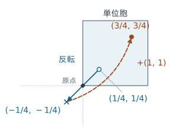

.. _point-and-space-groups:

点群と空間群
============

:ref:`結晶の対称操作<crystal-symmetry-operations>`\ を使い、空間群と点群が何を分類するかを
整理する。格子と原子配置の両方を考えることで、同じ\ :ref:`ブラベー格子型<bravais-lattice-types>`\ の結晶で対称性の違いが
生じる理由も見えてくる。

.. _crystal-space-group:

空間群と並進部分群
------------------

ある結晶の原子配置を保つ操作をすべて集めたものが **空間群** :math:`\mathcal G` である。
このうち線形部分が :math:`I` の操作、つまり結晶を保つ純粋な並進の集まりを並進部分群
:math:`\mathcal T` と呼ぶ。対応する並進ベクトルの集合が、その結晶の格子である。
例えばF中心の慣用単位胞を用いる場合は、胞の辺を整数倍した並進に加え、
:ref:`中心並進<centring-translation>`\ も :math:`\mathcal T` に含まれる。
三次元の結晶の空間群は230種類に分類される。

.. _screw-and-glide:

空間群の操作には、回転に軸方向の並進が伴うらせん操作や、鏡映に面に沿った並進が
伴う映進操作もある。例えば :math:`z` 軸のまわりの180度回転と :math:`c/2` の軸方向
並進を一緒に行う :math:`2_1` らせん操作は、2回繰り返すと :math:`c` の純粋な並進になる。
原子の座標を展開したり回折の反射条件を調べたりするときは、この並進部分も必要になる。

.. _crystal-point-group:

点群と空間群の関係
------------------

空間群の各操作 :math:`\{Q\mid\boldsymbol t\}` から線形部分 :math:`Q` を取り出すと
**点群** :math:`\mathcal P` が得られる。式 :eq:`crystal-symmetry-composition` に
よれば、同じ :math:`Q` を持つ二つの操作の差は純粋な格子並進である。点群の一つの
操作には、格子並進の違いだけをもつ空間群の操作の組が対応する。この関係を
:math:`\mathcal G/\mathcal T\simeq\mathcal P` と書く。
三次元の結晶学的な点群は32種類である。

先の :math:`2_1` らせん操作の例では、点群に残るのは180度回転である。同じ点群の
操作でも、空間群では純粋な回転として現れる場合と、らせん操作として現れる場合がある。
:ref:`対称操作による波数の変換<kpoint-symmetry-mapping>`\ には線形部分を使い、
:ref:`構造因子<scattering-structure-factor>`\ には原子の位置に応じた散乱波の位相が入る。

.. |equivalent-direction-families| replace:: 等価な方向と面の族

.. _equivalent-directions:

|equivalent-direction-families|
-------------------------------

:ref:`方向指数<crystal-direction-index>` :math:`[uvw]` は1本の方向、\ :ref:`Miller指数<lattice-planes-miller>` :math:`(hkl)` は1組の平行な格子面を指す。結晶の対称操作で互いに移り合う2つの方向に沿って見ると、原子の並びは同じである。外場や磁気秩序を含めて、測定するときの結晶の状態もその対称操作を保つなら、その方向に沿って測る物性も等しい。例えば立方晶では、:math:`z` 軸まわりの90度回転が :math:`[100]` を :math:`[010]` へ移す。このような方向や面の集まりを族と呼び、ひとまとめにした記号で書く（:numref:`lt-index-brackets`。International Tables for Crystallography, Vol. A (2006), `§1.1.4 <https://it.iucr.org/Ab/ch1o1v0001/sec1o1o4.pdf>`__）。

.. list-table:: 方向と面の指数の括弧
   :name: lt-index-brackets
   :header-rows: 1
   :widths: 18 82

   * - 表記
     - 指すもの
   * - :math:`[uvw]`
     - 1本の方向。格子ベクトル :math:`A\boldsymbol u` の向き
   * - :math:`\langle uvw\rangle`
     - :math:`[uvw]` と対称操作で移り合う方向の集まり
   * - :math:`(hkl)`
     - 1組の平行な格子面。法線は逆格子ベクトル :math:`B\boldsymbol h`
   * - :math:`\{hkl\}`
     - :math:`(hkl)` と対称操作で移り合う面の集まり

どの方向が等価かは、結晶の点群で決まる。対称操作 :math:`\{Q\mid\boldsymbol t\}` の線形部分を格子基底で表した行列を :math:`W=A^{-1}QA`\ （:eq:`crystal-symmetry-fractional`）とする。方向と面法線は2点の差で決まるベクトルなので、並進 :math:`\boldsymbol t` は作用しない。方向は :math:`QA\boldsymbol u=A(W\boldsymbol u)` に移る。:math:`Q` は直交行列なので :math:`Q=Q^{-\mathsf T}=A^{-\mathsf T}W^{-\mathsf T}A^{\mathsf T}` と書ける。これを使うと、面法線は :math:`QB\boldsymbol h=2\pi A^{-\mathsf T}W^{-\mathsf T}\boldsymbol h=B(W^{-\mathsf T}\boldsymbol h)` に移る。点群 :math:`\mathcal P` の各操作から作る :math:`W` の集合を :math:`\mathcal W` と書けば、

.. math::
   :label: equivalent-direction-family

   \langle uvw\rangle=\{\,W\boldsymbol u\mid W\in\mathcal W\,\},\qquad
   \{hkl\}=\{\,W^{-\mathsf T}\boldsymbol h\mid W\in\mathcal W\,\}.

並進が作用しないので、らせん軸や映進面は、対応する回転や鏡映と同じ族を作る。

族に含まれる方向の数は点群によって変わる。立方晶の点群 :math:`m\bar3m`\ （48個の操作）は、立方慣用単位胞の基底で、成分の並べ替えと符号の反転をすべて含む。このため :math:`\langle100\rangle` は :math:`\pm[100]`、:math:`\pm[010]`、:math:`\pm[001]` の6方向、:math:`\langle110\rangle` は12方向、:math:`\langle111\rangle` は8方向になる。正方晶の点群 :math:`4/mmm`\ （16個）には :math:`c` 軸を :math:`a` 軸へ移す操作が無い。:math:`\langle100\rangle` は :math:`\pm[100]` と :math:`\pm[010]` の4方向だけで、:math:`\pm[001]` は別の族 :math:`\langle001\rangle` になる。極性の点群 :math:`4mm`\ （8個）には :math:`c` 軸を反転する操作も無く、:math:`[001]` と :math:`[00\bar1]` は等価でない。:math:`[uvw]` と :math:`[\bar u\bar v\bar w]` が同じ族に入るのは、反転のように :math:`\boldsymbol u` を :math:`-\boldsymbol u` へ移す操作が点群にあるときに限る（\ :ref:`反転対称性と自発分極<inversion-and-polarization>`\ ）。

族の要素は、数字の並べ替えと符号の反転とは限らない。立方慣用単位胞の直交基底では :math:`W` が直交行列で :math:`W^{-\mathsf T}=W` なので、:math:`\langle uvw\rangle` と :math:`\{uvw\}` は同じ指数の組を並べる。六方晶の基底（:math:`\gamma=120^\circ`）では、:math:`c` 軸まわりの60度回転が :math:`\boldsymbol a_1` を :math:`\boldsymbol a_1+\boldsymbol a_2` へ移す。点群 :math:`6/mmm` の :math:`\langle100\rangle` は :math:`\pm[100]`、:math:`\pm[010]`、:math:`\pm[110]` の6方向、:math:`\{100\}` は :math:`\pm(100)`、:math:`\pm(010)`、:math:`\pm(1\bar10)` の6組になる。

.. _asymmetric-unit-and-cif:

非対称単位と原子座標の展開
--------------------------

非対称単位は、空間群の操作で空間全体に展開できる領域である。
:ref:`CIF<lt-cif>` に対称操作と代表原子の\ :ref:`分率座標<coordinates>`\ がある場合、式
:eq:`crystal-symmetry-fractional` を使って単位胞内の等価な原子を求められる。
単位胞の外に出た座標は、各成分が :math:`[0,1)` に入るよう整数を足し引きして戻す。例えば反転
:math:`(x,y,z)\mapsto(-x,-y,-z)` を :math:`(1/4,1/4,0)` に施すと
:math:`(3/4,3/4,0)` と等価な位置が得られる。反転中心の
:math:`(0,0,0)` にある原子は自分自身に戻るため、1個として数える。

:numref:`fig-asymmetric-unit-inversion`\ では、反転で胞外の :math:`(-1/4,-1/4,0)` に移った点を
格子並進 :math:`(1,1,0)` で胞内の :math:`(3/4,3/4,0)` へ戻す。格子並進は結晶全体の配置を
保つので、胞内に戻した点も元の原子と対称性で等価である。

   :math:`z=0` の断面。白抜きの丸がCIFにあると仮定した代表原子、×が反転直後の位置、
   塗りつぶした丸が単位胞内に折り戻した等価な原子である。ひし形は反転中心の原点を示す。

.. _inversion-and-polarization:

反転対称性と自発分極
--------------------

ブラベー格子型は格子点の並びを分類し、空間群はそこに置いた原子配置の対称性を表す。
例えば\ :ref:`チタン酸バリウムの立方晶相<batio3-crystal-phases>`\ では、反転で
原子配置が保たれる。\ :ref:`自発分極<spontaneous-polarization>`\ は極性ベクトルなので、反転で符号が変わる。
反転対称な構造が許す巨視的な自発分極は :math:`\boldsymbol P=-\boldsymbol P` を
満たし、ゼロになる。正方晶相では反転対称性が失われ、長軸方向の分極が許される。
実際に分極が生じるか、その大きさがいくらかは、原子変位と電子状態で決まる。

参考資料
--------

* IUCr, `Space group <https://dictionary.iucr.org/Space_group>`_.
* IUCr, `Point group <https://dictionary.iucr.org/Point_group>`_.
* IUCr, `The structure of space groups <https://it.iucr.org/Ac/ch1o3v0001/sec1o3o3/>`_.
* IUCr, `Asymmetric unit <https://dictionary.iucr.org/Asymmetric_unit>`_.
