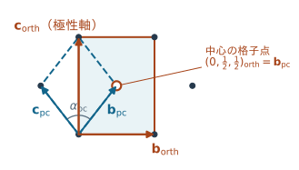

.. _pseudocubic-cell:

==========================
ペロブスカイトの擬立方格子
==========================

:ref:`単位胞の取り直し<lt-cell-transform>`\ では、同じ格子を別の胞で表す例を見た。ここでは、少しだけ歪んだ結晶を、
歪む前の高対称な結晶の軸で表す方法を扱う。この軸を使うと、相ごとに空間群の胞が違っても、格子定数や
方向の指数を共通の軸で比べられる。BaTiO\ :sub:`3`\ を例に、擬立方胞と各相の慣用単位胞の関係、直方晶相での
格子定数の換算、擬立方表記で表せないことを順に見る。

**前提知識**: :ref:`格子の基底変換<lt-primitive-basis>`、:ref:`方向と面の指数の変換<lt-index-transform>`、
:ref:`等価な方向と面の族<equivalent-directions>`、:ref:`空間群<crystal-space-group>`、
:ref:`R格子の六方軸表示<lt-rhombohedral-hexagonal>`。

**学習目標**:

* 擬立方胞と各相の慣用単位胞の関係を、変換行列で表す。
* 直方晶のA中心化胞の格子定数を、擬立方の格子定数に換算する。
* 空間群の設定による軸の名前の違いと、擬立方表記で表せないことを説明する。

.. _pseudocubic-phases:

擬立方胞と各相の胞
------------------

理想的なペロブスカイト型構造ABO\ :sub:`3`\ は空間群 :math:`Pm\bar3m` をとり、単純立方格子の胞に1化学式単位を含む（BaTiO\ :sub:`3`\ では胞の一辺が約4 Å）。BaTiO\ :sub:`3`\ の正方晶・直方（斜方）晶・菱面体晶の相は、この構造から原子がわずかに変位し、格子が少し歪んだものである [`Kwei 1993 <https://doi.org/10.1021/j100112a043>`__]。空間群の慣用単位胞の軸は相ごとに向きも大きさも異なる。一方、これらの相では原子の変位で並進周期が変わらないので、どの相でも、立方胞の3辺から連続的に変形した3本の格子ベクトルを選べる。この3本を辺とする胞を\ **擬立方胞**\ （pseudocubic cell）と呼び、格子行列を :math:`A_{\rm pc}=(\boldsymbol a_{\rm pc},\boldsymbol b_{\rm pc},\boldsymbol c_{\rm pc})` と書く。添字pcを付けた方向・面の指数は、この胞の基底での係数を表す。各相の胞は、\ :ref:`基底変換<lt-primitive-basis>`\ の行列 :math:`P` を使って

.. math::
   :label: pseudocubic-transform

   A=A_{\rm pc}P,\qquad V=|\det P|\,V_{\rm pc}

と表せる。:numref:`lt-batio3-pseudocubic-table` に各相の胞と擬立方胞の関係をまとめる。分極の向きの列は、等価な方向の族から1つを選んで書いた。

.. list-table:: BaTiO\ :sub:`3`\ の各相の胞と擬立方胞
   :name: lt-batio3-pseudocubic-table
   :header-rows: 1
   :widths: 14 14 44 10 18

   * - 相
     - 空間群
     - 擬立方胞との関係
     - :math:`|\det P|`
     - 分極の向き
   * - 立方晶
     - :math:`Pm\bar3m`
     - 同じ胞。:math:`a=b=c`、角は90°
     - 1
     - なし
   * - 正方晶
     - :math:`P4mm`
     - 同じ胞。:math:`a=b\ne c`、角は90°
     - 1
     - :math:`[001]_{\rm pc}`
   * - 直方晶
     - :math:`Amm2`
     - :math:`\boldsymbol a_{\rm orth}=\boldsymbol a_{\rm pc}`。:math:`\boldsymbol b_{\rm orth}`、:math:`\boldsymbol c_{\rm orth}` は面の対角線（式 :eq:`pseudocubic-orthorhombic`）
     - 2
     - :math:`[011]_{\rm pc}`
   * - 菱面体晶
     - :math:`R3m`
     - 菱面体基本単位胞が擬立方胞（角は90°に近い）。慣用単位胞は六方軸の胞
     - 1（六方軸は3）
     - :math:`[111]_{\rm pc}`

どの相でも擬立方胞は基本単位胞の一つであり、慣用単位胞との違いは中心化と軸の取り方にある。直方晶相ではA中心化胞（:math:`|\det P|=2`）、菱面体晶相では六方軸の胞（:math:`|\det P|=3`）が慣用単位胞になる。後者は\ :ref:`R格子の節<lt-rhombohedral-hexagonal>`\ の :math:`P_{R,H}` で作る。辺の長さは :math:`a_{R,H}\simeq\sqrt2\,a_{\rm pc}`、:math:`c_{R,H}\simeq\sqrt3\,a_{\rm pc}` で、:math:`\boldsymbol c_{R,H}=\boldsymbol a_{\rm pc}+\boldsymbol b_{\rm pc}+\boldsymbol c_{\rm pc}` が極性軸 :math:`[111]_{\rm pc}` に沿う。

.. _pseudocubic-orthorhombic:

直方晶のA中心化胞との換算
-------------------------

空間群 :math:`Amm2` の標準の設定では、2回軸（極性軸）を :math:`c` 軸に取り、胞はA中心並進 :math:`(0,1/2,1/2)` を持つ。BaTiO\ :sub:`3`\ の直方晶相では、2回軸は擬立方胞の面の対角線 :math:`[011]_{\rm pc}` に沿う。そこで

.. math::
   :label: pseudocubic-orthorhombic

   \begin{aligned}
   \boldsymbol a_{\rm orth}&=\boldsymbol a_{\rm pc},\\
   \boldsymbol b_{\rm orth}&=\boldsymbol b_{\rm pc}-\boldsymbol c_{\rm pc},\\
   \boldsymbol c_{\rm orth}&=\boldsymbol b_{\rm pc}+\boldsymbol c_{\rm pc},
   \end{aligned}
   \qquad
   P_{\rm pc,orth}=\begin{pmatrix}
   1&0&0\\0&1&1\\0&-1&1
   \end{pmatrix},\qquad \det P_{\rm pc,orth}=2

と取る（:numref:`fig-pseudocubic-orthorhombic-cell`）。直方晶の胞の体積は擬立方胞の2倍で、格子点を2個含む。A中心並進の分率座標を擬立方胞の基底へ移すと :math:`P_{\rm pc,orth}(0,1/2,1/2)^{\mathsf T}=(0,1,0)^{\mathsf T}` で、:math:`\boldsymbol b_{\rm pc}` という格子並進になる。:ref:`FCCの基本単位胞<lt-fcc-cell>`\ への変換（:math:`\det P_{\rm F}=1/4`）とは逆向きに、基本単位胞から中心化した慣用単位胞へ移る変換である。

   :math:`\boldsymbol a_{\rm pc}` に垂直な面への投影。黒丸は格子点、青い矢印と破線のひし形は擬立方胞の
   :math:`\boldsymbol b_{\rm pc}`、:math:`\boldsymbol c_{\rm pc}`、オレンジの矢印と長方形は直方晶の胞の
   :math:`\boldsymbol b_{\rm orth}`、:math:`\boldsymbol c_{\rm orth}` を示す。白抜きの丸はA中心並進による格子点。
   見やすさのため :math:`\alpha_{\rm pc}` を76°に誇張した（BaTiO\ :sub:`3`\ では約89.9°）。

直方晶の胞の辺は互いに直交するので、計量行列 :math:`G_{\rm orth}=P_{\rm pc,orth}^{\mathsf T}G_{\rm pc}P_{\rm pc,orth}` は対角になる。:math:`G_{\rm pc}=P_{\rm pc,orth}^{-\mathsf T}G_{\rm orth}P_{\rm pc,orth}^{-1}` を計算すると、擬立方胞は :math:`b_{\rm pc}=c_{\rm pc}`、:math:`\beta_{\rm pc}=\gamma_{\rm pc}=90^\circ` で、:math:`\alpha_{\rm pc}` だけが90°からずれる。胞の形は単斜だが、結晶の対称性は直方のままである。このとき

.. math::

   \begin{aligned}
   b_{\rm orth}^2&=|\boldsymbol b_{\rm pc}-\boldsymbol c_{\rm pc}|^2=2b_{\rm pc}^2(1-\cos\alpha_{\rm pc}),\\
   c_{\rm orth}^2&=|\boldsymbol b_{\rm pc}+\boldsymbol c_{\rm pc}|^2=2b_{\rm pc}^2(1+\cos\alpha_{\rm pc})
   \end{aligned}

で、:math:`(\boldsymbol b_{\rm pc}-\boldsymbol c_{\rm pc})\cdot(\boldsymbol b_{\rm pc}+\boldsymbol c_{\rm pc})=b_{\rm pc}^2-c_{\rm pc}^2=0` から2本の対角線は直交する。半角の公式で書き直し、逆に解いた式と並べると

.. math::
   :label: pseudocubic-orthorhombic-lengths

   \begin{aligned}
   b_{\rm orth}&=2b_{\rm pc}\sin\frac{\alpha_{\rm pc}}2,&
   c_{\rm orth}&=2b_{\rm pc}\cos\frac{\alpha_{\rm pc}}2,\\
   b_{\rm pc}=c_{\rm pc}&=\frac{\sqrt{b_{\rm orth}^2+c_{\rm orth}^2}}2,&
   \cos\alpha_{\rm pc}&=\frac{c_{\rm orth}^2-b_{\rm orth}^2}{c_{\rm orth}^2+b_{\rm orth}^2}
   \end{aligned}

:math:`\alpha_{\rm pc}=90^\circ` なら :math:`b_{\rm orth}=c_{\rm orth}=\sqrt2\,b_{\rm pc}` である。擬立方の格子定数を :math:`\sqrt2` 倍して直方晶の胞の :math:`b`、:math:`c` とする換算は、この極限で成り立つ。:math:`b_{\rm orth}` と :math:`c_{\rm orth}` の差は :math:`\alpha_{\rm pc}` の90°からのずれに表れるので、長さを :math:`\sqrt2` 倍するだけでは再現できない。

実測の格子定数で差の大きさを見積もる。Shiraneらの中性子回折による263 Kの構造は :math:`a_{\rm orth}=3.990` Å、:math:`b_{\rm orth}=5.669` Å、:math:`c_{\rm orth}=5.682` Å [`Shirane 1957 <https://doi.org/10.1103/PhysRev.105.856>`__]（値は\ `AFLOWの結晶構造プロトタイプ <https://aflow.org/p/AB3C_oC10_38_a_ae_b-002>`__\ の記録から引用）。式 :eq:`pseudocubic-orthorhombic-lengths` から :math:`a_{\rm pc}=3.990` Å、:math:`b_{\rm pc}=c_{\rm pc}=4.013` Å、:math:`\cos\alpha_{\rm pc}=0.00229`、:math:`\alpha_{\rm pc}=89.87^\circ` を得る。:math:`\sqrt2\,b_{\rm pc}=5.6755` Å は :math:`b_{\rm orth}` より0.0065 Å長く、:math:`c_{\rm orth}` より0.0065 Å短い。擬立方の値 :math:`b_{\rm pc}=c_{\rm pc}` だけを :math:`\sqrt2` 倍して戻すと、約0.2%ある :math:`b` と :math:`c` の差が消える。

方向と面の指数は、:ref:`方向と面の指数の変換則<lt-index-transform>`\ どおり :math:`\boldsymbol u_{\rm orth}=P_{\rm pc,orth}^{-1}\boldsymbol u_{\rm pc}`、:math:`\boldsymbol h_{\rm orth}=P_{\rm pc,orth}^{\mathsf T}\boldsymbol h_{\rm pc}` で移る。極性軸 :math:`[011]_{\rm pc}` は :math:`[001]_{\rm orth}`、:math:`[01\bar1]_{\rm pc}` は :math:`[010]_{\rm orth}` である。面 :math:`(011)_{\rm pc}` は :math:`(002)_{\rm orth}` になり、同じ逆格子ベクトルを表す。逆に :math:`(001)_{\rm orth}` は :math:`\boldsymbol h_{\rm pc}=(0,1/2,1/2)` で整数にならず、逆格子点ではない。これは :math:`k+l` が奇数の反射が消えるA中心の反射条件にあたり、\ :ref:`中心並進のある胞の逆格子<centred-reciprocal-lattice>`\ の条件 :eq:`centred-reciprocal-condition` を :math:`T=\{(0,0,0),(0,1/2,1/2)\}` に当てはめたものである。

.. _pseudocubic-settings:

空間群の設定による軸の名前の違い
--------------------------------

上の :math:`P_{\rm pc,orth}` は :math:`Amm2` の標準の設定を前提にしている。同じ空間群型（No. 38）は、軸の名前の付け方によって :math:`Amm2`、:math:`Bmm2`、:math:`B2mm`、:math:`C2mm`、:math:`Cm2m`、:math:`Am2m` とも書ける（International Tables for Crystallography, Vol. A (2006), `Table 4.3.2.1 <https://it.iucr.org/Ab/ch4o3v0001/table4o3o2o1.pdf>`__）。例えば :math:`C2mm` の設定では極性軸が :math:`a` 軸、擬立方胞の辺と同じ長さの軸が :math:`c` 軸になり、:math:`P` の列が入れ替わる。文献や構造ファイルの「:math:`b`」「:math:`c`」がどの物理的な方向の長さかは設定で変わるので、設定の違う文献の :math:`b` どうしを並べると、別の方向の長さを比べることになる。空間群の記号から擬立方胞との対応 :math:`P` を決めれば、同じ物理的な方向どうしを対応づけられる。

.. _pseudocubic-limits:

擬立方表記で表せないこと
------------------------

擬立方の指数は、歪んだ相の方向を高温相の立方胞の軸で名付ける。:ref:`等価な方向の族<equivalent-directions>`\ は低温相の点群で決まるので、擬立方表記の族は厳密な等価性を表さない。例えば「擬立方の :math:`\langle100\rangle`」は、立方晶の点群 :math:`m\bar3m` で等価だった6方向の名前である。正方晶相（点群 :math:`4mm`）では、6方向は極性軸の向き :math:`[001]_{\rm pc}`、その逆向き :math:`[00\bar1]_{\rm pc}`、残りの4方向という3つの族に分かれる。強誘電体の分極が「擬立方の :math:`\langle100\rangle` を向く」とは、6方向のうち1つが選ばれた状態をいう。分極の向きがそろった領域を\ :ref:`分域<ferroelectric-domains>`\ （ドメイン）といい、隣り合う分域では6方向のうち別の方向が選ばれている。

直方晶相（点群 :math:`mm2`）では、立方晶で :math:`\langle110\rangle` だった12方向が5つの族に分かれる。極性軸 :math:`[011]_{\rm pc}` とその逆向き :math:`[0\bar1\bar1]_{\rm pc}` はそれぞれ単独の族で、:math:`\pm[01\bar1]_{\rm pc}` が1つの族、残りの8方向が4方向ずつ2つの族になる。「分極は擬立方の :math:`\langle110\rangle` を向く」は、この12方向のうち1つが極性軸として選ばれたことを表す。

擬立方胞が基本単位胞になるのは、BaTiO\ :sub:`3`\ の各相のように並進周期が立方相と同じ場合に限る。隣り合う酸素八面体が互いに逆向きに回転する相では、並進周期が擬立方胞の辺の2倍になる方向が現れる [`Glazer 1972 <https://doi.org/10.1107/S0567740872007976>`__, `Howard & Stokes 1998 <https://doi.org/10.1107/S0108768198004200>`__]。例えばGdFeO\ :sub:`3`\ 型の :math:`Pnma` の胞は :math:`a\simeq c\simeq\sqrt2\,a_{\rm pc}`、:math:`b\simeq2a_{\rm pc}` で、4化学式単位を含む。このとき擬立方胞の辺は格子並進でなく、擬立方胞は単位胞にならない。擬立方の格子定数は、長さと角度を立方胞の軸で読むための参照として使われる。

関連資料
----------

* :ref:`ferroelectricity` — BaTiO\ :sub:`3`\ の相と自発分極。
* :ref:`lt-cell-transform` — 同じ格子を別の胞で表す例。

参考文献
--------

* IUCr, *International Tables for Crystallography*, Vol. A (2006), `Table 4.3.2.1 <https://it.iucr.org/Ab/ch4o3v0001/table4o3o2o1.pdf>`__.
* G\. H. Kwei, A. C. Lawson, S. J. L. Billinge, and S.-W. Cheong, “Structures of the ferroelectric phases of barium titanate,” *Journal of Physical Chemistry* **97**, 2368–2377 (1993), `doi:10.1021/j100112a043 <https://doi.org/10.1021/j100112a043>`__.
* G\. Shirane, H. Danner, and R. Pepinsky, “Neutron diffraction study of orthorhombic BaTiO\ :sub:`3`,” *Physical Review* **105**, 856–860 (1957), `doi:10.1103/PhysRev.105.856 <https://doi.org/10.1103/PhysRev.105.856>`__. 格子定数は `AFLOW Encyclopedia of Crystallographic Prototypes, AB3C_oC10_38_a_ae_b-002 <https://aflow.org/p/AB3C_oC10_38_a_ae_b-002>`__ の記録による.
* A\. M. Glazer, “The classification of tilted octahedra in perovskites,” *Acta Crystallographica B* **28**, 3384–3392 (1972), `doi:10.1107/S0567740872007976 <https://doi.org/10.1107/S0567740872007976>`__.
* C\. J. Howard and H. T. Stokes, “Group-theoretical analysis of octahedral tilting in perovskites,” *Acta Crystallographica B* **54**, 782–789 (1998), `doi:10.1107/S0108768198004200 <https://doi.org/10.1107/S0108768198004200>`__.
