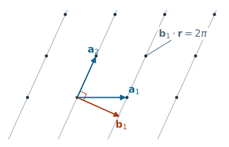
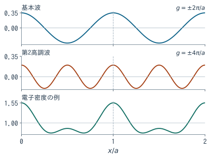

.. _reciprocal-lattice:

======
逆格子
======

結晶中の波や回折を扱うときには、実空間の格子に対応する逆格子（reciprocal lattice）を使う。
ここでは逆格子の基本並進ベクトルを定義し、格子と同じ周期をもつ平面波の波数が逆格子ベクトルに
限られることを示す。最後に、中心並進のある慣用単位胞の辺から作ったベクトルのうち、どれが
逆格子ベクトルになるかの条件を導く。この条件は回折の反射条件になる。

**前提知識**: :ref:`格子行列<lattice-translations>` :math:`A`、:ref:`分率座標<coordinates>`、
:ref:`中心並進<centring-translation>`。

.. _reciprocal-basis:

逆格子の基本並進ベクトル
------------------------

基本並進ベクトルに対し、逆格子の基本並進ベクトルを次の外積で定める。本ノートでは固体物理で一般的な :math:`2\pi` を含む規約を使う（結晶学では :math:`2\pi` を含めない定義も使われる）。

.. math::
  \boldsymbol{b}_1 = 2\pi\frac{\boldsymbol{a}_2\times\boldsymbol{a}_3}
  {\boldsymbol{a}_1\cdot \left(\boldsymbol{a}_2\times\boldsymbol{a}_3\right)}
  , \quad
  \boldsymbol{b}_2 = 2\pi\frac{\boldsymbol{a}_3\times\boldsymbol{a}_1}
  {\boldsymbol{a}_1\cdot \left(\boldsymbol{a}_2\times\boldsymbol{a}_3\right)}
  , \quad
  \boldsymbol{b}_3 = 2\pi\frac{\boldsymbol{a}_1\times\boldsymbol{a}_2}
  {\boldsymbol{a}_1\cdot \left(\boldsymbol{a}_2\times\boldsymbol{a}_3\right)}
  :label: bvec

格子ベクトルと逆格子ベクトルは、次の直交関係を満たす。

.. math::
  \boldsymbol{a}_i \cdot \boldsymbol{b}_j = 2\pi\delta_{ij}
  :label: ortho

:numref:`fig-lattice-reciprocal-vectors`\ の二次元の例では、:math:`\boldsymbol b_1` は
:math:`\boldsymbol a_2` に垂直である。隣り合う平行線の間で :math:`\boldsymbol b_1\cdot\boldsymbol r`
は :math:`2\pi` ずつ変わる。この平行線の組は、格子点をすべて含む\ :ref:`格子面<lattice-planes-miller>`\ の
二次元版で、逆格子ベクトルが面の法線を向く。

   黒い点は実格子点。灰色の各線上では :math:`\boldsymbol b_1\cdot\boldsymbol r` が一定で、
   :math:`\boldsymbol a_1` の方向に一つ隣の線へ移ると内積が :math:`2\pi` 増える。
   逆格子ベクトルの矢印は向きを示す。

逆格子ベクトルも、式 :eq:`amat` の :math:`A` と同じように列に並べて

.. math::
  B \equiv
  (\boldsymbol b_1,\boldsymbol b_2,\boldsymbol b_3)
  =
  \begin{pmatrix}
  b_{1}^x & b_{2}^x & b_{3}^x \\
  b_{1}^y & b_{2}^y & b_{3}^y \\
  b_{1}^z & b_{2}^z & b_{3}^z
  \end{pmatrix}
  :label: bmat

とおく。式 :eq:`ortho` の直交性から、行列の積として

.. math::
  A^\top B
  =
  \begin{pmatrix}
  a_{1}^x & a_{1}^y & a_{1}^z \\
  a_{2}^x & a_{2}^y & a_{2}^z \\
  a_{3}^x & a_{3}^y & a_{3}^z \\
  \end{pmatrix}
  \begin{pmatrix}
  b_{1}^x & b_{2}^x & b_{3}^x \\
  b_{1}^y & b_{2}^y & b_{3}^y \\
  b_{1}^z & b_{2}^z & b_{3}^z \\
  \end{pmatrix}
  = 2\pi I
  :label: abortho

となることがわかる。これから、\ :math:`A, B` の逆行列は、互いの転置行列を :math:`2\pi` で割ったものとなることがわかる。

.. math::
  A^{-1} = \frac{1}{2\pi}B^\top
  , \quad
  B^{-1} = \frac{1}{2\pi}A^\top
  :label: inverse

すなわち :math:`B=2\pi A^{-\top}` である。式 :eq:`fractional-cartesian-matrix` の分率座標も、:math:`\boldsymbol s=A^{-1}\boldsymbol r=B^\top\boldsymbol r/2\pi`、すなわち :math:`s_i=\boldsymbol b_i\cdot\boldsymbol r/2\pi` と逆格子ベクトルから求まる。

.. _reciprocal-lattice-vectors:

逆格子ベクトルと周期関数
------------------------

逆格子の基本並進ベクトルの整数結合 :math:`\boldsymbol g=B\boldsymbol h`\ （:math:`\boldsymbol h\in\mathbb Z^3`）を逆格子ベクトルと呼び、その全体が逆格子である。:math:`\boldsymbol g` と格子ベクトル :math:`\boldsymbol R=A\boldsymbol n` の内積は

.. math::
  \boldsymbol g\cdot\boldsymbol R=\boldsymbol h^\top B^\top A\,\boldsymbol n=2\pi\,\boldsymbol h^\top\boldsymbol n

で :math:`2\pi` の整数倍なので、すべての格子ベクトルについて :math:`e^{i\boldsymbol g\cdot\boldsymbol R}=1` となる。

.. _periodic:

結晶の電子密度やポテンシャルは、任意の格子ベクトル :math:`\boldsymbol R` について

.. math::
   :label: periodic0

   \rho(\boldsymbol r+\boldsymbol R)=\rho(\boldsymbol r)

を満たす、格子と同じ周期の関数である。

.. _periodic-fourier-series:

格子と同じ周期の関数は、逆格子ベクトルを波数とする平面波 :math:`e^{i\boldsymbol g\cdot\boldsymbol r}` の重ね合わせ（フーリエ級数）で表せる。

.. math::
   :label: periodic-fourier

   \rho(\boldsymbol r)=\sum_{\boldsymbol g}\rho_{\boldsymbol g}\,e^{i\boldsymbol g\cdot\boldsymbol r}

:math:`\rho_{\boldsymbol g}` は、平面波 :math:`e^{i\boldsymbol g\cdot\boldsymbol r}` がどれだけ含まれるかを表すフーリエ係数である。格子ベクトル :math:`\boldsymbol R` だけ移動すると、各平面波に :math:`e^{i\boldsymbol g\cdot\boldsymbol R}=1` が掛かるので、和の各項が元に戻り、式 :eq:`periodic0` が成り立つ。

一次元の例を :numref:`fig-periodic-fourier-components` に示す。第2高調波は基本波の
半分の周期をもつが、どちらも :math:`a` だけ平行移動すると元の値に戻る。
このため、二つの成分と定数項を足した密度も :math:`a` ごとに繰り返す。

   上段の :math:`0.35\cos(2\pi x/a)` は :math:`g=\pm2\pi/a`、
   中段の :math:`0.2\cos(4\pi x/a)` は :math:`g=\pm4\pi/a` の平面波の組に対応する。
   下段はこの二成分に :math:`g=0` の定数項1を足した密度の模式例。
   縦の破線が周期一つ分の境界を示す。

逆に、すべての格子ベクトル :math:`\boldsymbol R` について :math:`e^{i\boldsymbol g\cdot\boldsymbol R}=1` となる波数ベクトル :math:`\boldsymbol g` は、逆格子ベクトルに限られる。:math:`B` は正則なので、任意の :math:`\boldsymbol g` を実数の成分をもつ :math:`\boldsymbol h` で :math:`\boldsymbol g=B\boldsymbol h` と書ける。:math:`\boldsymbol R=\boldsymbol a_i` を代入すると、式 :eq:`ortho` から :math:`\boldsymbol g\cdot\boldsymbol a_i=2\pi h_i` となり、これが :math:`2\pi` の整数倍であるには :math:`h_i` が整数でなければならない。したがって逆格子は、格子のすべての並進で位相が変わらない平面波の波数の集合である。格子と同じ周期の関数のフーリエ級数 :eq:`periodic-fourier` に、逆格子ベクトル以外の波数の平面波が現れないのもこのためである。次節ではこの性質を使う。

.. _centred-reciprocal-lattice:

中心並進のある胞の逆格子
------------------------

慣用単位胞の辺 :math:`A_{\rm c}=(\boldsymbol c_1,\boldsymbol c_2,\boldsymbol c_3)` から式 :eq:`bvec` と同じ外積で作る :math:`B_{\rm c}=2\pi A_{\rm c}^{-\top}` は、\ :ref:`中心並進<centring-translation>`\ があると逆格子の基本並進ベクトルの組にならない。:math:`A_{\rm c}` の辺だけでは格子のすべての並進を生成しないからである。どの指数が逆格子ベクトルに対応するかは、前節の性質で判定できる。

格子は式 :eq:`centred-lattice` のとおり :math:`\boldsymbol R=A_{\rm c}(\boldsymbol n+\boldsymbol\tau)`\ （:math:`\boldsymbol n\in\mathbb Z^3`、:math:`\boldsymbol\tau\in T`）と書ける。波数を :math:`\boldsymbol g=B_{\rm c}\boldsymbol h_{\rm c}` と書くと、:math:`A_{\rm c}^\top B_{\rm c}=2\pi I` から

.. math::
  \boldsymbol g\cdot\boldsymbol R=2\pi\,\boldsymbol h_{\rm c}^\top(\boldsymbol n+\boldsymbol\tau)

となる。これがすべての :math:`\boldsymbol n` と :math:`\boldsymbol\tau` について :math:`2\pi` の整数倍になるのは、:math:`\boldsymbol h_{\rm c}` が整数で、かつ

.. math::
  \boldsymbol h_{\rm c}^\top\boldsymbol\tau\in\mathbb Z\qquad\text{for all }\boldsymbol\tau\in T
  :label: centred-reciprocal-condition

が成り立つときである。:math:`\boldsymbol h_{\rm c}` が整数でも、この条件を満たさなければ :math:`B_{\rm c}\boldsymbol h_{\rm c}` は逆格子ベクトルではない。

BCCでは :math:`T=\{(0,0,0),(1/2,1/2,1/2)\}` なので、条件は :math:`h+k+l` が偶数であること。FCCでは3つの面心並進から :math:`k+l`、:math:`h+l`、:math:`h+k` がすべて偶数、すなわち :math:`h,k,l` がすべて偶数かすべて奇数であることが条件になる。例えばFCCの :math:`B_{\rm c}(1,0,0)^\top` は逆格子ベクトルではなく、:math:`B_{\rm c}(2,0,0)^\top` と :math:`B_{\rm c}(1,1,1)^\top` は逆格子ベクトルである。

条件 :eq:`centred-reciprocal-condition` は、回折で中心並進が許す反射の指数の条件（反射条件）と一致する。中心並進で移り合う原子からの散乱波の位相和から同じ条件を導く過程は、\ :ref:`中心並進による打ち消し<sf-centring-extinction>`\ で示す。

参考資料
--------

* IUCr, `Reflection conditions <https://dictionary.iucr.org/Reflection_conditions>`_.
