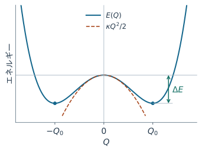
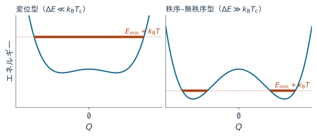
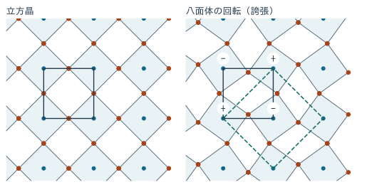

.. _soft-mode:

ソフトモードと構造相転移
========================

高温で対称性の高い結晶が、冷やすと原子配置のわずかなずれによって対称性の低い構造へ移ることがある。
このような構造相転移の多くでは、特定の格子振動の振動数が転移温度に近づくにつれて下がり、
その振動の変位パターンが低温相で凍結する。この振動を **ソフトモード** と呼ぶ。本稿では、
ソフトモードの振幅を秩序変数とみなしてエネルギーを展開し、二重井戸ポテンシャルの形、
その評価法、相転移の型を導く。例として、極性のソフトモードをもつBaTiO\ :sub:`3`\ と、
極性をもたない八面体回転のソフトモードをもつSrTiO\ :sub:`3`\ を取り上げる。

**前提知識**: :ref:`調和近似とフォノン<phonon>`\ （とくに\ :ref:`虚数振動数<imaginary-frequency>`\ と\ :ref:`非調和性<anharmonicity>`）、:ref:`反転対称性と自発分極<inversion-and-polarization>`。

**学習目標**:

* ソフトモードの考え方と、虚数振動数・低温相の構造との関係を説明する。
* モードの振幅でエネルギーを展開し、二重井戸の極小の位置と深さを導く。
* 反転対称性から :math:`+Q` と :math:`-Q` の極小が等価になる理由を説明する。
* 固有ベクトルに沿ってエネルギーを計算する方法（frozen phonon）の手順と注意点を説明する。
* 変位型と秩序–無秩序型の相転移を、井戸の深さと熱エネルギーの比で区別する。
* ソフトモードが強誘電性に限らず、極性をもたない構造変化にも現れることを例で示す。

.. _sm-definition:

ソフトモードの考え方
--------------------

Cochranは、変位による構造相転移を格子振動の不安定性として説明した [Cochran1959]_ [Cochran1960]_。
高温相のある振動モードの振動数 :math:`\omega_{\mathrm s}` が、温度 :math:`T` を下げると小さくなり、
そのモードの変位パターンが低温相で凍結する。高温相で振動数の2乗が

.. math::
   :label: sm-cochran

   \omega_{\mathrm s}^2\propto T-T_0

に従うことを、Cochranの法則と呼ぶ。:math:`T_0` は、高温相での振動数を低温側へ外挿して0になる温度である。
ソフトモードの振動数が温度とともに下がる様子は、中性子の非弾性散乱やRaman散乱で
観測されてきた [Scott1974]_。

:math:`T_0` は転移温度 :math:`T_{\mathrm c}` と同じとは限らない。転移が連続的に起こる理想的な場合（2次転移）は、
:math:`T_0` で復元力が消え、モードの変位がそこから育つので、:math:`T_{\mathrm c}=T_0` である。
BaTiO\ :sub:`3`\ の立方晶–正方晶転移 [Merz1953]_ のような1次転移では、温度が :math:`T_0` に下がる前に、
変位した構造の自由エネルギーが高温相と等しくなる。そのため :math:`T_0<T_{\mathrm c}` で、:math:`\omega_{\mathrm s}` は
:math:`T_{\mathrm c}` で有限のまま転移が起こる。:math:`T_{\mathrm c}-T_0` は、\ :ref:`常誘電相<paraelectric-phase>`\ の節で自由エネルギーの展開から導く。

0 Kの調和近似で高温相の構造のフォノンを計算したとき、ソフトモードが
:ref:`虚数振動数<imaginary-frequency>`\ として現れるのは、その計算条件（\ :ref:`交換相関汎関数<exchange-correlation-functional>`、格子定数など）で
高温相の構造が不安定な場合である。立方晶BaTiO\ :sub:`3`\ はこの例にあたる [CohenKrakauer1990]_。
計算条件で高温相が安定なら、ソフトモードも実数の振動数をもつ。0 Kの計算で虚数になるモードが
高温で実数になるのは、大きな振幅の熱振動が\ :ref:`非調和項<anharmonicity>`\ を通じて平均的な復元力を変えるためである。

ソフトモードの波数 :math:`\boldsymbol k` によって、低温相の単位胞が決まる。格子ベクトル :math:`\boldsymbol R` だけ離れた胞の変位には
位相因子 :math:`e^{i\boldsymbol k\cdot\boldsymbol R}` が掛かる（\ :ref:`基準振動とフォノン<ph-normal-modes>`）。Γ点のモードなら、すべての単位胞で
同じ変位が凍結するので、低温相の単位胞は高温相と同じ大きさで、胞内の原子配置だけが変わる。
Γ点以外のモードが凍結すると、波数が逆格子ベクトルの有理数倍なら、単位胞が整数倍に大きくなる。:math:`\boldsymbol k\cdot\boldsymbol R` が :math:`\pi` の奇数倍になる並進
（1次元鎖のゾーン境界、立方晶のX・M・R点）では、その並進で移った胞の変位が逆向きになる。1次元鎖の\ :ref:`Peierls不安定性<peierls-instability>`\ も、周期が2倍になる変形という点で同じ形をしている。

.. _polar-soft-mode:

Γ点のモードのうち、正負のイオンが逆向きに動いて電気双極子モーメントを生むものを
**極性ソフトモード** と呼ぶ。これが凍結すると、結晶全体に\ :ref:`自発分極<spontaneous-polarization>`\ が生じる。
極性モードが一つの場合、静的な誘電率 :math:`\varepsilon(0)` と高周波の誘電率 :math:`\varepsilon(\infty)` の比は、
横波と縦波の光学モードの振動数 :math:`\omega_{\mathrm{TO}}`、:math:`\omega_{\mathrm{LO}}` を使って

.. math::
   :label: sm-lst

   \frac{\varepsilon(0)}{\varepsilon(\infty)}=\frac{\omega_{\mathrm{LO}}^2}{\omega_{\mathrm{TO}}^2}

と表される（Lyddane–Sachs–Tellerの関係） [LST1941]_。ソフトモードが横波の光学モードなら、
:math:`\omega_{\mathrm{TO}}\to0` で :math:`\varepsilon(0)` が発散する。:eq:`sm-cochran` を代入すると
:math:`\varepsilon(0)\propto1/(T-T_0)` となり、強誘電体の誘電率が転移温度の上で従う\ :ref:`Curie–Weissの法則<paraelectric-phase>`\ が導かれる [Cochran1960]_。
:math:`T_0` は、Curie–Weissの法則 :eq:`fe-curie-weiss` のCurie–Weiss温度にあたる。1次転移では、誘電率も :math:`T_{\mathrm c}` で有限のまま転移する。

.. _sm-landau:

秩序変数としてのモードの振幅
----------------------------

ソフトモードの振幅を :math:`Q` とする。:eq:`ph-mode-energy` と同じく、:ref:`動的行列<dynamical-matrix>`\ の規格化した実の固有ベクトル
:math:`\boldsymbol e`\ （:math:`3n` 成分）を使い、胞内の原子の変位を並べたベクトル :math:`\boldsymbol u` と :math:`Q` を

.. math::
   :label: sm-mode-amplitude

   \boldsymbol u=Q\,M^{-1/2}\boldsymbol e,\qquad Q=\boldsymbol e^{\mathsf T}M^{1/2}\boldsymbol u

で結ぶ。:math:`M` は各原子の質量 :math:`m_\kappa` を対角に並べた :math:`3n\times3n` の行列である。:math:`\boldsymbol e` は質量の平方根で重み付けた
座標での向きなので、質量の異なる原子では、変位 :math:`\boldsymbol u` の成分の比が :math:`\boldsymbol e` の成分の比と異なる。
第2式は :math:`M^{1/2}\boldsymbol u` を :math:`\boldsymbol e` へ射影したもので、:math:`\boldsymbol u` がこのモードだけからなるとき第1式の逆になる。
ゾーン境界のモードでも、:math:`\boldsymbol k` と :math:`-\boldsymbol k` のモードを組み合わせた実のベクトルを使えば同じ形になる。

高温相では :math:`Q=0`、低温相では :math:`Q\ne0` なので、:math:`Q` は相を区別する
**秩序変数** の役割をもつ。高温相の構造のまわりで単位胞あたりのエネルギーを :math:`Q` で展開すると

.. math::
   :label: sm-landau

   E(Q)=E_0+\frac12\kappa\,Q^2+\frac14\beta\,Q^4+O(Q^6)

と書ける。:math:`\kappa` は :eq:`ph-mode-energy` の :math:`\omega_{\mathrm s}^2` に等しい。奇数次の項がないのは、:ref:`+Qと−Qの等価性<sm-inversion-equivalence>`\ による。:math:`\beta>0` とする。

:math:`\kappa>0` なら極小は :math:`Q=0` だけで、高温相の構造が安定である。:math:`\kappa<0`
（虚数振動数）なら、:math:`dE/dQ=\kappa Q+\beta Q^3=0` の :math:`Q\ne0` の解として

.. math::
   :label: sm-q0

   Q_0=\pm\sqrt{-\kappa/\beta}

に極小が現れる。:eq:`sm-landau` に代入すると、極小の :math:`Q=0` から測った深さは

.. math::
   :label: sm-depth

   \Delta E=E(Q_0)-E(0)=\frac12\kappa\left(-\frac{\kappa}{\beta}\right)+\frac14\beta\left(\frac{\kappa}{\beta}\right)^2
   =-\frac{\kappa^2}{4\beta}

である。極小での曲率は :math:`E''(Q_0)=\kappa+3\beta Q_0^2=-2\kappa>0` で、低温相の構造は
このモードに沿って安定である。この模型では、低温相でのモードの振動数は
:math:`\sqrt{-2\kappa}`、つまり高温相の虚数振動数の大きさの :math:`\sqrt2` 倍になる。

温度の効果を最も簡単に取り込むのが **Landau理論** である。:eq:`sm-landau` を自由エネルギーと読み替え、
:math:`\kappa` だけが :math:`\kappa=a(T-T_0)`\ （:math:`a>0`）と温度に比例して変わるとする。
:math:`T>T_0` では :math:`Q_0=0` で、ソフトモードの振動数は :math:`\omega_{\mathrm s}^2=\kappa=a(T-T_0)` と
:eq:`sm-cochran` に従って下がる。:math:`T<T_0` では :eq:`sm-q0` から
:math:`Q_0=\sqrt{a(T_0-T)/\beta}` となり、秩序変数は :math:`T_0` から連続的に育つ。この模型の転移は2次転移で、:math:`T_{\mathrm c}=T_0` である。
極小のまわりの振動数の2乗は :math:`-2\kappa=2a(T_0-T)` で、:math:`T_0` の下では上の2倍の傾きで再び増える
（:numref:`fig-soft-mode-double-well`\ の右）。

   左：:math:`\kappa<0`、:math:`\beta>0` の式 :eq:`sm-landau`\ （青の実線）と、その2次の項だけの放物線
   :math:`\kappa Q^2/2`\ （赤の破線）。点は極小 :math:`\pm Q_0`\ （式 :eq:`sm-q0`）、両矢印は深さ
   :math:`\Delta E`\ （式 :eq:`sm-depth`）。右：Landau模型で :math:`\kappa=a(T-T_0)` としたときのモードの
   :math:`\omega^2`。:math:`T_0` の上（青）は高温相の :math:`\kappa`、下（赤）は極小のまわりの曲率 :math:`-2\kappa`。

Landau理論は、平均場の近似で相転移の形を表す現象論である。実際の物質では :math:`\beta<0` で6次の項が必要になり、秩序変数が不連続に変わる1次転移になるものもある。
このとき転移温度 :math:`T_{\mathrm c}` は :math:`T_0` より高く、ソフトモードの振動数は :math:`T_{\mathrm c}` で0にならない（\ :ref:`常誘電相<paraelectric-phase>`\ の導出）。BaTiO\ :sub:`3`\ の
三つの転移は、いずれも1次転移である [ZhongVanderbiltRabe1995]_。

.. _sm-inversion-equivalence:

+Qと−Qの等価性と反転対称性
--------------------------

高温相の構造に、変位パターンを :math:`\boldsymbol e\to-\boldsymbol e` に写す対称操作があるとする。
対称操作で移り合う構造はエネルギーが等しいので :math:`E(Q)=E(-Q)` が成り立ち、
:eq:`sm-landau` の奇数次の項は消える。このとき :math:`+Q_0` と :math:`-Q_0` の極小は等価で、深さも等しい。

極性ソフトモードでは、この操作は反転である。立方晶ペロブスカイトの反転中心にBサイトの原子を置くと、
反転は各副格子を同じ副格子へ写し、各原子の変位の向きを逆にする。全原子が同じパターンで動くΓ点の
極性モードでは、反転によって :math:`Q` が :math:`-Q` に変わる。\ :ref:`自発分極は反転で符号を変える<inversion-and-polarization>`\ ので、
二つの極小は大きさが等しく向きが反対の分極をもつ。結晶の中で異なる極小を選んだ領域（:ref:`分域<ferroelectric-domains>`）が共存しうるのも、
この等価性による。

ゾーン境界のモードでは、高温相の格子並進が同じ役割をもつことがある。格子ベクトル :math:`\boldsymbol R` の並進は変位に位相因子
:math:`e^{i\boldsymbol k\cdot\boldsymbol R}` を掛けるので、:math:`\boldsymbol k\cdot\boldsymbol R` が :math:`\pi` の奇数倍になる :math:`\boldsymbol R` があれば
（1次元鎖のゾーン境界、立方晶のX・M・R点）、その並進は各胞の変位の符号を逆にし、ずらした構造は :math:`-Q` の構造になる。
このとき :math:`+Q` と :math:`-Q` は、原点の取り方だけが違う同じ構造である。六方格子のK点のように、並進で位相が
:math:`2\pi/3` ずつずれる波数では、並進は :math:`Q` を :math:`-Q` へ写さない。:math:`+Q` と :math:`-Q` が等価かどうかは、並進以外の対称操作で決まる。

:math:`\boldsymbol e\to-\boldsymbol e` に写す操作がないモードでは、3次の項は対称性で禁じられず、現れうる。その係数が0でなければ、
:math:`+Q` と :math:`-Q` の極小は等価でない。

.. _double-well-potential:

二重井戸ポテンシャル
--------------------

:math:`\kappa<0` の :eq:`sm-landau` のように、対称な位置 :math:`Q=0` の山を挟んで等価な二つの極小をもつ
エネルギー曲線を **二重井戸ポテンシャル** と呼ぶ。曲線の形は二つの部分で決まる。
小さい変位の領域では、2次の項 :math:`\kappa Q^2/2` が支配し、曲率はフォノン計算の虚数振動数と同じ量である。
大きい変位の領域では、4次以上の非調和項がエネルギーを押し上げ、井戸の外側の壁を作る。

:eq:`sm-q0` と :eq:`sm-depth` が示すように、極小の位置と深さは :math:`\kappa` と :math:`\beta` の両方で決まる。
同じ曲率 :math:`\kappa` でも、壁の立ち上がり :math:`\beta` が半分なら、:math:`Q_0` は :math:`\sqrt2` 倍、:math:`\Delta E`
は2倍になる。したがって、計算手法や模型を比べるときは、原点の曲率と大きい変位での壁を別々に
比べる必要がある。片方が合っていても、もう片方が合うとは限らない。

井戸の深さは、格子のひずみとの結合でも変わる。ひずみ :math:`\eta` と弾性定数 :math:`C_{\mathrm{el}}` を使い、
対称性から許される最低次の結合 :math:`\lambda\eta Q^2` を加えると

.. math::
   :label: sm-strain

   E(Q,\eta)=\frac12\kappa\,Q^2+\frac14\beta\,Q^4+\lambda\,\eta\,Q^2+\frac12C_{\mathrm{el}}\,\eta^2

となる。ひずみを固定すると、2次の係数は :math:`\kappa_{\mathrm{eff}}=\kappa+2\lambda\eta` に変わり、
:math:`\lambda\eta<0` の向きのひずみは井戸を深くする。ひずみも緩和させると、:math:`\partial E/\partial\eta=0` から
:math:`\eta=-\lambda Q^2/C_{\mathrm{el}}` で、代入すると4次の係数が

.. math::
   :label: sm-beta-eff

   \beta_{\mathrm{eff}}=\beta-\frac{2\lambda^2}{C_{\mathrm{el}}}

に下がる。ひずみとの結合は壁を低くし、井戸を深くする。:math:`\beta_{\mathrm{eff}}<0` になれば、
\ :ref:`秩序変数の節<sm-landau>`\ の終わりに述べた1次転移になる。体積も同じように :math:`\kappa` を変えるので、二重井戸の深さは
計算に使う格子定数に敏感である。

ソフトモードが縮退している場合、秩序変数はベクトルになる。立方晶の結晶のΓ点の極性モードは、
:math:`x,y,z` の3方向に縮退している。振幅を :math:`\boldsymbol Q=(Q_x,Q_y,Q_z)` とすると、立方晶の対称性が許す4次までの項は

.. math::
   :label: sm-cubic-quartic

   E(\boldsymbol Q)=\frac12\kappa|\boldsymbol Q|^2+\frac14\beta|\boldsymbol Q|^4
   +\frac14\beta'\left(Q_x^2Q_y^2+Q_y^2Q_z^2+Q_z^2Q_x^2\right)

である [Devonshire1949]_。:math:`|\boldsymbol Q|` を固定すると、最後の括弧は :math:`\langle001\rangle` 方向で0、
:math:`\langle110\rangle` で :math:`|\boldsymbol Q|^4/4`、:math:`\langle111\rangle` で :math:`|\boldsymbol Q|^4/3` となり、
この範囲の最小と最大はそれぞれ :math:`\langle001\rangle` と :math:`\langle111\rangle` である。
したがって :math:`\beta'>0` なら :math:`\langle001\rangle` 方向（正方晶）、:math:`\beta'<0` なら :math:`\langle111\rangle` 方向
（菱面体晶）に変位する。:math:`\langle110\rangle` 方向（直方晶、斜方晶ともいう）が最も低くなるには6次の項が要る。

.. _frozen-phonon:

固有ベクトルに沿ってエネルギーを調べる方法
------------------------------------------

二重井戸の形は、ソフトモードの変位パターンに沿って原子を動かした構造の全エネルギーを、
振幅ごとに計算すれば得られる。この方法を **frozen phonon法** と呼ぶ。小さい振幅での曲率から振動数を読めば、\ :ref:`力定数を求める方法<phonon-force-constant-calculation>`\ の一つにもなる。
手順は次のとおりである。

1. 高温相の構造（例えば立方晶）を用意し、ソフトモードの固有ベクトルを、フォノン計算か文献から得る。
2. 振幅 :math:`Q` を何点か選び、各原子 :math:`\kappa` を、固有ベクトルの成分を質量の平方根で割った
   :math:`\boldsymbol e_\kappa/\sqrt{m_\kappa}` に比例する分だけ動かす（:eq:`sm-mode-amplitude`）。固有ベクトルの成分の比のまま
   動かすと、質量の異なる原子を含む結晶では、変位が目的のモードから外れる。プログラムが質量で割った後の変位を出力する場合は、
   その比をそのまま使う。
3. 各構造で、原子座標とセルを固定したまま全エネルギーを計算する（\ :ref:`単点計算<structure-optimization>`）。
   構造を緩和させると、原子は指定した変位から別の方向へ動き、:math:`Q` の値が保てない。
4. 同じ体積の :math:`Q=0` を基準に :math:`\Delta E(Q)=E(Q)-E(0)` を\ :ref:`化学式単位あたり<energy-reference>`\ で求め、
   :eq:`sm-landau` のような多項式で当てはめる。

Γ点のモードでは、どれか一つの原子を固定してもよい。:math:`\boldsymbol e_\kappa/\sqrt{m_\kappa}` に比例する変位から、
固定する原子の変位を全原子について一様に引けばよい。全原子の一様な並進はエネルギーを
変えないからである（\ :ref:`音響和則<harmonic-approximation>`）。実際の計算では、振幅を一つの原子の
変位 :math:`x`\ （Å）で測り、他の原子の変位をその比 :math:`r_\kappa` で決めることが多い。ただし、
曲率 :math:`k_x=d^2E/dx^2` から振動数を求めるときは、パターンから重心の並進を除く必要がある。
重心の並進を除いた比を :math:`\tilde r_\kappa=r_\kappa-\sum_{\kappa'}m_{\kappa'}r_{\kappa'}/\sum_{\kappa'}m_{\kappa'}` とすると、
:eq:`sm-mode-amplitude` の第2式から基準座標は :math:`Q=\sqrt{M_{\mathrm{eff}}}\,x`、

.. math::
   :label: sm-effective-mass

   M_{\mathrm{eff}}=\sum_\kappa m_\kappa\tilde r_\kappa^2,\qquad
   \omega_{\mathrm s}^2=\frac{k_x}{M_{\mathrm{eff}}}

となる。一様な並進は位置エネルギーを変えないが、運動エネルギーは変えるからである。
:ref:`1次元二原子鎖<ph-diatomic-chain>`\ のΓ点の光学モードで確かめると、Bを固定してAだけを :math:`x` 動かす
パターンでは、各Aの両側のばねが :math:`x` だけ伸び縮みするので :math:`E=Cx^2` で、:math:`k_x=2C` である。
:math:`M_{\mathrm{eff}}` の代わりにAの質量 :math:`m_{\mathrm A}` を使うと :math:`\omega^2=2C/m_{\mathrm A}` と誤る。
重心を除くと :math:`M_{\mathrm{eff}}=m_{\mathrm A}m_{\mathrm B}/(m_{\mathrm A}+m_{\mathrm B})` となり、
:eq:`ph-chain-dispersion` のΓ点の値 :math:`2C(1/m_{\mathrm A}+1/m_{\mathrm B})` に一致する。
:eq:`sm-mode-amplitude` の第2式で :math:`Q` を求めれば、変位に一様な並進が含まれていても値は変わらない。
光学モードの :math:`\boldsymbol e` は並進の固有ベクトル（成分が :math:`\sqrt{m_\kappa}` に比例）と直交するからである。
井戸の深さ :math:`\Delta E` は位置エネルギーだけで決まるので、この補正を受けない。

frozen phonon法が調べるのは、配置空間の中の一本の直線の上のエネルギーである。他のモードやひずみを
緩和させるとエネルギーはさらに下がりうるので、得られる井戸の深さは、すべての自由度を最適化した
極小までの深さを超えない。変位が大きくなると、最もエネルギーが下がる変位の比が、小さい変位での
固有ベクトルからずれることもある。

.. _displacive-order-disorder:

変位型と秩序–無秩序型の相転移
------------------------------

二重井戸をもつ結晶の相転移は、単位胞ごとの井戸の深さ :math:`|\Delta E|` と、隣の胞の変位どうしの
相互作用のエネルギーの比で、二つの極限に分けられる [Dove1997]_。転移温度の熱エネルギー
:math:`k_{\mathrm B}T_{\mathrm c}` は、どちらの極限でも主に胞どうしの相互作用で決まり、井戸の深さそのものでは
決まらない。そのため、この比は :math:`|\Delta E|/k_{\mathrm B}T_{\mathrm c}` で見積もれる
（:numref:`fig-soft-mode-displacive-order-disorder`）。

**変位型** （:math:`|\Delta E|\ll k_{\mathrm B}T_{\mathrm c}`）では、転移温度の上で原子は二つの井戸を区別せず、
対称な位置のまわりで振動する。各胞の変位の分布は対称な位置を中心に一つの山をもち、各胞にも
局所的な変位は残らない。冷やしていくと、隣どうしの強い相互作用のために原子は周りと一緒に
同じ向きへずれ、平均位置が少しずつ対称な位置から離れていく。ソフトモードの振動数が0に近づき、
変位が凍結するのがこの型である。不安定な揺らぎは、ブリルアンゾーンのΓ点の近くなど狭い範囲に限られる
[ZhongVanderbiltRabe1995]_。

**秩序–無秩序型** （:math:`|\Delta E|\gg k_{\mathrm B}T_{\mathrm c}`）では、転移温度より十分に高い温度でも、
各胞の原子はどちらかの井戸の底にいて、ときどき反対側へ飛び移る。転移温度の上では、どちらの井戸に
いるかが胞ごとにばらばらなので、平均構造は対称でも各胞には局所的な変位が残っている。
変位の分布には二つの山がある。転移は、各胞の井戸の選び方がそろうことで起こり、転移のエントロピーは
主に配置の数から生じる [Dove1997]_。胞ごとにほぼ独立に井戸を選ぶので、揺らぎはブリルアンゾーン全体に
広がる [ZhongVanderbiltRabe1995]_。

   単位胞あたりのエネルギー曲線（青）と、極小から :math:`k_{\mathrm B}T` だけ上の高さ（赤の点線）。
   赤の太線は、そのエネルギーで原子が届く範囲を示す。左の変位型では二つの井戸にまたがり、
   右の秩序–無秩序型では片方の井戸の中に限られる。係数は説明用で、特定の物質の値ではない。

二つの型は極限であり、多くの物質はその間にある。0 Kで計算した井戸の深さだけでは型は決まらず、
胞どうしの相互作用の強さとの比が型を決める。Zhongらは、計算した揺らぎがブリルアンゾーンのどの範囲まで
広がっているかを、型を判定する基準に使った [ZhongVanderbiltRabe1995]_。

.. _sm-octahedral-rotation:

極性をもたないソフトモード：SrTiO\ :sub:`3`\ の八面体回転
----------------------------------------------------------

ソフトモードは強誘電性に限らない。ペロブスカイト型のSrTiO\ :sub:`3`\ は、室温では立方晶である。
約105 K（初期の文献では110 K）で、TiO\ :sub:`6`\ 八面体が一つの立方晶の軸のまわりに回転した正方晶の構造へ移る。UnokiとSakudoはFe\ :sup:`3+`\ の電子スピン共鳴で八面体の回転を見いだし、その回転角を転移の
秩序変数として温度変化を追った [UnokiSakudo1967]_。ShiraneとYamadaは中性子散乱で、立方晶の
ブリルアンゾーンの角のR点 :math:`(\pi/a)(1,1,1)` のモードが転移温度に向かって低くなることを観測した
[ShiraneYamada1969]_。Fleuryらは、転移温度の下でRaman散乱のソフトモードの振動数が
転移温度に向かって0に近づくことを示した [Fleury1968]_。

隣り合う八面体は頂点の酸素を共有しているので、一つの八面体が回ると、同じ面内の隣の八面体は
逆向きに回る（:numref:`fig-soft-mode-octahedral-rotation`）。SrTiO\ :sub:`3`\ では回転軸の方向に隣り合う八面体も
逆向きに回る。三つの方向すべてで隣の胞と逆になるので、凍結するのはR点のモードであり、
単位胞は :math:`\sqrt2a\times\sqrt2a\times2a` に大きくなる。この構造の空間群は :math:`I4/mcm` である
[ZhongVanderbilt1995]_ [HowardStokes1998]_。

   回転軸の方向から見たTiO\ :sub:`6`\ 八面体の網目（Srは省略）。青丸がTi、赤丸が赤道面のO、
   薄い四角形が八面体の投影である。左は立方晶で、黒の正方形が元の単位胞の断面。右は回転角を誇張した図で、
   ＋と−は回転の向き、緑の破線は面内で :math:`\sqrt2` 倍になった単位胞の断面を示す。

八面体の回転は、各八面体の中心を動かさず、正負の電荷の重心もずらさないので、分極を生まない。
秩序変数は回転角 :math:`\phi` で、隣の胞へ一つ並進すると :math:`\phi` が :math:`-\phi` になるので、
:ref:`ゾーン境界のモードの等価性<sm-inversion-equivalence>`\ から :math:`E(\phi)=E(-\phi)` である。ZhongとVanderbiltは、R点の回転モードに沿ったfrozen phonon計算（LDA）で、回転に対する曲率 :math:`\kappa_R=\frac12\partial^2E/\partial\phi^2` を8種類のペロブスカイトについて求めた。:math:`\kappa_R<0` の物質は、この回転に対して不安定である [ZhongVanderbilt1995]_。

SrTiO\ :sub:`3`\ では、Γ点の極性モードも冷やすと低くなる [Cowley1964]_。それでも、最低温度まで強誘電相には
移らない。誘電率は低温で大きな値に飽和し、MüllerとBurkardはこれを量子常誘電と呼んだ [MullerBurkard1979]_。
原子核の\ :ref:`零点振動<zero-point-vibration>`\ が、浅い井戸への秩序化を妨げるためである。
このように、一つの物質に極性と非極性のソフトモードが共存し、一方の不安定性が他方を抑えることもある
[ZhongVanderbilt1995]_。

説明用の科学的事例：BaTiO\ :sub:`3`\ の極性ソフトモード
----------------------------------------------------------

BaTiO\ :sub:`3`\ の立方晶相では、Γ点の極性モードがソフトモードであり、Harada、Axe、Shiraneが中性子散乱で
観測した [Harada1971]_。0 Kの第一原理計算では、このモードは\ :ref:`虚数振動数<imaginary-frequency>`\ をもつ [CohenKrakauer1990]_。

`計算事例「二重井戸ポテンシャル Part 2」 <https://example.quloud-platform.quemix.com/BaTiO3/total-energy.html>`_\ は、5原子の立方晶セルを出発点に、CohenとKrakauerが求めた不安定モードの固有ベクトルの比でBa・Ti・Oを動かし、各変位で原子とセルを固定したOpenMX（LDA）の単点計算を行っている。
これは本稿のfrozen phonon法の手順にあたる。事例ではBaを固定したパターンを使っているが、
井戸の深さを求めるだけなら、この固定は結果を変えない。

同じ体積の :math:`Q=0` を基準にすると、立方晶の格子で〈001〉方向にも〈111〉方向にも二重井戸が現れ、
:math:`\pm Q` の二つの極小は反対向きの分極をもつ。〈111〉方向の井戸のほうが深いことは、4次までの模型 :eq:`sm-cubic-quartic` では :math:`\beta'<0` に対応する。正方晶のひずみを加えると〈001〉方向の井戸が深くなり、
:eq:`sm-strain` で :math:`\lambda\eta<0` となる向きのひずみにあたる。体積を小さくすると両方の井戸が浅くなる。
事例では、これらの傾向がCohenとKrakauerの報告と一致するとしている。変位の比や井戸の深さの数値は、
計算条件とともに事例に載っている。

`計算事例「二重井戸ポテンシャル Part 1」 <https://example.quloud-platform.quemix.com/BaTiO3/total-energy-DFT-MLIP.html>`_\ は、Tiだけを〈001〉方向に動かした断面を、OpenMXと3種類の\ :ref:`機械学習原子間ポテンシャル<mlip>`\ で比べている。Tiだけの変位は固有ベクトルではないが、この断面にも二重井戸が現れる。事例では、小さい変位での負の曲率を
再現するモデルと、大きい変位での壁をDFTに近く再現するモデルが一致しなかった。これは
:ref:`二重井戸ポテンシャル<double-well-potential>`\ で述べたとおり、曲率と壁を別々に評価する必要がある例である。
事例は、高温の\ :ref:`常誘電相<paraelectric-phase>`\ でも平均構造は立方晶のまま、瞬間的にはTiが中心からずれて局所的な極性をもちうると
述べている。

有限温度の相転移の型については、Zhong、Vanderbilt、Rabeが第一原理計算からパラメータを決めた有効ハミルトニアンを
モンテカルロ法で解いた [Zhong1994]_ [ZhongVanderbiltRabe1995]_。立方晶・正方晶・直方晶・菱面体晶の順に現れる相の順序は、
実験と一致した。LDAの体積の過小評価を補う負の圧力（−4.8 GPa）をかけた計算での転移温度は、立方晶–正方晶が297 K
（論文に併記された実験値403 K）、正方晶–直方晶が230 K（278 K）、直方晶–菱面体晶が200 K（183 K）で、上の二つの転移は
実験より低い（同論文の表III、:math:`14\times14\times14` 胞の値）。
立方晶相の転移温度のすぐ上で、各胞の局所的な変位の分布は弱く二つの山をもち、不安定な揺らぎは
Γ点からX点への方向にゾーン境界まで広がっていた。彼らは立方晶–正方晶転移を、変位型と秩序–無秩序型の
中間で、やや秩序–無秩序型に近いと結論した。立方晶の\ :ref:`フォノン分散<phonon-batio3-example>`\ で
不安定な分枝がΓ点からXとMの方向へ平らに広がることや、X線の散漫散乱から提案されたTiの変位の
鎖状の相関 [Comes1968]_ も、この描像と整合する。X線吸収微細構造でも、変位型と秩序–無秩序型の
成分が共存すると報告されている [Stern2004]_。

解釈と限界
----------

0 Kの計算で高温相の構造に虚数振動数が出ることは、その近似のもとで高温相の構造が局所的に不安定で
あることを示す。転移温度や低温相の順序までは決まらない。
`計算事例「二重井戸ポテンシャル Part 2」の有限温度MD計算への接続 <https://example.quloud-platform.quemix.com/BaTiO3/total-energy.html#md>`_\ でも述べられているように、
二重井戸は0 Kでの局所的なエネルギー面であり、有限温度の相転移には、胞どうしの変位の相関、格子のひずみ、
エントロピー、熱揺らぎが加わる。これらを扱うには、\ :ref:`分子動力学法<molecular-dynamics>`\ やモンテカルロ法などの統計的な計算が要る。

:math:`\kappa` は体積に敏感なので、二重井戸の深さは計算に使う格子定数に強く依存する。\ :ref:`交換相関汎関数<exchange-correlation-functional>`\ によって
平衡格子定数が変わると、井戸の深さや、不安定性が現れるかどうかまで変わりうる。異なる計算の井戸の深さを
比べるときは、体積をそろえるか、体積の違いを分けて考える必要がある。

ソフトモードの描像は、転移の前後で同じ原子配置の連続的な変形がたどれる場合に使える。原子の大きな再配列を
伴う転移や、秩序–無秩序型の極限では、振動数が0に近づくモードが観測されないこともある。

関連項目
--------

* :ref:`phonon`
* :ref:`point-and-space-groups`
* :ref:`ferroelectricity`
* :ref:`peierls-instability`

参考文献
--------

.. [Cochran1959] W. Cochran, “Crystal stability and the theory of ferroelectricity,”
   *Physical Review Letters* **3**, 412–414 (1959),
   `doi:10.1103/PhysRevLett.3.412 <https://doi.org/10.1103/PhysRevLett.3.412>`_.
.. [Cochran1960] W. Cochran, “Crystal stability and the theory of ferroelectricity,”
   *Advances in Physics* **9**, 387–423 (1960),
   `doi:10.1080/00018736000101229 <https://doi.org/10.1080/00018736000101229>`_.
.. [Scott1974] J. F. Scott, “Soft-mode spectroscopy: Experimental studies of structural phase transitions,”
   *Reviews of Modern Physics* **46**, 83–128 (1974),
   `doi:10.1103/RevModPhys.46.83 <https://doi.org/10.1103/RevModPhys.46.83>`_.
.. [LST1941] R. H. Lyddane, R. G. Sachs, and E. Teller, “On the polar vibrations of alkali halides,”
   *Physical Review* **59**, 673–676 (1941),
   `doi:10.1103/PhysRev.59.673 <https://doi.org/10.1103/PhysRev.59.673>`_.
.. [Devonshire1949] A. F. Devonshire, “XCVI. Theory of barium titanate,” *The London, Edinburgh, and
   Dublin Philosophical Magazine and Journal of Science* **40**, 1040–1063 (1949),
   `doi:10.1080/14786444908561372 <https://doi.org/10.1080/14786444908561372>`_.
.. [Dove1997] M. T. Dove, “Theory of displacive phase transitions in minerals,”
   *American Mineralogist* **82**, 213–244 (1997),
   `doi:10.2138/am-1997-3-401 <https://doi.org/10.2138/am-1997-3-401>`_.
.. [UnokiSakudo1967] H. Unoki and T. Sakudo, “Electron spin resonance of Fe\ :sup:`3+` in SrTiO\ :sub:`3`
   with special reference to the 110°K phase transition,” *Journal of the Physical Society of Japan*
   **23**, 546–552 (1967), `doi:10.1143/JPSJ.23.546 <https://doi.org/10.1143/JPSJ.23.546>`_.
.. [ShiraneYamada1969] G. Shirane and Y. Yamada, “Lattice-dynamical study of the 110°K phase transition
   in SrTiO\ :sub:`3`,” *Physical Review* **177**, 858–863 (1969),
   `doi:10.1103/PhysRev.177.858 <https://doi.org/10.1103/PhysRev.177.858>`_.
.. [Fleury1968] P. A. Fleury, J. F. Scott, and J. M. Worlock, “Soft phonon modes and the 110°K phase
   transition in SrTiO\ :sub:`3`,” *Physical Review Letters* **21**, 16–19 (1968),
   `doi:10.1103/PhysRevLett.21.16 <https://doi.org/10.1103/PhysRevLett.21.16>`_.
.. [ZhongVanderbilt1995] W. Zhong and D. Vanderbilt, “Competing structural instabilities in cubic
   perovskites,” *Physical Review Letters* **74**, 2587–2590 (1995),
   `doi:10.1103/PhysRevLett.74.2587 <https://doi.org/10.1103/PhysRevLett.74.2587>`_.
.. [HowardStokes1998] C. J. Howard and H. T. Stokes, “Group-theoretical analysis of octahedral tilting
   in perovskites,” *Acta Crystallographica Section B* **54**, 782–789 (1998),
   `doi:10.1107/S0108768198004200 <https://doi.org/10.1107/S0108768198004200>`_.
.. [Cowley1964] R. A. Cowley, “Lattice dynamics and phase transitions of strontium titanate,”
   *Physical Review* **134**, A981–A997 (1964),
   `doi:10.1103/PhysRev.134.A981 <https://doi.org/10.1103/PhysRev.134.A981>`_.
.. [MullerBurkard1979] K. A. Müller and H. Burkard, “SrTiO\ :sub:`3`: An intrinsic quantum paraelectric
   below 4 K,” *Physical Review B* **19**, 3593–3602 (1979),
   `doi:10.1103/PhysRevB.19.3593 <https://doi.org/10.1103/PhysRevB.19.3593>`_.
.. [Harada1971] J. Harada, J. D. Axe, and G. Shirane, “Neutron-scattering study of soft modes in
   cubic BaTiO\ :sub:`3`,” *Physical Review B* **4**, 155–162 (1971),
   `doi:10.1103/PhysRevB.4.155 <https://doi.org/10.1103/PhysRevB.4.155>`_.
.. [CohenKrakauer1990] R. E. Cohen and H. Krakauer, “Lattice dynamics and origin of ferroelectricity
   in BaTiO\ :sub:`3`: Linearized-augmented-plane-wave total-energy calculations,”
   *Physical Review B* **42**, 6416–6423 (1990),
   `doi:10.1103/PhysRevB.42.6416 <https://doi.org/10.1103/PhysRevB.42.6416>`_.
.. [Zhong1994] W. Zhong, D. Vanderbilt, and K. M. Rabe, “Phase transitions in BaTiO\ :sub:`3` from
   first principles,” *Physical Review Letters* **73**, 1861–1864 (1994),
   `doi:10.1103/PhysRevLett.73.1861 <https://doi.org/10.1103/PhysRevLett.73.1861>`_.
.. [ZhongVanderbiltRabe1995] W. Zhong, D. Vanderbilt, and K. M. Rabe, “First-principles theory of
   ferroelectric phase transitions for perovskites: The case of BaTiO\ :sub:`3`,”
   *Physical Review B* **52**, 6301–6312 (1995),
   `doi:10.1103/PhysRevB.52.6301 <https://doi.org/10.1103/PhysRevB.52.6301>`_.
.. [Comes1968] R. Comès, M. Lambert, and A. Guinier, “The chain structure of BaTiO\ :sub:`3` and
   KNbO\ :sub:`3`,” *Solid State Communications* **6**, 715–719 (1968),
   `doi:10.1016/0038-1098(68)90571-1 <https://doi.org/10.1016/0038-1098(68)90571-1>`_.
.. [Stern2004] E. A. Stern, “Character of order-disorder and displacive components in barium titanate,”
   *Physical Review Letters* **93**, 037601 (2004),
   `doi:10.1103/PhysRevLett.93.037601 <https://doi.org/10.1103/PhysRevLett.93.037601>`_.
