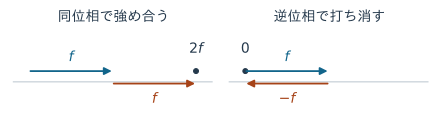
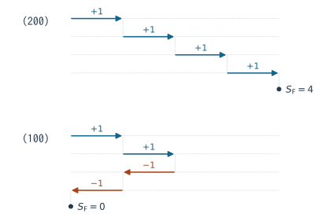

.. _structure-factor:

構造因子と反射条件
==================

回折では、単位胞内の原子からの散乱波を位相込みで足す。単位胞内のどの位置に
どの原子を置くかで、同じ格子でも反射の強度が変わる。ここでは
:ref:`分率座標<coordinates>`\ と\ :ref:`逆格子<reciprocal-lattice>`\ を使って散乱波の和を表し、
:ref:`中心並進<centring-translation>`\ から
F中心・I中心の反射条件を導く。この条件は、\ :ref:`中心並進のある胞の逆格子<centred-reciprocal-lattice>`\ で
逆格子ベクトルになる指数の条件と一致する。

.. _scattering-structure-factor:

原子ごとの散乱波と構造因子
--------------------------

単位胞の格子行列を :math:`A`、その辺の双対行列を :math:`B=2\pi A^{-\mathsf T}` とする。:math:`A` が基本単位胞なら :math:`B` は逆格子の基本並進ベクトルの組である。中心並進のある慣用単位胞では、:math:`B` の整数結合のうち一部だけが逆格子ベクトルになる（\ :ref:`中心並進のある胞の逆格子<centred-reciprocal-lattice>`）。
反射指数 :math:`\boldsymbol h=(h,k,l)^{\mathsf T}`\ （\ :ref:`共通因子で約分しない<index-common-factor>`）の散乱ベクトルを
:math:`\boldsymbol g=B\boldsymbol h` とし、原子 :math:`j` の分率座標を
:math:`\boldsymbol s_j` とする。原点と比べた散乱波の位相は
:math:`\boldsymbol g\cdot A\boldsymbol s_j=2\pi\boldsymbol h^{\mathsf T}\boldsymbol s_j`
だけずれる。この位相で各原子の散乱因子 :math:`f_j(\boldsymbol g)` を足すと、
単位胞の **構造因子** が得られる。

.. math::
   :label: structure-factor-sum

   F_{hkl}=\sum_j f_j(\boldsymbol g)
   \exp\!\left(2\pi i\,\boldsymbol h^{\mathsf T}\boldsymbol s_j\right)

和は選んだ単位胞内の原子について取る。単一散乱の近似では、反射の強度は
幾何学的な補正などを除いて :math:`|F_{hkl}|^2` に比例する。例えば、散乱因子が
等しい二つの原子からの波の位相が :math:`\pi` だけずれると、振幅の和はゼロになる。

:numref:`fig-structure-factor-phase-sum`\ では、二つの散乱振幅を矢印として足し、
同じ大きさでも位相によって和が変わることを示す。F中心の四つの位相因子についても、
:numref:`fig-f-centering-phase-sum` で同じ考え方を使う。

   二つの矢印は散乱振幅の大きさと位相を表し、見分けやすいよう縦にずらしている。
   黒丸は和の終点を示す。右では位相差が :math:`\pi` なので、二つ目の矢印が左を向く。

.. _sf-centring-extinction:

中心並進による打ち消し
----------------------

中心並進がある慣用単位胞では、同じ単位構造が複数の格子点に置かれている。
原点を含めた中心並進の分率座標の集合を :math:`T` とする。単位構造内の原子の
座標 :math:`\boldsymbol s_j` に :math:`\boldsymbol t\in T` を足すたびに、
:eq:`structure-factor-sum` の各項に同じ位相因子が掛かる。そこで和を
中心並進の因子 :math:`S_T` と単位構造の因子 :math:`F^{\rm motif}_{hkl}` に分けられる。

.. math::
   :label: structure-factor-centring

   F_{hkl}=S_T(hkl)F^{\rm motif}_{hkl},\qquad
   S_T(hkl)=\sum_{\boldsymbol t\in T}
   e^{2\pi i\,\boldsymbol h^{\mathsf T}\boldsymbol t}

中心並進どうしを足すと、整数の差を除いてまた :math:`T` の要素になる。そのため、ある
:math:`\boldsymbol t_0\in T` を各 :math:`\boldsymbol t` に足しても :math:`T` の要素が並べ替わるだけで、
:math:`S_T(hkl)\,e^{2\pi i\,\boldsymbol h^{\mathsf T}\boldsymbol t_0}=S_T(hkl)` が成り立つ。
:math:`\boldsymbol h^{\mathsf T}\boldsymbol t_0` が整数でない :math:`\boldsymbol t_0` が一つでもあれば
位相因子は1でないので :math:`S_T=0`、すべての :math:`\boldsymbol t` で整数なら :math:`S_T` は
:math:`T` の要素数に等しい。後者は、\ :ref:`中心並進のある胞の逆格子<centred-reciprocal-lattice>`\ の条件
:eq:`centred-reciprocal-condition` そのものである。逆格子の側から見ると、条件を満たさない指数は逆格子ベクトルに
対応せず、散乱波の側から見ると、中心並進で移り合う原子の散乱波が打ち消し合う。

:math:`S_T=0` なら、単位構造によらず反射が消える。これを中心並進による
系統消滅と呼ぶ。:math:`S_T\ne 0` の指数でも、:math:`F^{\rm motif}_{hkl}` が
ゼロになると反射は消える。

.. _sf-f-centering:

F中心の反射条件
----------------

F中心の慣用単位胞では、原点のほかに :math:`(0,1/2,1/2)`、:math:`(1/2,0,1/2)`、
:math:`(1/2,1/2,0)` の中心並進がある。式 :eq:`structure-factor-centring` に代入すると、

.. math::
   :label: structure-factor-f-factor

   S_{\rm F}=1+(-1)^{k+l}+(-1)^{h+l}+(-1)^{h+k}

となる。:math:`h,k,l` がすべて偶数かすべて奇数なら4項とも正で、:math:`S_{\rm F}=4`
になる。奇数と偶数が混ざると正と負が2項ずつになり、:math:`S_{\rm F}=0` になる。
例えば :math:`(100)` は消滅し、:math:`(200)` はF中心の反射条件を満たす。
これは条件 :eq:`centred-reciprocal-condition` をF中心の :math:`T` に当てはめた結果と同じである。

:numref:`fig-f-centering-phase-sum`\ では、:math:`(200)` の四つの位相因子が強め合い、
:math:`(100)` では正と負の項が打ち消し合う。

   矢印は式 :eq:`structure-factor-f-factor` の4項を上から順に表す。右向きが
   :math:`+1`、左向きが :math:`-1` で、点線で上下を結んで前の矢印の終点から足している。
   黒丸は和 :math:`S_{\rm F}` の値を示す。

I中心の反射条件
----------------

I中心の慣用単位胞には原点と :math:`(1/2,1/2,1/2)` の二つの位置がある。
同様に和を取ると、

.. math::

   S_{\rm I}=1+(-1)^{h+k+l}

となる。:math:`h+k+l` が奇数なら消滅し、偶数ならI中心の反射条件を満たす。
例えば :math:`(111)` はI中心では消滅するがF中心の条件を満たし、
:math:`(110)` はI中心の条件を満たすがF中心では消滅する。
実際に観測される反射の有無や強度を解釈するときは、
:ref:`らせん・映進操作<screw-and-glide>`\ による反射条件や、単位構造の散乱振幅も考慮する。

参考資料
--------

* IUCr, `Structure factor <https://dictionary.iucr.org/Structure_factor>`_.
* IUCr, `Reflection conditions <https://dictionary.iucr.org/Reflection_conditions>`_.
