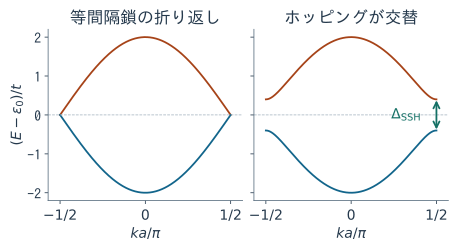

.. _tightbinding:

タイト・バインディング近似
==========================

**タイト・バインディング近似** （強束縛近似）は、原子の周囲などに局在した
軌道を基底として電子状態を記述する方法である。本稿では最も簡単な
1次元原子鎖の模型を周期境界条件のもとで解き、バンドの形、分散の形を変える要因、
結合交替によるギャップがどの式から現れるかを確かめる。両端が開いた有限の鎖の準位は
「\ :ref:`finite-chain`\ 」で扱う。

**前提知識**: 量子力学の固有値問題、行列の対角化、:ref:`ブロッホの定理<blochstheorem>`、
:ref:`周期境界条件<pbc-allowed-wavevectors>`、:ref:`第1ブリルアンゾーン<first-brillouin-zone>`。

**学習目標**:

* 局在軌道の基底でハミルトニアンを行列として書き、1次元鎖のバンド分散を導く。
* 軌道の重なりや第2近接ホッピングが分散の形をどう変えるかを説明する。
* ホッピングが交替する鎖（SSH模型）でギャップ :math:`2|t_1-t_2|` が開くことを導く。

模型の設定
----------

.. _hopping-integral:

原子 :math:`n` に置いた軌道を :math:`|n\rangle` と書き、軌道は互いに直交する
（:math:`\langle m|n\rangle=\delta_{mn}`）とする。ハミルトニアンの行列要素を

.. math::
   :label: tb-elements

   \langle n|\hat H|n\rangle=\varepsilon_0,\qquad
   \langle n|\hat H|n\pm1\rangle=-t\quad(t>0)

とし、それ以外の要素は0とする。:math:`\varepsilon_0` を **軌道エネルギー**
（**オンサイトエネルギー**）と呼ぶ。軌道間の電子の移動を表す非対角の行列要素を
**ホッピング積分** と呼び、ここでは :math:`t` で表す。s軌道どうしの
隣接間の行列要素は通常負になるので、:math:`-t` と書いて :math:`t` を正に
とることが多い。文献によって符号の付け方が異なるので、式を比較するときは注意する。

波動関数を :math:`|\psi\rangle=\sum_n c_n|n\rangle` と展開すると、
Schrödinger方程式 :math:`\hat H|\psi\rangle=E|\psi\rangle` は係数に対する
連立方程式

.. math::
   :label: tb-recursion

   \varepsilon_0 c_n-t\,(c_{n+1}+c_{n-1})=E\,c_n

になる。両端をどう扱うか（境界条件）を決めると、この式の解が決まる。

周期鎖のバンド分散
------------------

.. _bloch-sum:

:math:`N` 個の原子を間隔 :math:`a` で並べ、\ :ref:`周期境界条件<pbc-allowed-wavevectors>` :math:`c_{n+N}=c_n`
を課す。:ref:`ブロッホの定理<blochstheorem>` より、並進 :math:`n\to n+1` に
対して位相 :math:`e^{ika}` だけ変わる解を探せばよい。そこで、各原子の軌道に位相を付けて足し合わせた **ブロッホ和**

.. math::
   :label: tb-bloch-sum

   |k\rangle=\frac{1}{\sqrt N}\sum_{n=1}^{N}e^{ikna}|n\rangle,\qquad
   k=\frac{2\pi m}{Na}\quad(m=0,1,\ldots,N-1)

を考える。:math:`c_n=e^{ikna}/\sqrt N` を :eq:`tb-recursion` に代入すると

.. math::

   c_{n+1}+c_{n-1}=\left(e^{ika}+e^{-ika}\right)c_n=2\cos(ka)\,c_n

なので、:math:`|k\rangle` は固有状態であり、固有値は

.. math::
   :label: tb-band

   E(k)=\varepsilon_0-2t\cos(ka)

となる。有限の周期鎖では、:math:`N` 個の原子軌道から :math:`N` 個の状態ができる。
各状態の波数は :eq:`tb-bloch-sum` の離散値をとり、代表点を第1ブリルアンゾーン
:math:`-\pi/a<k\le\pi/a` から選べる。

.. _band-width:

:math:`N\to\infty` の極限では、離散的な準位がバンドを連続的に埋める。
:math:`k=0` ではすべての軌道が同位相で重なり、エネルギーは下端
:math:`\varepsilon_0-2t` になる。:math:`k=\pi/a` では隣どうしが逆位相になり、
エネルギーは上端 :math:`\varepsilon_0+2t` になる。バンドの上端と下端の差を **バンド幅** と呼び、
この模型では :math:`W=4t` である。

.. _half-filling:

:math:`N` 個の波数それぞれに、スピンを含めて電子が2個まで入るので、バンドの定員は
:math:`2N` 個である。1原子あたり1電子の鎖では :math:`N` 個の電子が入り、定員の半分を占める。
これを **半充填** と呼ぶ。

.. _fermi-wavenumber:

無限鎖の半充填では、絶対零度で :math:`|k|<\pi/(2a)` の状態が占有され、
\ :ref:`フェルミ準位<fermi-surface>`\ は :math:`E_{\mathrm F}=\varepsilon_0` になる。
占有された状態と空の状態の境目の波数を **フェルミ波数** と呼び、この鎖では :math:`k_{\mathrm F}=\pi/(2a)` である。
1次元ではフェルミ面は :math:`k=\pm k_{\mathrm F}` の2点になる。
バンドがフェルミ準位を横切るので、この模型の無限鎖は金属的である。

.. _id4:

原子数が有限でも、周期境界条件を課した鎖の準位は :eq:`tb-band` の離散的な点に乗る。
両端が開いた鎖では定在波が固有状態になり、原子数に反比例する有限サイズギャップが現れる。
分子や有限の鎖の計算結果をバンドと比べるときに必要になるので、
「\ :ref:`finite-chain`\ 」で導く。

第2近接ホッピング
-----------------

ここまでの模型は、直交基底で最近接ホッピングのみを考える最小限のものである。
実際の原子軌道を基底にすると、軌道の重なりや、より遠い原子とのホッピングが現れ、
分散の形が変わる。

第2近接の行列要素 :math:`\langle n|\hat H|n\pm2\rangle=-t_2` を加えても、
ブロッホ和 :eq:`tb-bloch-sum` は固有状態のままであり、

.. math::
   :label: tb-band-t2

   E(k)=\varepsilon_0-2t\cos(ka)-2t_2\cos(2ka)

となる。一般に :math:`m` 番目の近接ホッピングは :math:`\cos(mka)` の項を加える。
したがって、周期鎖の :math:`E(k)` を :math:`\cos(mka)` で展開した係数は、
直交基底での各距離のホッピングに対応する。

.. |nonorthogonal-basis| replace:: 軌道の重なりと一般化固有値問題

|nonorthogonal-basis|
---------------------

隣接軌道の重なりを :math:`\langle n|n\pm1\rangle=s` とすると、
固有値問題は一般化固有値問題 :math:`Hc=ESc` になる。ブロッホ和を使うと
:math:`H` と :math:`S` はともに対角化され、

.. math::
   :label: tb-band-overlap

   E(k)=\frac{\varepsilon_0-2t\cos(ka)}{1+2s\cos(ka)}

となる。:math:`s` について1次まで展開すると

.. math::

   E(k)\simeq\varepsilon_0+2ts-2(t+\varepsilon_0 s)\cos(ka)+2ts\cos(2ka)

となり、重なりは実効的な最近接ホッピングを変えるだけでなく、:math:`\cos(2ka)` の
項も生む。:math:`\cos(2ka)` の項が必要だからといって、それだけで第2近接ホッピングが
あるとは結論できない。重なりがあると、結合的な状態と反結合的な状態で準位の
広がり方が非対称になる [McKinnon1995]_。

.. _tb-ssh:

ホッピングが交替する鎖（SSH模型）
----------------------------------

隣接原子間のホッピングの大きさが1本おきに :math:`t_1>0`、:math:`t_2>0` と交替する鎖を考える。
Su、Schrieffer、Heegerがポリアセチレンの結合交替を記述するために用いた模型で、
SSH模型と呼ばれる [SSH1979]_。元の模型ではホッピングの交替は原子の変位から
生じるが、ここではホッピングが交替するという結果だけを扱う。

.. _sublattice:

周期は :math:`2a` に倍化するので、隣接する2原子を単位胞にとり、単位胞 :math:`m`
の2つの原子をA、Bと呼ぶ。各単位胞のAの集まり、Bの集まりを **副格子** と呼ぶ。
胞内のAとBの間のホッピングを :math:`-t_1`、Bと次の胞の
Aの間のホッピングを :math:`-t_2` とする。単位胞の数を :math:`M=N/2` として、
副格子ごとのブロッホ和

.. math::

   |k,\mathrm A\rangle=\frac{1}{\sqrt M}\sum_{m}e^{ik\,2ma}|m,\mathrm A\rangle,\qquad
   |k,\mathrm B\rangle=\frac{1}{\sqrt M}\sum_{m}e^{ik\,2ma}|m,\mathrm B\rangle

を作る。胞 :math:`m` のAは、同じ胞のBと :math:`-t_1`、1つ前の胞 :math:`m-1` の
Bと :math:`-t_2` で結ばれているので、

.. math::

   \langle k,\mathrm A|\hat H|k,\mathrm B\rangle=-\left(t_1+t_2e^{-2ika}\right)

となる。ハミルトニアンは :math:`k` ごとの :math:`2\times2` 行列

.. math::
   :label: tb-ssh-hk

   H(k)=
   \begin{pmatrix}
   \varepsilon_0 & -h(k)\\
   -h(k)^* & \varepsilon_0
   \end{pmatrix},\qquad
   h(k)=t_1+t_2e^{-2ika}

に分かれる。

.. _reduced-brillouin-zone:

実空間の周期が :math:`2a` になると逆格子の周期は :math:`\pi/a` になり、
第1ブリルアンゾーンも半分の幅になる。元の周期 :math:`a` のゾーンと区別して、これを **縮小ブリルアンゾーン** と呼ぶ。
ここで :math:`k` は縮小ブリルアンゾーン :math:`-\pi/(2a)<k\le\pi/(2a)` を動き、固有値は

.. math::
   :label: tb-ssh-band

   E_\pm(k)=\varepsilon_0\pm|h(k)|
   =\varepsilon_0\pm\sqrt{t_1^2+t_2^2+2t_1t_2\cos(2ka)}

である。

.. |ssh-band-gap| replace:: 周期の倍化とバンドギャップ

|ssh-band-gap|
--------------

:math:`t_1=t_2=t` のときは :math:`|h(k)|=2t|\cos(ka)|` となり、:eq:`tb-band` の
バンドを縮小ゾーンに折り返したものに戻る。2本のバンドは :math:`k=\pm\pi/(2a)` で
接している。:math:`t_1\neq t_2` になると、:math:`\cos(2ka)=-1` となるこの点で
:math:`|h(k)|` は最小値 :math:`|t_1-t_2|` をとり、2本のバンドの間に

.. math::
   :label: tb-ssh-gap

   \Delta_{\mathrm{SSH}}=2|t_1-t_2|

のギャップが開く。半充填では下のバンドがちょうど満たされるので、ホッピングの
交替は金属的だった鎖を絶縁体的にする。ギャップが開く :math:`k=\pm\pi/(2a)` は
元の鎖のフェルミ波数 :math:`k_{\mathrm F}` であり、周期の倍化によって
:math:`k_{\mathrm F}` がちょうど新しいゾーン境界になったことに対応する。

:numref:`fig-tightbinding-ssh-bulk-gap`\ では、ホッピングが交替すると、折り返しだけでは
接していた二つのバンドがゾーン境界で離れる。

   式 :eq:`tb-ssh-band` の上下のバンド。左は :math:`t_1=t_2=t`、右は
   :math:`t_1=0.8t,\ t_2=1.2t`。両者を同じ縮小ゾーンに描いた。
   右端の両矢印はバルクのギャップ（式 :eq:`tb-ssh-gap`）を示す。

このギャップは無限鎖でも残る。この点で、等間隔の鎖を有限の長さで切ったときに
現れるギャップとは違う。後者は鎖を長くするとゼロに近づく。両端が開いたSSH模型の鎖では、
端の結合の強さによって準位の並びが変わる（\ :ref:`finite-chain-ssh`）。

.. 旧版の節と文献へのリンクを、移転先の案内に残す。

.. _peierls-and-bond-order-wave:
.. _heeger1988:
.. _id8:

本稿ではホッピングの交替を与えられたものとして扱った。格子が自発的に二量化してこのギャップが開く条件は、
電子エネルギーの利得と弾性エネルギーの損失の釣り合いで決まり、\ :ref:`Peierls不安定性<peierls-instability>`\ で導く。

.. _tb-interpretation-limits:

解釈と限界
----------

本稿の模型は、直交基底、1原子1軌道、最近接ホッピングのみ、電子間相互作用なし
という強い単純化の上に成り立っている。目的に応じて、複数の軌道、遠くの原子との
ホッピング、軌道の重なり、電子間相互作用などを考慮する。

:eq:`tb-band` や :eq:`tb-ssh-band` の :math:`t` は模型のパラメータである。
第一原理計算のバンドに当てはめて得た :math:`t` は、その計算の準位の並びを再現する有効パラメータであり、
フィットに使った分散の形（第2近接や重なりの項を含めるか）によっても値が変わる。

.. _tb-related:

関連資料
--------

* :ref:`bandstructure`
* :ref:`blochstheorem`
* :ref:`finite-chain`
* :ref:`peierls-instability`
* :ref:`bond_order`

.. _tb-references:

参考文献
--------

* `N. Manini: The tight-binding model for electronic band structure <https://materia.fisica.unimi.it/manini/dida/tight.binding.notes.html>`_
* N. W. Ashcroft and N. D. Mermin, *Solid State Physics* (Holt, Rinehart and
  Winston, 1976), Chap. 10.
* J. K. Asbóth, L. Oroszlány, and A. Pályi, `A Short Course on Topological Insulators <https://arxiv.org/abs/1509.02295>`_, Section 1.3.

.. [McKinnon1995] B. A. McKinnon and T. C. Choy, “Significance of nonorthogonality in
   tight-binding models,” *Physical Review B* **52**, 14531 (1995),
   `doi:10.1103/PhysRevB.52.14531 <https://doi.org/10.1103/PhysRevB.52.14531>`_.
.. [SSH1979] W. P. Su, J. R. Schrieffer, and A. J. Heeger, “Solitons in
   Polyacetylene,” *Physical Review Letters* **42**, 1698–1701 (1979),
   `doi:10.1103/PhysRevLett.42.1698 <https://doi.org/10.1103/PhysRevLett.42.1698>`_.

.. raw:: html

   
