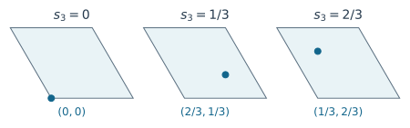

.. _lt-cell-transform:

単位胞の取り直しとブラベー格子型
================================

FCCの慣用単位胞と基本単位胞を例に、単位胞を取り直したときに原子位置、結晶方向、
反射指数がどう変わるかを確認する。続いて、辺の形が異なる単位胞で同じ並進格子を表す例を見て、
胞の形だけではブラベー格子型が決まらないことを示す。最後に、FCCの変換と超胞をNumPyで検算する。

**前提知識**: :ref:`格子の基底変換<lt-primitive-basis>`、:ref:`超胞<lt-supercell>`、
:ref:`逆格子の変換則<lt-reciprocal-transform>`、:ref:`格子系<bravais-lattice-types>`、
:ref:`中心並進<centring-translation>`、:ref:`中心並進のある胞の逆格子<centred-reciprocal-lattice>`、
:ref:`方向と格子面<crystal-directions-planes>`。

**学習目標**:

* FCCの慣用単位胞と基本単位胞の間で、原子位置・方向指数・反射指数を変換する。
* 胞の形だけではブラベー格子型が決まらないことを、R格子の六方軸表示、六方P格子の直交C中心化胞、FCC格子の体心正方胞の例で説明する。
* 単位胞の変換と超胞を数値で検算する。

.. _lt-fcc-cell:

FCCの慣用単位胞と基本単位胞
---------------------------------------

一辺 :math:`a` の立方慣用単位胞をCartesian軸に沿って置くと :math:`A_{\rm c}=aI` である。FCC（F中心立方）格子の基本並進ベクトルの組の一例は

.. math::

   A_{\rm p}=A_{\rm c}P_{\rm F},\qquad
   P_{\rm F}=\frac12
   \begin{pmatrix}
   0&1&1\\
   1&0&1\\
   1&1&0
   \end{pmatrix}.

この列はそれぞれ :math:`\frac a2(0,1,1)`、:math:`\frac a2(1,0,1)`、:math:`\frac a2(1,1,0)` である。:math:`\det P_{\rm F}=1/4` なので :math:`V_{\rm c}=a^3`、:math:`V_{\rm p}=a^3/4`。3本の基本並進ベクトルの長さは :math:`a/\sqrt2`、相互の角度は :math:`60^\circ` である。

F中心慣用単位胞には、原点に加えて分率座標 :math:`(0,1/2,1/2)`、:math:`(1/2,0,1/2)`、:math:`(1/2,1/2,0)` の格子点がある（\ :ref:`中心並進<centring-translation>`）。単原子FCCでは慣用単位胞に4格子点、基本単位胞に1格子点が含まれる。

.. figure:: images/fcc_conventional_primitive.svg
   :name: lt-fcc-cell-figure
   :alt: FCCの慣用立方胞と菱面体基本単位胞を同じCartesian軸上に重ねた図
   :width: 92%
   :align: center

   青線は慣用立方胞（破線は奥の辺）、赤線は同じFCC格子を張る基本単位胞。黒丸は立方体の頂点、白丸は6つの面心の格子点で、基本単位胞の頂点 :math:`\boldsymbol a_1+\boldsymbol a_2` などは反対側の面心に一致する。表示は三次元構造の正射影である。

.. |fcc-positions-and-directions| replace:: FCCの原子位置と結晶方向の変換

|fcc-positions-and-directions|
------------------------------

慣用単位胞の面心位置を基本単位胞座標へ移す例では

.. math::

   P_{\rm F}^{-1}\begin{pmatrix}0\\1/2\\1/2\end{pmatrix}
   =\begin{pmatrix}1\\0\\0\end{pmatrix}
   \equiv\begin{pmatrix}0\\0\\0\end{pmatrix}
   \pmod{\mathbb Z^3}.

原点と整数格子並進だけ異なるため、基本単位胞内では同じ格子点に重なる。胞を小さくする際にはこの周期同値性を用いて重複を除く。

方向の指数も基底に依存する。慣用立方軸に沿う方向 :math:`[001]_{\rm c}` の旧基底成分は :math:`\boldsymbol u_{\rm c}=(0,0,1)^{\mathsf T}` であり、基本並進ベクトルの組では

.. math::

   \boldsymbol u_{\rm p}=P_{\rm F}^{-1}\boldsymbol u_{\rm c}
   =(1,1,-1)^{\mathsf T}.

すなわち :math:`[001]_{\rm c}` は :math:`[11\bar{1}]_{\rm p}` である。これは方向そのものが変わったのではなく、同じ方向ベクトルを異なる格子基底の係数で書いた結果である。Cartesian :math:`z` 軸と慣用軸が揃うこの例では :math:`[001]_{\rm c}` は :math:`z_{\rm Cartesian}` に平行だが、基本並進ベクトルの組の :math:`[001]_{\rm p}` とは平行でない。

.. figure:: images/fcc_directions.svg
   :name: lt-fcc-direction-figure
   :alt: 慣用基底の[001]方向、Cartesianのz軸、基本並進ベクトルの組の[001]方向の違い
   :width: 80%
   :align: center

   青矢印は :math:`[001]_{\rm c}` で、Cartesian :math:`z` 軸に平行。基本並進ベクトルの組では :math:`\boldsymbol a_1+\boldsymbol a_2-\boldsymbol a_3`\ （灰色の破線）と書けるので :math:`[11\bar{1}]_{\rm p}` である。赤矢印の :math:`[001]_{\rm p}=\boldsymbol a_3=\frac a2(1,1,0)` は別の方向を指す。

同じ指数の方向と面法線は、基底によっては平行にならない（\ :ref:`方向と面法線が平行になる条件<direction-and-plane-normal>`）。
立方晶の直交慣用基底では、:math:`[001]_{\rm c}` と、FCCの格子面の組 :math:`(002)_{\rm c}`\ （\ :ref:`指数の共通因子<index-common-factor>`）の法線はともに :math:`z` 軸を向く。
一方、基本並進ベクトルの組では、:math:`[11\bar{1}]_{\rm p}` が :math:`z` 軸を向くのに対し、
:math:`(11\bar{1})_{\rm p}` の法線は :math:`(-1,-1,3)` の向きで、なす角の余弦は :math:`3/\sqrt{11}\simeq0.905` である。

.. _lt-fcc-reciprocal:

FCCの反射指数と基本単位胞
--------------------------

:ref:`中心並進のある胞の逆格子<centred-reciprocal-lattice>`\ では、FCCの慣用指数 :math:`\boldsymbol h_{\rm c}` が逆格子ベクトルに対応する条件を、面心並進の分率座標から導いた。基本並進ベクトルの組へ移すと、同じ条件が指数の整数性として現れる。\ :ref:`逆格子の変換則<lt-reciprocal-transform>` :math:`B'=BP^{-\mathsf T}` から

.. math::

   \boldsymbol h_{\rm p}=P_{\rm F}^{\mathsf T}\boldsymbol h_{\rm c},
   \qquad B_{\rm c}\boldsymbol h_{\rm c}=B_{\rm p}\boldsymbol h_{\rm p}.

:math:`B_{\rm p}` の整数結合が逆格子なので、:math:`B_{\rm c}\boldsymbol h_{\rm c}` が逆格子ベクトルとなるのは :math:`\boldsymbol h_{\rm p}` が整数のとき、すなわち慣用指数 :math:`(hkl)` がすべて偶数またはすべて奇数のときで、条件 :eq:`centred-reciprocal-condition` と一致する。例えば :math:`(100)_{\rm c}` は :math:`\boldsymbol h_{\rm p}=(0,1/2,1/2)` で条件を満たさず、:math:`(200)_{\rm c}` は :math:`\boldsymbol h_{\rm p}=(0,1,1)` で条件を満たす。

.. _lt-special-cells:

特殊な単位胞表現とBravais格子型
-------------------------------------------

:ref:`基本単位胞や慣用単位胞<lattice-unit-cells>`\ の辺の形と、中心並進を含む格子点集合の\ :ref:`ブラベー格子型<bravais-lattice-types>`\ は区別する。異なる胞でも中心の格子点や周期像を含めれば同じ並進格子を表せる。辺長や角度を特殊な値へ\ **変形**\ すると格子の対称性が高まり、Bravais格子型自体が変わることがある。このような格子型間の特殊関係は `Grimmer (2015) <https://doi.org/10.1107/S2053273314027351>`_ が整理している。

.. _lt-rhombohedral-hexagonal:

R格子の菱面体基本単位胞と六方軸表示
^^^^^^^^^^^^^^^^^^^^^^^^^^^^^^^^^^^^^^^^^^^^^^^^^^^^

三方晶系のR格子は、菱面体基本単位胞を使う表示と、R中心化された六方軸の胞を使う表示の両方がある。六方軸で書いても六方P格子になるわけではない。IUCr International Tables for Crystallography, Volume A はR格子の菱面体基本単位胞と体積が3倍のR中心化六方軸セルを区別し、Bravais格子型を格子系ごとに定義している（`§1.3.2.4 <https://it.iucr.org/Ac/ch1o3v0001/sec1o3o2o4.pdf>`_, `§1.3.4.4.3 <https://it.iucr.org/Ac/ch1o3v0001/sec1o3o4o4o3.pdf>`_）。

菱面体基本単位胞の列格子行列を :math:`A_R=(\boldsymbol a_1,\boldsymbol a_2,\boldsymbol a_3)` とし、各ベクトルの長さを :math:`a_R`、共通角を :math:`\alpha_R` とする。次の軸を選ぶ。

.. math::

   \begin{aligned}
   \boldsymbol a_{R,H}&=\boldsymbol a_1-\boldsymbol a_2,\\
   \boldsymbol b_{R,H}&=\boldsymbol a_2-\boldsymbol a_3,\\
   \boldsymbol c_{R,H}&=\boldsymbol a_1+\boldsymbol a_2+\boldsymbol a_3.
   \end{aligned}

すると :math:`A_{R,H}=A_RP_{R,H}` で、

.. math::

   P_{R,H}=\begin{pmatrix}
   1&0&1\\-1&1&1\\0&-1&1
   \end{pmatrix},\qquad \det P_{R,H}=3.

:math:`q=\cos\alpha_R` とすれば、六方軸胞の格子定数と角度は

.. math::

   a_{R,H}=b_{R,H}=a_R\sqrt{2(1-q)},\qquad
   c_{R,H}=a_R\sqrt{3(1+2q)},

.. math::

   \alpha_{R,H}=\beta_{R,H}=90^\circ,\qquad \gamma_{R,H}=120^\circ.

この胞の体積は菱面体基本単位胞の3倍で、分率座標 :math:`(0,0,0)` に加えて :math:`(2/3,1/3,1/3)` と :math:`(1/3,2/3,2/3)` にR中心並進による格子点を持つ。したがって、六方軸表示を六方P格子と読み替えると格子点を取り落とす。

:numref:`fig-rhombohedral-hexagonal-layers`\ では、六方軸胞を底面に平行な三つの
高さで切って、R中心並進による格子点の横方向のずれを示す。

   各パネルの :math:`s_3` は六方軸胞での高さ。丸が格子点、下の座標が底面内の分率座標
   :math:`(s_1,s_2)` である。整数の並進で移る格子点は省略した。

.. _lt-hexagonal-orthogonal:

六方P格子を直交C中心化胞で表す
^^^^^^^^^^^^^^^^^^^^^^^^^^^^^^^^^^^^^^^^^^^^

底面の長さが :math:`a`、角が :math:`120^\circ` の六方P格子の基本並進ベクトルの組 :math:`A_{\rm hexP}` から、次の胞を作る。

.. math::

   \begin{aligned}
   \boldsymbol a_o&=\boldsymbol a_1+\boldsymbol a_2,\\
   \boldsymbol b_o&=-\boldsymbol a_1+\boldsymbol a_2,\\
   \boldsymbol c_o&=\boldsymbol a_3.
   \end{aligned}

.. math::

   A_o=A_{\rm hexP}M_{\rm hexP},\qquad
   M_{\rm hexP}=\begin{pmatrix}
   1&-1&0\\1&1&0\\0&0&1
   \end{pmatrix},\qquad \det M_{\rm hexP}=2.

ここで :math:`A_{\rm hexP}` は直前のR格子の六方軸セルとは異なり、六方P格子の\ **基本単位胞**\ である。新しい辺は直交し、長さは :math:`a_o=a`、:math:`b_o=\sqrt3a`、:math:`c_o=c`。旧格子ベクトル :math:`\boldsymbol a_2` は新胞の分率座標 :math:`(1/2,1/2,0)` に来るため、この胞はC中心化している。胞の体積は2倍で、中心の格子点と周期像を含めれば六方Pと同じ格子点集合を表す。したがって、直交形状だけを根拠に直交P格子として扱ってはならない。

.. _lt-fcc-tetragonal:

FCC格子を体心正方胞で表す
^^^^^^^^^^^^^^^^^^^^^^^^^^^^^^^^^^^^

一辺 :math:`a` のFCC慣用単位胞 :math:`A_c=aI` に対し、次の辺を選ぶ。

.. math::

   \begin{aligned}
   \boldsymbol a_t&=\tfrac a2(1,1,0),\\
   \boldsymbol b_t&=\tfrac a2(-1,1,0),\\
   \boldsymbol c_t&=a(0,0,1).
   \end{aligned}

.. math::

   A_t=A_cP_{F,t},\qquad
   P_{F,t}=\begin{pmatrix}
   1/2&-1/2&0\\1/2&1/2&0\\0&0&1
   \end{pmatrix},\qquad \det P_{F,t}=1/2.

この胞は :math:`a_t=b_t=a/\sqrt2`、:math:`c_t=a`、したがって :math:`c_t/a_t=\sqrt2` の体心正方形状である。FCCの面心並進 :math:`\tfrac a2(0,1,1)` は新しい胞の分率座標 :math:`(1/2,1/2,1/2)_t` に移る。体心点を含めれば、FCC慣用単位胞の半分の体積で同じFCC格子を表せる。この特殊な軸比ではBravais格子型は立方Fである。

一般の体心正方格子では :math:`c_t/a_t=1` が立方I（BCC）、:math:`c_t/a_t=\sqrt2` が立方F（FCC）に対応する。一般の体心正方格子をこれらの比へ\ **変形**\ することは、単位胞の表現を変えるだけではない。

.. _lt-rhombohedral-cubic:

菱面体形状の基本単位胞から立方格子を見分ける
^^^^^^^^^^^^^^^^^^^^^^^^^^^^^^^^^^^^^^^^^^^^^^^^^^^^^^^^^^^^^^^^^^

等長の3ベクトルが等しい相互角で張る菱面体形状は、三方晶R格子に限らない。角度が特別な値なら、より高い立方対称性を持つ基本単位胞にもなる。

.. list-table:: 菱面体形状の基本単位胞と対応する立方Bravais格子
   :name: lt-rhombohedral-cubic-table
   :header-rows: 1
   :widths: 40 60

   * - 基本並進ベクトル間の角度
     - Bravais格子型
   * - :math:`60^\circ`
     - 立方F（FCC）
   * - :math:`90^\circ`
     - 立方P（単純立方）
   * - :math:`\arccos(-1/3)\simeq109.47^\circ`
     - 立方I（BCC）

例えば\ :ref:`FCCの基本並進ベクトル<lt-fcc-cell>`\ は互いに :math:`60^\circ` で、菱面体形状を持つが、Bravais格子型は三方Rではなく立方Fである。一般のR格子からこの角度条件へ計量を変える場合は、同一格子の基底変換ではなく格子の特殊化となる。

以上の例では、胞の形が直交・六方・菱面体・体心正方に見えることだけでBravais格子型は決まらない。中心並進を含む格子点集合を調べ、単位胞の取り直しと計量を変える格子変形を区別する。さらに、原子配置を含む結晶の空間群は格子型だけでは決まらない。

.. |numerical-check| replace:: 数値での確認

.. _lt-numerical-check:

|numerical-check|
-----------------

次の短いNumPy例は、FCC変換、回転、超胞、逆格子の双対性をまとめて検算する。格子ベクトルは基底変換の式と同様に\ **列**\ で保持し、原子座標も列ベクトルとする。格子ベクトルを行に並べるAPIへ渡すときは、\ :ref:`配列規約<lt-array-conventions>`\ のとおり転置する。

.. code-block:: python

   from itertools import product
   import numpy as np

   a = 4.0  # Angstrom
   A = a * np.eye(3)
   P = 0.5 * np.array([[0, 1, 1], [1, 0, 1], [1, 1, 0]])
   Ap = A @ P
   assert np.isclose(np.linalg.det(A), 64.0)
   assert np.isclose(abs(np.linalg.det(Ap)), 16.0)

   # 基本並進ベクトルの長さと相互の角度
   G = Ap.T @ Ap
   assert np.allclose(np.sqrt(np.diag(G)), 2 * np.sqrt(2))
   assert np.isclose(np.degrees(np.arccos(G[0, 1] / G[0, 0])), 60.0)

   # 面心位置と方向の基本並進ベクトルの組表示
   s_primitive = np.linalg.solve(P, np.array([0.0, 0.5, 0.5]))
   u_primitive = np.linalg.solve(P, np.array([0.0, 0.0, 1.0]))
   assert np.allclose(s_primitive, [1, 0, 0])
   assert np.allclose(u_primitive, [1, 1, -1])

   # 逆格子と、同じ指数の方向・面法線のなす角
   Bp = 2 * np.pi * np.linalg.inv(Ap).T
   assert np.allclose(Ap.T @ Bp, 2 * np.pi * np.eye(3))
   d, n = Ap @ [1, 1, -1], Bp @ [1, 1, -1]
   assert np.isclose(d @ n / np.linalg.norm(d) / np.linalg.norm(n), 3 / np.sqrt(11))

   # z軸まわりの任意角の回転
   theta = 0.37
   Q = np.array([[np.cos(theta), -np.sin(theta), 0],
                 [np.sin(theta),  np.cos(theta), 0],
                 [0, 0, 1]])
   assert np.allclose(Q.T @ Q, np.eye(3))
   assert np.allclose((Q @ Ap).T @ (Q @ Ap), G)

   # 超胞: 12個の周期像と、周期境界込みの最短原子間距離
   M = np.diag([2, 3, 2])
   As = Ap @ M
   assert np.isclose(abs(np.linalg.det(As)), 12 * 16.0)
   S = [np.linalg.solve(M, n) for n in product(range(2), range(3), range(2))]
   assert len(S) == 12
   d_min = min(np.linalg.norm(As @ (sj - si + np.array(n)))
               for i, si in enumerate(S) for j, sj in enumerate(S)
               for n in product(range(-1, 2), repeat=3)
               if not (i == j and n == (0, 0, 0)))
   assert np.isclose(d_min, 2 * np.sqrt(2))

行列式から慣用単位胞 :math:`64\,\mathrm{\mathring{A}}^3`、基本単位胞 :math:`16\,\mathrm{\mathring{A}}^3`、超胞 :math:`192\,\mathrm{\mathring{A}}^3` を得る。FCC基本並進ベクトル長は :math:`4/\sqrt2=2\sqrt2\,\mathrm{\mathring{A}}`、相互の角度は :math:`60^\circ`、面心点は基本単位胞の分率座標 :math:`(1,0,0)`、方向は :math:`(1,1,-1)` となる。任意角（例では :math:`\theta=0.37` rad）の回転で計量行列は変わらず、逆格子は :math:`A_{\rm p}^{\mathsf T}B_{\rm p}=2\pi I` を満たす。:math:`[11\bar1]_{\rm p}` と :math:`(11\bar1)_{\rm p}` の法線のなす角の余弦は :math:`3/\sqrt{11}` である。12個の周期像を作ると原子数が12倍になり、超胞周期境界も含めた最短原子間距離は :math:`2\sqrt2\,\mathrm{\mathring{A}}` で元のFCC最近接距離と一致する。

この例は代数恒等式を検算するものであり、特定の計算コードのファイル読込や、任意の非対角超胞での周期像列挙までは検証しない。実計算に接続するときは、原子種・占有率・単位・境界条件も含む構造全体で照合する。

.. _lt-cell-related:

関連資料
----------

* :ref:`pseudocubic-cell` — 歪んだ結晶を高対称相の軸で表す。
* :ref:`lt-structure-input` — 格子還元と結晶学的標準化。
* :ref:`periodic_boundary` — 超胞によるブリルアンゾーンとバンドの変化。

.. _lt-cell-references:

参考文献
------------

* IUCr, `Reflection conditions <https://dictionary.iucr.org/Reflection_conditions>`_.
* IUCr, *International Tables for Crystallography*, Vol. A, §§1.3.2.4 and 1.3.4.4.3, `Section 1.3.2.4 <https://it.iucr.org/Ac/ch1o3v0001/sec1o3o2o4.pdf>`_, `Section 1.3.4.4.3 <https://it.iucr.org/Ac/ch1o3v0001/sec1o3o4o4o3.pdf>`_.
* H\. Grimmer, “Partial order among the 14 Bravais types of lattices: basics and applications,” *Acta Crystallographica A* **71**, 143–149 (2015), `doi:10.1107/S2053273314027351 <https://doi.org/10.1107/S2053273314027351>`_.

.. raw:: html

   
