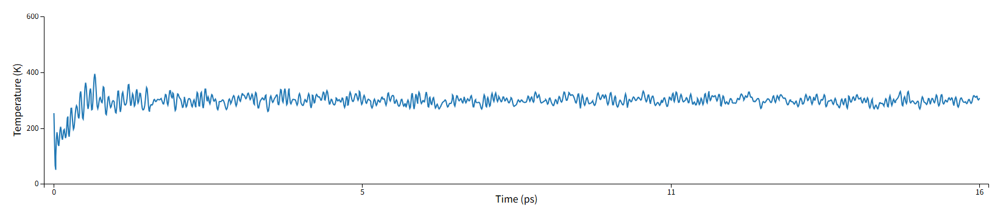
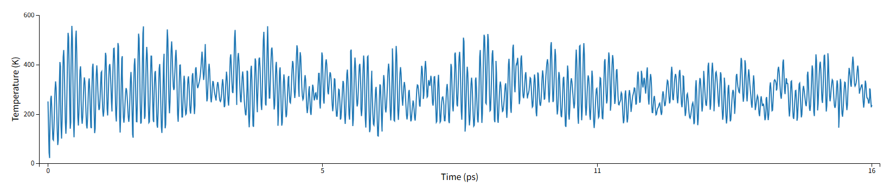

.. _temperature:

==============================
温度の計算
==============================

-------------------------------
運動エネルギー
-------------------------------

:math:`N` 個の粒子からなる系を考える。運動エネルギーを

.. math::
    T_{\rm kin} \equiv \sum_{i=1}^{N} \frac{\boldsymbol{p}^2_i}{2m_i}
    :label: temp1

とする。ポテンシャルエネルギーは具体的な形は考えず、\
ただ座標のみに依存するものとしておく。\
このときハミルトニアン（全エネルギー）は

.. math::
    H = T_{\rm kin}
    + V_{\rm pot}\left(
    \boldsymbol{r}_1, \boldsymbol{r}_2, \cdots, \boldsymbol{r}_N
    \right)
    :label: temp3

であり、これを用いて（古典的）分配関数は次式で与えられる（\ :math:`\beta\equiv1/kT`\ ）。

.. math::
    Z
    =
    \int \prod_{i=1}^N d\boldsymbol{r}_i
    \int \prod_{i=1}^N d\boldsymbol{p}_i
    \exp{\left(-\beta H\right)} .
    :label: temp4

運動エネルギーの平均値を計算する。

.. math::
    \left< T_{\rm kin} \right>
    =
    \frac{
    \int \prod_{i=1}^N d\boldsymbol{r}_i
    \int \prod_{i=1}^N d\boldsymbol{p}_i
    \left( \sum_{j=1}^{N} \frac{\boldsymbol{p}^2_j}{2m_j} \right)
    \exp{\left(-\beta H\right)}
    }{Z}
    =
    \sum_{j=1}^{N}
    \frac{
    \int d\boldsymbol{p}_j
    \frac{\boldsymbol{p}^2_j}{2m_j}
    \exp{\left(-\beta \frac{\boldsymbol{p}^2_j}{2m_j} \right)}
    }{\int d\boldsymbol{p}_j\exp{\left(-\beta \frac{\boldsymbol{p}^2_j}{2m_j} \right)}}
    \equiv
    \sum_{j=1}^{N}
    \left< t_{j} \right> .
    :label: temp5

ここで、\ :math:`j`\ 番目の粒子の運動エネルギーの平均値を

.. math::
    \left< t_{j} \right>
    =
    \left< \frac{\boldsymbol{p}^2_j}{2m_j} \right>

とおいた。\ :ref:`ガウス積分<gaussian_intg>`\ の公式より

.. math::
    \int d\boldsymbol{p} \exp{\left(-\beta \frac{\boldsymbol{p}^2}{2m} \right)}
    =
    \left( \frac{2m\pi}{\beta} \right)^{3/2}

が求まり、さらにこれを利用して

.. math::
    \int d\boldsymbol{p} \frac{\boldsymbol{p}^2}{2m} \exp{\left(-\beta \frac{\boldsymbol{p}^2}{2m} \right)}
    =
    -\frac{\partial}{\partial\beta}
    \int d\boldsymbol{p} \exp{\left(-\beta \frac{\boldsymbol{p}^2}{2m} \right)}
    =
    \frac{3}{2}\left( \frac{2m\pi}{\beta} \right)^{3/2} \frac{1}{\beta}

と計算できるので、粒子１個の運動エネルギーの平均値は\ :math:`j`\ によらず

.. math::
    \left< t_{j} \right>
    =
    \frac{3}{2} kT

となる。最終結果は次のようになる。

.. math::
    \left< T_{\rm kin} \right> = \frac{3N}{2} \frac{1}{\beta} = \frac{3N}{2} kT .
    :label: temp6

この式を温度 :math:`T` について解けば、

.. math::
    T = \frac{2}{3k} \frac{\left< T_{\rm kin} \right>}{N}
    :label: temp7-1

が得られるので、これから、粒子１個あたりの運動エネルギーの平均値を計算すれば、\
系の温度が得られる事が分かる。また、平均の記号を外して

.. math::
    T(t) \equiv \frac{2}{3k} \frac{T_{\rm kin}(t)}{N}
    :label: temp7

という量を定義すると、これは各時刻 :math:`t` における「瞬間の温度」とでも呼ぶべき量となっており、\
MDシミュレーションなどでは、これを使って系の温度を一定に保つといった制御を行っている。

  Fe原子432個からなる系で温度一定（300K）のMDを行った場合

------------------------------------
温度の揺らぎ
------------------------------------

:eq:`temp6` 式の導出から明らかなように、どれか一個の粒子の運動エネルギーを追うだけでも\
温度がわかることになる。原理的にはその通りなのだが、実際は、粒子数が少ないと揺らぎが大きくなりすぎて\
実用的な温度の指標としては使いにくいものになる。\ :numref:`tempfig2`\ に少数原子系の例を示す。

  Fe原子16個からなる系で温度一定（300K）のMDを行った場合

粒子数が多い場合、揺らぎが小さくなって、統計的な量であってもほとんど確定値が得られる。\
:eq:`temp5` の導出と同じく、運動エネルギーは :math:`3N` 個の独立な2乗の項の和であり、\
1項あたりの分散は :math:`(kT)^2/2` なので、:math:`T_{\rm kin}` の分散は :math:`3N(kT)^2/2` となる。\
分散の平方根を平均値 :eq:`temp6` で割ると、瞬間の温度 :eq:`temp7` の相対的な揺らぎ（標準偏差/平均値）は

.. math::
    \frac{\sqrt{\left< T_{\rm kin}^2 \right> - \left< T_{\rm kin} \right>^2}}{\left< T_{\rm kin} \right>}
    =
    \sqrt{\frac{2}{3N}}
    :label: temp9

となり、粒子数の平方根に反比例して小さくなる。

------------------------------------
エネルギー等分配の法則
------------------------------------

:eq:`temp6` 式の導出の仕方から明らかなように、ハミルトニアンの中に自由度の2乗で表される項があると、\
その項の平均値は :math:`kT/2` となる。極端な場合は調和振動子系で、\
このときはポテンシャルエネルギーも座標の2乗になるので、

.. math::
    \left< T_{\rm kin} + V_{\rm Harm}\right> = \left< H \right> = 3NkT
    :label: temp8

となり、個々の調和振動子のエネルギーの平均値が、いずれも :math:`kT` になるという、\
いわゆるエネルギー等分配の法則が得られる。\
格子振動を調和振動子の集まりと考えて計算した比熱（上式の :math:`T` 微分）が定数\
になることは Dulong-Petit の法則として知られており、\
低温で古典論が破綻する例として教科書にもよく取り上げられている。

------------------------------------
関連資料
------------------------------------

* :ref:`分子動力学法の温度制御<thermostat-barostat>`
